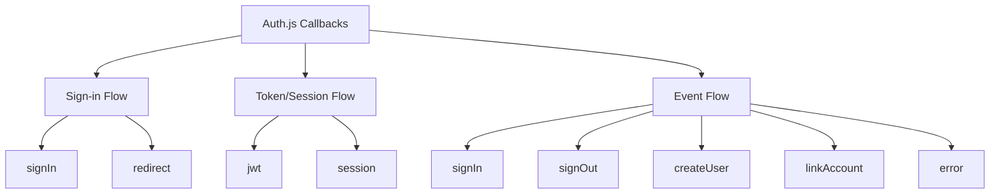

# Callbacks

## Introduction
Callbacks in Auth.js are asynchronous functions that allow you to customize various aspects of the authentication flow, such as controlling who can sign in, modifying session/JWT payloads, and responding to authentication events.

## Why we need callbacks
Auth.js provides a solid foundation, but every application has unique requirements. Callbacks give you hooks to inject custom logic without modifying the core library, enabling flexible adaptation to specific business rules, security needs, and user experience goals.

## Problem statement
How do we customize the authentication flow in Auth.js to implement custom sign-in logic, enrich session data with application-specific information, handle events for logging and analytics, and respond to different authentication scenarios (sign in, sign out, error, etc.)?

## Real-world story
A multi-tenant SaaS needed to ensure users could only sign in to their designated tenant. By using the `signIn` callback to validate the tenant subdomain against the user's membership, they enforced tenant isolation without modifying Auth.js core.

## Real-world analogy
**Callbacks**: Like customizable plugs in a modular synthesizer - you keep the core oscillator and filter (Auth.js) but patch in your own envelopes, LFOs, and effects (callbacks) to shape the sound exactly as needed.

## Visual explanation
```
Authentication Flow with Callbacks:
Login → 
  [signIn callback] → Allow/block → 
  [Authorize/Credentials] → 
  [jwt callback] → Encode token → 
  [session callback] → Format session → 
  [redirect] → 
  [signOut callback] → Cleanup → 
  [event callbacks] → Log/analyze
```

## Mermaid Diagram 1: Callback Types


## Internal working
**Callback execution timing**:
1. **signIn**: Called when credentials are valid but before session creation - use to allow/block sign-in
2. **jwt**: Called when creating or validating a JWT - use to encode/decode token payload
3. **session**: Called when creating or retrieving a session - use to customize session object
4. **signIn (event)**: Called after successful sign-in - use for logging, analytics, etc.
5. **signOut (event)**: Called after sign-out - use for cleanup, logging, etc.
6. **createUser**: Called when a new user is created - use for setting defaults, sending welcome email
7. **linkAccount**: Called when linking an account to existing user - use for merging data
8. **error**: Called when an error occurs - use for custom error logging/reporting
9. **redirect**: Called before redirecting to custom error page - use for logging
10. **debug**: Called when debug mode is enabled - use for development logging

**Important characteristics**:
- All callbacks are asynchronous and must return a value (or Promise resolving to value)
- Returning `false` or `null` from `signIn` callback blocks sign-in
- Callbacks receive context-specific parameters (user, account, token, etc.)
- Multiple callbacks can be chained - order matters for dependent data
- Errors in callbacks are caught and handled by Auth.js (convert to appropriate error response)
- Callbacks have access to `req` and `res` objects in some contexts (advanced usage)

## Step-by-step flow with callbacks
1. User submits credentials (email/password) or completes OAuth flow
2. Auth.js validates credentials/tokens and gets user data from provider
3. **signIn callback**: 
   - Receives: `{ user, account, profile, email, credentials }`
   - Returns: `true`/`false`/`Promise` to allow/block, or `{ redirect: URL }` for custom redirect
   - If `false`/`null`/rejected Promise: sign-in aborted with `AccessDenied` error
4. **JWT creation** (if using JWT strategy):
   - **jwt callback**:
     - Receives: `{ token, user, account, profile, isNewUser }`
     - Modifies: `token` object (what gets encoded in JWT)
     - Returns: Modified `token` object
5. **Session creation**:
   - **session callback**:
     - Receives: `{ session, token, user, newUser }`
     - Modifies: `session` object (what gets returned to client)
     - Returns: Modified `session` object
6. After successful sign-in:
   - **signIn event**: 
     - Receives: `{ user, account, profile, email, credentials }`
     - Used for: Logging, analytics, welcome emails
7. On sign-out:
   - **signOut event**: 
     - Receives: `{ token, session }`
     - Used for: Cleanup, logging, revoking tokens
8. When creating new user:
   - **createUser callback**:
     - Receives: `{ user }`
     - Allows: Modifying user before saving to database
9. When linking account:
   - **linkAccount callback**:
     - Receives: `{ user, account, profile, email, credentials }`
     - Used for: Merging account data, handling conflicts
10. On error:
    - **error callback**:
      - Receives: `{ error }`
      - Used for: Custom logging, error monitoring, error transformation

## Implementation
### Basic callback setup
```typescript
// app/api/auth/[...nextauth]/route.ts
import NextAuth from "next-auth"
import GoogleProvider from "next-auth/providers/google"

export const { GET, POST } = NextAuth({
  providers: [
    GoogleProvider({
      clientId: process.env.GOOGLE_ID,
      clientSecret: process.env.GOOGLE_SECRET,
    })
  ],
  callbacks: {
    // Controls if a user is allowed to sign in
    async signIn({ user, account, profile, email, credentials }) {
      // Return true to allow sign-in, false to deny
      // You can also return a URL to redirect to: return '/custom-path'
      const isAllowed = user.email?.endsWith('@example.com') ?? false
      
      // Example: Block sign-in if email not from company domain
      if (!isAllowed) {
        // You can also throw an error with a specific message
        // throw new Error('Access denied')
      }
      
      return isAllowed
    },
    
    // Modifies the JWT token
    async jwt({ token, user, account, profile, isNewUser }) {
      // Persist the OAuth access_token to the token for later use
      if (account) {
        token.accessToken = access_token
        token.idToken = id_token
      }
      
      // Add custom fields to token
      if (user) {
        token.userId = user.id
        token.role = user.role ?? 'user'
      }
      
      return token
    },
    
    // Modifies the session object
    async session({ session, token, user }) {
      // Send properties to the client
      session.user.id = token.sub
      session.user.role = token.role
      session.user.accessToken = token.accessToken
      
      return session
    }
  },
  
  // Event callbacks (for logging, side effects)
  events: {
    async signIn({ user, account, profile, isNewUser }) {
      console.log('User signed in:', user.email)
      // Send analytics event, welcome email, etc.
    },
    
    async signOut({ session, token }) {
      console.log('User signed out:', session.user.email)
      // Revoke tokens, clear server-side state, etc.
    },
    
    async createUser({ user }) {
      // User is created, set defaults, send welcome email
      console.log('User created:', user.email)
      return user
    }
  }
})
```

### Advanced: Redirect based on role
```typescript
callbacks: {
  async signIn({ user, account, profile }) {
    // Allow sign-in for all users
    return true
  },
  
  async redirect({ url, baseUrl }) {
    // Allows relative callback URLs
    if (url.startsWith("/")) return `${baseUrl}${url}`
    // Allows callback URLs on the same origin
    else if (new URL(url).origin === baseUrl) return url
    return baseUrl // Default to base URL
  }
}
```

### Advanced: Role-based session customization
```typescript
callbacks: {
  async jwt({ token, user, account }) {
    // Initial sign in
    if (account && user) {
      return {
        ...token,
        accessToken: access_token,
        idToken: id_token,
        userId: user.id,
        role: user.role,
        // Add permissions based on role
        permissions: getPermissionsForRole(user.role)
      }
    }
    
    // Return existing token with user data
    return {
      ...token,
      userId: token.sub,
      role: token.role,
      permissions: getPermissionsForRole(token.role)
    }
  },
  
  async session({ session, token }) {
    // Send properties to client
    session.user.id = token.id
    session.user.role = token.role
    session.userId
    session.user.permissions = token.permissions
    
    return session
  }
}

// Helper function
function getPermissionsForRole(role: string): string[] {
  const permissionsMap: Record<string, string[]> = {
    admin: ['read', 'write', 'delete', 'manage_users'],
    editor: ['read', 'write', 'publish'],
    viewer: ['read'],
    // ... other roles
  }
  
  return permissionsMap[role] || []
}
```

## Folder structure
```
src/
├── app/
│   └── api/
│       └── [...nextauth]/
│           └── route.ts
├── lib/
│   ├── auth.ts
│   └── callbacks.ts (helper for complex logic)
├── types/
│   └── next-auth.d.ts
├── utils/
│   └── permissions.ts
└── events/
    ├── audit.logger.ts
    ├── welcome.email.ts
    └── analytics.tracker.ts
```

## Best practices
**signIn callback**:
- Return `true` to allow, `false` to deny
- Return a string URL to redirect to a custom page
- Throw an error for specific error messages (will be shown to user)
- Perform async checks (database lookups, external API calls)
- Never modify user or account objects here (use other callbacks)
- Keep it fast - this runs on every sign-in attempt
- Consider rate limiting here for brute force protection

**jwt callback**:
- Only modify the `token` object - what gets stored in the JWT
- Add minimal necessary data to keep token size small
- Remember token size limits (cookies have 4KB limit)
- Sensitive data should be encrypted if stored in token
- Runs on both sign-in and token validation
- Do not perform expensive operations here (runs on every request)
- The `token` object is persisted and passed to `session` callback

**session callback**:
- Modify the `session` object that is returned to the client
- Only include data that needs to be exposed to frontend
- Avoid putting sensitive data in session (passwords, tokens)
- Runs on every request when using `getServerSession` or `useSession`
- The `session` object is what `useSession()` returns
- Keep it lightweight for performance

**Event callbacks**:
- Used for side effects: logging, analytics, emails, etc.
- Do not return values that affect authentication flow
- Can be asynchronous (good for network requests)
- Do not throw errors - they are caught but not exposed to user
- Good place for audit logging, metrics collection
- `createUser`: Ideal for setting defaults, sending welcome emails
- `linkAccount`: Handle account merging, conflict resolution
- `signIn`/`signOut`: Track authentication events for security

**General**:
- Always handle asynchronous operations properly with `await`
- Test all code paths: new user, existing user, different providers
- Consider copying objects before modifying to avoid mutations
- Keep callbacks pure where possible (same input → same output)
- Document what each callback modifies for team clarity
- Remove unused callbacks to avoid confusion
- Use TypeScript interfaces for callback parameters

## Common mistakes
- Forgetting to return a value from callback (results in `undefined`)
- Modifying the wrong object (e.g., changing `user` in `jwt` instead of `token`)
- Storing too much data in JWT causing cookie size issues (>4KB)
- Performing expensive database queries in `jwt` callback (runs on every request)
- Not waiting for promises (forgetting `await`)
- Mutating input objects directly instead of creating copies
- Returning `false` from `signIn` when you meant to redirect (use `{ redirect: '/' }`)
- Not handling the `isNewUser` flag correctly
- Modifying session in `jwt` callback instead of `session` callback
- Forgetting that callbacks run in Node.js environment (no browser APIs)
- Not handling null/undefined values from providers
- Overlooking that `signIn` callback runs before account is linked to user
- Using `return false` to show custom error (should throw error instead)
- Not cleaning up event listeners or timers in event callbacks (memory leak)
- Assuming callback order (don't rely on undocumented execution order)

## Security considerations
**Authorization bypass**:
- Never rely on client-side only checks - always validate server-side
- Ensure `signIn` callback properly validates all authentication attempts
- Consider implementing rate limiting in `signIn` or custom provider
- Validate redirect URLs to prevent open redirect vulnerabilities
- Sanitize inputs to prevent injection attacks (though less relevant in callbacks)

**Data leakage**:
- Avoid putting sensitive data (tokens, passwords, PII) in JWT or session
- Remember that JWT payload is visible to anyone who can decode it
- Session data is exposed to client-side JavaScript via `useSession()`
- Encrypt sensitive data if must be stored in token (not recommended)
- Consider using database sessions for sensitive applications

**Token integrity**:
- Validate any data you put into JWT is safe to expose
- Consider signing critical operations separately
- Implement token rotation strategies for high-security applications
- Monitor for token replay attacks (use nonces if needed)

**Privacy compliance**:
- Minimize personal data stored in JWT/session (data minimization)
- Provide mechanism for users to export/delete their data
- Consider pseudonymization techniques for analytics
- Log only necessary information for audit trails

**Dependency security**:
- Keep callback dependencies updated
- Audit any libraries used in callbacks for vulnerabilities
- Be careful with eval() or similar dangerous patterns

## Performance notes
**Impact on latency**:
- Callbacks add to authentication and session validation time
- `jwt` callback runs on every request (critical path)
- `session` callback runs on every `getServerSession` or `useSession` call
- Keep callback logic lightweight and efficient
- Move heavy lifting to background jobs or async processes when possible
- Cache results where acceptable
- Consider caching results of expensive operations (with proper invalidation)
- Use connection pooling for database queries in callbacks
- Avoid synchronous file system operations in callbacks

**Scaling considerations**:
- Stateless callbacks (JWT strategy) scale horizontally easily
- Stateful callbacks (relying on in-memory state) cause scaling issues
- Share nothing architecture preferred for callbacks
- Use external services (databases, caches) for shared state if needed
- Consider implementing callback logic as microservices for extreme scale
- Monitor memory usage of callback functions (especially in serverless)

**Optimization techniques**:
- Precompute values when possible (e.g., role permissions at user update)
- Use lazy loading for infrequently needed data
- Implement circuit breaker pattern for external API calls
- Use resource pooling (database connections, HTTP clients)
- Consider implementing callback logic in Web Workers for client-side equivalents
- Batch database operations when making multiple related queries

## Interview questions
1. What's the difference between the `signIn` callback and the `signIn` event?
2. How would you add a user's role to the JWT token?
3. When would you use the `session` callback vs the `jwt` callback?
4. How do you prevent a user from signing in using a callback?
5. What is the purpose of the `redirect` callback?
6. How do you access the request object in callbacks?
7. What happens if you throw an error in a callback?
8. How would you implement "remember me" functionality using callbacks?
9. What's the difference between `newUser` and existing user in callbacks?
10. How would you log every successful sign-in to an external analytics service?

## MCQs
1. Which callback is responsible for determining whether a user can sign in?
   a) jwt
   b) session
   c) signIn
   d) redirect
   Answer: c

2. What should the `jwt` callback return?
   a) A boolean indicating success
   b) The modified token object
   c) A session object
   d) A redirect URL
   Answer: b

3. Which callback runs on every request when using `getServerSession`?
   a) signIn
   b) jwt
   c) session
   d) createUser
   Answer: c

4. How do you prevent a user from signing in using the `signIn` callback?
   a) Return false
   b) Return null
   c) Throw an error
   d) All of the above
   Answer: d

5. What is the purpose of the `event` callbacks in Auth.js?
   a) To modify authentication flow
   b) To perform side effects like logging and analytics
   c) To change the URL redirection
   d) To encrypt session data
   Answer: b

## Practice exercise
Implement the following using callbacks:
1. Only allow users with @company.com email to sign in
2. Add user's role and permissions to JWT token
3. Include user's timezone in session object for client-side formatting
4. Log every sign-in attempt (success/failure) to external audit service
5. Send welcome email when new user is created
6. Redirect administrators to /admin dashboard after login
7. Redirect regular users to /dashboard after login
8. Block sign-in if account is marked as inactive in database
9. Add last login IP to user record on successful sign-in
10. Revoke all other sessions when user changes password

## Debugging experience
"Invalid JWT token" error after login.
Check:
1. JWT callback returning malformed token object
2. Secret mismatch between signing and verification
3. Token expiration set too low (check system clock)
4. Modifying reserved JWT claims (iat, exp, nbf, iss, aud) incorrectly
5. Forgetting to return token from jwt callback
6. Asynchronous operation not awaited in callback
7. Circular JSON structure causing serialization error
8. Token size exceeding cookie limits (4KB)
9. Incorrect handling of `isNewUser` flag
10. Mutating input objects instead of creating new ones

## Real-world scenario
Enterprise SSO with role-based access control:
- Map SAML attributes to user roles in `jwt` callback
- Enforce MFA for admins via `signIn` callback checking auth` callback
- Add session timeout based on sensitivity of accessed resources
- Log all access attempts to SIEM via `event` callbacks
- Prevent concurrent sessions for high-security roles
- Automatically add users to security groups based on domain
- Implement just-in-time provisioning for contractors
- Audit privilege escalation attempts
- Integrate with HR system for automatic role updates via `createUser` callback
- Block access during maintenance windows via `signIn` callback
- Customize error messages for different failure types via `error` callback

## Mini project
Create a callback visualization tool that:
- Shows the execution order of all callbacks during login/logout
- Displays the data flow between callbacks (what gets passed where)
- Allows testing different callback implementations with mock data
- Visualizes token and session object evolution through callbacks
- Includes common callback patterns as templates (role-based, audit logging, etc.)
- Provides linting for common callback mistakes
- Generates TypeScript definitions for custom callback parameters
- Exports callback configuration as reusable module