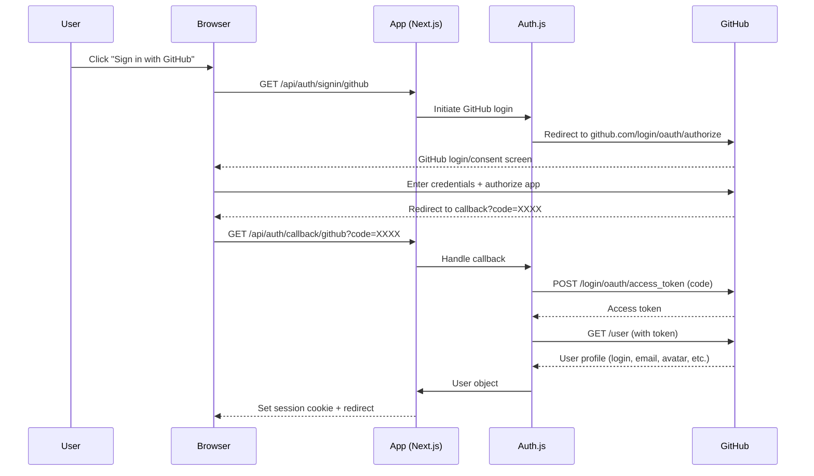

# GitHub Provider

## Introduction
The GitHub provider in Auth.js enables users to authenticate using their GitHub accounts via OAuth 2.0. This allows "Sign in with GitHub" functionality in your Next.js application, leveraging GitHub's secure authentication infrastructure.

## Why we need the GitHub provider
GitHub is widely used by developers, making it a convenient authentication option for developer-focused products, open source projects, and dev tools. Integrating GitHub login reduces friction for users who already have a GitHub account and avoids the need to manage separate credentials.

## Problem statement
How do we integrate GitHub OAuth 2.0 authentication into a Next.js application using Auth.js, including setup, configuration, scope management, and handling of user profile data?

## Real-world story
A developer productivity tool wanted to allow users to sign in with GitHub to automatically import their repositories and contributions. By using Auth.js's GitHub provider, they implemented the authentication in under an hour, focusing instead on the core product features.

## Real-world analogy
**GitHub provider**: Like using a valet key for your car that only grants access to the trunk (repositories) and driver's seat (profile) but not the glove compartment (private settings) - you get limited, scoped access without sharing your master key (password).

## Visual explanation
```
User clicks "Sign in with GitHub"
        ↓
Redirect to GitHub OAuth login
        ↓
User grants permission to application
        ↓
GitHub redirects back with auth code
        ↓
Auth.js exchanges code for access token
        ↓
Auth.js fetches user profile from GitHub API
        ↓
Auth.js creates session with user data
```

## Mermaid Diagram 1: GitHub OAuth Flow


## Internal working
**GitHub provider specifics**:
- Uses OAuth 2.0 Authorization Code Flow
- Requires GitHub OAuth Application credentials (Client ID and Client Secret)
- Default scope: `read:user` (reads public profile and email)
- Additional scopes available: `user:email`, `repo`, `workflow`, etc.
- Exchange process:
  1. Redirect user to GitHub authorization URL with `client_id`, `redirect_uri`, `scope`, `state`
  2. User authenticates and grants permission on GitHub
  3. GitHub redirects back to your `callback_url` with `code` parameter
  4. Your server exchanges `code` for `access_token` via POST to GitHub token endpoint
  5. Use `access_token` to fetch user data from GitHub API
  6. Auth.js creates session with user data
- Automatic handling of:
  - State parameter for CSRF protection
  - Code exchange for access token
  - User profile fetching
  - Token refresh (if offline access requested)
  - Error handling (invalid code, denied access, etc.)

## Step-by-step flow (detailed)
1. **Initiation**: User clicks "Sign in with GitHub" link generated by `signIn('github')`
2. **Redirect**: Browser sent to `https://github.com/login/oauth/authorize?client_id=...&redirect_uri=...&scope=read%3Auser&state=...`
3. **GitHub login**: User enters GitHub credentials (or uses existing session)
4. **Authorization**: User reviews requested permissions and clicks "Authorize application"
5. **Callback**: GitHub redirects to `YOUR_REDIRECT_URI/callback/github?code=LONG_RANDOM_STRING&state=ORIGINAL_STATE`
6. **State validation**: Auth.js verifies `state` parameter matches original to prevent CSRF
7. **Token exchange**: Backend sends POST to `https://github.com/login/oauth/access_token` with:
   - `client_id`
   - `client_secret`
   - `code`
   - `redirect_uri`
8. **Token response**: GitHub returns JSON: `{ access_token: "...", token_type: "bearer", scope: "read:user" }`
9. **User profile**: Backend GET to `https://api.github.com/user` with `Authorization: token ACCESS_TOKEN`
10. **User data**: GitHub returns JSON with `login`, `id`, `avatar_url`, `email`, `name`, etc.
11. **Profile processing**: Auth.js maps GitHub user fields to standard user object
12. **Session creation**: Auth.js creates JWT or database session with user data
13. **Cookie setting**: Encrypted session cookie set in response
14. **Redirect**: User sent to `callbackUrl` (default: `/` or `callbackUrl` from signIn)

## Implementation
### Basic setup
```typescript
// app/api/auth/[...nextauth]/route.ts
import NextAuth from "next-auth"
import GitHubProvider from "next-auth/providers/github"

export const { GET, POST } = NextAuth({
  providers: [
    GitHubProvider({
      clientId: process.env.GITHUB_ID,
      clientSecret: process.env.GITHUB_SECRET,
    })
  ],
  // Optional: customize scope
  // providers: [
  //   GitHubProvider({
  //     clientId: process.env.GITHUB_ID,
  //     clientSecret: process.env.GITHUB_SECRET,
  //     authorization: {
  //       params: {
  //         scope: "read:user user:email"
  //       }
  //     }
  //   })
  // ]
})
```

### With custom profile mapping
```typescript
// app/api/auth/[...nextauth]/route.ts
import NextAuth from "next-auth"
import GitHubProvider from "next-auth/providers/github"

export const { GET, POST } = NextAuth({
  providers: [
    GitHubProvider({
      clientId: process.env.GITHUB_ID,
      clientSecret: process.env.GITHUB_SECRET,
      authorization: {
        params: {
          scope: "read:user user:email"
        }
      },
      profile(profile) {
        // Customize how user profile is mapped
        return {
          id: profile.id.toString(),
          name: profile.name || profile.login,
          email: profile.email,
          image: profile.avatar_url,
          // Add custom fields
          githubLogin: profile.login,
          githubAvatarUrl: profile.avatar_url,
          githubHtmlUrl: profile.html_url,
          githubFollowers: profile.followers,
          githubPublicRepos: profile.public_repos
        }
      }
    })
  ],
  // Optional: customize JWT/session callbacks
  callbacks: {
    async jwt({ token, account, profile }) {
      // Persist GitHub access token to token
      if (account) {
        token.accessToken = access_token
        token.githubLogin = profile.login
      }
      return token
    },
    async session({ session, token, user }) {
      // Send properties to client
      session.user.githubLogin = token.githubLogin
      return session
    }
  }
})
```

### Advanced: Requesting additional scopes
```typescript
// For accessing private repositories
GitHubProvider({
  clientId: process.env.GITHUB_ID,
  clientSecret: process.env.GITHUB_SECRET,
  authorization: {
    params: {
      scope: "read:user user:email repo"
    }
  }
})

// For GitHub Actions workflow access
GitHubProvider({
  clientId: process.env.GITHUB_ID,
  clientSecret: process.env.GITHUB_SECRET,
  authorization: {
    params: {
      scope: "workflow"
    }
  }
})
```

## Folder structure
```
src/
├── app/
│   └── api/
│       └── auth/
│           └── [...nextauth]/
│               └── route.ts
├── lib/
│   ├── auth.ts
│   └── github.ts (helper for API calls)
├── components/
│   ├── SignInWithGitHub.tsx
│   └── ProfileCard.tsx
├── pages/
│   └── dashboard/
│       └── page.tsx (protected route)
└── utils/
    └── githubApi.ts
```

## Best practices
**Scope management**:
- Request only the scopes you need (principle of least privilege)
- For basic profile: `read:user` (includes public email if public)
- For private email: `user:email` (requires user authorization)
- For repo access: `repo` or specific repo scopes
- For organization data: `read:org`
- Combine scopes as space-separated list
- Review scopes in GitHub OAuth application settings

**Security**:
- Store GitHub client secret securely (never in client-side code)
- Use different OAuth apps for development and production
- Set correct redirect URIs in GitHub OAuth app settings
- Enable "Allow access to user emails" if using `user:email` scope
- Regularly rotate client secrets
- Monitor OAuth application audit log
- Consider IP allowlist for OAuth app (if applicable)
- Notify users of new authorized applications (GitHub does this by default)

**User experience**:
- Use GitHub's "Sign in with GitHub" button guidelines
- Show loading state during authentication
- Handle "account not linked" scenarios gracefully
- Provide way to disconnect GitHub account
- Sync profile picture periodically if desired
- Show last login time from GitHub
- Explain what permissions you're requesting and why

**Data handling**:
- Cache GitHub API responses appropriately (respect rate limits)
- Handle API rate limiting (429 responses) gracefully
- Store access token securely (encrypted in JWT or database)
- Consider token refresh for long-lived sessions
- Be aware of GitHub API terms of service
- Don't store sensitive data from GitHub without consent

## Common mistakes
- Forgetting to set redirect URI in GitHub OAuth app (must match exactly)
- Using HTTP instead of HTTPS in redirect URI (GitHub requires HTTPS for production)
- Missing `user:email` scope when trying to access private email
- Not handling rate limiting (429 responses from GitHub API)
- Storing GitHub access token in localStorage (XSS risk) - use HttpOnly cookies via Auth.js
- Forgetting to urlencode redirect URI when constructing auth link manually
- Using the wrong endpoint (GitHub Enterprise vs github.com)
- Not updating OAuth app when changing domains
- Assuming email is always provided (users can hide email)
- Not checking `verified_email` attribute from GitHub API
- Forgetting that GitHub usernames are case-sensitive
- Not handling suspended or blocked GitHub accounts gracefully
- Missing `Referrer-Policy` header that breaks GitHub redirects

## Security considerations
**Token security**:
- Access tokens are bearer tokens - treat like passwords
- Never log or expose access tokens
- Use short-lived tokens where possible (refresh tokens for long-term access)
- Store tokens encrypted (Auth.js does this in JWT/database)
- Consider token binding to request properties (IP, User-Agent)
- Implement token revocation on logout
- Monitor for leaked tokens in public repositories

**Data privacy**:
- Only request scopes necessary for your application
- Clearly explain what data you're accessing and why
- Allow users to disconnect GitHub access
- Respect GitHub's developer terms of service
- Don't sell or misuse GitHub-derived data
- Provide privacy policy covering GitHub data usage

**Integrity verification**:
- Verify email ownership if required (GitHub may not verify all emails)
- Consider email verification flow for sensitive operations
- Validate that email domain matches expected patterns (for corporate SSO)
- Use `verified_email` flag from GitHub response when available

**Dependency security**:
- Keep `octokit` or GitHub API clients updated
- Audit dependencies for known vulnerabilities
- Use dependency checking tools (npm audit, snyk, etc.)

## Performance notes
**API rate limits**:
- GitHub API: 5000 requests/hour per authenticated token
- Unauthenticated: 60 requests/hour per IP
- Implement caching for frequently accessed data
- Use conditional requests (ETag, Last-Modified) when possible
- Batch requests where supported by GitHub GraphQL API
- Consider webhooks for real-time updates instead of polling
- Monitor `X-RateLimit-Remaining` and `X-RateLimit-Reset` headers

**Authentication latency**:
- OAuth adds network roundtrips (typically 300ms-1s+)
- Cache user profile data briefly after login
- Consider pre-fetching public profile data
- Use CDN for static assets; API must origin from server
- Optimize database queries for user lookup/creation
- Use connection pooling for database access

**Scaling**:
- GitHub OAuth scales horizontally by design
- Your backend must handle concurrent callback requests
- Rate limit your own token exchange endpoint to prevent abuse
- Consider using GitHub App instead of OAuth for integrations (more granular permissions)
- For high-scale applications, evaluate GitHub's Enterprise Cloud vs Server

## Interview questions
1. What OAuth flow does the GitHub provider use?
2. Which endpoint exchanges the authorization code for an access token?
3. What scope is needed to access a user's private email address?
4. How does Auth.js prevent CSRF attacks in the GitHub flow?
5. Where is the GitHub access token stored after authentication?
6. How would you refresh a GitHub access token if needed?
7. What information is available in the GitHub user profile endpoint?
8. How do you request access to private repositories?
9. What happens if a user revokes your application's access on GitHub?
10. How do you handle GitHub API rate limiting?

## MCQs
1. Which protocol does the GitHub provider use?
   a) SAML 2.0
   b) OpenID Connect
   c) OAuth 2.0 Authorization Code Flow
   d) WS-Federation
   Answer: c

3. What is the default scope for the GitHub provider in Auth.js?
   a) user:email
   b) repo
   c) read:user
   d) no scope (defaults to public profile)
   Answer: c

4. Which header contains the GitHub access token when making API requests?
   a) Authorization: Bearer <token>
   b) X-GitHub-Token: <token>
   c) GitHub-Token: <token>
   d) Cookie: oauth_token=...
   Answer: a

5. How do you prevent CSRF attacks in GitHub OAuth flow?
   a) Using HTTPS only
   b) Validating the state parameter
   c) Checking the Referer header
   d) Using short-lived tokens
   Answer: b

## Practice exercise
Set up GitHub authentication with:
1. Create OAuth App in GitHub developer settings
2. Add GITHUB_ID and GITHUB_SECRET to .env.local
3. Configure GitHub provider in Auth.js options
4. Add "Sign in with GitHub" button to your page
5. Create a protected route that displays user's GitHub login and avatar
6. Implement logout functionality
7. Add error handling for failed authentication
8. Test the full flow: login, access protected route, logout

## Debugging experience
"Bad credentials" error when exchanging code for token.
Check:
1. GITHUB_ID and GITHUB_SECRET match exactly from GitHub OAuth app
2. No extra spaces in environment variables
3. Using correct endpoint: `github.com/login/oauth/access_token`
4. POST request with form-urlencoded body (not JSON)
5. Including redirect_uri parameter in token exchange
6. Redirect URI exactly matches what's in GitHub OAuth app
7. Not using OAuth App credentials for GitHub App (different systems)
8. Checking GitHub status for service incidents
9. Verifying clock skew isn't causing timestamp issues
10. Trying to regenerate client secret in GitHub developer settings

## Real-world scenario
Open source project maintainer dashboard:
- Sign in with GitHub to verify maintainership
- Request `repo` scope for private repositories
- Display contribution graph and issue statistics
- Allow triggering workflows via `workflow` scope
- Show security alerts from GitHub Advanced Security
- Dependabot integration for dependency updates
- Team synchronization for organization members
- Repository permission matrix visualization

## Mini project
Create a GitHub profile explorer that:
- Authenticates users via GitHub
- Shows public profile info (name, bio, location)
- Displays repository list with language breakdown
- Shows contribution calendar for the past year
- Lists followers and following
- Displays recent public activity (events)
- Allows searching repositories by name/language
- Includes dark/light mode toggle
- Respects rate limits with caching and exponential backoff