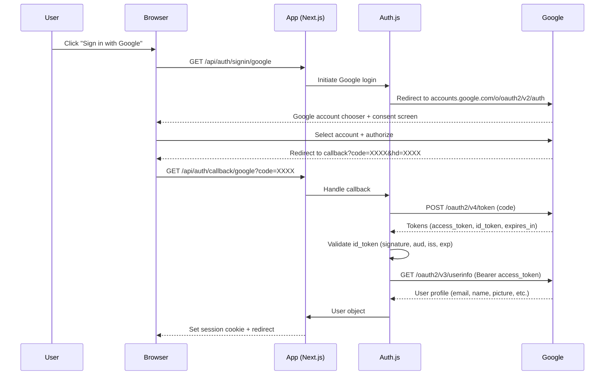

# Google Provider

## Introduction
The Google provider in Auth.js enables users to authenticate using their Google accounts via OAuth 2.0 and OpenID Connect. This allows "Sign in with Google" functionality in your Next.js application, leveraging Google's secure authentication infrastructure.

## Why we need the Google provider
Google accounts are ubiquitous, making Google login a convenient option for consumer-facing applications. Integrating Google login reduces barriers to entry, increases conversion rates, and provides access to Google's user data (with consent) for personalization.

## Problem statement
How do we integrate Google OAuth 2.0 / OpenID Connect authentication into a Next.js application using Auth.js, including setup, configuration, scope management, ID token validation, and handling of user profile data?

## Real-world story
A productivity SaaS wanted to allow users to quickly start using their service without creating another password. By adding "Sign in with Google" via Auth.js, they increased sign-up completion rates by 35% and reduced support tickets related to forgotten passwords.

## Real-world analogy
**Google provider**: Like using a federal ID (passport) to prove your identity at various institutions (banks, government offices, airlines) - you present one trusted credential instead of managing separate credentials for each service.

## Visual explanation
```
User clicks "Sign in with Google"
        ↓
Redirect to Google OAuth consent screen
        ↓
User selects account and grants permission
        ↓
Google redirects back with auth code
        ↓
Auth.js exchanges code for tokens
        ↓
Auth.js validates ID token (if OpenID Connect)
        ↓
Auth.js fetches user profile (if needed)
        ↓
Auth.js creates session with user data
```

## Mermaid Diagram 1: Google OAuth/OIDC Flow


## Internal working
**Google provider specifics**:
- Supports both OAuth 2.0 and OpenID Connect (when `scope` includes `openid`)
- Requires Google Cloud Platform OAuth 2.0 Client ID and Client Secret
- Default scope when using OpenID Connect: `openid email profile`
- Additional scopes available: `https://www.googleapis.com/auth/calendar`, `drive`, `gmail`, etc.
- Exchange process:
  1. Redirect user to Google authorization URL with `client_id`, `redirect_uri`, `scope`, `response_type=code`, `access_type=offline` (for refresh tokens), `prompt=consent` (optional), `state`
  2. User selects Google account and consents to permissions on accounts.google.com
  3. Google redirects back to your `redirect_uri` with `code` parameter (and `hd` for hosted domain if applicable)
  4. Your server exchanges `code` for `access_token`, `id_token`, and `refresh_token` via POST to Google token endpoint
  5. Auth.js validates the `id_token` (signature, aud, iss, exp) if using OpenID Connect
  6. Use `access_token` to fetch user data from Google UserInfo endpoint
  7. Auth.js creates session with user data
- Automatic handling of:
  - State parameter for CSRF protection
  - Code exchange for tokens
  - ID token validation (when `openid` scope present)
  - User profile fetching via UserInfo endpoint
  - Token refresh (if `access_type=offline` and refresh token granted)
  - Error handling (invalid code, disallowed useragent, etc.)

## Step-by-step flow (detailed with OpenID Connect)
1. **Initiation**: User clicks "Sign in with Google" link from `signIn('google')`
2. **Redirect**: Browser sent to `https://accounts.google.com/o/oauth2/v2/auth?client_id=...&redirect_uri=...&scope=openid%20email%20profile&access_type=offline&response_type=code&prompt=consent&state=...`
3. **Account chooser**: User selects Google account (if multiple signed in)
4. **Consent screen**: User reviews requested permissions and clicks "Allow"
5. **Callback**: Google redirects to `YOUR_REDIRECT_URI/callback/google?code=LONG_RANDOM_STRING&state=ORIGINAL_STATE&hd=HOSTED_DOMAIN_IF_APPLICABLE`
6. **State validation**: Auth.js verifies `state` parameter matches original to prevent CSRF
7. **Token exchange**: Backend sends POST to `https://oauth2.googleapis.com/token` with:
   - `code`
   - `client_id`
   - `client_secret`
   - `redirect_uri`
   - `grant_type=authorization_code`
8. **Token response**: Google returns JSON:
   ```json
   {
     "access_token": "ya29...",
     "expires_in": 3599,
     "refresh_token": "1//0...",
     "scope": "openid email profile https://www.googleapis.com/auth/calendar.readonly",
     "id_token": "eyJhbGciOiJSUzI1NiIsImtpZCI6Ij...",
     "token_type": "Bearer"
   }
   ```
9. **ID token validation**: Auth.js:
   - Retrieves Google's public keys from `https://www.googleapis.com/oauth2/v3/certs`
   - Validates `id_token` signature using appropriate key
   - Checks `iss` (issuer) is `accounts.google.com` or `https://accounts.google.com`
   - Checks `aud` (audience) matches your `client_id`
   - Checks `exp` (expiration) is in the future
   - Optionally checks `hd` (hosted domain) if restricting to specific G Suite domain
10. **User profile**: Backend GET to `https://openidconnect.googleapis.com/v1/userinfo` with `Authorization: Bearer ACCESS_TOKEN`
11. **User data**: Google returns JSON with `email`, `name`, `picture`, `given_name`, `family_name`, `locale`, etc.
12. **Profile processing**: Auth.js maps Google user fields to standard user object
13. **Session creation**: Auth.js creates JWT or database session with user data
14. **Cookie setting**: Encrypted session cookie set in response
15. **Redirect**: User sent to `callbackUrl` (default: `/` or `callbackUrl` from signIn)

## Implementation
### Basic setup (OpenID Connect)
```typescript
// app/api/auth/[...nextauth]/route.ts
import NextAuth from "next-auth"
import GoogleProvider from "next-auth/providers/google"

export const { GET, POST } = NextAuth({
  providers: [
    GoogleProvider({
      clientId: process.env.GOOGLE_ID,
      clientSecret: process.env.GOOGLE_SECRET,
    })
  ]
})
```

### With custom scope and profile mapping
```typescript
// app/api/auth/[...nextauth]/route.ts
import NextAuth from "next-auth"
import GoogleProvider from "next-auth/providers/google"

export const { GET, POST } = NextAuth({
  providers: [
    GoogleProvider({
      clientId: process.env.GOOGLE_ID,
      clientSecret: process.env.GOOGLE_SECRET,
      authorization: {
        params: {
          scope: "openid email profile https://www.googleapis.com/auth/calendar.readonly"
        }
      },
      profile(profile) {
        return {
          id: profile.sub,
          name: profile.name,
          email: profile.email,
          image: profile.picture,
          // Add custom fields from Google profile
          googleId: profile.sub,
          googleLocale: profile.locale,
          googleHd: profile.hd, // hosted domain
          googleEmailVerified: profile.email_verified,
          googlePicture: profile.picture,
          googleGivenName: profile.given_name,
          googleFamilyName: profile.family_name
        }
      }
    })
  ],
  callbacks: {
    async jwt({ token, account, profile }) {
      // Persist Google access token and ID token if needed
      if (account) {
        token.accessToken = access_token
        token.idToken = id_token
      }
      return token
    },
    async session({ session, token, user }) {
      // Send properties to client
      session.user.accessToken = token.accessToken
      return session
    }
  }
})
```

### Restrict to specific hosted domain (e.g., company.com)
```typescript
GoogleProvider({
  clientId: process.env.GOOGLE_ID,
  clientSecret: process.env.GOOGLE_SECRET,
  authorization: {
    params: {
      scope: "openid email profile",
      hd: "yourcompany.com" // Optional: pre-select domain
    }
  },
  // Optional: validate hosted domain in profile
  profile(profile) {
    if (profile.hd !== "yourcompany.com") {
      throw new Error("Access denied: invalid domain")
    }
    return {
      id: profile.sub,
      name: profile.name,
      email: profile.email,
      image: profile.picture
    }
  }
})
```

## Folder structure
```
src/
├── app/
│   └── api/
│           └── [...nextauth]/
│               └── route.ts
├── lib/
│   ├── auth.ts
│   └── google.ts (helper for Google API calls)
├── components/
│   ├── SignInWithGoogle.tsx
│   └── GoogleProfileCard.tsx
├── pages/
│   └── dashboard/
│       └── page.tsx (protected route)
└── utils/
    └── googleApi.ts
```

## Best practices
**Scope management**:
- Use `openid` scope to enable ID token validation (OpenID Connect)
- Request `email` and `profile` for basic user information
- Add additional scopes only when needed (follow principle of least privilege)
- Common additional scopes:
  - `https://www.googleapis.com/auth/calendar` - Calendar access
  - `https://www.googleapis.com/auth/drive.file` - Drive file access
  - `https://www.googleapis.com/auth/gmail.send` - Send email
  - `https://www.googleapis.com/auth/contacts.readonly` - Read contacts
- Combine scopes as space-separated string
- Review and justify each scope in your privacy policy

**Security**:
- Store Google client secret securely (use secrets manager in production)
- Use different OAuth clients for development and production
- Set authorized JavaScript origins and redirect URIs in Google Cloud Console
- Enable "Allow access to user data" for required APIs
- Consider restricting by hosted domain (`hd` parameter) for G Suite
- Regularly rotate client secrets
- Monitor Google Cloud audit logs for OAuth activity
- Set appropriate API restrictions (HTTP referrers, IP addresses) if applicable

**User experience**:
- Use Google's "Sign in with Google" button guidelines
- Show which account is being used (email/avatar) after login
- Handle multiple account selection gracefully
- Provide way to disconnect Google account
- Explain what data you're accessing and why
- Offer to sync data periodically if applicable
- Show last login time/location from Google signals (if available)
- Implement graceful handling of suspended/disabled Google accounts

**Data handling**:
- Cache Google API responses appropriately (respect rate limits and freshness)
- Handle API errors (400, 401, 403, 429, 5xx) gracefully
- Store access token encrypted (Auth.js does this in JWT/database)
- Consider token refresh for long-lived sessions
- Be aware of Google API terms of service and quota limits
- Don't store sensitive Google data without explicit consent
- Implement data deletion upon user request (GDPR/CCPA compliance)

## Common mistakes
- Forgetting to set authorized JavaScript origins and redirect URIs in Google Cloud Console
- Using HTTP instead of HTTPS in redirect URI (Google requires HTTPS for production)
- Missing `openid` scope when you want to validate ID token
- Not checking `email_verified` flag from Google profile
- Assuming email is always provided (users can have unverified email)
- Forgetting to urlencode redirect URI when constructing auth link manually
- Using the wrong endpoint for Google Workspace vs consumer accounts
- Not updating OAuth client when changing domains
- Assuming profile picture URL is always available (may be empty)
- Not handling users without given_name/family_name (some cultures)
- Missing `access_type=offline` when you need refresh tokens
- Forgetting to set `prompt=consent` to force re-consent (important for scope changes)
- Overlooking that Google may return `email` as null for some accounts
- Not validating that the `hd` claim matches expected domain if restricting

## Security considerations
**Token security**:
- ID tokens are JWTs - validate signature, iss, aud, exp
- Access tokens are bearer tokens - protect like passwords
- Never log or expose ID or access tokens
- Use short-lived access tokens (default 1 hour) with refresh tokens for longevity
- Store tokens encrypted (Auth.js does this in JWT/database)
- Consider token binding to request properties (IP, User-Agent)
- Implement token revocation on logout (revoke refresh token)
- Monitor for leaked tokens in public repositories

**Data privacy**:
- Only request scopes necessary for your application
- Clearly explain what Google data you're accessing in your privacy policy
- Allow users to disconnect Google access and delete associated data
- Respect Google's API Terms of Service and Developer Policies
- Implement data processing agreements if handling EU user data
- Provide option to download/delete Google-derived data

**Domain validation**:
- When restricting to hosted domain (`hd`), validate the claim in ID token
- Consider that `hd` may not be present for consumer (@gmail.com) accounts
- Implement additional email domain validation if needed
- Be aware of Google Groups and alias email addresses

**Dependency security**:
- Keep `googleapis` npm package updated if making direct API calls
- Audit dependencies for known vulnerabilities
- Use dependency checking tools (npm audit, snyk, etc.)

## Performance notes
**API rate limits**:
- Google OAuth 2.0: Generally generous quotas (check specific API)
- Userinfo endpoint: 10,000 requests per 100 seconds per project
- Google Cloud APIs: Vary by service (check console.cloud.google.com/apis/api)
- Implement exponential backoff for 429 responses
- Use conditional requests (If-Modified-Since, ETag) when applicable
- Consider batching requests where supported by Google APIs
- Cache non-sensitive data (user name, email) with appropriate TTL
- Monitor quota usage in Google Cloud Console

**Authentication latency**:
- OAuth adds network roundtrips (typically 500ms-1.5s+)
- Cache ID token validation keys (JWKS) for 5+ minutes (they rotate infrequently)
- Consider pre-fetching user profile during silent authentication
- Use CDN for static assets; API must origin from server
- Optimize database queries for user lookup/creation
- Use connection pooling for database access
- Implement server-side caching for frequent Google API calls (respecting TTL)

**Scaling**:
- Google OAuth scales horizontally by design
- Your backend must handle concurrent callback requests
- Consider using Google Identity Toolkit (now Firebase) for alternative approach
- For high-scale applications, evaluate Customer Managed Encryption Keys (CMEK)
- Monitor quota usage and set up alerts for unexpected spikes

## Interview questions
1. What's the difference between using Google provider with and without `openid` scope?
2. Which endpoint validates the Google ID token?
3. What claims are essential to validate in a Google ID token?
4. How does Auth.js prevent CSRF attacks in the Google flow?
5. Where is the Google access token stored after authentication?
6. How would you refresh a Google access token if needed?
7. What information is available in the Google UserInfo endpoint?
8. How do you request access to Google Calendar or Drive?
9. What happens if a user revokes your application's access in their Google account?
10. How do you restrict Google sign-in to specific hosted domain (e.g., company.com)?

## MCQs
1. Which protocol does the Google provider use when `openid` scope is included?
   a) OAuth 2.0 only
   b) OpenID Connect only
   c) Both OAuth 2.0 and OpenID Connect
   d) SAML 2.0
   Answer: c

2. What is the purpose of the `id_token` in Google OpenID Connect flow?
   a) To refresh access tokens
   b) To authenticate the user (identity token)
   c) To authorize API access
   d) To encrypt session data
   Answer: b

3. Which claim in the Google ID token identifies the user?
   a) aud
   b) iss
   c) sub
   d) hd
   Answer: c

4. How do you prevent CSRF attacks in Google OAuth flow?
   a) Using HTTPS only
   b) Validating the state parameter
   c) Checking the Referer header
   d) Using short-lived tokens
   Answer: b

5. Which endpoint fetches user profile data after token exchange?
   a) /oauth2/v3/userinfo
   b) /oauth2/v4/tokeninfo
   c) / OpenID Connect v1/userinfo
   d) /plus/v1/people/me
   Answer: a (or c - both are valid endpoints)

## Practice exercise
Set up Google authentication with:
1. Create OAuth Client ID in Google Cloud Console
2. Add GOOGLE_ID and GOOGLE_SECRET to .env.local
3. Configure Google provider with openid email profile scopes
4. Add "Sign in with Google" button to your page
5. Create a protected route that displays user's email and profile picture
6. Implement logout functionality
7. Add error handling for failed authentication
8. Test the full flow: login, access protected route, logout
9. Verify ID token validation works by tampering with token (should fail)

## Debugging experience
"invalid_id_token" error during authentication.
Check:
1. GOOGLE_ID and GOOGLE_SECRET match exactly from Google Cloud Console
2. `openid` scope included in authorization params
3. No extra spaces in environment variables
4. Using correct token endpoint: `https://oauth2.googleapis.com/token`
5. ID token validation: verifyaud matches GOOGLE_ID
6. Issuer validation: iss is `accounts.google.com` or `https://accounts.google.com`
7. Token not expired (check exp claim)
8. Hosted domain validation (if using hd parameter)
9. Clock skew not causing validation failure
10. Trying to regenerate client secret in Google Cloud Console
11. Verifying that the ID token is actually a JWT (three parts separated by .)
12. Checking that the JWKS endpoint is accessible from your server