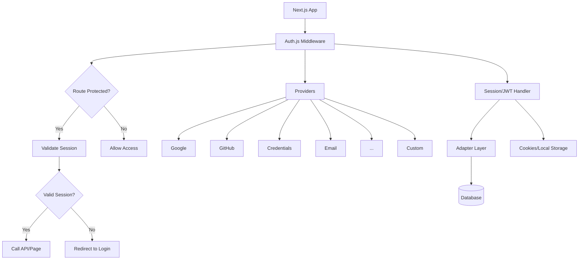
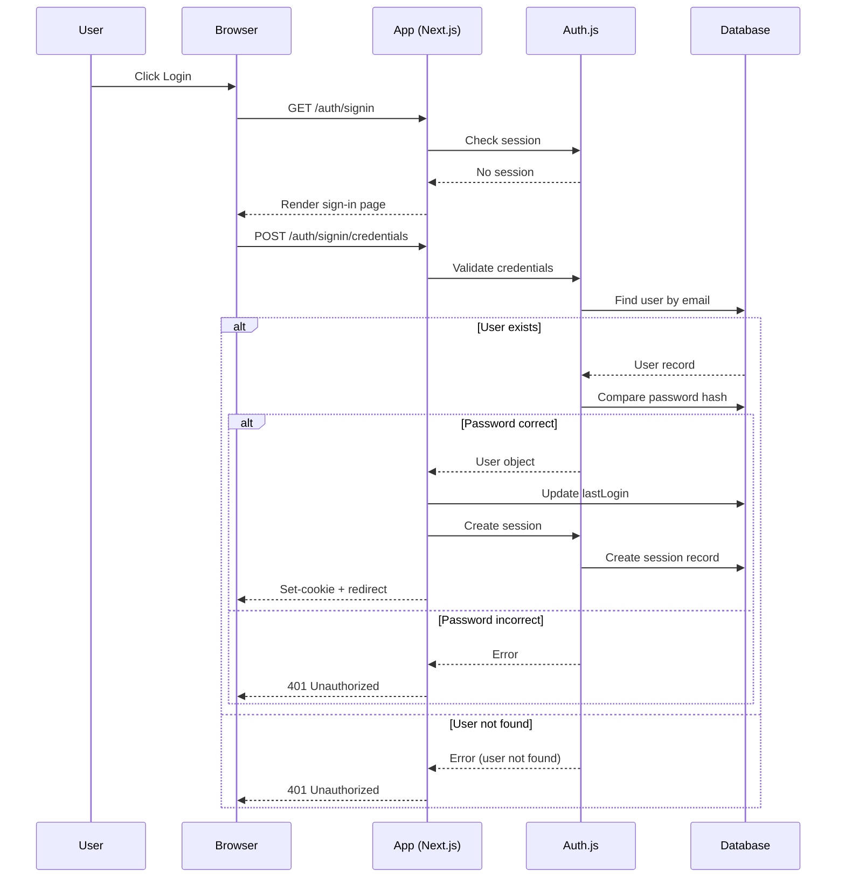

# Introduction to Auth.js

## Introduction
Auth.js is a complete, open-source authentication solution for Next.js applications. It simplifies implementing authentication by handling complex concerns like session management, token handling, CSRF protection, and provider integrations.

## Why we need Auth.js
Building secure authentication requires expertise in cryptography, session management, and security best practices. Auth.js provides a battle-tested solution that reduces development time and security risks.

## Problem statement
How can we implement robust authentication in Next.js without becoming security experts or spending weeks on low-level details?

## Real-world story
A startup needed to launch an MVP quickly but lacked security expertise. Using Auth.js, they implemented Google login, email/password, and GitHub authentication in two days instead of two weeks, with enterprise-grade security.

## Real-world analogy
**Auth.js**: Like using a bank's secure vault instead of building your own. You get professional-grade security without needing to be a cryptographer or safe engineer.

## Visual explanation
```
Your Next.js App
        ↓
    Auth.js Library
        ↓
+----------------+     +------------------+
|   Providers    |     |   Session Mgmt   |
| (Google, GitHub|     | (JWT or Database)|
|  Email, etc.)  |     +------------------+
+----------------+             ↓
        ↓              +------------------+
    [Callbacks]       |   Adapters         |
        ↓              | (Prisma, MongoDB)  |
    [JWT Handling]    +------------------+
        ↓                   ↓
    [Your App]    ←→  [Database]
```

## Mermaid Diagram 1: Auth.js Architecture


## Internal working
**Auth.js flow**:
1. **Middleware**: Runs on every request (or configured paths) to check session
2. **Providers**: Handle authentication with external services (OAuth) or custom logic (Credentials)
3. **Callbacks**: Customize behavior during sign-in, sign-out, session creation, etc.
4. **JWT/Local Session**: Manage token creation, validation, and storage
5. **Adapter**: Interface with database to store users, accounts, sessions
6. **Endpoints**: Exposes API routes (`/api/auth/*`) for authentication flows

## Step-by-step flow (sign in with Google)
1. User clicks "Sign in with Google"
2. Redirect to Google's OAuth consent screen
3. User grants permission
4. Google redirects back to `/api/auth/callback/google?code=...`
5. Auth.js exchanges code for tokens
6. Auth.js checks if user exists in database (via adapter)
7. If new user, creates account; if existing, updates tokens
8. Auth.js creates JWT or session
9. Sets encrypted cookie with session token
10. Redirects to callback URL (e.g., `/`)
11. On subsequent requests, middleware validates cookie and sets `req.user`

## Step-by-step flow (credentials provider)
1. User submits email/password to `/api/auth/credential`
2. Auth.js calls `authorize` callback with credentials
3. Your code validates credentials against database
4. If valid, returns user object
5. Auth.js creates JWT/session
6. Sets cookie and redirects

## Architecture
**Core components**:
- **Provider Manager**: Handles different authentication strategies
- **Session Manager**: Creates and validates sessions (JWT or database)
- **Adapter Interface**: Abstracts database operations (User, Account, Session, VerificationToken models)
- **Event System**: Emits events for logging, analytics, etc.
- **JWT Handler**: Signs, verifies, and encrypts tokens
- **Cookie Handler**: Manages secure cookie settings

## Mermaid Diagram 2: Data Flow


## Implementation
### Basic Next.js integration
```typescript
// app/api/auth/[...nextauth]/route.ts
import NextAuth from "next-auth"
import GoogleProvider from "next-auth/providers/google"
import GithubProvider from "next-auth/providers/github"
import CredentialsProvider from "next-auth/providers/credentials"

export const { handlers, auth, signIn, signOut } = NextAuth({
  providers: [
    GoogleProvider({
      clientId: process.env.GOOGLE_ID,
      clientSecret: process.env.GOOGLE_SECRET,
    }),
    GithubProvider({
      clientId: process.env.GITHUB_ID,
      clientSecret: process.env.GITHUB_SECRET,
    }),
    CredentialsProvider({
      name: "Credentials",
      credentials: {
        email: { label: "Email", type: "email" },
        password: { label: "Password", type: "password" }
      },
      async authorize(credentials) {
        // Add your own logic here
        const user = { id: "1", name: "John Doe", email: "john@example.com" }
        if (user) {
          return user
        } else {
          return null
        }
      }
    })
  ],
  pages: {
    signIn: '/auth/signin',
  },
  callbacks: {
    async session({ session, token }) {
      // Send properties to the client
      session.user.id = token.sub
      return session
    }
  }
})
```

### Folder structure
```
src/
├── app/
│   └── api/
│       └── auth/
│           └── [...nextauth]/
│               └── route.ts
├── lib/
│   └── auth.ts
├── components/
│   └── SignInButton.tsx
└── types/
    └── next-auth.d.ts
```

## Best practices
- Use environment variables for secrets (never hardcode)
- Enable HTTPS in production (required for cookies)
- Set appropriate cookie security flags (Secure, SameSite)
- Use strong secret for JWT encryption (`NEXTAUTH_SECRET`)
- Limit callback URLs to prevent open redirect
- Regularly update dependencies
- Implement proper error handling
- Use database adapter for production (not default JWT)
- Configure session strategy appropriately (jwt vs database)
- Log authentication events for audit
- Implement rate limiting on credential provider

## Common mistakes
- Forgetting to set `NEXTAUTH_SECRET` in production
- Using the same secret across environments (dev/staging/prod)
- Not configuring `trustHost` when behind a proxy
- Exposing sensitive data in logs or error messages
- Misconfiguring callback URLs (must match exactly)
- Using outdated versions with known vulnerabilities
- Storing secrets in client-side code
- Not setting proper CORS for API routes
- Ignoring email verification flows
- Not handling token expiration gracefully

## Security considerations
- **Transport Security**: Enforce HTTPS everywhere in production
- **Session Security**: Use `SameSite=Lax` or `Strict`, `HttpOnly`, `Secure`
- **Token Security**: Rotate encryption key periodically, use strong secrets
- **CSRF Protection**: Built-in via double-submit cookie (state parameter)
- **Rate Limiting**: Implement on credential provider to prevent brute force
- **Input Validation**: Sanitize and validate all inputs in callbacks
- **Dependency Scanning**: Regularly check for vulnerable dependencies
- **Logging**: Audit authentication events (success/fail) without sensitive data
- **Dependencies**: Keep `next-auth` and related packages updated

## Performance notes
- **JWT verification**: Adds minimal CPU overhead (microseconds)
- **Database queries**: Optimize with proper indexing on email/account fields
- **Session storage**: Database reads on each request (mitigate with caching)
- **Cookie size**: Encrypted JWTs can be large; consider database sessions for big payloads
- **Connector pooling**: Use database connection pools to handle concurrent auth requests
- **CDN**: Cache public assets; authentication endpoints should not be cached
- **Edge runtime**: Auth.js supports edge with some limitations (check docs)

## Interview questions
1. What are the main components of Auth.js?
2. How does Auth.js handle session management?
3. What's the difference between JWT and database session strategies?
4. How do you add a custom provider to Auth.js?
5. What are callbacks used for in Auth.js?
6. How do you secure Auth.js cookies?
7. What is the purpose of the `secret` in Auth.js?
8. How does Auth.js prevent CSRF attacks?
9. When would you choose a database adapter over JWT?
10. How do you handle offline access (refresh tokens) in Auth.js?

## MCQs
1. Which file configures Auth.js in a Next.js app?
   a) pages/api/auth/[...nextauth].js
   b) app/api/auth/[...nextauth]/route.ts
   c) Both A and B (depending on Pages vs App router)
   d) next-auth.config.js
   Answer: c

2. What is the default session strategy in Auth.js?
   a) Database
   b) JWT
   c) Cookie
   d) LocalStorage
   Answer: b

3. Which environment variable is REQUIRED for Auth.js to work in production?
   a) NEXTAUTH_URL
   b) NEXTAUTH_SECRET
   c) Both A and B
   d) Neither
   Answer: c

4. How does Auth.js protect against CSRF attacks?
   a) Using SameSite cookies
   b) Implementing double-submit cookie pattern
   c) Using CSRF tokens in forms
   d) Both A and B
   Answer: d

5. What method do you use to customize the JWT token in Auth.js?
   a) callbacks.jwt
   b) callbacks.session
   c) callbacks.signIn
   d) providers.callback
   Answer: a

## Practice exercise
Set up Auth.js with:
1. Google and GitHub providers
2. Custom pages for sign-in and sign-out
3. A callback to add user role to session
4. Protected route that checks for admin role
5. Logout button that clears session

## Debugging exercise
"Callback URL mismatch" error when using Google provider.
Check:
1. Google Cloud Console OAuth redirect URIs exactly match
2. NEXTAUTH_URL set correctly in environment variables
3. No trailing slash mismatch
4. Using correct provider ID (google vs google-oauth2)
5. Proxy headers not causing host mismatch
6. Local development using http vs https (use NEXTAUTH_URL=http://localhost:3000)

## Real-world scenario
Build a multi-tenant SaaS where:
- Each tenant has their own branding
- Users can belong to multiple tenants
- Authentication uses SAML for enterprise clients
- Social login for individual users
- Audit log tracks every login attempt
- Session sharing between web and mobile apps

## Mini project
Create an authentication dashboard showing:
- Active sessions (with location/IP)
- Login history (success/fail)
- Linked accounts (Google, GitHub, etc.)
- Security settings (password change, 2FA)
- Ability to revoke sessions
- WebAuthn security key registration