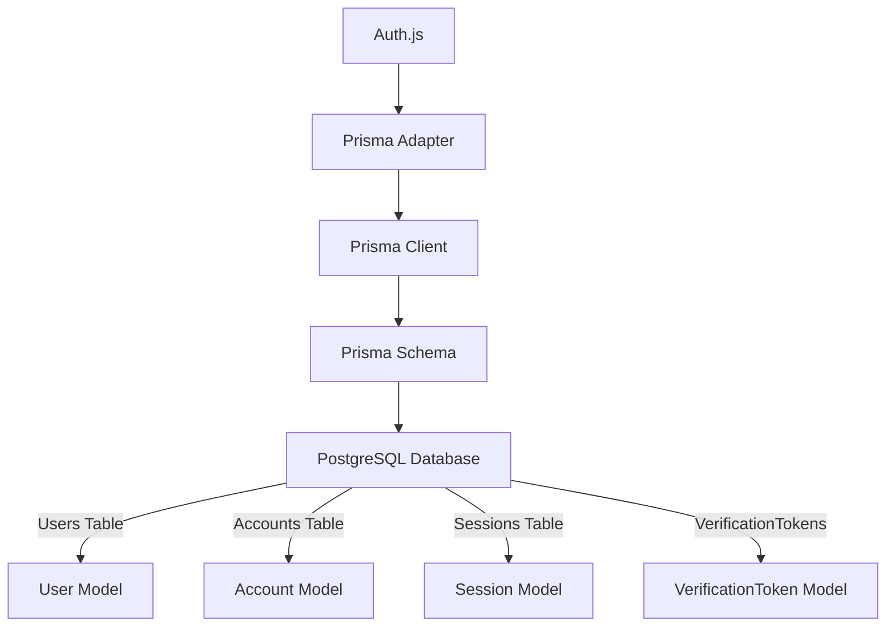

# Prisma Adapter

## Introduction
The Prisma Adapter for Auth.js provides a type-safe, fully-featured way to integrate Auth.js with Prisma ORM, enabling seamless authentication with PostgreSQL, MySQL, SQLite, MongoDB, and other databases supported by Prisma.

## Why we need the Prisma Adapter
Prisma offers a modern ORM experience with type safety, migrations, and a powerful query builder. Combining it with Auth.js gives you the best of both worlds: robust authentication from Auth.js and excellent database handling from Prisma.

## Problem statement
How do we set up Auth.js with Prisma ORM to store authentication data (users, accounts, sessions, verification tokens) in a type-safe way, including schema definition, migration management, and performance optimization?

## Real-world story
A SaaS company wanted to migrate from a custom SQL authentication system to Auth.js while keeping their existing Prisma setup. By using the Prisma Adapter, they integrated Auth.js in a day, benefiting from Prisma's type safety and migration system without rewriting their data access layer.

## Real-world analogy
**Prisma Adapter**: Like a universal translator that lets Auth.js (speaking authentication concepts) and Prisma (speaking database concepts) communicate perfectly, giving you the benefits of both systems without learning each other's languages.

## Visual explanation
```
Auth.js Core
        ↓
 Prisma Adapter
        ↓
    Prisma ORM
        ↓
+---------------------+
| PostgreSQL Database |
|  Users Table        |
|  Accounts Table     |
|  Sessions Table     |
| VerificationTokens  |
+---------------------+
```

## Mermaid Diagram 1: Prisma Adapter Integration


## Internal working
**How the Prisma Adapter works**:
1. Implements the Auth.js Adapter interface using Prisma Client methods
2. Maps Auth.js entities to Prisma models:
   - User → User model
   - Account → Account model
   - Session → Session model
   - VerificationToken → VerificationToken model
3. Handles type conversion between Auth.js expectations and Prisma return types
4. Manages relationships between models (User has many Accounts, Sessions, etc.)
5. Provides transactional safety where needed (account linking, etc.)

**Data flow**:
1. **Sign-in**:
   - Adapter.findUserByEmail() → Prisma.user.findUnique({ where: { email } })
   - Adapter.findUserByAccount({ where: { provider, provider } })}) Account linkAccount(account: user: Prisma.account.create({ data account   ->   Prisma.session.create({ data the
   - Adapter.createSession()Prisma.
  
 - ```

Adapter.getSessionAndUser():
   - Prisma.session.findUnique() with include for user
   - Returns { session, user }
```

## Schema definition
### Prisma schema for Auth.js
```prisma
// prisma/schema.prisma
generator client {
  provider = "prisma-client-js"
}

datasource db {
  provider = "postgresql" // or "mysql", "sqlite", "mongodb"
  url      = env("DATABASE_URL")
}

model User {
  id            String   @id @default(cuid())
  name          String?
  email         String?  @unique
  emailVerified DateTime?
  image         String?
  // Custom fields can be added here
  role          String   @default("user")
  // Relations
  accounts      Account[]
  sessions      Session[]
  // Custom relations
  posts         Post[]   // Example custom relation
  
  @@map("users")
}

model Account {
  id                 String   @id @default(cuid())
  userId             String
  type               String
  provider           String
  providerAccountId  String
  refresh_token      String?
  access_token       String?
  expires_at         Int?
  token_type         String?
  scope              String?
  id_token           String?
  session_state      String?
  
  user               User   @relation(fields: [userId], references: [id], onDelete: Cascade)
  
  @@unique([provider, providerAccountId])
  @@map("accounts")
}

model Session {
  id           String   @id @default(cuid())
  sessionToken String   @unique
  userId       String
  expires      DateTime
  
  user         User   @relation(fields: [userId], references: [id], onDelete: Cascade)
  
  @@map("sessions")
}

model VerificationToken {
  id           String   @id @default(cuid())
  identifier   String
  token        String   @unique
  
  @@unique([identifier, token])
  @@map("verification_tokens")
}

// Example custom model - you can add your own
model Post {
  id        String   @id @default(cuid())
  title     String
  content   String?
  author    String?
  createdAt DateTime @default(now())
  
  authorId  String
  author    User     @relation(fields: [authorId], references: [id], onDelete: SetNull)
  
  @@map("posts")
}
```

## Implementation
### Basic setup
```typescript
// app/api/auth/[...nextauth]/route.ts
import NextAuth from "next-auth"
import GoogleProvider from "next-auth/providers/google"
import { PrismaAdapter } from "@next-auth/prisma-adapter"
import prisma from "@/lib/prisma"

export const { GET, POST } = NextAuth({
  adapter: PrismaAdapter(prisma),
  providers: [
    GoogleProvider({
      clientId: process.env.GOOGLE_ID,
      clientSecret: process.env.GOOGLE_SECRET,
    })
  ],
  // Optional: customize session strategy
  session: {
    strategy: "database" // Explicitly use database sessions with Prisma
  }
})
```

### Prisma client setup
```typescript
// lib/prisma.ts
import { PrismaClient } from "@prisma/client"

declare global {
  // Prevent multiple instances of Prisma Client in development
  var prisma: PrismaClient | undefined
}

export const prisma =
  global.prisma ||
  new PrismaClient({
    log: ["query"] // Enable query logging in development
  })

if (process.env.NODE_ENV !== "production") global.prisma = prisma
```

### With custom user fields
```typescript
// app/api/auth/[...nextauth]/route.ts
export const { GET, POST } = NextAuth({
  adapter: PrismaAdapter(prisma),
  providers: [
    GoogleProvider({
      clientId: process.env.GOOGLE_ID,
      clientSecret: process.env.GOOGLE_SECRET,
    })
  ],
  callbacks: {
    async jwt({ token, user }) {
      // Add custom fields to JWT
      if (user) {
        token.role = user.role
        // Add any other custom fields you need in token
        token.customField = user.customField
      }
      return token
    },
    async session({ session, user }) {
      // Send custom fields to session
      if (user) {
        session.user.role = user.role
        session.user.customField = user.customField
        // Add any other custom fields
      }
      return session
    }
  }
})
```

### Advanced: Using transactions for account linking
```typescript
// lib/auth.ts
import { PrismaClient } from "@prisma/client"

const prisma = new PrismaClient()

export async function linkSocialAccount(
  userId: string,
  provider: string,
  providerAccountId: string,
  accountData: Partial<Account>
) {
  return await prisma.$transaction(async (tx) => {
    // Check if account already linked to another user
    const existingAccount = await tx.account.findFirst({
      where: {
        provider,
        providerAccountId
      }
    })
    
    if (existingAccount && existingAccount.userId !== userId) {
      throw new Error("Account already linked to another user")
    }
    
    // Upsert account
    const account = await tx.account.upsert({
      where: {
        provider_providerAccountId: {
          provider,
          providerAccountId
        }
      },
      update: accountData,
      create: {
        userId,
        type: "oauth",
        provider,
        providerAccountId,
        ...accountData
      }
    })
    
    return account
  })
}

// Usage in signIn callback or credentials provider
// await linkSocialAccount(user.id, "google", profile.id, {
//   access_token: tokens.access_token,
//   refresh_token: tokens.refresh_token,
//   expires_in: tokens.expires_in
// })
```

## Folder structure
```
src/
├── app/
│   └── api/
│       └── [...nextauth]/
│           └── route.ts
├── lib/
│   ├── prisma.ts
│   └── auth.ts
├── prisma/
│   ├── schema.prisma
│   └── migrations/
│       ├── 001_init.sql
│       └── 002_add_role_field.sql
├── types/
│   └── next-auth.d.ts
└── seed/
    └── seed.ts
```

## Best practices
**Schema design**:
- Use `@id @default(cuid())` for globally unique identifiers
- Add `@unique` constraints on email and provider+providerAccountId
- Use appropriate field types (String, DateTime, Int, Boolean)
- Include relation fields for easy querying (user, accounts, sessions)
- Add application-specific fields to User model as needed
- Consider using composite IDs for multi-tenant scenarios
- Use `@map` to control table names if needed
- Add indexes explicitly for performance-critical queries
- Consider using `@updatedAt` and `@createdAt` for audit trails

**Migration management**:
- Use `prisma migrate dev` for development
- Use `prisma migrate deploy` for production
- Generate migration SQL for review: `prisma migrate diff`
- Use `prisma migrate reset` only in development
- Consider using `prisma migrate deploy` with `--skip-generate` in CI/CD
- Monitor migration execution time and plan for downtime
- Have rollback strategy using `prisma migrate resolve`

**Performance optimization**:
- Add indexes on frequently queried fields:
  - `User.email` for lookup by email
  - `Account.provider` + `Account.providerAccountId` for account lookup
  - `Session.sessionToken` for session validation
  - `Session.expires` for finding expired sessions
- Consider composite indexes for common query patterns
- Use connection pooling appropriately (Prisma Client handles this)
- Monitor query performance with `prisma studio` or database tools
- Consider read replicas for read-heavy workloads
- Implement caching for frequently accessed non-sensitive data
- Use `SELECT ... FOR UPDATE` where needed to prevent race conditions

**Type safety**:
- Leverage Prisma's generated TypeScript types
- Extend User model with custom fields safely
- Use Prisma's `Select` and `Include` types for query optimization
- Create utility types for common projections
- Use `zod` or similar for runtime validation of Prisma models
- Implement type guards for discriminated unions if needed

**Security considerations**:
- Use `@unique` on email to prevent duplicate accounts
- Consider hashing sensitive tokens if storing (though Auth.js handles encryption)
- Implement row-level security for multi-tenant applications
- Regularly backup your database
- Use connection limits and timeouts to prevent resource exhaustion
- Consider using SSL/TLS for database connections
- Monitor for SQL injection attempts (though Prisma minimizes risk)
- Implement data retention policies for old sessions and tokens
- Encrypt backup files and store securely

**Development workflow**:
- Use Prisma Studio for data exploration during development
- Generate Prisma client after schema changes: `prisma generate`
- Use `prisma fmt` to keep schema formatted
- Consider using `prisma validate` to check schema for errors
- Use `prisma db pull` to fetch schema from existing database
- Use `prisma db push` for prototyping (not recommended for production)
- Keep schema under version control
- Document schema changes in migration messages

## Common mistakes
- Forgetting to run `prisma generate` after schema changes
- Not adding `@unique` constraint on email (allows duplicate accounts)
- Missing `@unique` on `[provider, providerAccountId]` in Account model
- Using incorrect field types (e.g., String for dates instead of DateTime)
- Forgetting to add relation fields (user, accounts, sessions)
- Using `@default(now())` for `emailVerified` (should be nullable)
- Not handling `null` values properly in callbacks
- Overlooking cascade deletion settings in relations
- Using `String` for IDs when expecting `ObjectId` (MongoDB)
- Forgetting to add `extends User` when customizing user model in next-auth.d.ts
- Not updating Prisma client version when upgrading Auth.js
- Missing required fields in Prisma schema (id, timestamps)
- Using `@id` without `@default()` (requires manual ID generation)
- Forgetting to set `provider` in datasource block
- Using incompatible database URL format
- Not handling database connection errors gracefully
- Overlooking case sensitivity in unique constraints (depends on collation)

## Security considerations
**Data protection**:
- Use `@unique` on email to prevent account enumeration via registration
- Consider encrypting sensitive fields if required by compliance
- Implement proper database user permissions (least privilege)
- Regularly rotate database credentials
- Use connection string pooling with appropriate limits
- Monitor for unusual query patterns (possible injection attempts)
- Consider using database-managed encryption for sensitive columns
- Implement data masking in non-production environments
- Use prepared statements (Prisma does this automatically)
- Consider using AWS Secrets Manager or HashiCorp Vault for secrets

**Integrity**:
- Use foreign key constraints with `onDelete: Cascade` or `SetNull`
- Implement check constraints for data validation (if supported by database)
- Consider using triggers for audit logging or complex validation
- Use transactions for operations that must be atomic (account linking)
- Validate data before storage (email format, URL format, etc.)
- Implement soft delete patterns where appropriate to prevent data loss
- Consider using materialized views for complex queries

**Availability**:
- Implement database replication for high availability
- Use connection pooling to prevent exhausting database limits
- Monitor query performance and set up alerts for slow queries
- Consider read replicas for distributing authentication load
- Implement circuit breaker pattern for database access
- Have failover strategy for database outages
- Regularly test backup and restore procedures
- Consider using managed database services (AWS RDS, Google Cloud SQL)

## Performance notes
**Query optimization**:
- Use `select()` and `include()` to fetch only needed data
- Avoid `findMany()` without limits on large tables
- Consider pagination for listing operations
- Monitor query execution plans with `EXPLAIN ANALYZE`
- Use indexes appropriately:
  - B-tree indexes for equality and range queries
  - Composite indexes for common query patterns
  - Partial indexes for filtered subsets
  - Covering indexes to avoid table lookups
- Consider using materialized views for expensive aggregations
- Implement query timeout to prevent long-running queries
- Use `DISTINCT` sparingly - consider alternative approaches

**Connection management**:
- Prisma Client uses connection pooling by default
- Monitor pool utilization with `metrics` enabled
- Consider setting `connection_limit` in connection string
- Monitor for "too many connections" errors
- Implement retry logic for transient connection errors
- Consider using connection string parameters for tuning:
  - `connect_timeout`
  - `socket_timeout`
  - `keepalive`
  - `tcp_keepalive`
- Use separate connection pools for read/write if needed

**Caching strategies**:
- Cache non-sensitive user data (roles, preferences) with TTL
- Use Redis or Memcached for distributed caching
- Consider using Prisma's built-in caching (experimental)
- Implement cache invalidation on data updates
- Cache verification tokens briefly (they're short-lived anyway)
- Avoid caching session data (security risk)
- Use HTTP caching for public resources, not auth endpoints

**Monitoring and metrics**:
- Track query execution time (avg, p95, p99)
- Monitor connection pool utilization
- Track slow queries (>1s or >5s threshold)
- Monitor database locks and deadlocks
- Track replication lag (if using replicas)
- Monitor storage utilization and growth rate
- Track backup success rate and duration
- Consider using PGStatStatements or equivalent for query analysis
- Set up alerts for critical metrics

## Interview questions
1. What are the four main models required for the Prisma Adapter?
2. How do you add custom fields to the User model with Prisma Adapter?
3. What's the difference between using `@id @default(cuid())` and `@id @default(uuid())`?
4. How do you handle relationship deletion (cascade vs set null) in Prisma?
5. What indexes should you add for optimal authentication performance?
6. How do you perform transactions with the Prisma Adapter?
7. How do you handle database migrations with Prisma and Auth.js?
8. What security considerations are important for the authentication database?
9. How would you optimize query performance for user lookup by email?
10. How do you handle null values from Prisma in Auth.js callbacks?

## MCQs
1. Which Prisma field type should be used for email addresses?
   a) Text
   b) String
   c) Varchar
   d) Uuid
   Answer: b

2. What does `@@unique([provider, providerAccountId])` do in the Account model?
   a) Creates a composite primary key
   b) Ensures the combination of provider and providerAccountId is unique
   c) Creates an index on provider only
   d) Makes both fields required
   Answer: b

3. Which relation behavior should you use for Sessions when a User is deleted?
   a) @relation(..., onDelete: Cascade)
   b) @relation(..., onDelete: SetNull)
   c) @relation(..., onDelete: Restrict)
   d) @relation(..., onDelete: NoAction)
   Answer: a (delete sessions when user deleted)

4. What is the purpose of the `cuid()` default value in Prisma?
   a) Generates a UUID
   b) Generates a short, URL-friendly unique ID
   c) Generates a timestamp-based ID
   d) Generates a random number
   Answer: b

5. Which file defines the database schema when using Prisma with Auth.js?
   a) prisma/schema.sql
   b) prisma/schema.prisma
   c) prisma/models.ts
   d) database/schema.json
   Answer: b

## Practice exercise
Set up Auth.js with Prisma Adapter:
1. Create Prisma schema with User, Account, Session, VerificationToken models
2. Add custom fields to User model (role, department, employeeId)
3. Add proper indexes on email, provider+providerAccountId, sessionToken
4. Configure connection pooling in database URL
5. Create migration for initial schema
6. Seed initial data (admin user, roles)
7. Implement custom callbacks to use custom fields
8. Create protected route that checks user role
9. Add audit logging for authentication events
10. Test login/logout flow with multiple providers
11. Measure query performance with EXPLAIN ANALYZE
12. Implement backup and recovery procedure
13. Add monitoring for slow queries
14. Document schema and relationships

## Debugging experience
"PrismaClientUnknownRequestError" error.
Check:
1. Prisma schema is correctly formatted
2. Prisma client is generated after schema changes (`prisma generate`)
3. Model names match exactly what Auth.js expects (User, Account, Session, VerificationToken)
4. Field names match expected formats (email, id, etc.)
5. Relation fields are correctly defined (user, accounts, sessions)
6. Not using Prisma Client in browser/client-side code
7. Database connection is properly established (check DATABASE_URL)
8. Not using preview features without enabling them
9. Not mixing Prisma versions (client and schema version mismatch)
10. Checking Prisma error log for more details

## Real-world scenario
E-commerce platform with complex user data:
- Prisma PostgreSQL database with row-level security for multi-tenancy
- User model extends with profile data (addresses, preferences, loyalty points)
- Account model extends with social media profile data (avatars, bios)
- Session model extended with device fingerprinting and geolocation data
- VerificationToken model includes purpose (email verification, password reset, etc.)
- Custom models for address book, payment methods, order history
- Encrypted fields for sensitive data (SSN, bank account numbers)
- Archive tables for historical data (partitioned by year)
- Read replicas for product catalog and recommendation queries
- Separate database for event logging and analytics
- Data pipelines for exporting to data warehouse
- GDPR compliance tools for data export and deletion
- Regular security scanning and penetration testing

## Mini project
Build a Prisma schema visualizer that:
- Shows entity-relationship diagram of Auth.js models
- Displays field types, constraints, and indexes
- Allows adding custom fields and relations visually
- Generates Prisma schema code from visual interface
- Includes validation rules for schema correctness
- Provides migration script generation from schema changes
- Shows performance impact of different indexing strategies
- Exports schema as JSON for documentation purposes
- Integrates with Prisma Studio for live data exploration
- Provides linting for common schema mistakes
- Generates TypeScript types from schema for custom extensions