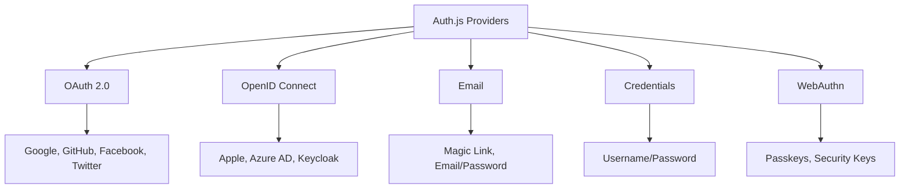

# Providers

## Introduction
Authentication providers in Auth.js are services that allow users to sign in using external accounts (OAuth, OpenID Connect) or custom credentials. They abstract the complexity of various authentication protocols into a unified interface.

## Why we need providers
Building and maintaining individual authentication integrations (Google, GitHub, email, etc.) is time-consuming and error-prone. Providers encapsulate the protocol-specific details, offering a consistent way to add authentication methods.

## Problem statement
How do we integrate multiple authentication methods (OAuth 2.0, OpenID Connect, email magic link, credentials) into a Next.js application using a unified API while handling provider-specific nuances?

## Real-world story
A startup needed to add "Sign in with Apple" alongside existing Google and GitHub logins. Instead of implementing Apple's JWT-based authentication from scratch, they used Auth.js's Apple provider, saving weeks of development time.

## Real-world analogy
**Providers**: Like universal power adapters - they convert different international plug standards (authentication protocols) to work with your device (application) through a single interface.

## Visual explanation
```
User Clicks "Sign in with Google"
        ↓
Auth.js Google Provider Handles
        ↓
OAuth 2.0 Flow with Google
        ↓
Returns User Profile to Auth.js
        ↓
Auth.js Creates Session/JWT
```

## Mermaid Diagram 1: Provider Types


## Internal working
**Provider lifecycle**:
1. **Initialization**: Provider configured with client ID/secret and endpoints
2. **Sign-in flow**: 
   - Redirects user to provider's authorization endpoint
   - Handles callback with authorization code
   - Exchanges code for tokens
   - Fetches user profile (if needed)
3. **Token handling**: 
   - Stores access/refresh tokens in account object
   - Uses access token for API calls (if requested)
   - Refreshes tokens when expired (if refresh token available)
4. **Session integration**: 
   - Maps provider user data to User object
   - Calls callbacks (signIn, jwt, session)
   - Creates final session/JWT

## Step-by-step flow (OAuth provider)
1. User clicks "Sign in with Google"
2. Browser redirected to: `https://accounts.google.com/o/oauth2/v2/auth?params...`
3. User consents to requested permissions
4. Google redirects back to: `https://yourapp.com/api/auth/callback/google?code=...`
5. Auth.js Google provider:
   - Validates state parameter (CSRF protection)
   - Exchanges code for tokens at Google's token endpoint
   - Retrieves user profile from Google's userinfo endpoint
   - Normalizes user data to standard format
6. Auth.js continues with:
   - `signIn` callback (allow/block sign-in)
   - `jwt` callback (encode user data into token)
   - `session` callback (format session object)
7. Session created and cookie set

## Provider categories
### OAuth 2.0 Providers
- Generic OAuth 2.0 (for custom implementations)
- Specific: Google, GitHub, Facebook, Twitter, LinkedIn, Twitch, etc.

### OpenID Connect Providers
- Generic OIDC (discovery-based)
- Specific: Apple, Azure AD, Keycloak, Auth0, Okta, Firebase

### Email Providers
- Email (magic link)
- Credentials (email/password)

### Specialty Providers
- Credentials (username/password)
- WebAuthn (passkeys, security keys)
- LDAP
- SAML (via community packages)

## Implementation
### Using built-in providers
```typescript
// app/api/auth/[...nextauth]/route.ts
import NextAuth from "next-auth"
import GoogleProvider from "next-auth/providers/google"
import GitHubProvider from "next-auth/providers/github"
import CredentialsProvider from "next-auth/providers/credentials"

export const { GET, POST } = NextAuth({
  providers: [
    GoogleProvider({
      clientId: process.env.GOOGLE_ID,
      clientSecret: process.env.GOOGLE_SECRET,
      authorization: {
        params: {
          scope: "openid email profile"
        }
      }
    }),
    GitHubProvider({
      clientId: process.env.GITHUB_ID,
      clientSecret: process.env.GITHUB_SECRET,
    }),
    CredentialsProvider({
      name: "Credentials",
      credentials: {
        email: { label: "Email", type: "email" },
        password: { label: "Password", type: "password" }
      },
      async authorize(credentials) {
        // Add your own logic here
        const user = { id: "1", name: "John Doe", email: "john@example.com" }
        
        if (user) {
          return user
        } else {
          return null
        }
      }
    })
  ]
})
```

### Configuring OAuth providers
Common configuration options:
```javascript
GoogleProvider({
  clientId: process.env.GOOGLE_ID,
  clientSecret: process.env.GOOGLE_SECRET,
  // Optional: customize authorization URL params
  authorization: {
    params: {
      scope: "openid email profile https://www.googleapis.com/auth/calendar.readonly"
    }
  },
  // Optional: customize profile mapping
  profile(profile) {
    return {
      id: profile.sub,
      name: profile.name,
      email: profile.email,
      image: profile.picture,
    }
  }
})
```

### Custom provider example (OAuth 2.0)
```typescript
import { OAuthConfig } from "next-auth/providers"

export const MyCustomProvider = (options: Record<string, any>): OAuthConfig<any> => ({
  id: "my-custom",
  name: "My Custom",
  type: "oauth",
  authorization: { 
    url: "https://api.example.com/oauth/authorize",
    params: { scope: "read write" }
  },
  token: { 
    url: "https://api.example.com/oauth/token" 
  },
  userinfo: { 
    url: "https://api.example.com/me" 
  },
  profile(profile) {
    return {
      id: profile.id,
      name: `${profile.first_name} ${profile.last_name}`,
      email: profile.email,
      image: profile.avatar_url,
    }
  },
  options: options
})
```

## Folder structure with providers
```
src/
├── app/
│   └── api/
│       └── auth/
│           └── [...nextauth]/
│               └── route.ts
├── lib/
│   └── providers/
│       ├── index.ts
│       ├── custom-provider.ts
│       └── oidc-provider.ts
├── types/
│   └── next-auth.d.ts
└── components/
    ├── SignInButton.tsx
    └── ProviderButtons.tsx
```

## Best practices
**Provider selection**:
- Use built-in providers when available (well-maintained, secure)
- Prefer OpenID Connect over OAuth 2.0 when possible (standardized)
- Consider security maturity of provider (2FA support, audit logs)
- Evaluate data privacy policies and compliance (GDPR, HIPAA, etc.)

**Configuration**:
- Use environment variables for all secrets (never hardcode)
- Request minimal scopes necessary for your application
- Configure redirect URIs exactly as required by provider
- Enable PKCE for public clients if supported (though Auth.js handles this)
- Set appropriate `authorization.params` for required scopes
- Implement custom `profile` function to map user data correctly

**Error handling**:
- Implement proper error handling in `authorize` (credentials) or `profile` (OAuth)
- Log authentication failures for monitoring (without sensitive data)
- Provide user-friendly error messages via `theme.signIn.signInErrorMessage`
- Handle account linking/unlinking scenarios gracefully

**Security**:
- Validate email domains for organizational accounts
- Implement allow/deny lists for email providers
- Consider just-in-time (JIT) provisioning vs pre-registered users
- Refresh token rotation where supported
- Monitor for token abuse (unusual locations, times)

## Common mistakes
- Using the same client credentials across environments
- Forgetting to set redirect URIs in provider developer console
- Requesting excessive scopes ("scope creep")
- Not handling missing or unexpected fields in profile data
- Misconfiguring `authorization.params` (wrong scope format)
- Using HTTP redirect URIs in production (should be HTTPS)
- Not enabling required APIs in provider console (e.g., Google People API)
- Ignoring token expiration and refresh logic
- Overlooking provider-specific requirements (e.g., Apple's domain association)
- Not testing provider flow in incognito/private browsing
- Missing state parameter validation (CSRF protection)

## Security considerations
**OAuth/OIDC specific**:
- **Authorization code interception**: Mitigated by PKCE (handled by Auth.js)
- **Token theft**: Use short-lived access tokens, refresh token rotation
- **Confused deputy problem**: Validate audience (`aud`) in ID tokens
- **Redirect URI manipulation**: Exact match validation (done by providers)
- **Code replay**: Single-use authorization codes (provider responsibility)
- **PKCE bypass**: Ensure PKCE is enabled for public clients (Auth.js default)
- **Implicit flow avoidance**: Auth.js uses authorization code flow by default

**Provider-specific**:
- Google: Enable required APIs (People API for contacts, etc.)
- GitHub: Set correct repository/org permissions
- Apple: Configure associated domains and enable Sign In with Apple
- Facebook: Implement app review for permissions
- Twitter: Follow developer policy and rate limits
- Azure AD: Configure app permissions and consent policies

## Performance notes
- **Network latency**: Each provider adds roundtrips to their servers
- **Token validation**: OIDC providers allow faster validation (JWKS caching)
- **Profile fetching**: Some providers require additional API calls for user data
- **Rate limits**: Be aware of provider API rate limits (especially during development)
- **Caching**: Consider caching non-sensitive profile data (avatar, name)
- **Parallelization**: Independent providers can be initiated simultaneously
- **Payload size**: Minimize data stored in JWT from provider responses
- **Connection pooling**: Use HTTP agent pooling for provider API calls

## Interview questions
1. What's the difference between OAuth 2.0 and OpenID Connect providers?
2. How do you add a custom OAuth provider to Auth.js?
3. What information is typically returned in the `profile` callback?
4. How do you handle token refresh for providers that support it?
5. What security measures does Auth.js implement for providers?
6. How would you debug a "state mismatch" error with a provider?
7. How do you request additional scopes beyond basic profile?
8. What's the purpose of the `authorization.params` option?
9. How do you handle providers that don't return email addresses?
10. What's the difference between `providerId` and `provider` in the account object?

## MCQs
1. Which protocol does Auth.js use by default for providers like Google and GitHub?
   a) SAML
   b) OpenID Connect
   c) OAuth 2.0 Authorization Code Flow
   d) WS-Federation
   Answer: c

2. Which method is used to customize how user data is mapped from a provider?
   a) JWT callback
   b) Session callback
   c) Profile function
   d) SignIn callback
   Answer: c

3. What is the purpose of the `state` parameter in OAuth flows?
   a) To store user session data
   b) To prevent CSRF attacks
   c) To specify requested scopes
   d) To enable refresh tokens
   Answer: b

4. Which provider type would you use for username/password authentication?
   a) OAuthProvider
   b) EmailProvider
   c) CredentialsProvider
   d) FormProvider
   Answer: c

5. How do you enable PKCE for OAuth providers in Auth.js?
   a) Set `pkce: true` in options
   b) It's enabled by default for OAuth 2.0 providers
   c) Use the `OAuthPKCEProvider` wrapper
   d) PKCE is not supported
   Answer: b

## Practice exercise
Configure three different provider types:
1. Google (OAuth 2.0/OIDC)
2. GitHub (OAuth 2.0)
3. Credentials (email/password) with dummy validation
Add custom profile mapping to extract avatar URLs and add them to the session.

## Debugging exercise
"access_denied" error from GitHub provider.
Check:
1. OAuth App permissions in GitHub developer settings
2. Correct client ID and secret from GitHub
3. Redirect URL matches exactly (including trailing slash)
4. No extra spaces in environment variables
5. GitHub account not restricted by organization policies
6. Not exceeding GitHub OAuth application limits
7. Using correct provider ID (github not github-oauth2)
8. Not trying to access protected resources without proper scopes
9. GitHub service status (check www.githubstatus.com)
10. Using latest NextAuth version (older versions had bugs)

## Real-world scenario
Financial institution authentication requirements:
- Corporate clients: SAML via Azure AD
- Retail customers: Username/password + TOTP 2FA
- Partnerships: OAuth with trusted partners (limited scope)
- Employees: Windows Integrated Authentication (Kerberos)
- Auditors: Just-in-time access with expiration
- All actions require step-up authentication for transfers >$10k

## Mini project
Create a provider comparison tool that:
- Lists all available Auth.js providers
- Shows required environment variables for each
- Displays typical user profile fields
- Indicates support for refresh tokens
- Shows documentation links
- Includes a "quick start" code snippet for each
- Allows toggling between OAuth 2.0 and OIDC modes where applicable