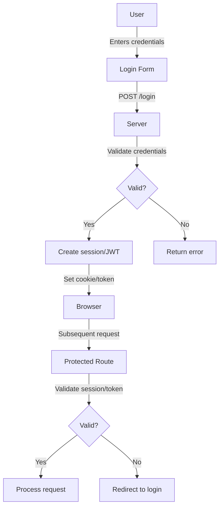
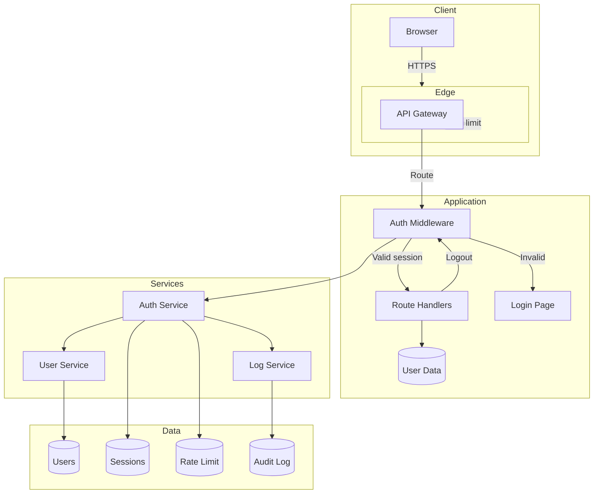

# Authentication Flow

## Introduction
An authentication flow is the sequence of steps that occurs when a user proves their identity to a system. Understanding the flow helps in implementing secure authentication and debugging issues.

## Why we need to understand the flow
Knowing the exact steps helps implement security controls at each point, prevents common vulnerabilities, and ensures a smooth user experience.

## Problem statement
How do we design an authentication process that is both secure and user-friendly, while protecting against common attacks like credential theft, session hijacking, and replay attacks?

## Real-world story
When you log into your email, you enter your password, the server checks it, creates a session, and sends you a cookie. Each step has security checks: password is hashed, session ID is random, cookie is secure, and each request validates the session.

## Real-world analogy
**Authentication flow**: Like going through airport security:
1. Show ID (credential submission)
2. Agent checks ID against database (validation)
3. Get boarding pass (session creation)
4. Scan boarding pass at gate (token validation)
5. Board plane (access granted)

## Visual explanation
```
User → Submit credentials → Server validates → Create session → Send token/cookie → 
Client stores → Subsequent requests include token → Server validates → Grant access
```

## Mermaid Diagram 1: Basic Authentication Flow


## Internal working
**Step-by-step details**:
1. **Credential submission**: User enters username/password (or uses social login)
2. **Transport security**: Credentials sent over HTTPS (POST body, not URL)
3. **Input validation**: Validate format (email, password length) before processing
4. **Credential lookup**: Find user by email/username in database
5. **Password verification**: Compare hash of submitted password with stored hash
6. **Account state check**: Ensure account is active, not locked, not expired
7. **Session creation**: Generate secure session ID or sign JWT
8. **Session storage**: Store session server-side (for sessions) or note issued token (for stateless)
9. **Response**: Set secure cookie (HttpOnly, Secure, SameSite) or return token in body/header
10. **Client storage**: Store cookie automatically or token in memory/storage
11. **Subsequent requests**: Client sends credentials (cookie/header) with each request
12. **Middleware validation**: Extract credentials, validate (lookup session or verify token)
13. **User context**: Attach user info to request for route handlers
14. **Access decision**: Proceed if valid, else return 401/403

## Step-by-step flow (detailed with security considerations)
1. **GET /login**: Serve login page over HTTPS with CSRF protection
2. **POST /login**: 
   - Validate CSRF token
   - Sanitize input (email format, password length)
   - Rate limit by IP/account to prevent brute force
   - Lookup user by email (case-insensitive)
   - If not found, return generic error (avoid user enumeration)
   - Verify password hash with appropriate work factor
   - On success: 
     * Generate session ID (128+ bit cryptographically random)
     * Store session: { userId, expiresAt, createdAt, ipAddress, userAgent }
     * Set cookie: `session_id=...; HttpOnly; Secure; SameSite=Strict; Max-Age=3600; Path=/`
     * Log successful login (user ID, timestamp, IP)
     * Redirect to intended page or dashboard
   - On failure:
     * Increment failed attempt counter
     * Log failed attempt
     * Return generic error (same as user not found)
3. **Subsequent request**:
   - Middleware reads cookie
   - Looks up session in store (Redis/DB)
   - Validates session not expired and IP/User-Agent match (optional)
   - Updates lastAccessed if sliding expiration
   - Attaches user object to request
   - Calls next middleware/handler
4. **Logout**:
   - Clear session from store
   - Set cookie with expired date: `session_id=deleted; Max-Age=0; Path=/`
   - Redirect to login page

## Mermaid Diagram 2: Detailed Flow with Security Checks
```mermaid
sequenceDiagram
    participant User
    participant Browser
    participant Client as Browser JS
    participant Server
    participant Auth as Auth Service
    participant DB as Database
    participant Log as Audit Log
    User->>Browser: Load login page (HTTPS)
    Browser->>Server: GET /login
    Server-->>Browser: HTML + CSRF token
    User->>Browser: Enter credentials
    Browser->>Client: JS validation (email/password length)
    Client->>Browser: Submit form
    Browser->>Server: POST /login {email, password, csrf_token}
    Server->>Server: Validate CSRF token
    Server->>Server: Rate limit check (/IP and /account)
    Server->>DB: Find user by email
    alt User not found
        Server-->>Browser: 200 {error: "Invalid credentials"}
    else User found
        Server->>Server: bcrypt.compare(password, storedHash)
        alt Password incorrect
            Server->>Log: Log failed attempt
            Server-->>Browser: 200 {error: "Invalid credentials"}
        else Password correct
            Server->>Server: Check account status (active, not locked)
            alt Account locked/disabled
                Server->>Log: Log locked account attempt
                Server-->>Browser: 403 {error: "Account locked"}
            else Account active
                Server->>Server: Generate sessionId (crypto.randomBytes)
                Server->>DB: Store session {userId, expiresAt, ip, userAgent}
                Server->>Log: Log successful login
                Server-->>Browser: Set-Cookie: session_id=...; HttpOnly; Secure; SameSite=Strict
                Server-->>Browser: 302 /dashboard
            end
        end
    end
    Browser->>Browser: Follow redirect to /dashboard
    Browser->>Server: GET /dashboard (with cookie)
    Server->>Server: Extract session_id from cookie
    Server->>DB: Lookup session
    alt Session not found/expired
        Server-->>Browser: 401 {error: "Unauthorized"}
    else Session valid
        Server->>Server: Optional: check IP/User-Agent match
        Server->>Server: Update lastAccessed (if sliding expiration)
        Server->>Server: Attach user data to request
        Server->>Server: Call dashboard handler
        Server-->>Browser: 200 {dashboard HTML}
    end
```

## Architecture
**Typical web app authentication architecture**:
- **Client**: Browser with HTML/JS, cookie storage
- **Edge**: CDN/WAF (rate limiting, bot protection)
- **API Gateway**: Load balancing, SSL termination, basic auth
- **Application Servers**: 
  - Public routes: login page, public assets
  - Auth middleware: session/token validation
  - Route handlers: protected resources
- **Services**: 
  - Auth service: credential validation, session management
  - User service: profile data
  - Log service: audit logging
- **Data Stores**:
  - User table: id, email, password_hash, status, created_at
  - Session table/sid: id, user_id, expires_at, data
  - Rate limit store: ip, account, timestamp, count
  - Audit log: immutable append-only store

## Mermaid Diagram 3: System Components


## Implementation
### Next.js App Router example (credentials provider)
```typescript
// app/api/auth/[...nextauth]/route.ts
import NextAuth from 'next-auth'
import CredentialsProvider from 'next-auth/providers/credentials'
import bcrypt from 'bcrypt'
import { getUserByEmail } from '@/lib/db'

export const authOptions = {
  providers: [
    CredentialsProvider({
      name: 'Credentials',
      credentials: {
        email: { label: 'Email', type: 'email' },
        password: { label: 'Password', type: 'password' }
      },
      async authorize(credentials) {
        if (!credentials?.email || !credentials?.password) {
          throw new Error('Invalid credentials')
        }
        
        const user = await getUserByEmail(credentials.email.toLowerCase())
        
        // User not found - return generic error to prevent enumeration
        if (!user) {
          // Log attempt for monitoring (but don't reveal existence)
          await logAuthAttempt(false, credentials.email, 'User not found')
          throw new Error('Invalid credentials')
        }
        
        // Check account status
        if (!user.isActive) {
          await logAuthAttempt(false, user.email, 'Account inactive')
          throw new Error('Account is disabled')
        }
        
        // Verify password
        const isValid = await bcrypt.compare(
          credentials.password,
          user.passwordHash
        )
        
        if (!isValid) {
          await logAuthAttempt(false, user.email, 'Invalid password')
          throw new Error('Invalid credentials')
        }
        
        // Successful login
        await logAuthAttempt(true, user.email, 'Success')
        
        // Return user object (will be saved in JWT or session)
        return {
          id: user.id,
          email: user.email,
          name: user.name,
          role: user.role
        }
      }
    })
  ],
  session: {
    strategy: 'jwt' // or 'database'
  },
  callbacks: {
    async jwt({ token, user, account, trigger, session }) {
      // Initial sign in
      if (account && user) {
        return {
          ...token,
          accessToken: account.access_token,
          userId: user.id,
          email: user.email,
          name: user.name,
          role: user.role
        }
      }
      // Return existing token with user data if session exists
      if (session?.sessionToken) {
        // In a real app, you'd fetch fresh user data or validate session
        return { ...token, ...session.user }
      }
      return token
    },
    async session({ session, token }) {
      // Send properties to the client
      session.user.id = token.userId
      session.user.email = token.email
      session.user.name = token.name
      session.user.role = token.role
      return session
    }
  },
  pages: {
    signIn: '/auth/signin',
    error: '/auth/error'
  },
  secret: process.env.NEXTAUTH_SECRET,
  // Security settings
  cookies: {
    sessionToken: {
      name: '__Secure-next-auth.session-token',
      options: {
        httpOnly: true,
        sameSite: 'lax',
        path: '/',
        secure: true, // requires HTTPS in production
        maxAge: 30 * 24 * 60 * 60 // 30 days
      }
    }
  }
}

const handler = NextAuth(authOptions)
export { handler as GET, handler as POST }
```

### Manual implementation with Next.js middleware
```typescript
// middleware.ts
import { NextResponse } from 'next/server'
import type { NextRequest } from 'next/server'

export async function middleware(request: NextRequest) {
  const { pathname } = request.nextUrl
  
  // Public paths
  if (
    pathname.startsWith('/_next') ||
    pathname.startsWith('/api/auth') ||
    pathname === '/login' ||
    pathname === '/register' ||
    pathname === '/'
  ) {
    return NextResponse.next()
  }
  
  // Check session
  const sessionToken = request.cookies.get('session_token')?.value
  
  if (!sessionToken) {
    const url = request.nextUrl.clone()
    url.pathname = '/login'
    return NextResponse.redirect(url)
  }
  
  // Validate session (simplified)
  const session = await validateSession(sessionToken)
  if (!session || !session.userId) {
    const url = request.nextUrl.clone()
    url.pathname = '/login'
    return NextResponse.redirect(url)
  }
  
  // Add user to request headers (for API routes)
  const requestHeaders = new Headers(request.headers)
  requestHeaders.set('x-user-id', session.userId)
  requestHeaders.set('x-user-role', session.role || 'user')
  
  return NextResponse.next({
    request: {
      headers: requestHeaders
    }
  })
}

// lib/session.ts
import { cookie } from 'cookie'
import { verify } from 'jsonwebtoken'

export async function validateSession(token: string) {
  try {
    // In production, use proper session store (Redis, DB)
    // This example uses JWT for simplicity
    const payload = verify(token, process.env.JWT_SECRET!) as {
      userId: string
      role: string
      exp: number
    }
    
    // Check expiration
    if (Date.now() >= payload.exp * 1000) {
      return null
    }
    
    return {
      userId: payload.userId,
      role: payload.role
    }
  } catch (error) {
    return null
  }
}
```

## Folder structure
```
src/
├── app/
│   ├── api/
│   │   └── auth/
│   │       └── [...nextauth]/
│   │           └── route.ts
│   ├── login/
│   │   └── page.tsx
│   └── dashboard/
│       └── page.tsx
├── lib/
│   ├── auth.ts
│   ├── db.ts
│   └── session.ts
├── middleware/
│   └── auth.ts
├── types/
│   └── auth.ts
└── utils/
    ├── logger.ts
    └── rateLimiter.ts
```

## Best practices
**Credential handling**:
- Always use HTTPS (enforce with HSTS)
- Never log passwords or sensitive data
- Use strong, adaptive hashing (bcrypt/scrypt/argon2) with sufficient work factor
- Implement rate limiting by IP and account
- Use generic error messages to prevent user enumeration
- Validate and sanitize all input (email format, length limits)
- Consider using email as username (lowercase normalized)

**Session management**:
- Generate session IDs with cryptographically random bytes (min 128 bits)
- Store sessions in secure, fast store (Redis) with expiration
- Set HttpOnly, Secure, SameSite=Strict cookies
- Implement idle timeout and absolute timeout
- Regenerate session ID after login and privilege changes
- Invalidate sessions on password change, logout, suspicious activity
- Consider device fingerprinting for step-up auth

**Transport security**:
- Set Secure flag on all auth cookies
- Use SameSite attribute to mitigate CSRF
- Implement HSTS header
- Use CSP to mitigate XSS
- Validate redirect URLs to prevent open redirect

**Monitoring and logging**:
- Log all auth attempts (success/failure) with timestamp, IP, user agent
- Alert on brute force attempts (multiple failures)
- Monitor for anomalous logins (new device, location)
- Implement account lockout after excessive failures
- Provide account recovery via email/SMS

## Common mistakes
- Storing passwords in plaintext or weak hashes (MD5, SHA1)
- Using predictable session IDs (incremental, based on username)
- Missing HttpOnly flag (exposes token to XSS)
- Missing Secure flag (transmits over HTTP)
- Using SameSite=None without Secure (blocked by modern browsers)
- Not implementing rate limiting (allows brute force)
- Returning specific error messages (user exists/wrong password)
- Forgetting to invalidate old sessions on password change
- Using long-lived tokens without refresh mechanism
- Storing tokens in localStorage (vulnerable to XSS)
- Not validating redirect URLs in OAuth flows
- Skipping CSRF protection on login forms
- Using SMS for 2FA without considering SIM swap risk
- Logging sensitive data (tokens, PII) in debug logs

## Security considerations
**Authentication-specific threats**:
- **Brute force**: Mitigate with rate limiting, account lockout, CAPTCHA after N attempts
- **Credential stuffing**: Use breach password detection, multi-factor authentication
- **Session hijacking**: Short-lived sessions, IP/User-Agent binding, secure cookie flags
- **Man-in-the-middle**: Enforce HTTPS everywhere, HSTS, certificate pinning (for apps)
- **Phishing**: Use domain-verified emails, security keys (WebAuthn), user education
- **Credential leakage**: Never log passwords, use secrets management, rotate keys
- **Replay attacks**: Use nonces in challenges, short-lived tokens, timestamp validation
- **Username enumeration**: Use generic error messages, constant-time comparison
- **Session fixation**: Regenerate session ID after login
- **Cookie theft**: HttpOnly + Secure + SameSite, short session lifetime

**Additional considerations**:
- Implement multi-factor authentication (TOTP, WebAuthn, SMS as last resort)
- Use breach password detection services (HaveIBeenPwned API)
- Consider passwordless authentication (magic links, WebAuthn)
- Implement account unlock via email confirmation
- Provide login history and active sessions page for users
- Allow users
- Session invalidation on password change from other devices

## Performance notes
- **Hashing cost**: Balance security vs performance (bcrypt cost 10-12 is typical)
- **Session store latency**: Use Redis with connection pooling, consider local cache for hot sessions
- **Database indexing**: Index email/username columns for fast lookups
- **Caching**: Cache user permissions/roles with short TTL (invalidate on change)
- **Async operations**: Use async/await for DB calls to avoid blocking event loop
- **CDN**: Serve login page assets via CDN, but API must originate from server
- **Rate limiting**: Use distributed cache (Redis) for shared counters across instances
- **Logging**: Asynchronous logging to avoid slowing auth flow

## Interview questions
1. Walk me through the steps of a typical login flow.
2. How do you prevent user enumeration during login?
3. What is the purpose of salt in password hashing?
4. How would you implement rate limiting for login attempts?
5. What security flags should you set on authentication cookies?
6. How do you handle "remember me" functionality securely?
7. What is session fixation and how do you prevent it?
8. When would you require re-authentication for sensitive operations?
9. How do you log out a user from all devices?
10. What are the differences between session-based and token-based auth?

## MCQs
1. Which HTTP method should be used for submitting login credentials?
   a) GET
   b) POST
   c) PUT
   d) DELETE
   Answer: b

2. What is the primary purpose of salt in password hashing?
   a) To make the hash longer
   b) To prevent rainbow table attacks
   c) To make hashing faster
   d) To encrypt the password
   Answer: b

3. Which cookie attribute prevents JavaScript access to the cookie?
   a) Secure
   b) SameSite
   c) HttpOnly
   d) Path
   Answer: c

4. What is a common technique to prevent brute force attacks on login?
   a) Increasing password length requirements
   b) Using CAPTCHA after every attempt
   c) Implementing rate limiting by IP and account
   d) Requiring special characters in passwords
   Answer: c

5. Which of the following is NOT a recommended practice for session management?
   - Using cryptographically random session IDs
   - Setting short expiration times
   - Storing session data in localStorage
   - Regenerating session ID after login
   Answer: Storing session data in localStorage

## Practice exercise
Build a secure login endpoint:
1. Accept email and password via POST
2. Validate input format (email regex, password length)
3. Implement rate limiting (5 attempts/minute/IP)
4. Lookup user by email (case-insensitive)
5. Verify password using bcrypt
6. On success: generate session, set secure cookie, log event
7. On failure: increment counter, log event, return generic error
8. Add logout endpoint that clears session and cookie

## Debugging exercise
Users report intermittent login failures.
Check:
1. Session store connectivity (Redis/DB)
2. Cookie domain/path settings causing mismatch
3. Clock skew between servers causing premature expiration
4. Load balancer sticky sessions not enabled (if using in-memory store)
5. Race condition in session creation/deletion
6. Cookie size limits exceeded (too much data in session)
7. Intermediate proxy stripping Set-Cookie or Cookie headers

## Real-world scenario
Design auth for a healthcare portal (HIPAA compliance):
- Multi-factor authentication required for PHI access
- Session timeout: 15 minutes of inactivity
- All access logged with user, timestamp, IP, action
- Automatic logout when device locks
- Biometric authentication available on mobile
- Break-glass access for emergencies with audit trail
- Regular access review reports

## Mini project
Build a login system with:
- Email/password login with "show password" toggle
- Remember me checkbox (extends session to 30 days)
- Forgot password flow with email reset link
- Rate limiting (5 attempts/minute, CAPTCHA after 3 failures)
- Login attempt tracking (show last login time/location)
- Session management with idle timeout
- Login page with background image and responsive design
- Error handling for network issues, server errors
- Accessibility compliance (WCAG 2.1 AA)
- Dark/light mode toggle

## Interview coding question
Implement a secure login rate limiter:
```javascript
class RateLimiter {
  constructor(maxAttempts, windowMs) {
    // Initialize storage (e.g., Map for single instance, Redis for distributed)
  }
  
  isAllowed(ip) {
    // Return true if request is allowed, false if rate limited
    // Also increment counter for this IP
  }
  
  reset(ip) {
    // Reset counter for this IP (e.g., on successful login)
  }
}

// Usage in login handler:
// if (!rateLimiter.isAllowed(req.ip)) {
//   return res.status(429).send('Too many attempts');
// }
// 
// // After successful login:
// rateLimiter.reset(req.ip);
```

## Summary
A secure authentication flow involves multiple layers: transport security, input validation, credential verification, session management, and monitoring. Each step must defend against specific threats while maintaining usability. Key principles include defense in depth, least privilege, fail-safe defaults, and comprehensive logging.

## Cheat sheet
**Password storage**:
- Algorithm: bcrypt (cost=12), scrypt, or argon2
- Salt: generated per password, stored alongside hash
- Pepper: optional application-secret added before hashing

**Session cookie**:
```
session_id=abc123; 
HttpOnly; 
Secure; 
SameSite=Strict; 
Path=/; 
Max-Age=3600
```

**Rate limiting**:
- 5-10 attempts per username/IP per 15 minutes
- CAPTCHA after 3-5 failed attempts
- Lock account after 5-10 failed attempts (temporarily)

**Logging**:
- Log: timestamp, event type, user ID/IP, outcome, user agent
- Never log: passwords, session tokens, sensitive data
- Store logs securely, monitor for anomalies

**Error messages**:
- Always generic: "Invalid email or password"
- Same timing for user exists/doesn't exist

**Session management**:
- ID: 128+ bit cryptographically random
- Storage: server-side (Redis) or signed JWT
- Expiration: 15-30 min idle, 8-24h absolute
- Invalidate: on logout, password change, privilege elevation