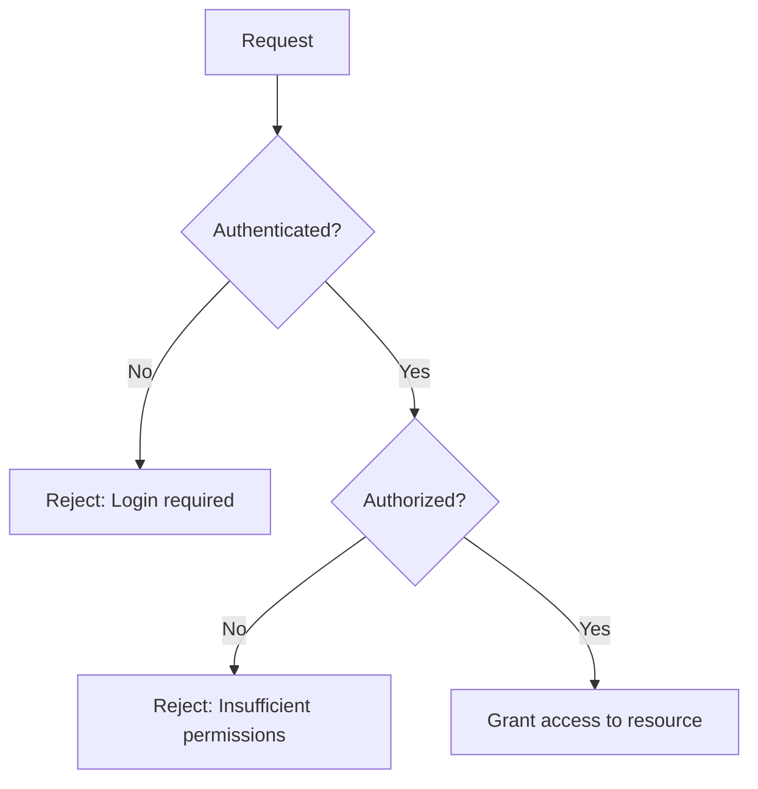
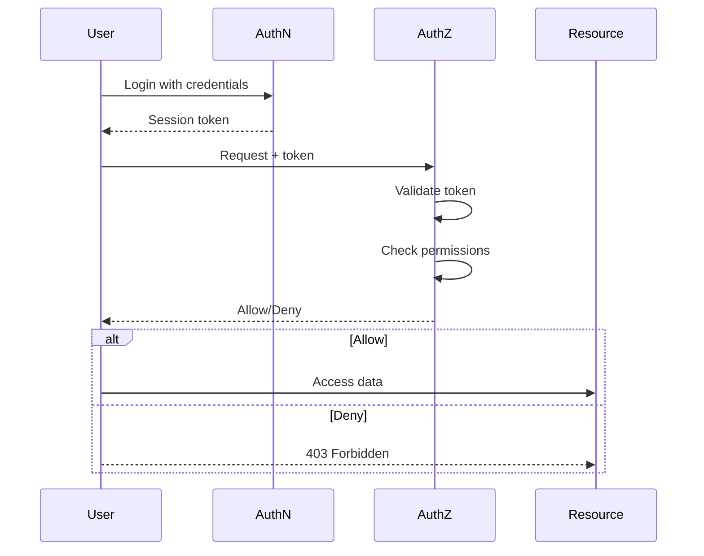
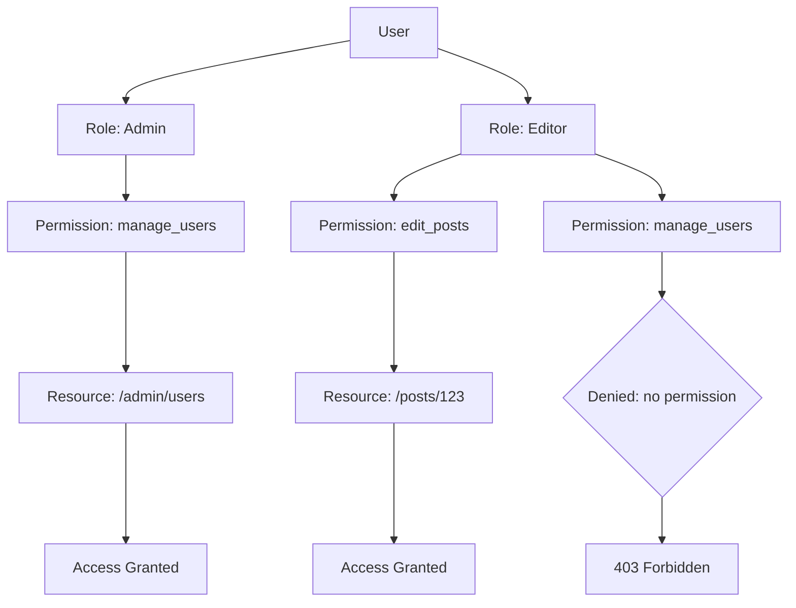
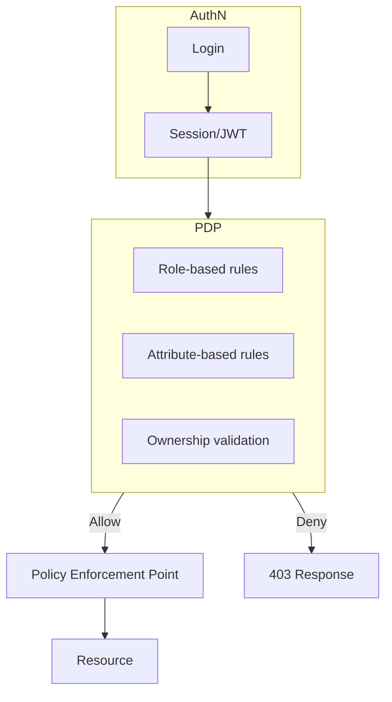

# Authentication vs Authorization

## Introduction
Authentication (AuthN) verifies identity. Authorization (AuthZ) determines permissions. Both are essential for access control but serve different purposes.

## Why we need both
A system might know who you are (authentication) but still need to decide what you're allowed to do (authorization). Conflating the leads to security flaws like privilege escalation or over-privileged users.

## Problem statement
How do we separate the concerns of verifying identity and checking permissions while maintaining a cohesive security model?

## Real-world story
Bob shows his driver's license (authentication) to enter a bar. The bouncer checks his age (authorization) to allow alcohol purchase. Same ID, different checks for different privileges.

## Real-world analogy
Authentication is like getting a badge at a conference:
- Badge shows your name and photo (proof of identity)
- Different colored stickers on badge indicate access levels (workshop A, workshop B, keynote)
- You need the badge to enter (authN) and the right sticker for specific rooms (AuthZ)

## Visual explanation
```
Authentication: Who are you? → Check credentials
Authorization: What can you do? → Check permissions
```

## Mermaid Diagram 1: AuthN vs AuthZ Flow


## Internal working
**Authentication phase**:
1. Present credentials (password, token, cert)
2. System validates against identity store
3. Creates security principal (user object with roles/claims)

**Authorization phase**:
1. Security principal presented with resource request
2. System evaluates policies (RBAC, ABAC, etc.)
3. Grant or deny based on rules

## Mermaid Diagram 2: Combined Flow


## Step-by-step flow
1. User attempts to access protected resource
2. Middleware checks for valid authentication (session/JWT)
3. If invalid, return 401 Unauthorized
4. If valid, retrieve user identity and roles/claims
5. Authorization middleware evaluates rules:
   - Is user role allowed?
   - Does user have specific permission?
   - Does resource ownership match?
6. If authorized, proceed to handler; else return 403 Forbidden

## Mermaid Diagram 3: RBAC Authorization


## Architecture
- **AuthN layer**: Handles login, session creation, token validation
- **AuthZ layer**: Middleware or library that checks permissions
- **Policy engine**: Defines who can do what (often decoupled)
- **Resource endpoints**: Apply authz checks before processing

## Mermaid Diagram 4: Policy Decision Point


## Implementation
### Basic example (middleware)
```javascript
// middleware/auth.js
export function authenticate(req, res, next) {
  const sessionId = req.cookies.session_id
  if (!sessionId) return res.status(401).end()
  
  // Validate session (simplified)
  const session = getSession(sessionId)
  if (!session || session.expired) return res.status(401).end()
  
  req.user = session.user
  next()
}

export function authorize(requiredRole) {
  return function (req, res, next) {
    if (!req.user) return res.status(401).end()
    if (req.user.role !== requiredRole) 
      return res.status(403).end()
    next()
  }
}

// Usage in route
app.get('/admin', authenticate, authorize('admin'), handler)
```

### Production example (Next.js middleware)
```typescript
// middleware/auth.ts
import { NextResponse } from 'next/server'
import type { NextRequest } from 'next/server'

// Mock session validation
async function validateSession(token: string): Promise<{ userId: string; role: string } | null> {
  // In reality: verify JWT or check session store
  if (token === 'valid-admin-token') 
    return { userId: '1', role: 'admin' }
  if (token === 'valid-user-token')
    return { userId: '2', role: 'user' }
  return null
}

export async function middleware(request: NextRequest) {
  const { pathname } = request.nextUrl
  
  // Skip auth for public paths
  if (pathname.startsWith('/public') || pathname === '/login') 
    return NextResponse.next()
  
  const sessionToken = request.cookies.get('session_token')?.value
  
  if (!sessionToken) {
    const url = request.nextUrl.clone()
    url.pathname = '/login'
    return NextResponse.redirect(url)
  }
  
  const session = await validateSession(sessionToken)
  if (!session) {
    const url = request.nextUrl.clone()
    url.pathname = '/login'
    return NextResponse.redirect(url)
  }
  
  // Authorization check for admin routes
  if (pathname.startsWith('/admin') && session.role !== 'admin') {
    return new NextResponse('Unauthorized', { status: 403 })
  }
  
  // Attach user to request
  const requestHeaders = new Headers(request.headers)
  requestHeaders.set('x-user-id', session.userId)
  requestHeaders.set('x-user-role', session.role)
  
  return NextResponse.next({
    request: {
      headers: requestHeaders
    }
  })
}
```

### Folder structure
```
src/
├── middleware/
│   ├── auth.ts
│   └── permissions.ts
├── lib/
│   ├── auth.ts
│   └── rbac.ts
└── policies/
    ├── admin.ts
    └── user.ts
```

## Best practices
- Separate authn and authz concerns into different middleware/libraries
- Use principle of least privilege: start with no permissions, grant explicitly
- Cache authorization decisions when appropriate (with invalidation on role change)
- Log authorization decisions (especially denials) for audit
- Use centralized policy administration (e.g., Casbin, OPA) for complex systems
- Always authenticate before authorizing
- Use secure token storage (HTTP-only cookies, secure storage)

## Common mistakes
- Performing authorization before authentication (can't check perms of unknown user)
- Forgetting to protect all HTTP methods (only checking GET)
- Using role names directly in code instead of constants/enums
- Storing permissions in client-side code (bypassable)
- Not invalidating cached authz decisions when roles change
- Overly complex permission models that are hard to audit
- Trusting client-side authorization checks

## Security considerations
- **Privately**: Never expose permission logic to client
- **Granularity**: Start coarse (roles), refine to fine-grained (permissions) as needed
- **Consistency**: Apply same authz checks across API, SSR, and client transitions
- **Testing**: Test both positive and negative authz cases
- **Monitoring**: Alert on repeated authorization failures (potential attack)

## Performance notes
- Authz checks add minimal latency if cached
- Complex policies (ABAC) may require evaluation engine; consider latency
- Precompute permissions for frequent checks
- Use efficient data structures (bitmaps, tries) for role/permission lookup
- Cache user roles/permissions with short TTL (invalidated on change)

## Interview questions
1. Can you have authorization without authentication? Why/why not?
2. What's the difference between RBAC and ABAC?
3. How would you implement "user can only edit their own posts"?
4. When would you use a policy engine like OPA?
5. How do you test authorization logic?

## MCQs
1. Which comes first: authentication or authorization?
   a) Authorization
   b) Authentication
   c) Simultaneous
   d) Doesn't matter
   Answer: b

2. Which model assigns permissions to roles, then roles to users?
   a) ABAC
   b) RBAC
   c) ACL
   d) PBAC
   Answer: b

3. What does "principle of least privilege" mean?
   a) Users get all permissions by default
   b) Users get only permissions needed for their job
   c) Administrators have minimal permissions
   d) Permissions are based on seniority
   Answer: b

4. Which check prevents a user from viewing another user's profile?
   a) Role-based access control
   b) Authentication strength
   c) Object-level authorization
   d) Session timeout
   Answer: c

5. What is a common symptom of broken authorization?
   a) Users can't log in
   b) Pages load slowly
   c) Users see data they shouldn't
   d) Increased server CPU usage
   Answer: c

## Practice exercise
Create middleware that:
1. Validates JWT from cookie
2. Checks if user has 'admin' role
3. Returns 403 if not authorized
4. Allows request if authorized

## Debugging exercise
Given: Admin users can't access admin panel despite correct login.
Check:
1. Role stored correctly in session/token
2. Authorization middleware comparing roles
3. Role name case sensitivity (admin vs Admin)
4. Middleware order (auth before authz)
5. Cookie path/domain settings

## Real-world scenario
Design authz for a multi-tenant SaaS where:
- Tenant admins manage their own users
- Regular users can only access their tenant's data
- Support engineers need cross-tenant read-only access
- Billing department sees only invoices, not user data

## Mini project
Build role-based dashboard with:
- Admin: users, settings, reports
- Editor: create/edit content, view reports
- Viewer: view content only
- Login redirects to appropriate dashboard
- Navigation menu hides inaccessible links

## Interview coding question
Implement a function that checks if a user can access a resource:
```javascript
function canAccess(user, resource, action) {
  // user: { id, role: string, permissions: string[] }
  // resource: { type, ownerId, sensitivity }
  // action: 'read', 'write', 'delete'
  // return boolean
}
```

## Summary
Authentication confirms identity; authorization grants permissions. Effective systems layer both: verify who you are, then decide what you may do. Use RBAC for role-based needs, ABAC for attribute-driven policies, and always enforce checks on server side.

## Cheat sheet
- **AuthN**: Validate credentials → establish identity
- **AuthZ**: Check roles/permissions → allow/deny action
- **RBAC**: User → Role → Permission → Resource
- **ABAC**: User attributes + Resource attributes + Environment → Decision
- **Always**: Authenticate first, then authorize

## Related topics
- Session management
- Token-based authentication (JWT)
- OAuth 2.0 scopes
- Password hashing
- CSRF protection
- Audit logging