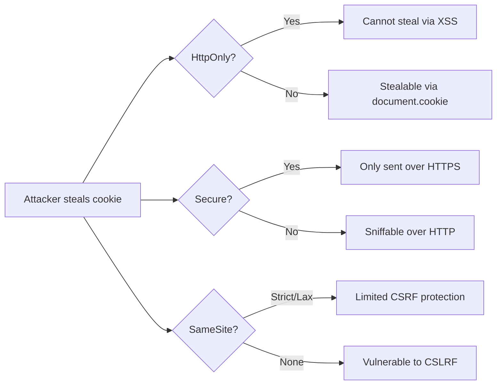

# Cookies in Authentication

## Introduction
Cookies are key-value pairs stored by browsers and sent with HTTP requests. They are fundamental for session management, storing tokens, and user preferences in web authentication.

## Why we need cookies
HTTP is stateless; cookies provide a mechanism to maintain state across requests. They enable persistent logins, shopping carts, and personalized experiences without requiring credentials on every request.

## Problem statement
How do we securely store and transmit authentication state between client and server while protecting against theft and tampering?

## Real-world story
When you check into a hotel, they give you a key card. You don't need to show ID again for room access, minibar, or gym—the key card proves your identity and permissions within the hotel's system.

## Real-world analogy
**Cookie**: A loyalty card at a coffee shop. The shop stamps it each visit (server updates data). You present it with each purchase (request) to get discounts (personalized service). The shop can disable the card (invalidate) if lost or abused.

## Visual explanation
```
Set-Cookie: session_id=abc123; HttpOnly; Secure; SameSite=Strict
Browser stores cookie → Sends with every request to domain → Server reads and validates
```

## Mermaid Diagram 1: Cookie Lifecycle
```mermaid
sequenceDiagram
    participant Browser
    participant Server
    Browser->>Server: POST /login
    Server-->>Browser: Set-Cookie: session=abc; HttpOnly; Secure
    Browser->>Server: GET /profile (includes cookie)
    Server-->>Browser: 200 OK (user data)
    Browser->>Server: POST /logout
    Server-->>Browser: Set-Cookie: session=deleted; Max-Age=0
```

## Internal working
**Setting cookies**:
- Server sends `Set-Cookie` header in HTTP response
- Browser stores cookie according to attributes (domain, path, expires, etc.)
- On subsequent requests, browser includes matching cookies in `Cookie` header

**Cookie attributes**:
- **Name=value**: The actual data (e.g., `session_id=abc123`)
- **Expires/Max-Age**: When cookie should be deleted
- **Domain**: Which hosts can send the cookie
- **Path**: Which URL paths should include the cookie
- **Secure**: Only send over HTTPS
- **HttpOnly**: Not accessible via JavaScript (mitigates XSS)
- **SameSite**: Controls cross-site request sending (Strict/Lax/None)
- **Priority**: Low/Medium/High (eviction preference under pressure)

## Step-by-step flow
1. User logs in via POST /login
2. Server validates credentials
3. Server creates session ID or token
4. Server sets cookie: `Set-Cookie: name=value; HttpOnly; Secure; SameSite=Strict; Path=/; Max-Age=3600`
5. Browser stores cookie
6. On next request to same domain/path, browser adds `Cookie: name=value` header
7. Middleware reads cookie, validates contents
8. Request proceeds or rejected based on validation
9. On logout or expiration, server sends `Set-Cookie` with past date to delete

## Mermaid Diagram 2: Cookie Attributes Flow
```mermaid
flowchart TD
    A[Set-Cookie Header] --> B{Has Secure?}
    B -->|Yes| C[Only sent over HTTPS]
    B -->|No| D[Sent over HTTP and HTTPS]
    A --> E{Has HttpOnly?}
    E -->|Yes| F[Not accessible via document.cookie]
    E -->|No| G[Accessible via JavaScript]
    A --> H{Has SameSite?}
    H -->|Strict| I[Only same-site requests]
    H -->|Lax| J[Same-site + top-level nav]
    H -->|None| K[All sites (requires Secure)]
    A --> L{Has Expires/Max-Age?}
    L -->|Yes| M[Expires at set time]
    L -->|No| N[Session cookie (deleted on browser close)]
```

## Architecture
**Cookie-based auth flow**:
1. Login endpoint sets authentication cookie
2. Protected routes middleware:
   - Reads Cookie header
   - Parses name-value pairs
   - Validates session ID or token signature
   - Attaches user context to request
   - Calls next or returns 401/403
3. Logout endpoint clears cookie via `Set-Cookie` with past expiration

## Mermaid Diagram 3: Cookie Theft Prevention


## Implementation
### Setting cookies (Next.js API)
```javascript
// lib/cookies.js
export function setAuthCookie(res, name, value, options = {}) {
  const defaults = {
    httpOnly: true,
    secure: process.env.NODE_ENV === 'production',
    sameSite: 'strict',
    path: '/',
    maxAge: 60 * 60 * 24 // 24 hours
  };
  
  const cookieOpts = { ...defaults, ...options };
  const cookie = [
    `${encodeURIComponent(name)}=${encodeURIComponent(value)}`,
    Object.entries(cookieOpts)
      .filter(([_, v]) => v !== undefined)
      .map(([k, v]) =>
        typeof v === 'number'
          ? `${k}=${v}`
          : k === 'true'
          ? k
          : `${k}=${v}`
      )
      .join('; ')
  ].join('; ');
  
  res.setHeader('Set-Cookie', cookie);
}

export function removeCookie(res, name, options = {}) {
  setAuthCookie(res, name, '', { ...options, maxAge: 0 });
}
```

### Reading cookies (Next.js API)
```javascript
// lib/cookies.js
export function getCookie(req, name) {
  const match = req.headers.cookie?.match(
    new RegExp(`(?:^|; )${encodeURIComponent(name)}=([^;]*)`)
  );
  return match ? decodeURIComponent(match[1]) : null;
}
```

### Middleware usage
```javascript
// middleware/auth.js
import { getCookie } from '@/lib/cookies';

export function authenticate(req, res, next) {
  const sessionId = getCookie(req, 'session_id');
  if (!sessionId) return res.status(401).end();
  
  const session = getSession(sessionId); // from session store
  if (!session || session.expired) {
    res.setHeader('Set-Cookie', 'session_id=deleted; Max-Age=0; Path=/');
    return res.status(401).end();
  }
  
  req.user = session.user;
  next();
}
```

## Folder structure
```
src/
├── lib/
│   ├── cookies.ts
│   ├── session.ts
│   └── auth.ts
├── middleware/
│   └── auth.ts
└── pages/
    ├── api/
    │   ├── login.ts
    │   ├── logout.ts
    │   └── protected.ts
    └── ...
```

## Best practices
- Always use `HttpOnly` for authentication cookies (prevents XSS theft)
- Always use `Secure` in production (requires HTTPS)
- Use `SameSite=Strict` or `Lax` to mitigate CSRF
- Set appropriate `Path` (usually `/`) and `Domain` (if needed for subdomains)
- Use `Max-Age` or `Expires` to limit lifetime (session cookies expire on close)
- Prefix cookie names with `__Host-` or `__Secure-` for additional security
- Rotate cookie values periodically (especially after privilege changes)
- Implement proper logout by clearing cookies with same attributes
- Consider cookie doubling or CSRF tokens for state-changing operations with SameSite=Lax
- Monitor cookie size (limit to 4KB; prefer minimal data like session ID)

## Common mistakes
- Forgetting `HttpOnly` (exposes token to JavaScript XSS theft)
- Missing `Secure` flag (transmits sensitive cookie over HTTP)
- Using `SameSite=None` without `Secure` (will be rejected by modern browsers)
- Setting overly broad domain (e.g., `.com` instead of `.example.com`)
- Storing sensitive data directly in cookies (should be session ID only)
- Not rotating session IDs after login (session fixation vulnerability)
- Using weak or predictable cookie values (use cryptographically random)
- Not setting expiration (creates persistent cookies unintentionally)
- Confusing `Max-Age` (seconds) with `Expires` (date string)
- Not handling cookie encoding (special characters, spaces)

## Security considerations
**Confidentiality**:
- Encrypt cookie contents if storing sensitive data (better: store ID only)
- Use `Secure` flag to prevent network eavesdropping
- Consider double-submit cookie pattern for CSRF with `SameSite=Lax`

**Integrity**:
- Sign cookie values to detect tampering (use HMAC)
- Detect and reject modified cookies
- Consider encrypting + signing (authenticated encryption)

**Availability**:
- Don't rely on cookies for critical functionality (users can clear/disable)
- Have fallback mechanisms for cookie-less clients (APIs, mobile apps)
- Monitor for cookie flooding attacks (oversized headers)

## Performance notes
- Cookie size directly impacts request header size (keep minimal)
- Large cookie counts/domains increase header overhead
- Consider moving to Authorization header or custom header for APIs
- Browser limits: 50 cookies per domain, 4KB per cookie
- Server-side: efficient cookie parsing (avoid regex on every request if possible)
- CDN caching: cookies often make responses uncacheable (consider varying by cookie)

## Interview questions
1. What does the `HttpOnly` flag prevent?
2. Why is the `Secure` flag important for authentication cookies?
3. How does `SameSite` attribute help with CSRF protection?
4. What's the difference between `max-age` and `expires`?
5. How do you securely implement "remember me" functionality?

## MCQs
1. Which cookie attribute prevents JavaScript access?
   a) Secure
   b) SameSite
   c) HttpOnly
   d) Path
   Answer: c

2. What is the primary security purpose of the `Secure` flag?
   a) Prevents cookie modification
   b) Ensures cookie only sent over HTTPS
   c) Makes cookie HTTP-only
   d) Sets expiration date
   Answer: b

3. Which SameSite value provides strongest CSRF protection?
   a) None
   b) Lax
   c) Strict
   d) Default
   Answer: c

4. What happens when you set `Max-Age=0` on a cookie?
   a) Cookie expires immediately
   b) Cookie becomes session-only
   c) Cookie lasts 1 second
   d) Attribute is ignored
   Answer: a

5. Which prefix indicates a cookie must be secure and host-only?
   a) __Secure-
   b) __Host-
   c) __Cookie-
   d) __Auth-
   Answer: b

## Practice exercise
Create a login function that:
1. Sets session cookie with HttpOnly, Secure, SameSite=Strict
2. Sets cookie path to /
3. Sets expiration to 24 hours
4. Returns user data in response body

## Debugging exercise
Users report being logged out when navigating from example.com to www.example.com.
Check:
1. Domain attribute in Set-Cookie (should be .example.com for subdomain coverage)
2. Path attribute (should be / for site-wide)
3. SameSite settings
4. Client-side code setting conflicting cookies
5. Proxy or CDN stripping/altering Set-Cookie headers

## Real-world scenario
Implement cookie strategy for:
- Public marketing site (optional cookies, GDPR consent)
- User dashboard (required auth cookie, strict settings)
- REST API (consider Authorization header instead of cookies)
- Mobile web app (similar to regular web but watch for Safari ITP)
- Embedded widget (cross-origin cookie challenges with SameSite)

## Mini project
Build cookie manager with:
- Set/get/delete helpers with secure defaults
- Middleware for auth cookie validation
- Login/logout endpoints demonstrating proper cookie handling
- Test page showing cookie attributes via document.cookie (non-HttpOnly) and server logs
- Simulate attacks: XSS attempt (should fail with HttpOnly), network sniffing (should require HTTPS)

## Interview coding question
Write a function that validates authentication cookie requirements:
```javascript
function isSecureAuthCookie(cookieString) {
  // Parse cookie string
  // Check for HttpOnly, Secure, SameSite attributes
  // Return true if all required for auth cookie, false otherwise
}
```

## Summary
Cookies are essential for web authentication but require careful configuration to balance functionality and security. Key attributes like HttpOnly, Secure, and SameSite protect against common attacks. Proper implementation involves setting minimal necessary data, appropriate lifetimes, and secure deletion patterns.

## Cheat sheet
- **Auth cookie**: `session_id=abc; HttpOnly; Secure; SameSite=Strict; Path=/; Max-Age=86400`
- **Non-auth cookie**: `theme=dark; SameSite=Lax` (may omit HttpOnly if JS needs it)
- **Deletion**: `Set-Cookie: name=deleted; Max-Age=0; Path=/`
- **Prefixes**: `__Secure-` (requires Secure), `__Host-` (Secure + Path=/ + no Domain)
- **Size limit**: 4KB per cookie, 20 cookies per domain (unofficial browser limits)

## Related topics
- Session storage mechanisms
- JSON Web Tokens (JWT)
- CSRF protection techniques
- Same-site cookie attribute
- GDPR and cookie consent
- Authentication headers vs cookies
- Cookie theft and session fixation attacks