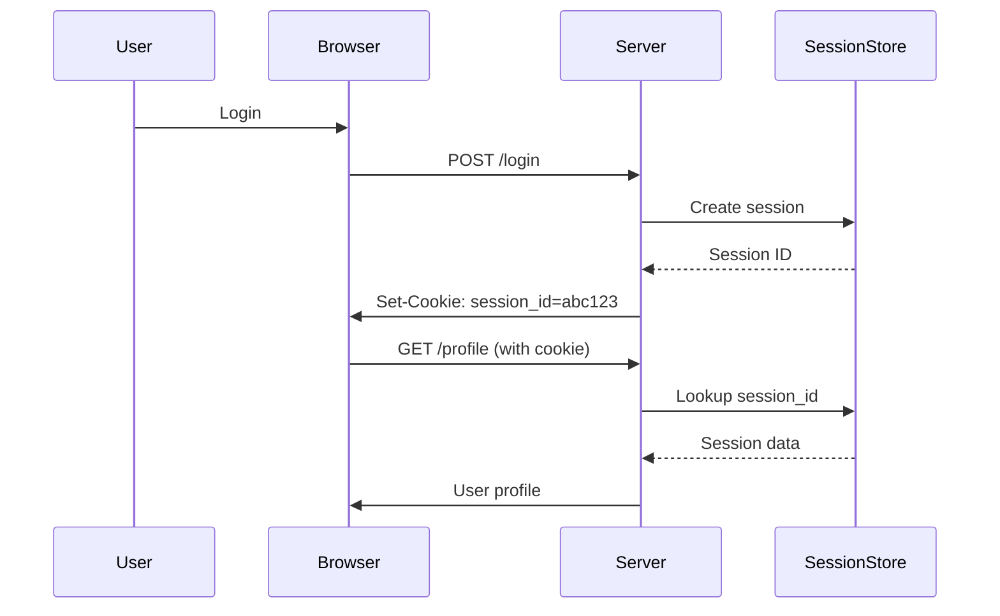
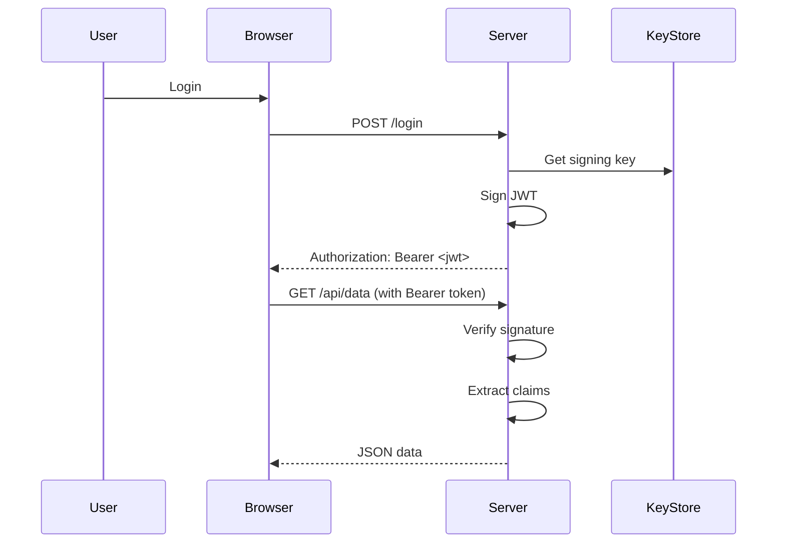
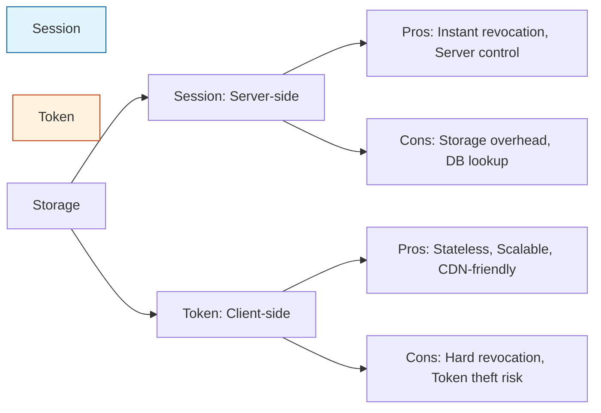
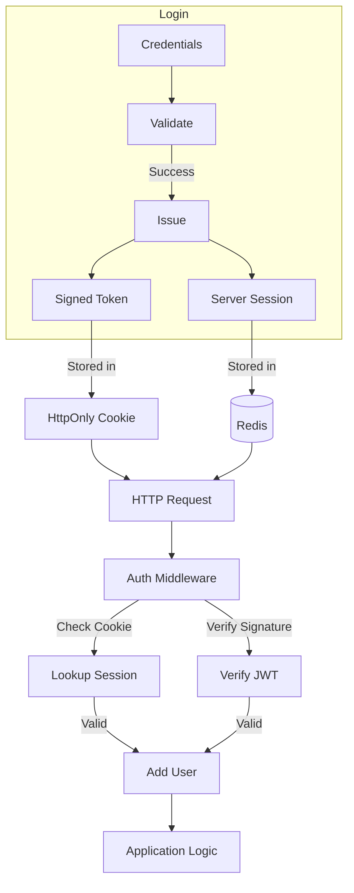

# Session vs Token Authentication

## Introduction
Session and token-based authentication are two primary mechanisms for maintaining user state in stateless HTTP. Sessions store state server-side; tokens encode state client-side.

## Why we need session/token mechanisms
HTTP is stateless; each request is independent. To remember logged-in users across requests, we need a mechanism to associate requests with a user identity.

## Problem statement
How do we securely maintain user identity across multiple HTTP requests without compromising security or scalability?

## Real-world story
Alice checks into a hotel (session): gets a key card (session ID) that unlocks her room and grants hotel privileges. She returns the key at checkout (session invalidated). Alternatively, she gets a tamper-proof wristband (token) with her room number and privileges encoded—invalidate by cutting it.

## Real-world analogy
**Session**: Coat check at a club. You give coat, get ticket (session ID). Present ticket to get coat back. Coat stored securely backstage.
**Token**: Valet key with embedded code specifying which car you can drive and for how long. No need to check back with desk; validate cryptographic signature.

## Visual explanation
```
Session: Login → Server creates session ID → Store in DB → Send ID to client → Client sends ID with requests → Server looks up session
Token: Login → Server creates signed token → Send to client → Client sends token with requests → Server verifies signature & claims
```

## Mermaid Diagram 1: Session Flow


## Internal working
**Sessions**:
1. Login validates credentials
2. Server generates random session ID
3. Stores session data (user ID, roles, expiry) in store (Redis, DB)
4. Sends session ID to client via Set-Cookie header
5. Client returns cookie with subsequent requests
6. Server validates ID, retrieves session data, proceeds

**Tokens (JWT)**:
1. Login validates credentials
2. Server creates JSON payload (user ID, roles, expiry)
3. Signs payload with secret key (HMAC) or private key (RSA)
4. Sends token to client (often in Authorization header or cookie)
5. Client includes token in requests
6. Server verifies signature, extracts claims, proceeds

## Mermaid Diagram 2: Token Flow


## Step-by-step flow
**Session**:
1. POST /login with credentials
2. Server verifies credentials
3. Generate cryptographically random session ID (128+ bits)
4. Store { userId, expiresAt, ... } in Redis/DDB with TTL
5. Response: Set-Cookie: session_id=abc123; HttpOnly; Secure; SameSite=Strict
6. Browser stores cookie, sends with same-domain requests
7. Middleware: read cookie, lookup session, validate expiry, attach user to request
8. On logout: delete session from store, clear cookie

**Token (JWT)**:
1. POST /login with credentials
2. Server verifies credentials
3. Create payload: { sub: userId, role: 'admin', exp: timestamp }
4. Sign: HMACSHA256(base64Url(header) + "." + base64Url(payload), secret)
5. Response: Authorization: Bearer headerxxxyyy.zzz
6. Client stores token (localStorage, cookie, memory)
7. Client: Authorization: Bearer <token> on requests
8. Middleware: extract token, verify signature, check exp, parse claims, attach user
9. On logout: remove token client-side (token remains valid until expiry unless blocklisted)

## Mermaid Diagram 3: Security Comparison


## Architecture
**Session architecture**:
- Login endpoint validates credentials
- Session store (Redis/Mongo) holds active sessions
- Middleware reads cookie, validates session
- Logout endpoint deletes session

**Token architecture**:
- Login endpoint signs JWT with secret/private key
- Token stored client-side (secure cookie or localStorage)
- Middleware verifies JWT signature and claims
- Optional: token blacklist revocation list for logout

## Mermaid Diagram 4: Hybrid Approach


## Implementation
### Session-based (Next.js API)
```javascript
// lib/session.js
import { createClient } from 'redis'
import { randomBytes } from 'crypto'

const redis = createClient({ url: process.env.REDIS_URL })

export async function createSession(userId) {
  const sessionId = randomBytes(32).toString('hex')
  const expiresAt = Date.now() + 24 * 60 * 60 * 1000 // 24h
  await redis.set(
    `sess:${sessionId}`,
    JSON.stringify({ userId, expiresAt }),
    { EX: Math.floor(24 * 60 * 60) }
  )
  return sessionId
}

export async function getSession(sessionId) {
  const data = await redis.get(`sess:${sessionId}`)
  return data ? JSON.parse(data) : null
}

export async function deleteSession(sessionId) {
  await redis.del(`sess:${sessionId}`)
}
```

### Token-based (JWT) (Next.js API)
```javascript
// lib/jwt.js
import jwt from 'jsonwebtoken'

const secret = process.env.JWT_SECRET

export function signJwt(payload, expiresIn = '1d') {
  return jwt.sign(payload, secret, { expiresIn })
}

export function verifyJwt(token) {
  try {
    return jwt.verify(token, secret)
  } catch (err) {
    return null
  }
}

// Usage in login route
const token = signJwt({ userId: user.id, role: user.role })
res.setHeader('Authorization', `Bearer ${token}`)
```

### Folder structure
```
src/
├── lib/
│   ├── session.ts
│   ├── jwt.ts
│   └── auth.ts
├── middleware/
│   ├── session.ts
│   └── jwt.ts
└── services/
    └── auth.service.ts
```

## Best practices
**Sessions**:
- Use HTTP-only, Secure, SameSite cookies
- Store sessions in fast store (Redis) with TTL
- Generate session IDs with crypto-random bytes (≥128 bits)
- Set reasonable idle/timeouts (15-30 min active, 1 day max)
- Invalidate on password change, logout, suspicious activity
- Regenerate session ID after login to prevent fixation

**Tokens**:
- Use strong secret (HMAC) or asymmetric keys (RSA/ECDSA)
- Set short expiration (15-30 min) with refresh token mechanism
- Never store sensitive data in JWT payload (it's visible)
- Implement token revocation (blocklist) for logout/security events
- Prefer HTTPS-only transmission
- Validate audience, issuer, and expiry claims
- Consider using established libraries (jsonwebtoken, jose)

## Common mistakes
**Sessions**:
- Storing sessions in memory (doesn't scale)
- Using predictable session IDs (e.g., incremental)
- Missing Secure flag (sent over HTTP)
- Forgetting HttpOnly (accessible via JS XSS)
- Not setting expiration (infinite sessions)
- Storing excessive data in session (bloat)

**Tokens**:
- Using weak secrets or exposing them in client code
- Accepting tokens without verifying signature ("none" algorithm)
- Storing tokens in localStorage (vulnerable to XSS)
- Missing expiration check (tokens valid forever)
- Putting sensitive data in JWT (base64 encoded = readable)
- Not implementing revocation (stolen tokens usable until expiry)
- Using long expiration without refresh tokens

## Security considerations
**Sessions**:
- Fixation: Regenerate ID after login
- Theft: Short lifetime, HTTPS-only, SameSite
- Stealing via XSS: HTTP-only cookie mitigates
- Sidejacking: Always use HTTPS
- Overflow: Rate-limit login attempts

**Tokens**:
- Theft: Short-lived access tokens + refresh tokens
- Replay: Short expiration + nonce/jti claims
- Signature none attack: Explicitly reject alg:none
- Key compromise: Rotate keys, use key ID (kid) claim
- Algorithm confusion: Specify expected algorithm in verify
- Token leakage: Avoid URLs, prefer Authorization header

## Performance notes
**Sessions**:
- Each request requires storage lookup (mitigate with fast cache)
- Memory usage proportional to active sessions
- Consider sticky sessions or shared Redis cluster
- Background cleanup of expired entries

**Tokens**:
- No storage lookup; verification is CPU-bound (signature check)
- Public key verification slower than HMAC
- Token size adds to request overhead (~200-500 bytes)
- Consider asymmetric keys for distributed verification
- Cache public keys if using JWKS (e.g., Auth0)

## Interview questions
1. What's the main difference between session and token auth?
2. How do you invalidate a JWT before expiration?
3. Why are HTTP-only cookies important for session IDs?
4. When would you choose JWT over session IDs?
5. How does the "none" algorithm attack work against JWT?

## MCQs
1. Where is session state primarily stored?
   a) Client cookie
   b) LocalStorage
   c) Server-side store
   d) URL parameters
   Answer: c

2. What protects session cookies from JavaScript access?
   a) Secure flag
   b) SameSite attribute
   c) HttpOnly flag
   d) MaxAge directive
   Answer: c

3. Which JWT claim specifies expiration time?
   a) iat
   b) nbf
   c) exp
   d) aud
   Answer: c

4. What is a major security risk of storing JWT in localStorage?
   a) Increased request size
   b) Vulnerable to XSS theft
   c) Cannot be sent with cookies
   d) Requires server-side storage
   Answer: b

5. How do you prevent token replay attacks?
   a) Use HTTPS only
   b) Set short expiration and use nonce/jti
   c) Store tokens in database
   d) Disable refresh tokens
   Answer: b

## Practice exercise
Implement logout for both:
1. Session: Delete session from store, clear cookie
2. Token: Add token to blocklist with TTL matching remaining expiry

## Debugging exercise
Users report being logged out after 5 minutes despite 1-day session setting.
Check:
1. Session store TTL configuration
2. Idle timeout middleware resetting activity
3. Cookie path/domain mismatch
4. Load balancer session affinity issues
5. Clock skew between servers

## Real-world scenario
Choose session vs token for:
- Public website: Sessions (simple, secure)
- Mobile API: Tokens (stateless, works with native apps)
- Microservices: JWT (shared secret for validation)
- Banking app: Sessions + short-lived tokens for step-up auth
- SSO system: SAML/OIDC tokens with server-side session

## Mini project
Build auth system with both options:
- Login endpoint returns either session cookie or JWT (based on client preference)
- Middleware supports both mechanisms
- Logout works for both (session delete, token blocklist)
- Switch between mechanisms via feature flag

## Interview coding question
Write middleware that accepts either session cookie or JWT:
```javascript
function authMiddleware(req, res, next) {
  // Try session cookie first
  // Fallback to Authorization: Bearer token
  // Attach req.user if valid
  // Else 401
}
```

## Summary
Sessions offer server-side control and easy revocation but require storage. Tokens enable stateless scalability but complicate revocation. Choose based on architecture: sessions for traditional web apps, tokens for APIs/microservices. Hybrid approaches combine benefits.

## Cheat sheet
- **Session ID**: 128+ bit random, stored in HTTP-only cookie
- **JWT**: HS256/RS256 signed, standard claims (iss, sub, exp, aud)
- **Cookie flags**: HttpOnly; Secure; SameSite=Strict; Path=/; MaxAge
- **Token expiry**: Access token 15m, refresh token 7d
- **Revocation**: Session delete; token blocklist with TTL

## Related topics
- OAuth 2.0 and OpenID Connect
- Refresh token patterns
- CSRF protection
- Same-site cookie attributes
- JSON Web Token (JWT) security best practices
- Session fixation attacks