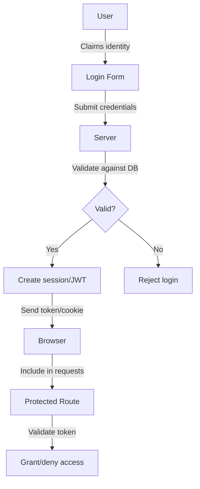
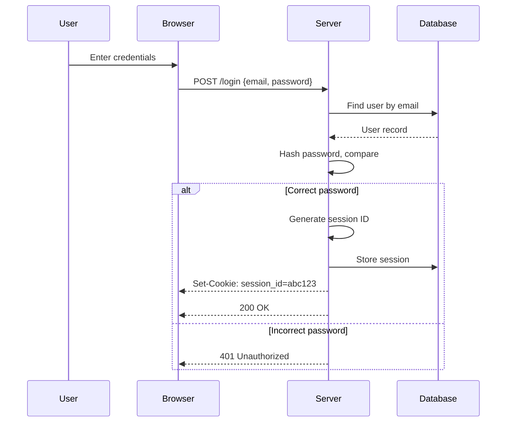
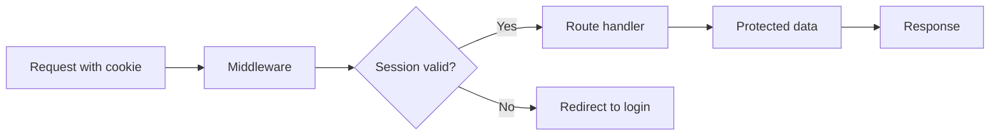
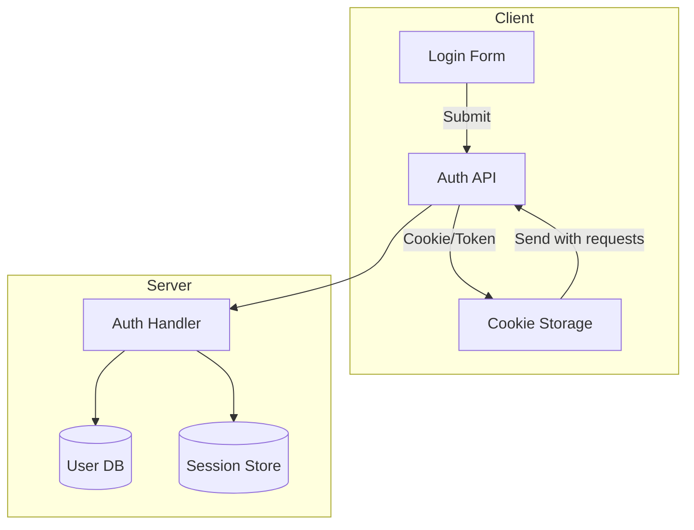

# What is Authentication?

## Introduction
Authentication is the process of verifying the identity of a user, device, or system. It answers "Who are you?"

## Why we need it
Without authentication, anyone could access sensitive data, perform actions as another user, or impersonate administrators. Authentication enables personalized experiences, access control, and audit trails.

## Problem statement
How can we reliably verify that a user claiming an identity is truly that user in a distributed system over an insecure network?

## Real-world story
Alice logs into her banking app. She enters her username and password. The bank verifies these against their records. If correct, she gains access to her account. If an attacker steals her password, they could impersonate her—hence the need for additional factors.

## Real-world analogy
Authentication is like showing ID at an airport:
1. You present your passport (credentials)
2. Agent checks photo and details against database
3. If match, you get boarding pass (session/token)
4. You use boarding pass to access gate (protected resource)

## Visual explanation
```
User claims identity
        ↓
System requests proof
        ↓
User provides credentials
        ↓
System validates credentials
        ↓
Access granted or denied
```

## Mermaid Diagram 1: Authentication Flow


## Internal working
1. **Credential submission**: User sends username/password via login form
2. **Lookup**: System finds user record by username/email
3. **Verification**: Compares submitted password hash with stored hash
4. **Session creation**: On success, generates session ID or JWT
5. **Response**: Sends session cookie or token to client
6. **Subsequent requests**: Client includes credentials; server validates

## Mermaid Diagram 2: Session Creation


## Step-by-step flow
1. User navigates to login page
2. User enters email and password
3. Browser sends POST request to /api/login
4. Server validates email exists in database
5. Server compares bcrypt hash of password with stored hash
6. If match, server creates session document in database
7. Server sets HTTP-only, Secure cookie with session ID
8. Browser stores cookie and sends it with future requests
9. On protected routes, middleware reads session ID and validates

## Mermaid Diagram 3: Token Validation


## Architecture
Typical auth architecture:
- **Client**: Login form, stores credentials (cookie/localStorage)
- **Server**: Auth API routes, session store, user database
- **Database**: User table (email, password_hash), sessions table
- **Optional**: Redis for session storage, rate limiting

## Mermaid Diagram 4: System Components


## Implementation
### Basic example (Next.js API route)
```javascript
// pages/api/login.js
import { compare } from 'bcrypt'
import { getUserByEmail } from '@/lib/db'
import { createSession } from '@/lib/session'

export default async function handler(req, res) {
  if (req.method !== 'POST') return res.status(405).end()
  
  const { email, password } = req.body
  const user = await getUserByEmail(email)
  
  if (!user) return res.status(401).json({ error: 'Invalid credentials' })
  
  const valid = await compare(password, user.password_hash)
  if (!valid) return res.status(401).json({ error: 'Invalid credentials' })
  
  const sessionId = await createSession(user.id)
  res.setHeader('Set-Cookie', `session_id=${sessionId}; HttpOnly; Secure; SameSite=Strict; Path=/`)
  res.status(200).json({ success: true })
}
```

### Production example (with Next.js App Router)
```typescript
// app/api/login/route.ts
import { compare } from 'bcrypt'
import { cookies } from 'next/headers'
import { getUserByEmail } from '@/lib/db'
import { createSession } from '@/lib/session'

export async function POST(request: Request) {
  const { email, password } = await request.json()
  
  const user = await getUserByEmail(email)
  if (!user) {
    return new Response(JSON.stringify({ error: 'Invalid credentials' }), { 
      status: 401 
    })
  }
  
  const valid = await compare(password, user.password_hash)
  if (!valid) {
    return new Response(JSON.stringify({ error: 'Invalid credentials' }), { 
      status: 401 
    })
  }
  
  const sessionId = await createSession(user.id)
  const cookieStore = cookies()
  cookieStore.set('session_id', sessionId, {
    httpOnly: true,
    secure: true,
    sameSite: 'strict',
    path: '/',
    maxAge: 60 * 60 * 24 * 7 // 1 week
  })
  
  return new Response(JSON.stringify({ success: true }))
}
```

### Folder structure
```
src/
├── app/
│   └── api/
│       └── login/
│           └── route.ts
├── lib/
│   ├── db.ts
│   └── session.ts
└── types/
    └── user.ts
```

## Best practices
- Always use HTTPS in production
- Hash passwords with bcrypt/scrypt/argon2 (work factor ≥ 12)
- Use HTTP-only, Secure, SameSite cookies for session IDs
- Implement rate limiting on auth endpoints
- Log auth events (success/failure) for audit
- Use CSRF protection for state-changing operations
- Set short session expiration (15-30 min) with refresh tokens
- Validate all redirects to prevent open redirect attacks

## Common mistakes
- Storing passwords in plaintext or using weak hashes (MD5, SHA1)
- Using localStorage for tokens (vulnerable to XSS)
- Missing Secure flag on cookies (transmitted over HTTP)
- Not implementing rate allowing brute force attacks
- Using predictable session IDs
- Forgetting to invalidate sessions on logout/password change

## Security considerations
- **Transport security**: Enforce HSTS and HTTPS everywhere
- **Credential storage**: Use adaptive hashing with salt
- **Session security**: Rotate session IDs after login, use short expiration
- **Input validation**: Validate email/length/password complexity
- **Logging**: Avoid logging passwords or sensitive data
- **Secrets management**: Store JWT keys, DB passwords in env vars

## Performance notes
- Hashing is CPU-intensive; consider async processing
- Session store lookups add latency; use Redis with TTL
- Cache user permissions to reduce DB queries on auth
- Use CDN for static assets; auth APIs should be origin-only
- Implement connection pooling for database

## Interview questions
1. How do you securely store passwords?
2. What's the difference between encryption and hashing?
3. Why are HTTP-only cookies important for session IDs?
4. How would you prevent brute force attacks?
5. What is session fixation and how do you prevent it?

## MCQs
1. Which hash algorithm is recommended for password storage?
   a) MD5
   b) SHA-256
   c) bcrypt
   d) Base64
   Answer: c

2. What does the HttpOnly cookie flag prevent?
   a) Sending cookie over HTTP
   b) Accessing cookie via JavaScript
   c) Sending cookie to third-party domains
   d) Modifying cookie value
   Answer: b

3. Which is NOT a factor of authentication?
   a) Something you know
   b) Something you have
   c) Something you like
   d) Something you are
   Answer: c

4. What is the purpose of salt in password hashing?
   a) Increase hash length
   b) Prevent rainbow table attacks
   c) Make hashing faster
   d) Allow decryption
   Answer: b

5. When should you regenerate session ID?
   a) On every request
   b) After login and privilege changes
   c) Only when user logs out
   d) Never, it should remain constant
   Answer: b

## Practice exercise
Create a login API endpoint that:
1. Accepts email and password
2. Validates user exists
3. Compares hashed password
4. Sets secure session cookie
5. Returns appropriate status codes

## Debugging exercise
Given: Users report being logged out immediately after login.
Check:
1. Cookie settings (Secure flag requires HTTPS)
2. SameSite attribute causing cross-site issues
3. Session store expiration too short
4. Middleware incorrectly validating session

## Real-world scenario
Build auth for a healthcare portal where:
- Doctors need MFA for patient data access
- Patients use email/password with session timeout
- System must audit all PHI access (HIPAA compliance)
- Legacy system integrates via SAML

## Mini project
Extend login system with:
- Password strength indicator
- "Show password" toggle
- Remember me checkbox (extends session)
- Responsive login form
- Client-side validation (email format, password length)

## Interview coding question
Implement a function that validates a session token:
```javascript
function validateSession(token, secret) {
  // Verify JWT signature and expiration
  // Return payload if valid, throw if invalid
}
```

## Summary
Authentication verifies identity using credentials. Secure implementation requires password hashing, session management, and transport security. Always defend against brute force, session fixation, and credential theft.

## Cheat sheet
- **Hash**: bcrypt(password, saltRounds=12)
- **Cookie**: `session_id=abc; HttpOnly; Secure; SameSite=Strict`
- **Rate limit**: 5 attempts/minute/IP
- **Session ID**: 32+ byte random string
- **Logout**: Clear cookie + delete server session

## Related topics
- Authorization (what users can do)
- Session vs token authentication
- OAuth 2.0 and OpenID Connect
- Password hashing algorithms
- CSRF and XSS protection