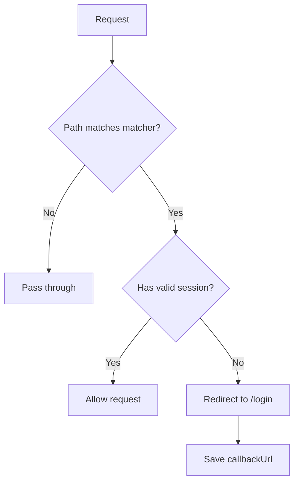

# Middleware

## Introduction

Next.js middleware runs before a request reaches your page or API route. It's the ideal place for authentication checks — redirecting unauthenticated users before they see protected content.

## Why Do We Need This?

Without middleware, every protected page would need its own auth check. Middleware centralizes this: one file, one check, applied to all matching routes.

## Basic Auth Middleware

```ts
// middleware.ts
import { NextResponse } from 'next/server'
import type { NextRequest } from 'next/server'
import { getToken } from 'next-auth/jwt'

export async function middleware(request: NextRequest) {
  const { pathname } = request.nextUrl
  
  // Public routes — no auth check needed
  if (pathname === '/login' || pathname === '/register') {
    return NextResponse.next()
  }
  
  // Protected routes — check for session
  const token = await getToken({ req: request })
  
  if (!token) {
    const loginUrl = new URL('/login', request.url)
    loginUrl.searchParams.set('callbackUrl', pathname)
    return NextResponse.redirect(loginUrl)
  }
  
  return NextResponse.next()
}

export const config = {
  matcher: ['/dashboard/:path*', '/profile/:path*', '/settings/:path*'],
}
```

## Middleware Flow



## Admin Route Protection

```ts
export async function middleware(request: NextRequest) {
  const { pathname } = request.nextUrl
  const token = await getToken({ req: request })
  
  // Admin routes
  if (pathname.startsWith('/admin')) {
    if (!token) {
      return NextResponse.redirect(new URL('/login', request.url))
    }
    if (token.role !== 'admin') {
      return NextResponse.redirect(new URL('/unauthorized', request.url))
    }
  }
  
  return NextResponse.next()
}
```

## Matcher Configuration

```ts
export const config = {
  matcher: [
    '/dashboard/:path*',
    '/admin/:path*',
    '/api/protected/:path*',
    // Exclude static files, API auth routes
    '/((?!_next/static|_next/image|favicon.ico|api/auth).*)',
  ],
}
```

## Common Mistakes

- **Not excluding static files** — Middleware runs on every matching request. Always exclude `_next/static`.
- **Infinite redirect loops** — Make sure login and register routes aren't matched as protected.
- **Only checking auth in middleware** — Always double-check in pages and API routes. Defense in depth.

## Best Practices

- Keep middleware fast — no database calls, use JWT verification instead
- Use `getToken` from `next-auth/jwt` for Auth.js session checks
- Always exclude public routes and static files in the matcher
- Save `callbackUrl` when redirecting to login

## Summary

Middleware is the first line of defense for protected routes. It redirects unauthenticated users before they see any content. Keep it fast, use `getToken` for Auth.js, and always double-check auth in the actual page or API route.

## Related Topics

- [Protected Pages](./protected-pages.md)
- [Protected API Routes](./protected-api-routes.md)
- [Role-Based Access](./role-based-access.md)
