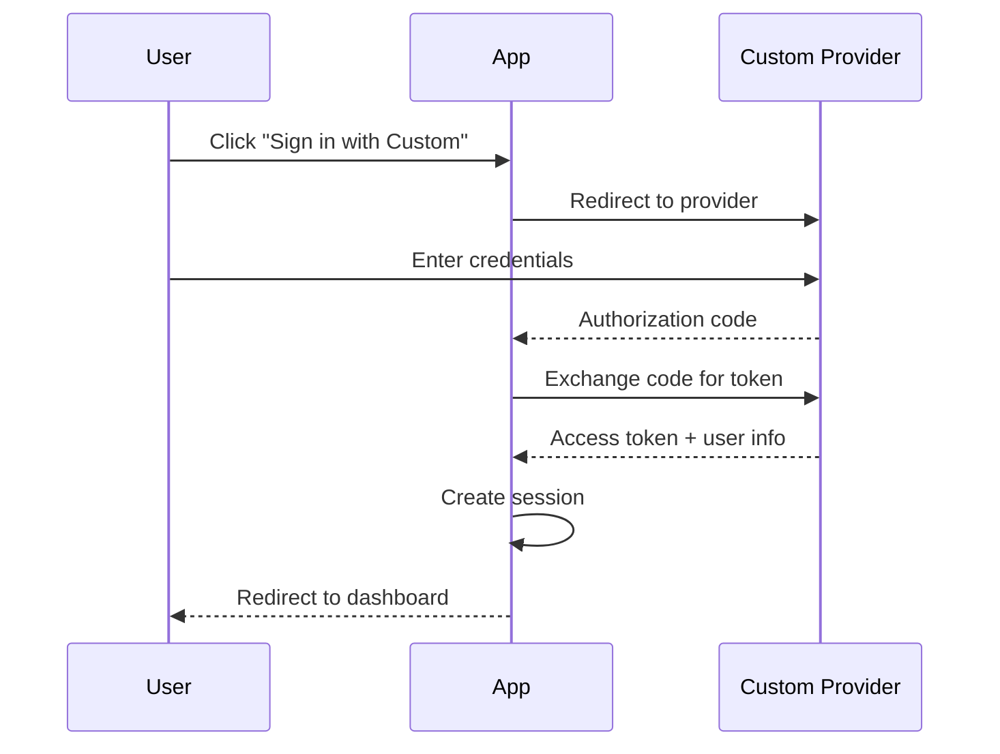

# Custom Provider

## Introduction

In addition to built-in providers, Auth.js lets you configure custom OAuth providers. This is useful for OAuth-compatible services not in the default provider list.

## Why Custom Providers?

- Your app uses a niche authentication service
- You need to integrate with an enterprise identity provider (Okta, Azure AD)
- You're building your own OAuth server

## Custom OAuth Provider

```ts
// lib/auth.ts
import type { OAuthConfig } from 'next-auth/providers'

const CustomProvider: OAuthConfig<{ /* profile type */ }> = {
  id: 'custom',
  name: 'Custom Provider',
  type: 'oauth',
  clientId: process.env.CUSTOM_CLIENT_ID!,
  clientSecret: process.env.CUSTOM_CLIENT_SECRET!,
  wellKnown: 'https://provider.com/.well-known/openid-configuration',
  authorization: {
    params: { scope: 'openid email profile' },
  },
  profile(profile) {
    return {
      id: profile.sub,
      name: profile.name,
      email: profile.email,
      image: profile.picture,
    }
  },
}

export const authOptions = {
  providers: [CustomProvider],
}
```

## Okta Example

```ts
import OktaProvider from 'next-auth/providers/okta'

providers: [
  OktaProvider({
    clientId: process.env.OKTA_CLIENT_ID!,
    clientSecret: process.env.OKTA_CLIENT_SECRET!,
    issuer: process.env.OKTA_ISSUER,
  }),
]
```

## Custom Provider Flow



## Common Mistakes

- **Not mapping the profile correctly** — The `profile()` function must return an object with `id`, `name`, `email`, and optionally `image`.
- **Missing wellKnown URL** — If the provider supports OpenID Connect, the `wellKnown` URL simplifies configuration.
- **Wrong scope configuration** — Insufficient scopes may result in missing user data.

## Best Practices

- Use `wellKnown` endpoint when available for automatic configuration
- Test the profile mapping with real API responses
- Use `.env` for all provider credentials

## Summary

Custom OAuth providers let you integrate with any OAuth or OpenID Connect service. Configure the authorization URL, token URL, and profile mapping. Use `wellKnown` when available for simpler setup.

## Related Topics

- [Google Login](./google-login.md)
- [GitHub Login](./github-login.md)
- [Auth.js Providers](../authjs/providers.md)
