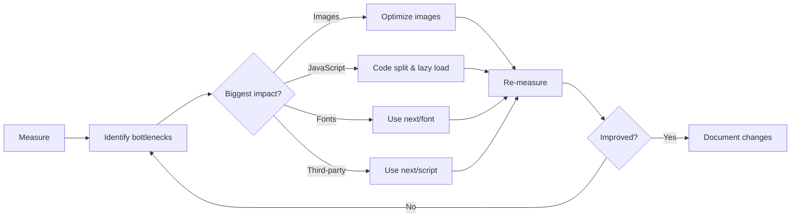

# Performance Best Practices

## Introduction

This topic summarizes the key performance practices for Next.js applications. Use it as a checklist when building and reviewing your projects.

## Performance Checklist

### Images
- [ ] Use `next/image` instead of ``
- [ ] Add `priority` to above-the-fold images
- [ ] Provide `width` and `height` or use `fill`
- [ ] Use `sizes` attribute for responsive images
- [ ] Configure `remotePatterns` for external images

### Fonts
- [ ] Use `next/font/google` instead of CDN links
- [ ] Limit to 2-3 font families per page
- [ ] Use `display: 'swap'` for body text
- [ ] Subset fonts to only needed characters

### Scripts
- [ ] Use `next/script` with `afterInteractive` strategy
- [ ] Use `lazyOnload` for non-critical scripts
- [ ] Load scripts in the root layout

### Lazy Loading
- [ ] Dynamic import heavy components (charts, maps, editors)
- [ ] Use `ssr: false` for browser-only components
- [ ] Provide loading states for dynamic imports

### Bundle
- [ ] Keep initial bundle under 200KB
- [ ] Use tree-shakeable library imports
- [ ] Run bundle analyzer monthly
- [ ] Remove unused dependencies

## Performance Optimization Strategy



## Key Metrics to Monitor

| Metric | Tool | Target |
|--------|------|--------|
| LCP | Lighthouse, Vercel Analytics | < 2.5s |
| FID/INP | Chrome User Experience Report | < 200ms |
| CLS | Lighthouse | < 0.1 |
| TTFB | DevTools Network tab | < 800ms |
| Bundle size | Bundle Analyzer | < 200KB per route |

## Production Monitoring

```tsx
// app/layout.tsx
export function reportWebVitals(metric: any) {
  // Send to your analytics
  const body = {
    name: metric.name,
    value: metric.value,
    rating: metric.rating,
    delta: metric.delta,
    id: metric.id,
  }
  
  // Send to Vercel Analytics (built-in)
  // Or your custom analytics endpoint
  fetch('/api/analytics', {
    method: 'POST',
    body: JSON.stringify(body),
  })
}
```

## Common Mistakes

- **Optimizing before measuring** — Always start with a baseline measurement.
- **Focusing on one metric at the expense of others** — Optimizing LCP by hiding content hurts CLS. Balance matters.
- **Not testing on real mobile devices** — Desktop DevTools throttling doesn't accurately represent mobile CPUs.
- **Applying all optimizations everywhere** — Be selective. Not every page needs every optimization.

## Summary

Follow the performance checklist for images, fonts, scripts, and bundles. Measure before and after each change. Focus on the optimizations that have the biggest impact on user experience.

## Related Topics

- [Why Performance Matters](./why-performance-matters.md)
- [Image Optimization](./image-optimization.md)
- [Bundle Optimization](./bundle-optimization.md)
