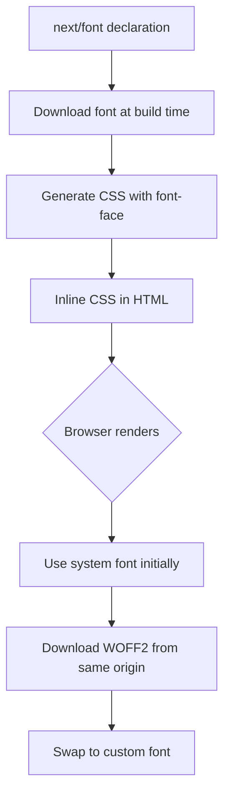

# Font Optimization

## Introduction

Fonts can significantly impact page performance. A typical Google Font request blocks rendering until the CSS and font files download. Next.js's `next/font` module solves this by self-hosting fonts and eliminating external requests.

## Why Do We Need This?

Without optimization, loading a Google Font involves:

1. DNS lookup for `fonts.googleapis.com`
2. Downloading the CSS file
3. Downloading the font files (WOFF2)
4. **During this time, text is invisible** (FOUT — Flash of Unstyled Text)

`next/font` eliminates steps 1-2 by bundling the font CSS at build time.

## Google Fonts

```tsx
// app/layout.tsx
import { Inter, Roboto_Mono } from 'next/font/google'

const inter = Inter({
  subsets: ['latin'],      // Only load needed characters
  display: 'swap',          // Show system font until custom font loads
  variable: '--font-inter', // Use as a CSS variable
})

const robotoMono = Roboto_Mono({
  subsets: ['latin'],
  display: 'swap',
  variable: '--font-roboto-mono',
})

export default function RootLayout({ children }: { children: React.ReactNode }) {
  return (
    <html lang="en" className={`${inter.variable} ${robotoMono.variable}`}>
      <body>{children}</body>
    </html>
  )
}
```

```css
/* app/globals.css */
body {
  font-family: var(--font-inter);
}

code, pre {
  font-family: var(--font-roboto-mono);
}
```

## Custom Fonts (Local)

```tsx
// app/fonts.ts
import localFont from 'next/font/local'

const geistSans = localFont({
  src: './fonts/GeistVF.woff2',
  variable: '--font-geist-sans',
  display: 'swap',
})

const geistMono = localFont({
  src: './fonts/GeistMonoVF.woff2',
  variable: '--font-geist-mono',
  display: 'swap',
})
```

## Font Loading Strategies

| Strategy | Description | When to Use |
|----------|-------------|-------------|
| `swap` | Show system font, swap when custom loads | Most cases — best for perceived performance |
| `block` | Hide text until font loads | Brand-critical fonts (short time) |
| `optional` | Use custom font if cached, system font otherwise | Good for performance-critical pages |
| `fallback` | Short block period, then swap | Middle ground |

```tsx
const headingFont = localFont({
  src: './fonts/Heading.woff2',
  display: 'block', // Brand font — worth the wait
})
```

## Font Subsetting

Google Fonts with `next/font` automatically subset to only the characters you need:

```tsx
const inter = Inter({
  subsets: ['latin'],  // Only Latin characters
  // subsets: ['latin', 'cyrillic', 'greek'], // Add more if needed
})
```

Each subset is a separate smaller font file. Only load what you need.

## Combined Font Loading Flow



## Common Mistakes

- **Loading too many font weights** — Each weight is a separate file. Stick to 2-3 variations.
- **Not using `display: 'swap'`** — Without it, text may be invisible while the font loads.
- **Loading entire font families** — Use subsets to only load characters your content needs.
- **Using Google Fonts CDN** — External font requests add DNS lookups and connection overhead.

## Best Practices

- Use `next/font/google` instead of direct Google Fonts CDN links
- Limit to 2-3 font families per page to minimize downloads
- Use `variable` fonts when available (one file, multiple weights)
- Use `display: 'swap'` for body text to avoid invisible text
- Use `display: 'block'` sparingly for brand-critical headlines
- Subset fonts to only include the scripts you need

## Summary

`next/font` eliminates external font requests by self-hosting fonts at build time. Use Google Fonts through `next/font/google`, set `display: 'swap'` for body text, and limit font families to keep pages fast.

## Related Topics

- [Image Optimization](./image-optimization.md)
- [Script Optimization](./script-optimization.md)
- [Best Practices](./best-practices.md)
