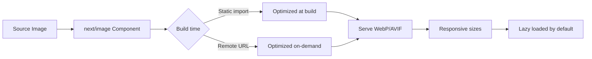

# Image Optimization

## Introduction

Images are often the largest assets on a webpage. Next.js's `next/image` component automatically optimizes images — resizing, compressing, and serving modern formats like WebP — without any configuration.

## Why Do We Need This?

A typical hero image (1920x1080) can be 2MB as a JPEG. `next/image` can reduce this to under 200KB while looking identical to the user. Smaller images mean faster page loads and better LCP scores.

## Image Optimization Flow



## Basic Usage

### Local Images

```tsx
import Image from 'next/image'
import heroImage from '@/public/hero.jpg'

export default function Hero() {
  return (
    <Image
      src={heroImage}
      alt="Hero banner"
      placeholder="blur" // Shows blurred preview while loading
      priority // Skip lazy loading for above-the-fold images
    />
  )
}
```

### Remote Images

```tsx
<Image
  src="https://example.com/photo.jpg"
  alt="Remote photo"
  width={800}
  height={600}
  // Remote images require width and height
/>
```

For remote images, configure allowed domains:

```ts
// next.config.js
module.exports = {
  images: {
    remotePatterns: [
      {
        protocol: 'https',
        hostname: 'example.com',
      },
      {
        protocol: 'https',
        hostname: 'images.unsplash.com',
      },
    ],
  },
}
```

## Responsive Images

```tsx
<Image
  src="/product.jpg"
  alt="Product"
  fill // Fills parent container
  className="object-cover" // CSS object-fit
  sizes="(max-width: 768px) 100vw, (max-width: 1200px) 50vw, 33vw"
  // Tells the browser which image size to download based on viewport
/>
```

The `sizes` attribute is important for performance. Without it, Next.js defaults to 100vw (full viewport width), which may download an image larger than needed.

## Image Priority

Above-the-fold images (hero, logo, main content) should use `priority`:

```tsx
export default function Page() {
  return (
    <>
      <Image src="/logo.png" alt="Logo" width={200} height={50} priority />
      <Image src="/hero.jpg" alt="Hero" fill priority />
    </>
  )
}
```

This tells Next.js to preload the image instead of lazy loading it.

## Placeholder Strategies

| Placeholder | How It Works | Use Case |
|------------|-------------|----------|
| `blur` | Shows blurred version of image | Local images with sharp content |
| `empty` (default) | No placeholder | When first paint is already fast |
| CSS background | Custom loading skeleton | Complex layouts |

```tsx
// Blur placeholder (local images only)
import hero from '@/public/hero.jpg'

<Image src={hero} alt="Hero" placeholder="blur" />

// Empty (remote images)
<Image
  src="https://example.com/photo.jpg"
  alt="Photo"
  width={800}
  height={600}
  placeholder="empty"
/>
```

## Common Mistakes

- **Missing width and height** — Causes layout shift (poor CLS). Always provide dimensions or use `fill`.
- **No `priority` on hero images** — Above-the-fold images should not lazy load.
- **Missing `sizes` attribute** — Without it, Next.js may serve oversized images.
- **Not configuring remotePatterns** — Remote image domains must be explicitly allowed.

## Best Practices

- Always use `next/image` instead of `` for automatic optimization
- Add `priority` to above-the-fold images (hero, logo)
- Use `sizes` for responsive images to serve appropriate sizes
- Use `placeholder="blur"` for local images to improve perceived performance
- Configure `remotePatterns` for all external image sources
- Prefer WebP output (done automatically by `next/image`)

## Summary

`next/image` handles resizing, format conversion, lazy loading, and responsive images automatically. Provide width and height to prevent layout shift, use `priority` for above-the-fold images, and configure remote patterns for external sources.

## Related Topics

- [Font Optimization](./font-optimization.md)
- [Lazy Loading](./lazy-loading.md)
- [Best Practices](./best-practices.md)
