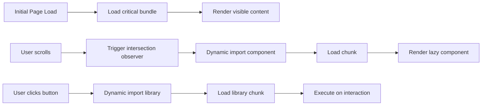

# Lazy Loading

## Introduction

Lazy loading defers loading of non-critical resources until they're actually needed. This reduces the initial bundle size and speeds up the first paint. Next.js provides several ways to lazy load components and libraries.

## Why Do We Need This?

A typical page might include:

- A rich text editor for comments
- A chart library for analytics
- A date picker for forms

None of these are needed immediately. Loading them upfront wastes bandwidth and slows down the initial render. Lazy loading defers them until the user interacts with them.

## Dynamic Imports

Use `next/dynamic` to lazy load React components:

```tsx
import dynamic from 'next/dynamic'

// HeavyChart is not included in the initial bundle
const HeavyChart = dynamic(() => import('@/components/HeavyChart'), {
  loading: () => <p>Loading chart...</p>,
  ssr: false, // Don't render on the server
})

export default function Dashboard() {
  const [showChart, setShowChart] = useState(false)
  
  return (
    <div>
      <button onClick={() => setShowChart(true)}>Show Chart</button>
      {showChart && <HeavyChart />}
    </div>
  )
}
```

## Without SSR

Some components shouldn't be server-rendered because they depend on browser APIs:

```tsx
const Map = dynamic(() => import('@/components/Map'), {
  ssr: false, // Map needs window.navigator
  loading: () => <MapSkeleton />,
})
```

## Named Exports

```tsx
const Chart = dynamic(() =>
  import('recharts').then((mod) => mod.LineChart)
)
```

## Library Lazy Loading

For libraries used inline, dynamic import works at the function level:

```tsx
'use client'

export async function formatDate(date: Date) {
  // date-fns is only loaded when this function is called
  const { format } = await import('date-fns')
  return format(date, 'PPP')
}
```

## Route-Level Code Splitting

This is automatic in Next.js — each page route gets its own JavaScript bundle. No configuration needed.

When a user navigates from `/` to `/about`, only the `about` page's JavaScript is loaded.

## Lazy Loading Flow



## Conditional Loading

```tsx
// Only load the editor when the user clicks "Edit"
export default function PostPage() {
  const [editing, setEditing] = useState(false)
  
  const Editor = editing
    ? dynamic(() => import('@/components/RichTextEditor'), { ssr: false })
    : null
  
  return (
    <div>
      {editing ? <Editor /> : <button onClick={() => setEditing(true)}>Edit</button>}
    </div>
  )
}
```

## Common Mistakes

- **Lazy loading above-the-fold content** — Content visible on initial page load should not be lazy loaded.
- **Forgetting `ssr: false` for browser-only components** — Components that use `window`, `document`, or `localStorage` will fail during SSR.
- **Not providing a loading state** — The `loading` prop provides better UX than a flash of nothing.
- **Lazy loading small components** — The overhead of dynamic import can outweigh the benefit for tiny components.

## Best Practices

- Lazy load components below the fold or behind user interactions
- Provide meaningful loading states (skeletons, spinners)
- Use `ssr: false` for components that rely on browser APIs
- Only lazy load components that add significant bundle size (> 10KB)
- Test with network throttling to verify lazy loading works as expected

## Summary

Lazy loading reduces initial bundle size by deferring non-critical components and libraries. Use `next/dynamic` for React components and dynamic `import()` for libraries. Route-level code splitting is automatic. Focus lazy loading on large components that aren't immediately visible.

## Related Topics

- [Bundle Optimization](./bundle-optimization.md)
- [Script Optimization](./script-optimization.md)
- [Image Optimization](./image-optimization.md)
