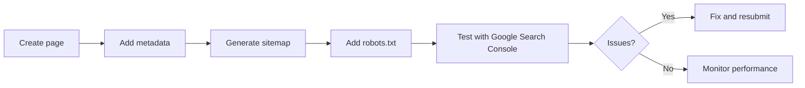

# SEO Introduction

## Introduction

SEO is the practice of optimizing your website to rank higher in search engine results. Next.js helps by providing built-in metadata APIs, server-side rendering (which search engines can read), and tools for generating sitemaps and robots.txt.

## Why Do We Need This?

Single-page applications (SPAs) built with client-side React have a fundamental SEO problem: the HTML is mostly empty until JavaScript runs. Search engine crawlers may not execute JavaScript, so they see a blank page.

Next.js solves this with server-side rendering and static generation — the HTML is fully populated before it reaches the browser (or crawler).

## How Next.js Helps SEO

| Feature | SEO Benefit |
|---------|-------------|
| Server-side rendering | Search engines see full HTML content |
| Metadata API | Set title, description, and OG tags per page |
| Dynamic metadata | Auto-generate metadata for blog posts, products |
| File-based routing | Clean, descriptive URLs |
| Sitemap generation | Help crawlers discover all pages |
| robots.txt | Control crawler access |

## SEO Workflow

## Real-World Example

A blog site without metadata:

- Search results show: `https://myblog.com/posts/123`
- No description or preview

With Next.js metadata:

- Search results show: **"How to Build Fast Websites | My Blog"**
- Description: "Learn how to optimize your Next.js application for performance and SEO."
- Thumbnail with the post's featured image

## Related Topics

- [Metadata](./metadata.md)
- [Open Graph](./open-graph.md)
- [SEO Best Practices](./seo-best-practices.md)
