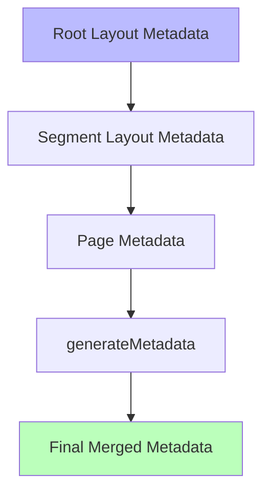

# Metadata

## Introduction

Metadata is information about a page that doesn't appear in the visible content — the page title, description, and other tags that help search engines and social platforms understand what the page is about.

## Static Metadata

For pages where the metadata doesn't change, export a `metadata` object:

```tsx
// app/about/page.tsx
import type { Metadata } from 'next'

export const metadata: Metadata = {
  title: 'About Us | My App',
  description: 'Learn more about our team and mission.',
}

export default function AboutPage() {
  return <div>{/* page content */}</div>
}
```

## Dynamic Metadata

For pages that need different metadata per route (blog posts, products), use `generateMetadata`:

```tsx
// app/posts/[slug]/page.tsx
import type { Metadata } from 'next'

type Props = {
  params: { slug: string }
}

export async function generateMetadata({ params }: Props): Promise<Metadata> {
  const post = await getPost(params.slug)
  
  return {
    title: `${post.title} | My Blog`,
    description: post.excerpt,
    openGraph: {
      title: post.title,
      description: post.excerpt,
      images: [{ url: post.coverImage }],
    },
  }
}
```

## Metadata Fields

```tsx
export const metadata: Metadata = {
  // Basic
  title: 'Page Title',
  description: 'Page description for search results',
  
  // Open Graph
  openGraph: {
    title: 'Social Share Title',
    description: 'Social share description',
    images: ['https://example.com/og-image.jpg'],
  },
  
  // Twitter
  twitter: {
    card: 'summary_large_image',
    title: 'Twitter Title',
    description: 'Twitter description',
  },
  
  // Other
  keywords: ['next.js', 'react', 'tutorial'],
  authors: [{ name: 'Your Name' }],
  robots: 'index, follow',
}
```

## Title Templates

Define a title template in the root layout to avoid repeating the site name:

```tsx
// app/layout.tsx
export const metadata: Metadata = {
  title: {
    default: 'My App',
    template: '%s | My App',
  },
  description: 'My amazing Next.js application',
}
```

Now any page only needs:

```tsx
export const metadata = {
  title: 'About', // → Renders as "About | My App"
}
```

## Metadata Hierarchy



Child pages override the parent's metadata. `generateMetadata` takes the highest priority.

## Common Mistakes

- **Not setting a default title** — The root layout should always have a title.
- **Duplicate or missing titles** — Every page should have a unique title.
- **Forgetting dynamic metadata for dynamic routes** — Blog posts and product pages must use `generateMetadata`.
- **Not using title templates** — Manually appending "| Site Name" to every page is error-prone.

## Best Practices

- Set a `title.template` in the root layout
- Use `generateMetadata` for dynamic routes
- Keep titles under 60 characters (search engine limit)
- Keep descriptions under 160 characters
- Every page should have a unique title and description
- Use `null` to explicitly inherit from parent layout

## Summary

Metadata tells search engines and social platforms what your page is about. Use static `metadata` for fixed pages and `generateMetadata` for dynamic routes. Set a title template in the root layout and give every page a unique title and description.

## Related Topics

- [Open Graph](./open-graph.md)
- [SEO Best Practices](./seo-best-practices.md)
- [Sitemap](./sitemap.md)
