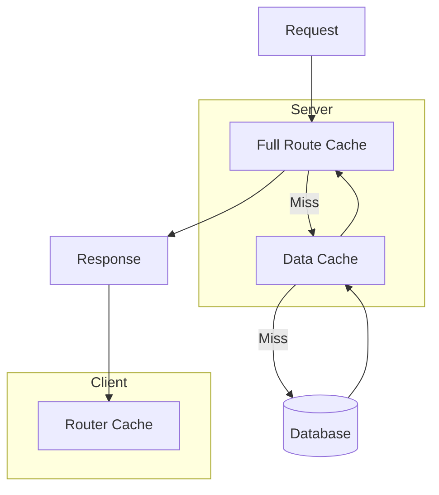

# Cache Overview

## Introduction

Next.js has four caching layers that work together to deliver content as fast as possible. Understanding these layers helps you make informed decisions about when and how to cache your content.

## The Four Cache Layers

### 1. Full Route Cache

The Full Route Cache stores the rendered HTML of static pages. When a page is marked as static (no dynamic functions like `cookies()`, `headers()`, or `no-store` fetch), the HTML is cached at build time.

```tsx
// This page is automatically cached as static HTML
export default async function AboutPage() {
  const data = await fetch('https://api.example.com/about')
  return <div>{/* render */}</div>
}
```

The cached HTML is served immediately on subsequent requests. This is the highest level of caching.

### 2. Data Cache

The Data Cache stores the results of `fetch()` requests. It persists across deployments and is stored on the server (or Vercel's edge network).

```tsx
// Cached for 60 seconds
const data = await fetch('https://api.example.com/posts', {
  next: { revalidate: 60 }
})

// Never cached — always fresh
const freshData = await fetch('https://api.example.com/live', {
  cache: 'no-store'
})

// Cached indefinitely (until manually revalidated)
const staticData = await fetch('https://api.example.com/config', {
  cache: 'force-cache'
})
```

### 3. Router Cache

The Router Cache is a client-side cache that stores the rendered content of pages you've visited. This enables instant back/forward navigation.

- Duration: Session (stored in memory)
- Invalidated by: Page refresh, `revalidatePath()`, or `router.refresh()`

### 4. React Cache

The React Cache caches the results of async functions within the same request. This prevents duplicate data fetching when multiple components need the same data.

```tsx
// Only fetches once per request, even if called from multiple components
export async function getProduct(id: string) {
  const product = await fetch(`https://api.example.com/products/${id}`)
  return product.json()
}
```

## Cache Layer Interaction



## Caching by Page Type

| Page Type | Full Route Cache | Data Cache | Example |
|-----------|-----------------|------------|---------|
| Static site | ✅ Yes | ✅ Yes | Marketing pages |
| ISR | ✅ Yes (with TTL) | ✅ Yes (with revalidation) | Blog posts |
| SSR/ Dynamic | ❌ No | ✅ Yes | Dashboard |
| Streaming | ❌ No | ✅ Yes | Real-time data |

## How to Check Cache Status

Use the `x-vercel-cache` header (on Vercel) or the `X-Nextjs-Cache` header:

| Header Value | Meaning |
|-------------|---------|
| `HIT` | Served from cache |
| `MISS` | Not cached, generated fresh |
| `STALE` | Cache expired, serving stale content while revalidating |

## Common Mistakes

- **Treating all caches as the same** — Each cache layer has different duration and invalidation rules.
- **Not checking cache status** — Use response headers to verify whether caching is working.
- **Over-relying on the Full Route Cache** — Pages with dynamic content should use ISR or SSR, not full static generation.
- **Confusing Router Cache with server-side caches** — The Router Cache only exists in the browser.

## Best Practices

- Use static rendering for marketing, blog, and documentation pages
- Use ISR for content that changes periodically (news, products)
- Use SSR/dynamic for personalized content (dashboards, user profiles)
- Verify cache behavior with response headers
- Match the caching strategy to your content's update frequency

## Summary

The four caching layers — Full Route, Data, Router, and React — work together to deliver content quickly. Static pages get the most caching (HTML + data). Dynamic pages still benefit from Data Cache for fetch responses. Understanding each layer helps you choose the right caching strategy.

## Related Topics

- [Revalidation](./revalidation.md)
- [Cache-Control](./cache-control.md)
- [Practical Examples](./practical-examples.md)
