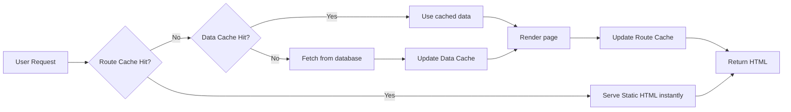

# Caching Introduction

## Introduction

Caching stores the result of an expensive operation so it can be reused later. In Next.js, caching happens at multiple levels — from database queries to rendered HTML — making your application faster and more efficient.

## Why Does Caching Matter?

Without caching, every page request would:

1. Query the database for data
2. Render the React components
3. Generate the HTML
4. Send it to the client

Repeating this for every visitor is wasteful. Caching stores the result after the first request, so subsequent visitors get the pre-computed result instantly.

## Caching in Next.js

Next.js has four caching layers:

| Cache Layer | What It Caches | Duration |
|------------|----------------|----------|
| **Full Route Cache** | Static HTML pages | Until revalidated or rebuilt |
| **Data Cache** | `fetch()` responses | Configurable (seconds to indefinite) |
| **Router Cache** | Navigation targets (client) | Session duration |
| **React Cache** | Component data | Per-request |

## How Caching Affects Your App



## Static vs Dynamic Caching

Pages can be either **static** (cached) or **dynamic** (not cached):

```tsx
// Static — cached at build time, served instantly
export default async function Page() {
  const data = await fetch('https://api.example.com/data')
  return <div>{/* render */}</div>
}

// Dynamic — rendered on each request
export default async function Page() {
  const data = await fetch('https://api.example.com/data', {
    cache: 'no-store', // or next: { revalidate: 0 }
  })
  return <div>{/* render */}</div>
}
```

## Real-World Example

A blog with 1000 daily visitors:

- **Without caching:** 1000 database queries per day, 1000 page renders
- **With ISR (revalidate every hour):** 24 database queries per day, 24 page renders

The page loads instantly for most visitors, and the database handles 97% fewer queries.

## Summary

Caching makes Next.js applications faster and more efficient by storing and reusing computed results. The framework provides four caching layers with different durations. Understanding how each layer works helps you choose the right strategy for your content.

## Related Topics

- [Cache Overview](./cache-overview.md)
- [Revalidation](./revalidation.md)
- [Practical Examples](./practical-examples.md)
