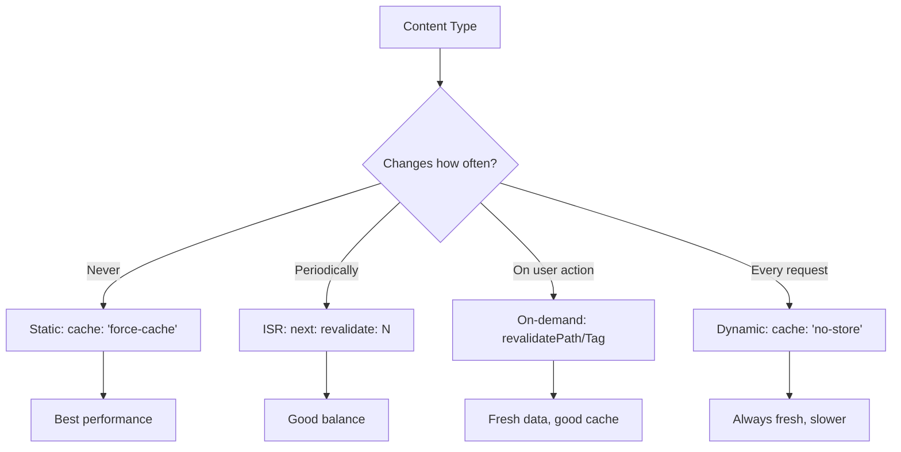

# Practical Examples

## Introduction

This topic brings together the caching concepts into practical, real-world patterns you can apply to your Next.js applications.

## Pattern 1: Blog with ISR

```tsx
// app/blog/[slug]/page.tsx
export default async function BlogPost({ params }: { params: { slug: string } }) {
  const post = await fetch(`https://cms.example.com/posts/${params.slug}`, {
    next: { revalidate: 3600 } // Revalidate every hour
  }).then(r => r.json())
  
  const relatedPosts = await fetch('https://cms.example.com/posts/related', {
    next: { revalidate: 3600, tags: ['related-posts'] }
  }).then(r => r.json())
  
  return (
    <article>
      <h1>{post.title}</h1>
      <div>{post.content}</div>
      <RelatedPosts posts={relatedPosts} />
    </article>
  )
}

// Trigger revalidation when content is updated via webhook
// app/api/webhooks/cms/route.ts
import { NextResponse } from 'next/server'

export async function POST(request: Request) {
  const { slug } = await request.json()
  revalidatePath(`/blog/${slug}`)
  revalidateTag('related-posts')
  return NextResponse.json({ revalidated: true })
}
```

## Pattern 2: Product Catalog with Filtering

```tsx
// app/products/page.tsx
export default async function ProductsPage({
  searchParams,
}: {
  searchParams: { category?: string; sort?: string }
}) {
  const products = await fetch(
    `https://api.example.com/products?category=${searchParams.category || ''}&sort=${searchParams.sort || 'newest'}`,
    { next: { revalidate: 300 } } // Cache for 5 minutes
  ).then(r => r.json())
  
  const categories = await fetch('https://api.example.com/categories', {
    next: { revalidate: 86400 } // Cache for 1 day (rarely changes)
  }).then(r => r.json())
  
  return (
    <div>
      <CategoryFilter categories={categories} />
      <ProductGrid products={products} />
    </div>
  )
}
```

## Pattern 3: Dashboard with Mixed Content

```tsx
// app/dashboard/page.tsx
export default async function DashboardPage() {
  // Fresh data every request
  const user = await fetch('https://api.example.com/me', {
    cache: 'no-store'
  }).then(r => r.json())
  
  // Revalidated hourly
  const stats = await fetch('https://api.example.com/stats', {
    next: { revalidate: 3600 }
  }).then(r => r.json())
  
  // Static config (rarely changes)
  const config = await fetch('https://api.example.com/config', {
    cache: 'force-cache'
  }).then(r => r.json())
  
  return (
    <div>
      <UserProfile user={user} />
      <DashboardStats stats={stats} />
      <FeatureFlags config={config} />
    </div>
  )
}
```

## Pattern 4: E-commerce Cart with On-Demand Revalidation

```tsx
// app/actions/cart.ts
"use server"

import { revalidatePath, revalidateTag } from 'next/cache'

export async function addToCart(productId: string) {
  const cart = await getCart()
  await db.cartItem.create({
    data: { cartId: cart.id, productId }
  })
  
  // Revalidate the specific page and cart data
  revalidatePath(`/products/${productId}`)
  revalidateTag(`cart-${cart.id}`)
}
```

## Pattern 5: API with CDN Caching

```tsx
// app/api/posts/route.ts
export async function GET() {
  const posts = await db.post.findMany({
    where: { published: true },
    orderBy: { createdAt: 'desc' },
    take: 20,
  })
  
  return NextResponse.json(posts, {
    headers: {
      'Cache-Control': 'public, s-maxage=60, stale-while-revalidate=300',
      // CDN caches for 1 minute, serves stale up to 5 minutes while revalidating
    },
  })
}
```

## Pattern 6: Tag-Based Cache Invalidation

```tsx
// app/products/page.tsx
export default async function ProductsPage() {
  const products = await fetch('https://api.example.com/products', {
    next: { tags: ['all-products', 'inventory'] }
  }).then(r => r.json())
  
  return <ProductGrid products={products} />
}

// Triggered when inventory changes
export async function updateInventory(productId: string, quantity: number) {
  await db.product.update({
    where: { id: productId },
    data: { stock: quantity }
  })
  
  // Invalidate all pages that depend on product inventory
  revalidateTag('inventory')
  revalidatePath(`/products/${productId}`)
}
```

## Caching Decision Flow



## Summary

Real-world caching uses a combination of strategies: ISR for periodic updates, on-demand revalidation for user-triggered changes, and dynamic rendering for personalized content. Match your caching strategy to how often the content changes and how fresh it needs to be.

## Related Topics

- [Cache Overview](./cache-overview.md)
- [Revalidation](./revalidation.md)
- [Cache-Control](./cache-control.md)
