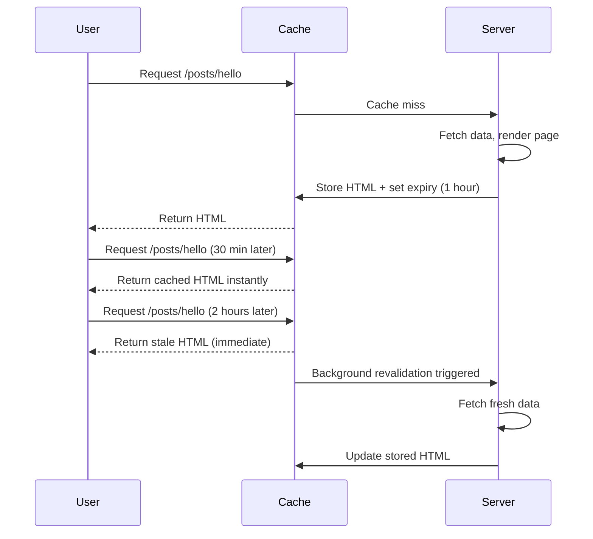

# Revalidation

## Introduction

Revalidation is the process of updating cached content when the source data changes. Next.js supports two revalidation strategies: time-based (ISR) and on-demand (triggered by code).

## Time-Based Revalidation (ISR)

Incremental Static Regeneration (ISR) lets you keep static pages up-to-date by revalidating them at a set interval:

```tsx
// app/posts/[slug]/page.tsx
export default async function PostPage({ params }: { params: { slug: string } }) {
  const post = await fetch(`https://api.example.com/posts/${params.slug}`, {
    next: { revalidate: 3600 } // Revalidate every hour
  }).then(r => r.json())
  
  return <article>{/* render post */}</article>
}
```

How ISR works:

1. First request: fetch data, render page, cache HTML
2. Subsequent requests within 1 hour: serve cached HTML instantly
3. After 1 hour: serve stale HTML (still cached), trigger background revalidation
4. When fresh data arrives: update the cache

### ISR Flow



## On-Demand Revalidation

On-demand revalidation updates the cache immediately when you know the data has changed — no need to wait for a time interval.

### revalidatePath

```tsx
// app/actions/posts.ts
"use server"

import { revalidatePath } from 'next/cache'

export async function createPost(formData: FormData) {
  await db.post.create({
    data: {
      title: formData.get('title'),
      content: formData.get('content'),
    }
  })
  
  // Clear the posts list cache
  revalidatePath('/posts')
  
  // Also revalidate the blog page
  revalidatePath('/blog')
}
```

### revalidateTag

First, tag your fetch requests:

```tsx
// app/posts/page.tsx
export default async function PostsPage() {
  const posts = await fetch('https://api.example.com/posts', {
    next: { tags: ['posts'] } // Tag the request
  }).then(r => r.json())
  
  return <div>{/* render posts */}</div>
}
```

Then revalidate by tag:

```tsx
// app/actions/posts.ts
"use server"

import { revalidateTag } from 'next/cache'

export async function publishPost(postId: string) {
  await db.post.update({
    where: { id: postId },
    data: { published: true }
  })
  
  // Revalidate all fetch requests tagged with 'posts'
  revalidateTag('posts')
}
```

## Revalidation Comparison

| Method | Scope | Use Case |
|--------|-------|----------|
| `revalidate: 3600` | Specific fetch | Blog posts that update hourly |
| `revalidatePath('/posts')` | Entire path | After creating/deleting a post |
| `revalidatePath('/posts/[slug]', 'page')` | Specific page | After updating a single post |
| `revalidateTag('posts')` | All tagged fetches | When any post changes |

## Common Mistakes

- **Not revalidating after mutations** — Created, updated, or deleted content stays stale in cache.
- **Revalidating too broadly** — `revalidatePath('/')` clears the entire cache. Be specific.
- **Setting `revalidate` too low** — Revalidating every few seconds defeats caching. Use on-demand for immediate updates.
- **Forgetting `revalidateTag` for tagged requests** — Tags are the most granular revalidation approach.

## Best Practices

- Use ISR (time-based revalidation) for content that changes on a schedule
- Use on-demand revalidation (`revalidatePath`, `revalidateTag`) for content updated by users
- Use tags for granular revalidation of specific data
- Don't set `revalidate` lower than your content's natural update frequency
- Combine ISR with on-demand revalidation for the best of both worlds

## Summary

Revalidation keeps cached content fresh. Use ISR (time-based) for content that changes on a schedule and on-demand revalidation (`revalidatePath`/`revalidateTag`) for content that changes based on user actions. For immediate updates, prefer on-demand over ISR with very short intervals.

## Related Topics

- [Cache Overview](./cache-overview.md)
- [Cache-Control](./cache-control.md)
- [Practical Examples](./practical-examples.md)
