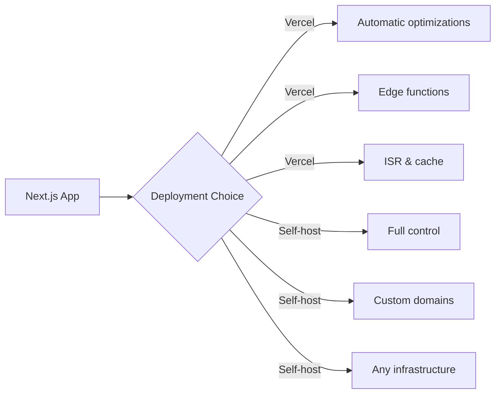

# Introduction to Deployment

## Introduction

Next.js applications can be deployed in several ways. The most common are Vercel (the platform built by the creators of Next.js) and self-hosting (your own servers, Docker, or other cloud platforms).

## Deployment Options

| Option | Best For | Setup Complexity |
|--------|----------|-----------------|
| Vercel | Most Next.js apps | Minimal |
| Docker | Custom infrastructure | Medium |
| Node.js server | Existing server setups | Medium |
| Cloud platforms (AWS, GCP) | Enterprise requirements | High |

## Vercel vs Self-Hosting

## Related Topics

- [Vercel Deployment](./vercel-deployment.md)
- [Self-Hosting](./self-hosting.md)
- [Environment Variables](./environment-variables.md)
