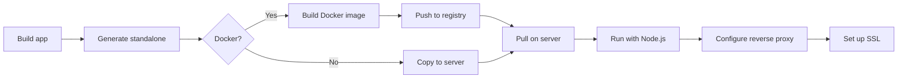

# Self-Hosting

## Introduction

Self-hosting means running your Next.js application on your own infrastructure — a VPS, Docker container, or cloud platform like AWS or Google Cloud.

## Why Self-Host?

- Full control over infrastructure
- No vendor lock-in
- Custom compliance requirements
- Lower costs at very high scale

## Docker Deployment

> **Requirement:** This Dockerfile requires `output: 'standalone'` in `next.config.js`. Without it, the `.next/standalone` folder won't exist.

### Dockerfile

```dockerfile
# Dockerfile
FROM node:20-alpine AS base

# Install dependencies
FROM base AS deps
WORKDIR /app
COPY package.json package-lock.json ./
RUN npm ci

# Build
FROM base AS builder
WORKDIR /app
COPY --from=deps /app/node_modules ./node_modules
COPY . .
RUN npm run build

# Production
FROM base AS runner
WORKDIR /app
ENV NODE_ENV=production

COPY --from=builder /app/public ./public
COPY --from=builder /app/.next/standalone ./
COPY --from=builder /app/.next/static ./.next/static

EXPOSE 3000
CMD ["node", "server.js"]
```

### Docker Compose

```yaml
# docker-compose.yml
version: '3'
services:
  nextjs:
    build: .
    ports:
      - "3000:3000"
    environment:
      - DATABASE_URL=postgresql://postgres:password@db:5432/mydb
    depends_on:
      - db

  db:
    image: postgres:16
    environment:
      POSTGRES_DB: mydb
      POSTGRES_PASSWORD: password
    volumes:
      - postgres_data:/var/lib/postgresql/data

volumes:
  postgres_data:
```

### Output File Tracing

For self-hosting, enable output file tracing to reduce deployment size:

```ts
// next.config.js
module.exports = {
  output: 'standalone',
}
```

This creates a `.next/standalone` folder with only the files needed to run your app.

## Node.js Server

```bash
# Build
npm run build

# Start production server
npm start

# Or specify a port
npx next start -p 8080
```

## Reverse Proxy with Nginx

```nginx
# /etc/nginx/sites-available/myapp
server {
    listen 80;
    server_name example.com;

    location / {
        proxy_pass http://127.0.0.1:3000;
        proxy_http_version 1.1;
        proxy_set_header Upgrade $http_upgrade;
        proxy_set_header Connection 'upgrade';
        proxy_set_header Host $host;
        proxy_cache_bypass $http_upgrade;
    }
}
```

## Self-Hosting Flow



## Common Mistakes

- **Not enabling `output: 'standalone'`** — Without it, the entire `node_modules` is needed on the server.
- **Running as root** — Always use a non-root user in Docker for security.
- **Hardcoding environment variables** — Use runtime environment variables, not build-time.
- **Not configuring reverse proxy** — Without it, you lose features like SSL termination and load balancing.

## Best Practices

- Use Docker for consistent deployments across environments
- Enable `output: 'standalone'` to reduce deployment size
- Use a reverse proxy (Nginx, Caddy) for SSL and load balancing
- Set up health checks for container orchestration
- Use environment variables for runtime configuration

## Summary

Self-hosting gives you full control. Use Docker with `output: 'standalone'` for efficient deployments, a reverse proxy for SSL and routing, and environment variables for configuration. Docker Compose simplifies multi-service setups.

## Related Topics

- [Vercel Deployment](./vercel-deployment.md)
- [Environment Variables](./environment-variables.md)
- [Deployment Checklist](./deployment-checklist.md)
