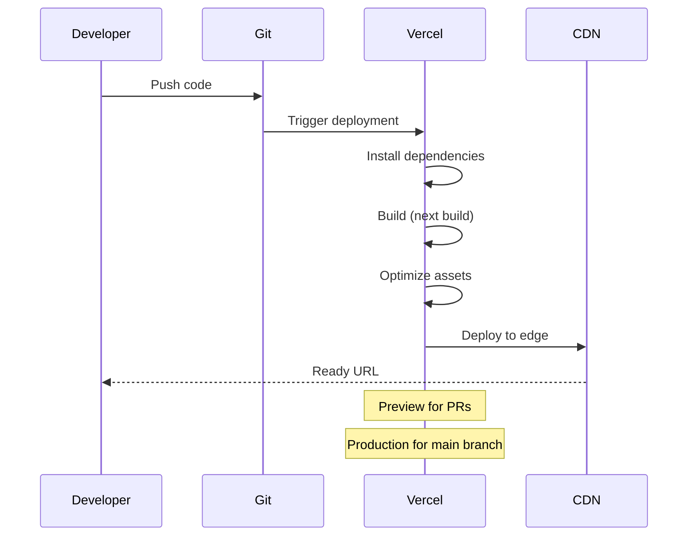

# Vercel Deployment

## Introduction

Vercel is the platform built by the creators of Next.js. It provides the best deployment experience with automatic optimizations, edge functions, and built-in analytics.

## Why Vercel?

- Zero-configuration deployment for Next.js
- Automatic ISR, image optimization, and caching
- Edge Functions for global performance
- Built-in analytics and monitoring
- Preview deployments for every Git branch

## Deploying to Vercel

### 1. Connect Your Git Repository

1. Go to [vercel.com](https://vercel.com) and sign up
2. Click "Add New → Project"
3. Import your Git repository (GitHub, GitLab, Bitbucket)
4. Vercel automatically detects Next.js

### 2. Configure Build Settings

Vercel auto-detects Next.js, so the defaults usually work:

```bash
# Build command (auto-detected)
npm run build

# Output directory (auto-detected)
.next

# Install command (auto-detected)
npm install
```

### 3. Add Environment Variables

Add these in the Vercel dashboard (Project Settings → Environment Variables):

```bash
DATABASE_URL=postgresql://...
NEXTAUTH_SECRET=your-secret
NEXTAUTH_URL=https://yourdomain.com
```

### 4. Deploy

Click "Deploy". Vercel builds your app and gives you a URL like `your-app.vercel.app`.

## Custom Domain

1. Go to Project Settings → Domains
2. Add your domain (e.g., `example.com`)
3. Update your DNS records as instructed
4. Vercel provisions an SSL certificate automatically

## Preview Deployments

Every pull request gets a unique preview URL:

```
your-app-git-feature-branch.vercel.app
```

This lets you test changes before merging to production.

## Deployment Flow



## Environment-Specific Settings

```json
// vercel.json
{
  "regions": ["iad1", "sin1", "gru1"],
  "headers": [
    {
      "source": "/(.*)",
      "headers": [
        {
          "key": "X-Frame-Options",
          "value": "DENY"
        }
      ]
    }
  ]
}
```

## Common Mistakes

- **Not setting environment variables** — The app may build but fail at runtime without `DATABASE_URL` or API keys.
- **Ignoring build warnings** — Build warnings can become errors in production. Fix them before deploying.
- **Pushing sensitive data to Git** — Use Vercel's environment variable UI, not `.env` files in Git.
- **Not configuring preview deployments** — Preview URLs can expose sensitive data if environment variables are shared.

## Best Practices

- Connect your Git repository for automatic deployments
- Use preview deployments to test changes before production
- Set environment variables in the Vercel dashboard, not in code
- Configure a custom domain with automatic SSL
- Use `vercel.json` for advanced configuration (regions, headers)

## Summary

Vercel provides the simplest deployment experience for Next.js. Connect your Git repository, add environment variables, and deploy. Use preview deployments for testing and custom domains for production.

## Related Topics

- [Self-Hosting](./self-hosting.md)
- [Environment Variables](./environment-variables.md)
- [Deployment Checklist](./deployment-checklist.md)
