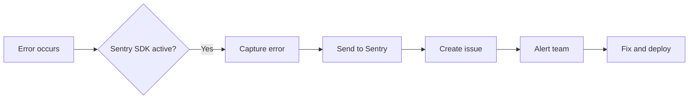

# Error Monitoring

## Introduction

Error monitoring captures unhandled exceptions and unexpected errors in your application. Instead of waiting for users to report bugs, error monitoring alerts you automatically.

## Why Do We Need This?

In development, errors appear in your terminal. In production, they happen in users' browsers or on remote servers — you won't see them unless you have error monitoring.

## Setting Up Sentry

Sentry is the most popular error monitoring platform for Next.js.

### Installation

```bash
npm install @sentry/nextjs
```

### Configuration

```ts
// sentry.client.config.ts (browser errors)
import * as Sentry from '@sentry/nextjs'

Sentry.init({
  dsn: process.env.NEXT_PUBLIC_SENTRY_DSN,
  tracesSampleRate: 0.1, // Sample 10% of transactions
  replaysSessionSampleRate: 0.1,
  replaysOnErrorSampleRate: 1.0,
})
```

```ts
// sentry.server.config.ts (server errors)
import * as Sentry from '@sentry/nextjs'

Sentry.init({
  dsn: process.env.SENTRY_DSN,
  tracesSampleRate: 0.1,
})
```

```ts
// next.config.js
const { withSentryConfig } = require('@sentry/nextjs')

module.exports = withSentryConfig(
  { /* your config */ },
  { /* Sentry options */ }
)
```

### Manual Error Reporting

```ts
import * as Sentry from '@sentry/nextjs'

export async function GET() {
  try {
    const data = await fetchExpensiveData()
    return NextResponse.json({ data })
  } catch (error) {
    Sentry.captureException(error)
    return NextResponse.json({ error: 'Failed' }, { status: 500 })
  }
}
```

## Error Monitoring Flow



## Global Error Handler

```tsx
// app/error.tsx
'use client'

import * as Sentry from '@sentry/nextjs'
import { useEffect } from 'react'

export default function ErrorPage({
  error,
  reset,
}: {
  error: Error & { digest?: string }
  reset: () => void
}) {
  useEffect(() => {
    Sentry.captureException(error)
  }, [error])

  return (
    <div className="p-8 text-center">
      <h1 className="text-2xl font-bold mb-4">Something went wrong</h1>
      <button
        onClick={() => reset()}
        className="px-4 py-2 bg-blue-600 text-white rounded"
      >
        Try again
      </button>
    </div>
  )
}
```

## Common Mistakes

- **No error monitoring configured** — You'll only learn about bugs when users report them (or leave).
- **Setting too high a sample rate** — At scale, sampling 100% of errors generates too much noise. Start with 10%.
- **Not filtering noisy errors** — Some errors (network failures, ad blockers) are noise. Configure filters.

## Best Practices

- Configure both client and server error monitoring
- Sample transactions (not errors) to manage cost — capture all errors, but only a fraction of traces
- Add context (user ID, page, action) to errors for easier debugging
- Set up alerts for critical error types
- Review errors regularly and fix the most frequent ones first

## Summary

Error monitoring catches production issues automatically. Sentry is the most popular choice for Next.js. Capture errors on both client and server, add context for debugging, and set up alerts for critical failures.

## Related Topics

- [Logging](./logging.md)
- [Performance Monitoring](./performance-monitoring.md)
- [Analytics](./analytics.md)
