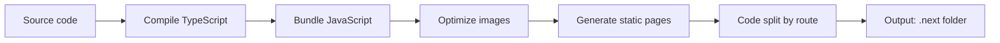

# Production Build

## Introduction

Running `next build` creates an optimized version of your application. It compiles TypeScript, bundles JavaScript, optimizes images, and generates static pages.

## Build Process



## What the Build Produces

```bash
.next/
├── static/          # JavaScript chunks and CSS
│   ├── chunks/      # Route-specific bundles
│   └── css/         # Global CSS
├── server/          # Server-side rendering code
│   ├── app/         # App Router pages
│   └── pages/       # Pages Router pages (if used)
├── standalone/      # Self-hosting output (if configured)
└── build-manifest.json  # Asset mappings
```

## Running the Build

```bash
# Standard production build
npm run build

# With bundle analyzer
ANALYZE=true npm run build

# With debug info
NODE_OPTIONS='--inspect' npm run build
```

## Build Commands

| Command | Purpose |
|---------|---------|
| `npm run build` | Standard production build |
| `ANALYZE=true npm run build` | Build with bundle analysis |
| `next build --debug` | Build with debug information |
| `next build --profile` | Build with React profiling |

## Static vs Dynamic Generation

During the build, Next.js determines which pages can be statically generated:

```txt
Route (app)                              Size     First Load JS
┌ ○ /                                    5.4 kB         87.1 kB
├ ○ /about                               1.2 kB         83.2 kB
├ λ /dashboard                           1.5 kB         85.4 kB
└ ● /blog/[slug]                         2.1 kB         84.5 kB
   ├ /blog/hello-world                   2.1 kB         84.5 kB
   └ /blog/nextjs-tips                   2.1 kB         84.5 kB

○  (Static)   - prerendered as static HTML
●  (SSG)      - prerendered as static HTML (with data)
λ  (Dynamic)  - server-rendered on demand
```

## Build Optimization Tips

```ts
// next.config.js
module.exports = {
  // Enable gzip compression (default)
  compress: true,
  
  // Generate a smaller standalone build for self-hosting
  output: 'standalone',
  
  // Configure build ID for cache busting
  generateBuildId: async () => {
    return `build-${Date.now()}`
  },
}
```

## Common Mistakes

- **Ignoring build warnings** — Warnings about large bundles or missing dependencies can cause production issues.
- **Not checking the build output** — Review which pages are static vs dynamic. Unexpected `λ` pages may indicate missing configuration.
- **Building without cleaning** — Old build artifacts can cause conflicts. Run `rm -rf .next` before building in CI.

## Best Practices

- Run `npm run build` locally before deploying to catch errors early
- Review the build output to confirm pages are rendered as expected (static vs dynamic)
- Use `output: 'standalone'` for self-hosted deployments
- Set up CI to run builds on every pull request

## Summary

The production build compiles, bundles, and optimizes your application. Review the build output to understand which pages are static vs dynamic. Use build analysis tools to identify optimization opportunities.

## Related Topics

- [Build Analysis](./build-analysis.md)
- [Static Assets](./static-assets.md)
- [Production Best Practices](./production-best-practices.md)
