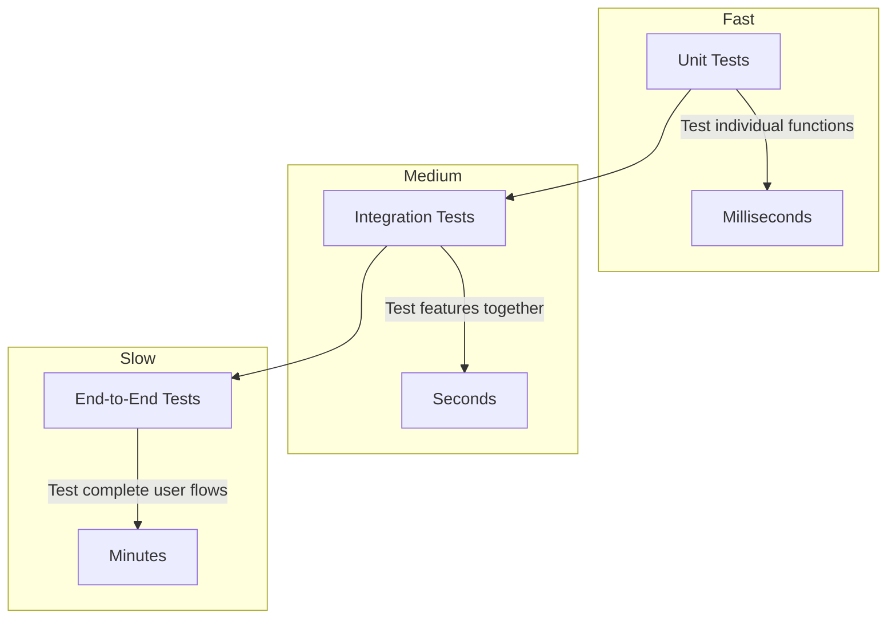

# Introduction to Testing

## Introduction

Testing your Next.js application involves multiple levels, each with different tradeoffs between speed and confidence.

## Testing Levels



## Testing Pyramid

| Test Type | What It Tests | Speed | Frequency |
|-----------|--------------|-------|-----------|
| Unit | Functions, utilities, small components | Fast (ms) | Every commit |
| Integration | Pages, API routes, features | Medium (s) | Every commit |
| E2E | Complete user flows (login, checkout) | Slow (min) | Before deploy |

## Recommended Setup

```bash
# Unit & Integration Tests
npm install vitest @testing-library/react @testing-library/jest-dom

# E2E Tests
npm install -D @playwright/test
npx playwright install
```

## Test Setup

```ts
// vitest.config.ts
import { defineConfig } from 'vitest/config'
import react from '@vitejs/plugin-react'
import path from 'path'

export default defineConfig({
  plugins: [react()],
  test: {
    environment: 'jsdom',
    setupFiles: ['./tests/setup.ts'],
  },
  resolve: {
    alias: {
      '@': path.resolve(__dirname, './src'),
    },
  },
})
```

## Summary

Use a mix of test types: fast unit tests for individual functions, integration tests for features, and a few critical E2E tests for complete user flows. Run fast tests on every commit, E2E tests before deployment.

## Related Topics

- [Unit Testing](./unit-testing.md)
- [Integration Testing](./integration-testing.md)
- [E2E Testing](./e2e-testing.md)
