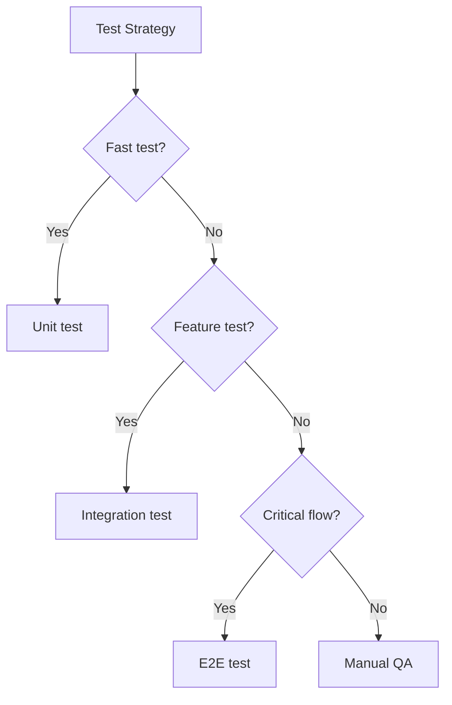

# Testing Best Practices

## Introduction

This topic summarizes the key practices for testing Next.js applications effectively.

## Testing Strategy



## What to Test

| Priority | What | Test Type |
|----------|------|-----------|
| High | Utility functions, helpers | Unit |
| High | API routes, Server Actions | Integration |
| High | Authentication flow | E2E |
| Medium | Form submissions | Integration |
| Medium | Rendering with various states | Unit |
| Low | Styling, layout | Visual |

## Writing Good Tests

```ts
// ✅ Good test — describes behavior
it('redirects unauthenticated users to login', async () => {
  const response = await fetch('http://localhost:3000/dashboard')
  expect(response.redirected).toBe(true)
  expect(response.url).toContain('/login')
})

// ❌ Not ideal — tests implementation
it('calls getServerSession', async () => {
  const spy = vi.spyOn(auth, 'getServerSession')
  await DashboardPage()
  expect(spy).toHaveBeenCalled()
})
```

## CI Integration

```yaml
# .github/workflows/test.yml
name: Tests
on: [push, pull_request]

jobs:
  test:
    runs-on: ubuntu-latest
    steps:
      - uses: actions/checkout@v4
      - uses: actions/setup-node@v4
      - run: npm ci
      - run: npx vitest run         # Unit + Integration
      - run: npx playwright test    # E2E
```

## Common Mistakes

- **Not running tests in CI** — Tests only catch issues if they're run. Integrate them into your CI pipeline.
- **Ignoring flaky tests** — A flaky test loses its value. Fix or remove it.
- **Testing only happy paths** — Test error states, empty states, and edge cases.

## Best Practices

- Run unit and integration tests on every commit
- Run E2E tests before deployment
- Keep tests fast — slow tests don't get run as often
- Test behavior, not implementation
- Use descriptive test names
- Clean up test data between runs

## Summary

A good testing strategy balances speed and confidence. Use unit tests for fast feedback, integration tests for feature verification, and a few E2E tests for critical flows. Run them in CI and keep them fast.

## Related Topics

- [Unit Testing](./unit-testing.md)
- [Integration Testing](./integration-testing.md)
- [E2E Testing](./e2e-testing.md)
