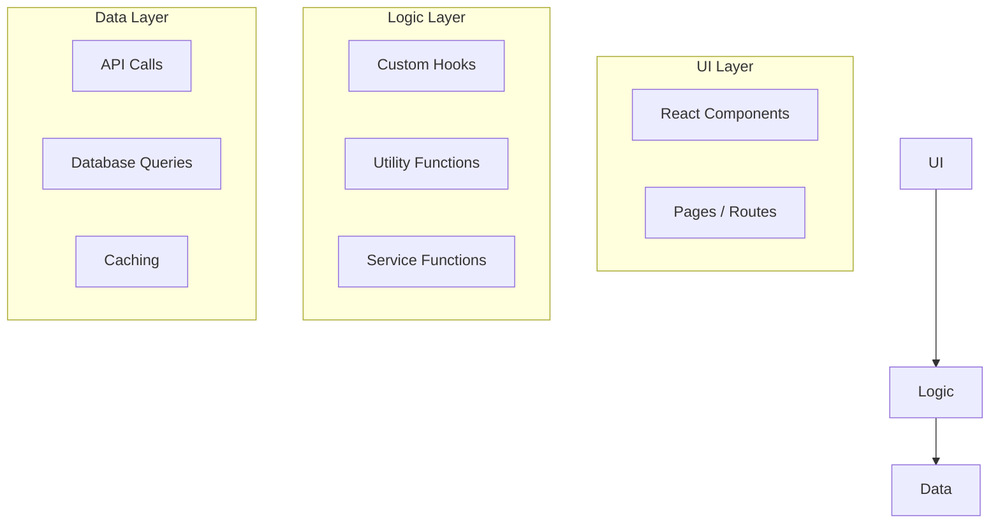

# Separating Concerns

## Introduction

Separation of concerns means organizing code so that different responsibilities live in different places. UI rendering, business logic, data access, and configuration should be separate modules.

## Why Do We Need This?

When all code is mixed together, changing one thing risks breaking another. Separated concerns let you modify the UI without touching business logic, or change the database without rewriting components.

## The Three Layers



## Example: Mixed vs Separated

### ❌ Mixed

```tsx
// app/dashboard/page.tsx
export default async function DashboardPage() {
  // Business logic mixed with rendering
  const posts = await db.post.findMany({
    where: { published: true },
  })
  
  const publishedCount = posts.filter(p => p.published).length
  const totalViews = posts.reduce((sum, p) => sum + p.views, 0)
  
  return (
    <div>
      <h1>{publishedCount} published posts</h1>
      <p>{totalViews} total views</p>
    </div>
  )
}
```

### ✅ Separated

```tsx
// lib/services/dashboard.ts
export async function getDashboardStats() {
  const posts = await db.post.findMany({
    where: { published: true },
  })
  
  return {
    publishedCount: posts.length,
    totalViews: posts.reduce((sum, p) => sum + p.views, 0),
    recentPosts: posts.slice(0, 5),
  }
}
```

```tsx
// app/dashboard/page.tsx
import { getDashboardStats } from '@/lib/services/dashboard'

export default async function DashboardPage() {
  const stats = await getDashboardStats()
  
  return (
    <div>
      <h1>{stats.publishedCount} published posts</h1>
      <p>{stats.totalViews} total views</p>
    </div>
  )
}
```

## Clean Architecture for Next.js

```
lib/
├── services/       # Business logic (getDashboardStats, createUser, etc.)
├── db.ts          # Database client
├── auth.ts        # Auth configuration
├── validations/   # Zod schemas
└── utils.ts       # General utilities
```

## Common Mistakes

- **Fat components** — If a component is 200+ lines, it's doing too much. Extract logic to services and hooks.
- **Logic in API routes** — API routes should be thin. Extract business logic to service functions.
- **Database queries in components** — Components should call services, not query databases directly.

## Best Practices

- Keep components focused on rendering and user interactions
- Extract business logic to service functions
- Use hooks for reusable stateful logic
- API routes should be thin — delegate to services

## Summary

Separate UI rendering from business logic and data access. Components handle rendering, services handle business logic, and the data layer handles persistence. This makes code easier to test, modify, and understand.

## Related Topics

- [Reusable Utilities](./reusable-utilities.md)
- [API Layer](./api-layer.md)
- [Clean Code](../maintainability/clean-code.md)
