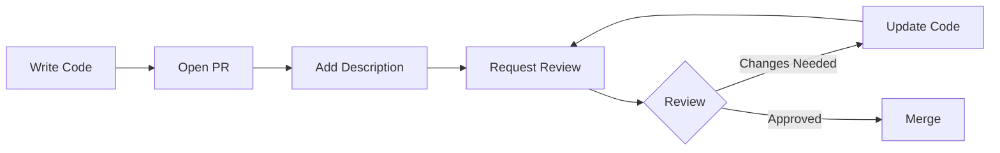

# Code Review

## Introduction

Code review is the practice of having team members examine each other's code before it gets merged. It's one of the most effective ways to catch bugs, share knowledge, and maintain code quality. For Next.js projects, code reviews also help catch framework-specific issues like incorrect data fetching patterns or missing cache configurations.

## Why Do We Need This?

- **Catch bugs early**: A second pair of eyes finds issues the author missed
- **Knowledge sharing**: Team members learn from each other's approaches
- **Consistency**: Reviews enforce project conventions and patterns
- **Ownership**: Everyone takes responsibility for code quality

## Real World Analogy

Code review is like having a co-pilot. The pilot flies the plane, but the co-pilot watches for things the pilot might miss — altitude changes, weather patterns, or runway traffic. Two people working together make better decisions than one.

## The Review Process



## What to Look For

### 1. Logic and Correctness

Does the code do what it's supposed to do?

```tsx
// ❌ Bug: Forgot to handle the case where posts is undefined
const totalViews = posts.reduce((sum, p) => sum + p.views, 0)

// ✅ Correct: Handle empty/undefined
const totalViews = posts?.reduce((sum, p) => sum + p.views, 0) ?? 0
```

### 2. Next.js Best Practices

Watch for framework-specific issues.

```tsx
// ❌ API call in a Client Component when Server Component would work
// ❌ Missing 'use client' directive when using hooks
// ❌ Using  instead of <Image> from next/image
// ❌ Not using caching strategies for data fetching
```

### 3. TypeScript Safety

Check for type issues and unnecessary `any` usage.

```tsx
// ❌ Avoiding types
function formatDate(date: any) { ... }

// ✅ Proper types
function formatDate(date: Date): string { ... }
```

### 4. Performance

Look for obvious performance issues.

```tsx
// ❌ Loading all data when only a subset is needed
const allUsers = await db.user.findMany()

// ✅ Only fetch what you need
const activeUsers = await db.user.findMany({
  where: { isActive: true },
  select: { id: true, name: true, email: true }
})
```

### 5. Security

Check for common security mistakes.

```tsx
// ❌ Exposing internal data
return NextResponse.json({ user, secretKey: process.env.API_KEY })

// ✅ Only send what's needed
return NextResponse.json({ id: user.id, name: user.name })
```

## Writing Good PR Descriptions

A good PR description helps reviewers understand what they're reviewing.

```markdown
## Summary

Add user profile editing feature.

## Changes

- Add `ProfileForm` component with validation
- Create PATCH `/api/user/profile` route handler
- Add form validation with Zod
- Update user avatar upload with signed URLs

## Testing

- [x] Unit tests for validation
- [x] Manual test with form submission
- [ ] E2E test for file upload (next PR)

## Screenshots


```

## Giving Feedback

### Be Specific

```
❌ "This needs work."
✅ "The error handling doesn't cover the case where the API returns 403. Let's add that."
```

### Be Kind

```
❌ "Why would anyone write code like this?"
✅ "This function is doing a lot. Could we break it into smaller pieces?"
```

### Ask Questions

```
❌ "You're wrong about this approach."
✅ "I'm curious why you chose useMemo here — would a simple variable work?"
```

## Receiving Feedback

- **Don't take it personally**: Feedback is about the code, not you
- **Ask for clarification** if you don't understand a comment
- **Thank reviewers** for catching issues
- **Push fixes quickly** to keep the PR moving

## Best Practices

- Keep PRs **small** (under 400 lines when possible)
- Review within **24 hours** to keep momentum
- Review **in order**: architecture → logic → style
- Use **suggestions** in GitHub/GitLab for small fixes
- Run the code locally if the change is complex
- **Automate** formatting and linting so reviews focus on logic

## Common Mistakes

- **Rubber stamping**: Approving without actually reviewing
- **Nitpicking style**: Let automation handle formatting
- **Reviewing too late**: Waiting days to review blocks the team
- **Bike-shedding**: Spending too much time on trivial decisions
- **Reviewing alone**: Complex changes benefit from multiple perspectives

## Summary

Code review is a team sport. The goal isn't to catch every bug — it's to share knowledge, maintain quality, and build a culture where everyone feels ownership over the codebase. Keep reviews focused, timely, and respectful.

## Related Topics

- [Clean Code](./clean-code)
- [Documentation](./documentation)
- [Refactoring](./refactoring)
- [Project Checklist](./project-checklist)
