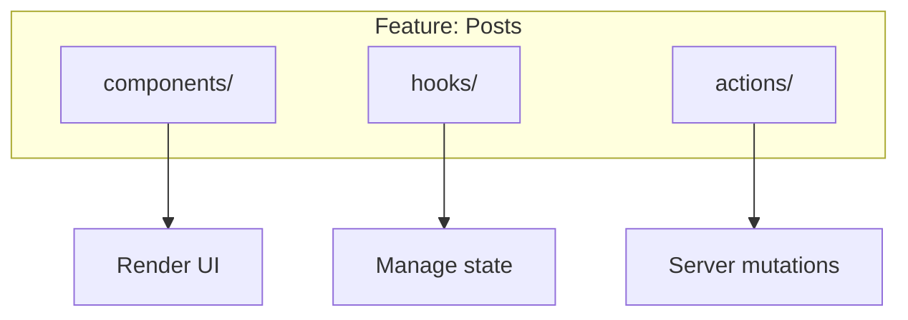

# Feature-Based Architecture

## Introduction

Feature-based architecture organizes code by the feature it belongs to (e.g., `auth`, `posts`, `billing`) rather than by file type (e.g., `components`, `hooks`, `utils`).

## Why Do We Need This?

In a typical file-type-based structure, a single feature touches many folders:

```
components/PostList.tsx
hooks/usePosts.ts
actions/createPost.ts
types/post.ts
```

When you need to understand or modify the "posts" feature, you have to jump between five different folders. Feature-based architecture keeps everything together:

```
features/posts/
  components/PostList.tsx
  hooks/usePosts.ts
  actions.ts
  types.ts
```

## Feature Structure



## Example Feature

```
features/posts/
├── components/
│   ├── PostList.tsx
│   ├── PostCard.tsx
│   ├── CreatePostForm.tsx
│   └── PostActions.tsx
├── hooks/
│   ├── usePosts.ts
│   └── usePost.ts
├── actions.ts          # Server Actions
└── types.ts            # Feature-specific types
```

```tsx
// features/posts/components/PostList.tsx
import { usePosts } from '../hooks/usePosts'
import { PostCard } from './PostCard'

export function PostList() {
  const { posts, loading } = usePosts()
  
  if (loading) return <PostListSkeleton />
  
  return (
    <div className="space-y-4">
      {posts.map(post => (
        <PostCard key={post.id} post={post} />
      ))}
    </div>
  )
}
```

## When to Create a Feature

Create a new feature folder when:

- The feature has 3+ related components
- The feature has custom hooks or state management
- The feature involves Server Actions or API calls

## Common Mistakes

- **Creating too many small features** — If a feature has only one file, it probably doesn't need its own folder.
- **Mixed granularity** — Keep features at the same level of abstraction. Don't have `auth` next to `submit-contact-form`.
- **Circular dependencies between features** — Features should not import from each other. Extract shared code to `components/` or `lib/`.

## Best Practices

- Create feature folders for significant, self-contained functionality
- Export a clean public API from each feature folder
- Keep shared code in `components/`, not imported across features
- Use barrel files (`index.ts`) to simplify imports

## Summary

Feature-based architecture groups code by business capability rather than file type. This makes features easier to understand, modify, and remove. Create feature folders for significant functionality and keep shared code in the `components/` folder.

## Related Topics

- [Folder Structure](./folder-structure.md)
- [Shared Components](./shared-components.md)
- [Separating Concerns](../code-organization/separating-concerns.md)
