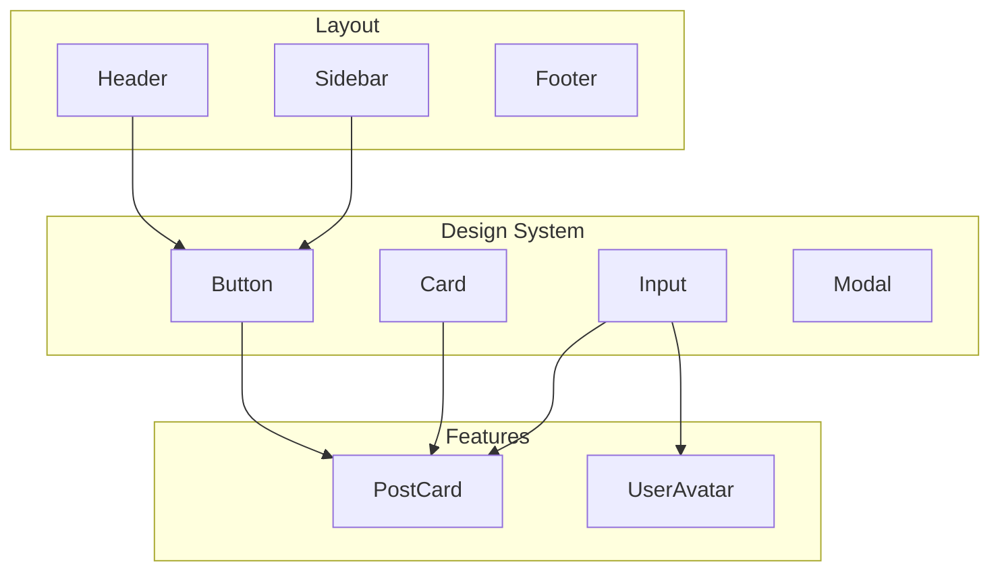

# Shared Components

## Introduction

Shared components are reusable UI elements used across multiple features — buttons, inputs, cards, modals. They ensure visual consistency and reduce duplication.

## Component Hierarchy



## Organizing Shared Components

```
components/
├── ui/                    # Primitive components (design system)
│   ├── Button.tsx
│   ├── Input.tsx
│   ├── Card.tsx
│   ├── Modal.tsx
│   └── index.ts          # Barrel exports
├── layout/                # Layout components
│   ├── Header.tsx
│   ├── Footer.tsx
│   └── Sidebar.tsx
└── shared/                # Domain-specific shared components
    ├── UserAvatar.tsx
    ├── Pagination.tsx
    └── EmptyState.tsx
```

## Building a Shared Component

```tsx
// components/ui/Button.tsx
import { ButtonHTMLAttributes, forwardRef } from 'react'

type ButtonVariant = 'primary' | 'secondary' | 'danger' | 'ghost'

interface ButtonProps extends ButtonHTMLAttributes<HTMLButtonElement> {
  variant?: ButtonVariant
}

export const Button = forwardRef<HTMLButtonElement, ButtonProps>(
  ({ variant = 'primary', className, children, ...props }, ref) => {
    const base = 'px-4 py-2 rounded-lg font-medium transition-colors'
    const variants = {
      primary: 'bg-blue-600 text-white hover:bg-blue-700',
      secondary: 'bg-gray-200 text-gray-900 hover:bg-gray-300',
      danger: 'bg-red-600 text-white hover:bg-red-700',
      ghost: 'text-gray-600 hover:bg-gray-100',
    }
    
    return (
      <button
        ref={ref}
        className={`${base} ${variants[variant]} ${className ?? ''}`}
        {...props}
      >
        {children}
      </button>
    )
  }
)

Button.displayName = 'Button'
```

## Barrel Exports

```ts
// components/ui/index.ts
export { Button } from './Button'
export { Input } from './Input'
export { Card } from './Card'
export { Modal } from './Modal'
```

Now features can import cleanly:

```tsx
import { Button, Input, Card } from '@/components/ui'
```

## Common Mistakes

- **Over-engineering shared components** — Add features (variants, sizes) as needed, not preemptively.
- **No TypeScript props** — Shared components should have well-typed props for discoverability.
- **Not using barrel exports** — Deep import paths (`@/components/ui/Button/Button`) are harder to refactor.

## Best Practices

- Start simple — extract shared components when you see duplication (3+ uses)
- Use TypeScript for prop autocomplete and type safety
- Export from barrel files for clean imports
- Keep components focused on presentation, not business logic
- Document complex components with JSDoc comments

## Summary

Shared components reduce duplication and ensure consistency. Organize them by layer (ui primitives, layout, shared domain). Use barrel exports for clean imports. Start simple and extract when needed.

## Related Topics

- [Reusable Hooks](./reusable-hooks.md)
- [Feature-Based Architecture](./feature-based-architecture.md)
- [Naming Conventions](./naming-conventions.md)
