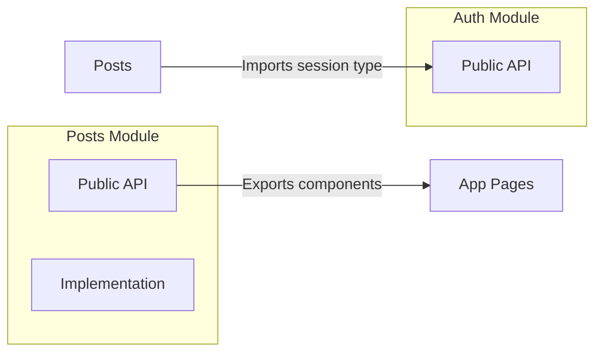

# Module Organization

## Introduction

Modules are the building blocks of your application. A well-organized module has clear boundaries, a defined public API, and minimal dependencies on other modules.

## What is a Module?

A module is a self-contained unit of functionality — like `auth`, `posts`, or `billing`. Each module should have:

- A clear responsibility
- Minimal dependencies on other modules
- A well-defined public API (exports)
- Internal details that are private to the module

## Module Structure

```
features/posts/
├── components/       # Public components
│   ├── PostList.tsx
│   └── PostCard.tsx
├── hooks/           # Public hooks
│   └── usePosts.ts
├── actions.ts       # Server Actions
├── types.ts         # Module-specific types
└── index.ts         # Barrel file — defines public API
```

## Public vs Private API

Use barrel files to define what's public:

```ts
// features/posts/index.ts — Public API
export { PostList, PostCard } from './components'
export { usePosts } from './hooks/usePosts'
export type { Post } from './types'

// Don't export — internal implementation details
// export { PostForm } from './components/PostForm'
// export { formatPostDate } from './utils'
```

Other modules should only import from the barrel:

```tsx
// ✅ Correct — imports from public API
import { PostList, usePosts } from '@/features/posts'

// ❌ Wrong — imports internal details
import { PostForm } from '@/features/posts/components/PostForm'
```

## Module Communication

Modules should communicate through clear interfaces:



## When to Extract a Module

Create a new module when:

- A set of files has a clear, single responsibility
- The code is used by multiple features or pages
- You can name it with a single noun (auth, posts, billing, notifications)

## Common Mistakes

- **Modules that depend on everything** — If a module imports from 10+ other modules, its responsibility is probably too broad.
- **Circular dependencies** — Module A imports from B, and B imports from A. This creates subtle bugs.
- **Giant barrel files that export everything** — Only export what other modules should use.

## Best Practices

- Use barrel files to define the public API of each module
- Keep module dependencies small and unidirectional
- Extract a module when you can name it with a single noun
- Regularly review and prune unnecessary exports

## Summary

Modules are self-contained units of functionality with clear public APIs. Use barrel files to define what's public and keep internal details private. Minimize dependencies between modules to keep the codebase maintainable as it grows.

## Related Topics

- [Project Scaling](./project-scaling.md)
- [Feature-Based Architecture](../project-structure/feature-based-architecture.md)
- [Separating Concerns](../code-organization/separating-concerns.md)
