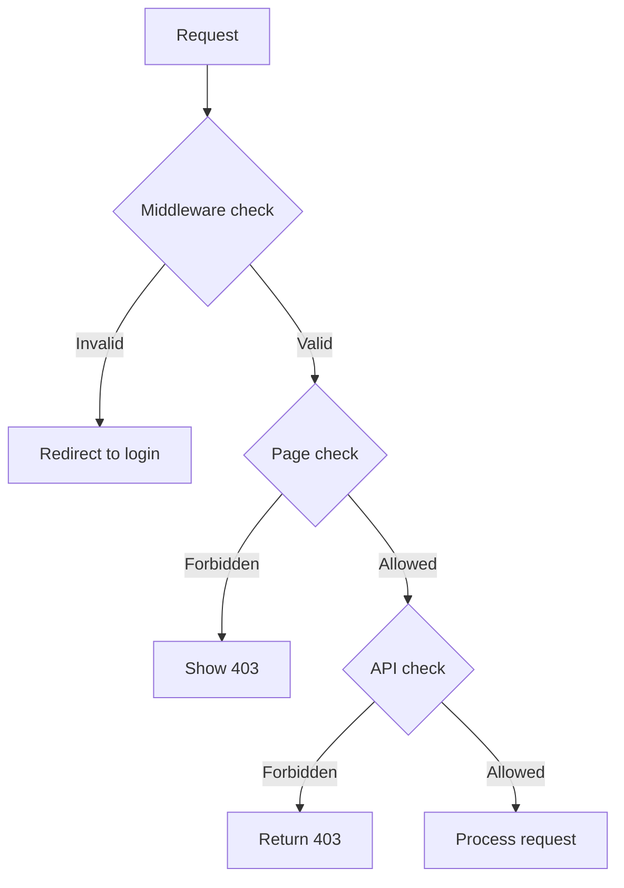

# Authorization Best Practices

## Introduction

Authorization determines what an authenticated user can do. While authentication answers "who are you?", authorization answers "what are you allowed to do?"

## Principle of Least Privilege

Users should only have the permissions they need to do their job. No more, no less.

```ts
// ✅ Correct — start with no permissions, add explicitly
const rolePermissions = {
  admin: ['create:post', 'edit:post', 'delete:post', 'manage:users'],
  editor: ['create:post', 'edit:post'],
  user: [], // Only access they have is what's publicly available
}
```

## Defense in Depth

Check authorization at multiple layers:



## Server-Side Enforcement

Never rely on client-side checks alone:

```ts
// ✅ Correct — check on the server
export async function deletePost(postId: string) {
  const session = await getServerSession(authOptions)
  if (!session) throw new Error('Unauthorized')
  
  const post = await db.post.findUnique({ where: { id: postId } })
  if (post.authorId !== session.user.id) {
    throw new Error('Forbidden') // Can't delete another user's post
  }
  
  await db.post.delete({ where: { id: postId } })
}
```

```tsx
// ❌ Wrong — client-side only check (easily bypassed)
{user.role === 'admin' && <DeleteButton />}
```

## Common Authorization Models

| Model | Description | When to Use |
|-------|-------------|-------------|
| RBAC | Users have roles, roles have permissions | Most applications |
| ABAC | Access based on attributes (user, resource, environment) | Complex, multi-tenant apps |
| Ownership | Users can only access their own data | Social apps, user content |

## Common Mistakes

- **Only checking in the UI** — Hide buttons but don't protect API routes. Attackers can call the API directly.
- **Inconsistent checks** — Checking auth in some routes but not others. Apply everywhere.
- **Overly complex permission systems** — Start with simple RBAC. Add complexity only when needed.

## Best Practices

- Check authorization on the server, never rely on the client
- Apply the principle of least privilege
- Use a consistent pattern for checks (middleware for routes, helpers for pages)
- Log authorization failures for security monitoring
- Test both positive (allowed) and negative (denied) cases

## Summary

Authorization controls what users can do. Enforce checks on the server at every layer — middleware, pages, and API routes. Use RBAC for most applications. Never trust client-side checks alone.

## Related Topics

- [Authentication Best Practices](./authentication-best-practices.md)
- [API Security](./api-security.md)
- [Common Security Mistakes](./common-security-mistakes.md)
