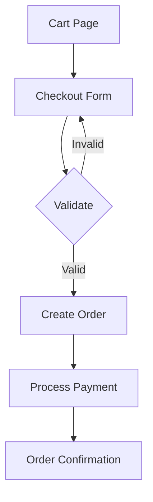

# Checkout

## Introduction

The checkout flow is where e-commerce gets real. You'll handle address validation, create orders in the database, and process payments. This guide uses a mock payment flow that you can replace with Stripe later.

## Checkout Flow



## Order Schema

```prisma
model Order {
  id          String   @id @default(cuid())
  userId      String?
  email       String
  items       Json
  total       Float
  status      String   @default("pending")
  address     Json
  createdAt   DateTime @default(now())
}
```

## Checkout Form with Server Action

```ts
// lib/actions/checkout.ts
'use server'

import { z } from 'zod'
import { db } from '@/lib/db'
import { revalidatePath } from 'next/cache'
import { redirect } from 'next/navigation'

const checkoutSchema = z.object({
  email: z.string().email(),
  name: z.string().min(2),
  address: z.string().min(5),
  city: z.string().min(2),
  postalCode: z.string().min(3),
  items: z.string(), // JSON stringified cart items
  total: z.string(),
})

export async function createOrder(formData: FormData) {
  const validated = checkoutSchema.safeParse({
    email: formData.get('email'),
    name: formData.get('name'),
    address: formData.get('address'),
    city: formData.get('city'),
    postalCode: formData.get('postalCode'),
    items: formData.get('items'),
    total: formData.get('total'),
  })

  if (!validated.success) {
    return { errors: validated.error.flatten().fieldErrors }
  }

  const data = validated.data

  try {
    await db.order.create({
      data: {
        email: data.email,
        items: JSON.parse(data.items),
        total: parseFloat(data.total),
        address: {
          name: data.name,
          address: data.address,
          city: data.city,
          postalCode: data.postalCode,
        },
      },
    })

    revalidatePath('/orders')
  } catch (error) {
    return { error: 'Failed to create order. Please try again.' }
  }

  redirect(`/orders/success?email=${encodeURIComponent(data.email)}`)
}
```

## Checkout Page

```tsx
// app/checkout/page.tsx
import CheckoutForm from '@/components/checkout-form'

export default function CheckoutPage() {
  return (
    <div className="max-w-2xl mx-auto px-4 py-8">
      <h1 className="text-3xl font-bold mb-8">Checkout</h1>
      <CheckoutForm />
    </div>
  )
}
```

```tsx
// components/checkout-form.tsx
'use client'

import { useActionState } from 'react'
import { useCartStore } from '@/lib/cart-store'
import { createOrder } from '@/lib/actions/checkout'

export default function CheckoutForm() {
  const { items, getTotal } = useCartStore()

  const [state, formAction, pending] = useActionState(
    async (prev: unknown, formData: FormData) => {
      formData.set('items', JSON.stringify(items))
      formData.set('total', getTotal().toString())
      return createOrder(formData)
    },
    { errors: {}, error: '' }
  )

  if (items.length === 0) {
    return (
      <p className="text-gray-500">
        Your cart is empty.{' '}
        <a href="/products" className="text-blue-600 hover:underline">
          Browse products
        </a>
      </p>
    )
  }

  return (
    <form action={formAction} className="space-y-6">
      {state.error && (
        <p className="bg-red-100 text-red-700 p-3 rounded">{state.error}</p>
      )}

      <div>
        <label htmlFor="email" className="block font-medium mb-1">Email</label>
        <input id="email" name="email" type="email" required
               className="w-full border rounded p-2" />
        {state.errors?.email && (
          <p className="text-red-500 text-sm">{state.errors.email}</p>
        )}
      </div>

      <div>
        <label htmlFor="name" className="block font-medium mb-1">Full Name</label>
        <input id="name" name="name" required className="w-full border rounded p-2" />
        {state.errors?.name && (
          <p className="text-red-500 text-sm">{state.errors.name}</p>
        )}
      </div>

      <div>
        <label htmlFor="address" className="block font-medium mb-1">Address</label>
        <input id="address" name="address" required
               className="w-full border rounded p-2" />
        {state.errors?.address && (
          <p className="text-red-500 text-sm">{state.errors.address}</p>
        )}
      </div>

      <div className="grid grid-cols-2 gap-4">
        <div>
          <label htmlFor="city" className="block font-medium mb-1">City</label>
          <input id="city" name="city" required
                 className="w-full border rounded p-2" />
        </div>
        <div>
          <label htmlFor="postalCode" className="block font-medium mb-1">
            Postal Code
          </label>
          <input id="postalCode" name="postalCode" required
                 className="w-full border rounded p-2" />
        </div>
      </div>

      <div className="border-t pt-4">
        <p className="text-xl font-bold">
          Total: ${getTotal().toFixed(2)}
        </p>
      </div>

      <button
        type="submit"
        disabled={pending}
        className="w-full bg-green-600 text-white py-3 rounded-lg
                   hover:bg-green-700 disabled:opacity-50 transition"
      >
        {pending ? 'Processing...' : 'Place Order'}
      </button>
    </form>
  )
}
```

## Best Practices

- Validate all inputs on the server with Zod
- Use database transactions for order creation
- Show order confirmation with a clear summary
- Handle payment failures gracefully with retry options

## Summary

The checkout flow uses Server Actions for secure order creation with Zod validation. Collect shipping information, validate on the server, create the order in the database, and redirect to a confirmation page.
