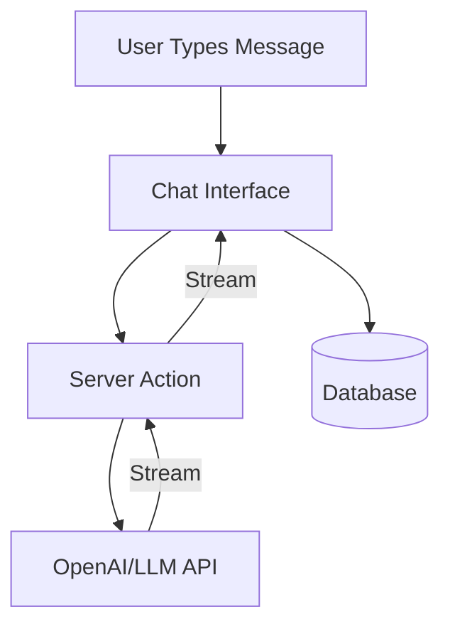

# Project Overview

## What You'll Build

A ChatGPT-style chat application where users type messages and receive streaming AI responses. The app supports multiple conversations, message history, and rich markdown rendering.

## Key Features

### 1. Chat Interface
- Message list with user and AI messages
- Input field with send button
- Loading indicator during streaming
- Auto-scroll to latest messages

### 2. Streaming Responses
- AI responses appear word-by-word (streaming)
- Cancel in-progress responses
- Error handling with retry

### 3. Conversation Management
- Create new conversations
- Switch between conversations
- View conversation history
- Delete conversations

### 4. Rich Message Rendering
- Markdown support in AI responses
- Code syntax highlighting
- Links rendered as clickable
- Copy code button

## Architecture

## Pages

| Route | Purpose |
|-------|---------|
| `/chat` | Main chat interface |
| `/chat/[id]` | Specific conversation |

## Learning Objectives

- Use the Vercel AI SDK for streaming
- Build Server Actions that return streams
- Manage conversation state
- Persist chat messages in a database
- Handle streaming UI updates with React
