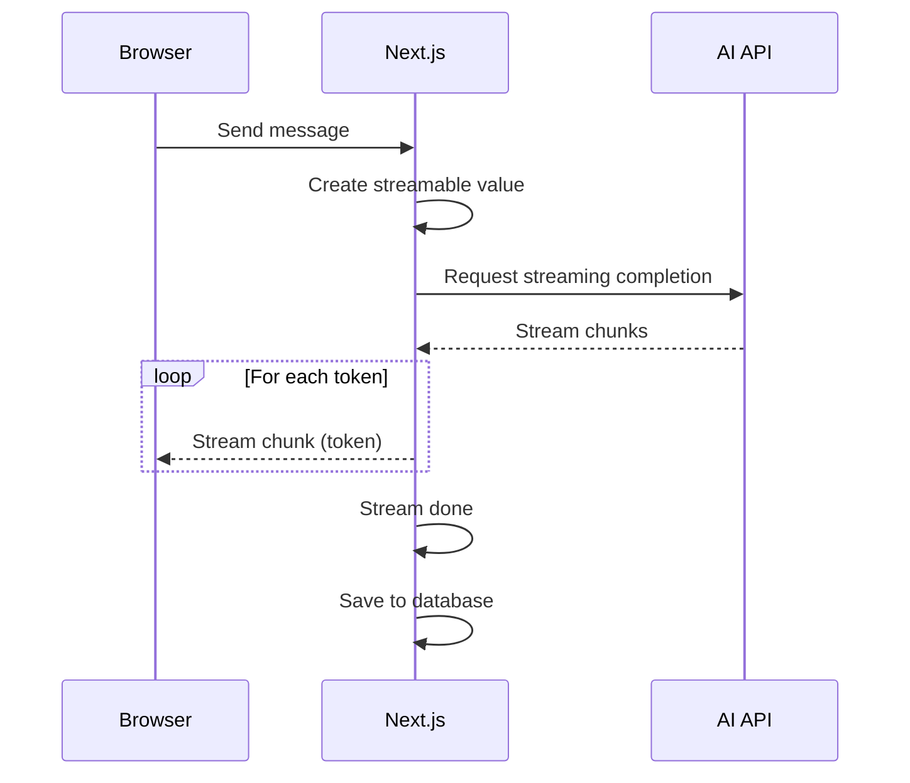

# Streaming Responses

## Introduction

Streaming is what makes AI chat feel interactive. Instead of waiting for the entire response, users see tokens appear one by one, creating a natural conversational experience.

## How Streaming Works



## Server-Side Streaming

The Vercel AI SDK handles the complexity of streaming:

```ts
// lib/actions/chat.ts
import { createStreamableValue } from 'ai/rsc'
import { streamText } from 'ai'
import { openai } from '@ai-sdk/openai'

export async function generateResponse(message: string) {
  'use server'

  const stream = createStreamableValue()

  ;(async () => {
    const { textStream } = await streamText({
      model: openai('gpt-4o-mini'),
      messages: [
        {
          role: 'system',
          content: 'You are a helpful assistant. Answer concisely.',
        },
        {
          role: 'user',
          content: message,
        },
      ],
    })

    for await (const chunk of textStream) {
      stream.update(chunk)
    }

    stream.done()
  })()

  return stream.value
}
```

## Client-Side Consumption

```tsx
// Client component
import { readStreamValue } from 'ai/rsc'

async function handleSend(message: string) {
  const stream = await generateResponse(message)

  let response = ''
  for await (const chunk of readStreamValue(stream)) {
    response += chunk ?? ''
    // Update UI with partial response
    updateMessage(response)
  }
}
```

## Error Handling

```ts
export async function generateResponseWithRetry(
  message: string,
  retries = 2
) {
  for (let i = 0; i <= retries; i++) {
    try {
      return await generateResponse(message)
    } catch (error) {
      if (i === retries) throw error
      await new Promise(r => setTimeout(r, 1000 * (i + 1)))
    }
  }
}
```

## Abort Controller

Allow users to cancel in-progress streams:

```ts
let abortController: AbortController | null = null

export async function generateResponse(message: string) {
  abortController = new AbortController()

  try {
    const { textStream } = await streamText({
      model: openai('gpt-4o-mini'),
      prompt: message,
      abortSignal: abortController.signal,
    })
    // ... consume stream
  } catch (error) {
    if ((error as any)?.name === 'AbortError') {
      return { cancelled: true }
    }
    throw error
  }
}

export function cancelResponse() {
  abortController?.abort()
}
```

## Best Practices

- Always stream AI responses — never wait for the full response
- Use `createStreamableValue` from `ai/rsc` for server-side streaming
- Implement retry logic for transient failures
- Allow users to cancel streaming responses
- Save complete messages to the database after streaming finishes

## Common Mistakes

- **Not consuming the stream** — `for await` loops are required to process chunks
- **Missing abort handling** — Users should be able to stop AI responses
- **No timeout** — Set a timeout on AI API calls to prevent hanging
- **Saving partial messages** — Only save complete messages to the database

## Summary

Streaming is essential for a good AI chat experience. Use `createStreamableValue` on the server and `readStreamValue` on the client. Add retry logic for resilience and abort controllers for user control.
