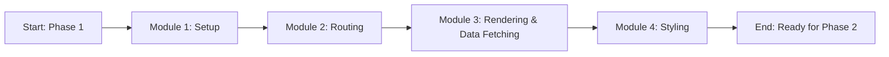
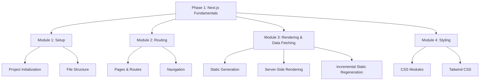
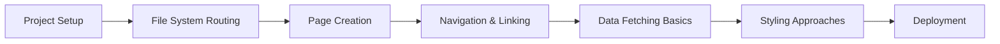
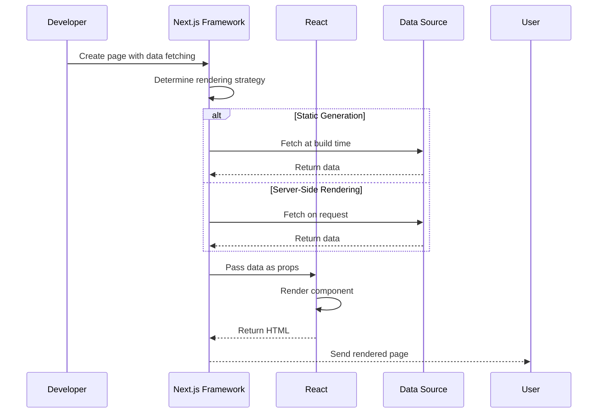

# Phase 1: Next.js Fundamentals

## Introduction
Welcome to Phase 1 of your Next.js journey! This phase lays the essential foundation for understanding Next.js, covering core concepts that will enable you to build robust applications. You'll learn how Next.js extends React with powerful features like file-system routing, page creation, and basic data fetching.

## Why do we need this?
Understanding the fundamentals is crucial before diving into advanced topics like the App Router, server components, and performance optimization. This phase ensures you grasp the building blocks that make Next.js unique and prepares you for real-world application development.

## Problem Statement
Developers transitioning to Next.js often face challenges in understanding its file-system routing, data fetching methods, and deployment processes. Without a solid foundation, they may struggle to build scalable applications, leading to inefficient code, poor performance, and deployment difficulties. This phase addresses these gaps by providing a structured learning path.

## Real World Story
Sarah, a frontend developer, was tasked with migrating a React application to Next.js for better SEO and performance. Initially overwhelmed by concepts like getStaticProps and API routes, she dedicated time to mastering the fundamentals through structured learning. After completing this phase, she successfully migrated the application, reducing load times by 60% and improving search rankings.

## Real World Analogy
Think of learning Next.js fundamentals as learning to drive a car. Before navigating complex highways (advanced features), you must first understand the controls (routing), how to start the engine (project setup), and basic traffic rules (data fetching). Once comfortable with these, you can confidently handle any driving scenario.

## Visual Explanation
This phase introduces the core concepts of Next.js through practical modules, guiding you from project setup to deployment. Each module builds upon the previous, ensuring a cohesive learning journey.

## Mermaid Diagram 1: Learning Path Overview


## Internal Working
This phase is organized into four progressive modules, each focusing on a key aspect of Next.js development. Concepts are introduced through explanations, visual aids, code examples, and hands-on exercises to reinforce learning.

## Mermaid Diagram 2: Module Structure


## Architecture
The phase follows a modular architecture where each module covers a distinct topic area. The progression ensures foundational knowledge is established before advancing to more complex concepts. Each module includes theory, practical examples, and exercises to solidify understanding.

## Mermaid Diagram 3: Concept Flow


## Step-by-Step Flow
1. **Setup**: Initialize a Next.js project and understand the default file structure.
2. **Routing**: Learn how pages become routes via the file-system.
3. **Navigation**: Implement client-side navigation with the Link component.
4. **Data Fetching**: Explore static generation, server-side rendering, and incremental regeneration.
5. **Styling**: Apply CSS using various methods like CSS Modules and Tailwind.
6. **Deployment**: Prepare and deploy your application to production.

## Mermaid Diagram 4: Data Flow in Next.js


## Syntax
### Basic Page Creation
```jsx
// pages/index.js
export default function Home() {
  return (
    <div>
      <h1>Welcome to Next.js!</h1>
      <p>This is your first Next.js page.</p>
    </div>
  );
}
```

## Basic Example
Creating a simple homepage with navigation:
```jsx
// pages/index.js
import Link from 'next/link';

export default function Home() {
  return (
    <div>
      <h1>My Next.js Blog</h1>
      <nav>
        <Link href="/">Home</Link> |
        <Link href="/about">About</Link> |
        <Link href="/posts">Posts</Link>
      </nav>
    </div>
  );
}
```

## Intermediate Example
Implementing data fetching with getStaticProps:
```jsx
// pages/posts.js
export async function getStaticProps() {
  const posts = [
    { id: 1, title: 'First Post' },
    { id: 2, title: 'Second Post' }
  ];
  return { props: { posts } };
}

export default function Posts({ posts }) {
  return (
    <div>
      <h1>Blog Posts</h1>
      <ul>
        {posts.map(post => (
          <li key={post.id}>{post.title}</li>
        ))}
      </ul>
    </div>
  );
}
```

## Advanced Example
Using incremental static regeneration (ISR) for a blog:
```jsx
// pages/posts/[id].js
export async function getStaticPaths() {
  return {
    paths: [
      { params: { id: '1' } },
      { params: { id: '2' } }
    ],
    fallback: 'blocking'
  };
}

export async function getStaticProps({ params }) {
  const post = { id: params.id, title: `Post ${params.id}` };
  return { props: { post }, revalidate: 60 }; // Revalidate every 60 seconds
}

export default function Post({ post }) {
  return (
    <div>
      <h1>{post.title}</h1>
      <p>Content for post {post.id}</p>
    </div>
  );
}
```

## Production Example
Deploying a Next.js application to Vercel:
1. Push code to a GitHub repository.
2. Import the repository into Vercel.
3. Configure build settings (if needed).
4. Click "Deploy" – Vercel automatically builds and deploys the application.
5. Access the live site at the provided URL.

## Folder Structure
A typical Next.js project follows this structure:
```
my-nextjs-app/
├── pages/
│   ├── index.js          # Home page
│   ├── about.js          # About page
│   └── posts/
│       └── [id].js       # Dynamic post page
├── public/
│   ├── images/
│   └── favicon.ico
├── styles/
│   └── globals.css
├── package.json
├── next.config.js
└── README.md
```
Each file in the `pages` directory automatically becomes a route based on its file path.

## Best Practices
- Use functional components with React hooks for state management.
- Leverage file-system routing: each file in `pages` becomes a route automatically.
- Optimize images with the `next/image` component for automatic resizing and format optimization.
- Implement environment variables for configuration (e.g., API keys) using `.env.local`.
- Keep components small and reusable; place shared components in a `components` directory.

## Common Mistakes
- Forgetting to export the page component as the default export in `pages/*.js` files.
- Placing non-page files (like components) directly in the `pages` directory, which creates unintended routes.
- Using `<a>` tags for navigation instead of the `next/link` component, causing full page reloads.
- Neglecting to optimize images, leading to slow page loads and poor Core Web Vitals.
- Overlooking error handling in data fetching methods, resulting in ungraceful failure states.

## Performance Notes
- Utilize Static Generation (SSG) for content that doesn't change frequently to achieve optimal performance.
- Implement Incremental Static Regeneration (ISR) for periodically updated content, balancing freshness with caching.
- Leverage Next.js's automatic code splitting to ensure only necessary JavaScript is loaded per page.
- Use the `next/image` component for automatic image optimization, including lazy loading and modern formats.
- Avoid large third-party libraries; consider tree-shaking alternatives or lazy loading non-critical scripts.

## Security Notes
- Always validate and sanitize user input on the server side, especially in API routes and server-side data fetching.
- Use environment variables for sensitive information (API keys, database tokens) and prefix with `NEXT_PUBLIC_` only for client-exposed variables.
- Implement proper HTTP headers (e.g., Content Security Policy) via middleware or custom server configurations.
- Regularly update dependencies using `npm audit` and `npm update` to mitigate known vulnerabilities.
- Protect API routes with authentication and authorization checks to prevent unauthorized access.

## SEO Considerations
- Use semantic HTML elements (header, nav, main, section, footer) to improve accessibility and search engine understanding.
- Implement dynamic meta tags using the `next/head` component for unique titles and descriptions per page.
- Generate a sitemap automatically with tools like `next-sitemap` to help search engines index your site effectively.
- Ensure fast loading times by optimizing images, leveraging browser caching, and minimizing render-blocking resources.
- Create descriptive, keyword-rich URLs using the file-system routing (e.g., `/blog/post-title` instead of `/post?id=123`).

## Interview Questions
1. What command creates a new Next.js project?
2. How does Next.js handle routing by convention?
3. What's the difference between `npm run dev` and `npm start`?
4. Where should you place static assets like images?
5. How do you customize Next.js configuration?

## MCQs
1. What is the default port for Next.js development server?
   a) 8080
   b) 3000
   c) 5000
   d) 8000
   <details>
   <summary>Answer</summary>
   b) 3000
   </details>

2. Which directory holds pages that automatically become routes?
   a) components/
   b) pages/
   c) routes/
   d) views/
   <details>
   <summary>Answer</summary>
   b) pages/
   </details>

3. What command starts the Next.js development server?
   a) npm start
   b) npm run dev
   c) next dev
   d) both b and c
   <details>
   <summary>Answer</summary>
   d) both b and c
   </details>

## Practice Exercise
1. Create a new Next.js project named "learning-nextjs".
2. Add an About page at `pages/about.js`.
3. Add a Contact page at `pages/contact.js`.
4. Link between pages using the `<Link>` component.
5. Run the development server and verify navigation works.

## Mini Project
Build a personal portfolio with:
- Home page with brief introduction
- About page with skills and experience
- Projects page showcasing 3 projects
- Contact page with form (static version)
- Consistent navigation header across all pages

## Summary
This phase provided a comprehensive introduction to Next.js fundamentals, covering project setup, file-system routing, basic data fetching, styling approaches, and deployment. By completing the modules and exercises, you now possess the foundational knowledge to build basic Next.js applications and are prepared to advance to more intermediate topics.

## Cheat Sheet
```
# Next.js Basics
npx create-next-app@latest my-app
cd my-app
npm run dev   # Development
npm run build # Production build
npm start     # Production server

# Pages
pages/index.js → /
pages/about.js → /about
pages/blog/[id].js → /blog/1

# Components
import Link from 'next/link'
import Head from 'next/head'
import Image from 'next/image'

# Styling
import '../styles/globals.css'
<div className="styles.container">
```

## Related Topics
- CSS Styling in Next.js
- Image Optimization
- Environment Variables
- Custom _app.js and _document.js
- API Routes

## Further Reading
- [Next.js Documentation - Getting Started](https://nextjs.org/docs/getting-started)
- [Create Next.js App](https://github.com/vercel/next.js/tree/canary/packages/create-next-app)
- [Next.js Learn Tutorial](https://nextjs.org/learn)