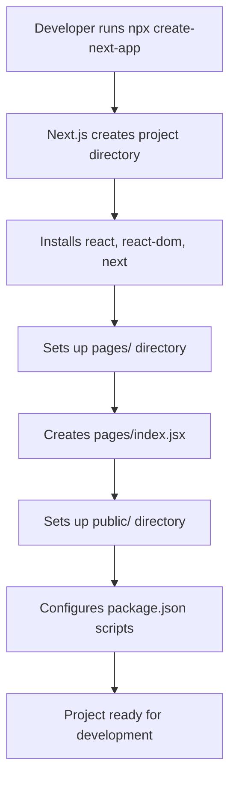
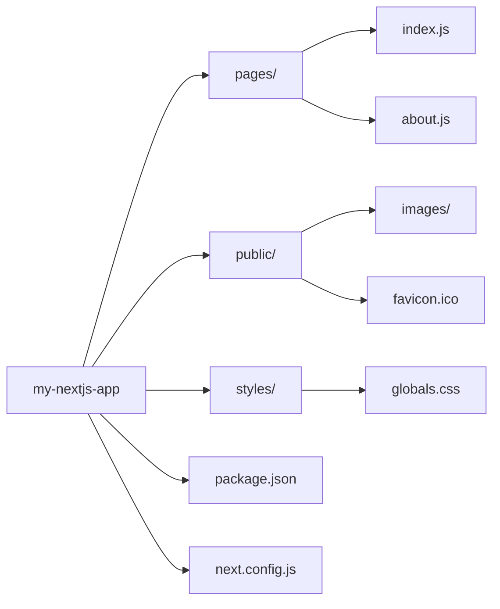

# Setting up Your First Next.js Project

## Introduction
This module guides you through the process of setting up your first Next.js project from scratch. You'll learn how to initialize a new Next.js application, understand the default file structure, and run the development server.

## Why do we need this?
Every journey begins with a single step. Before diving into Next.js features, you need to know how to set up your development environment and create a working Next.js application. This foundation is crucial for all subsequent learning.

## Problem Statement
New developers often struggle with initial setup, leading to frustration before even writing their first line of code. Without a proper setup guide, developers waste time configuring tools instead of learning Next.js concepts.

## Real World Story
Imagine you're hired to build a company website. Your first task is to set up the development environment and create the project structure that the entire team will use. A smooth setup allows the team to focus on building features rather than troubleshooting installation issues.

## Real World Analogy
Setting up a Next.js project is like laying the foundation for a house. Without a solid foundation, the house (your application) won't stand strong. Just as you need level ground and proper materials for a house, you need the right tools and configuration for a Next.js project.

## Visual Explanation


## Internal Working
When you run `npx create-next-app`, Next.js:
1. Creates a new directory with your project name
2. Sets up a basic file structure (pages, public, styles)
3. Installs required dependencies (react, react-dom, next)
4. Configures basic scripts for development and production
5. Sets up a default pages/index.js file as the homepage

## Mermaid Diagram 1: Project Initialization Flow


## Architecture
Next.js follows a convention-over-configuration approach:
- **pages/**: Each file becomes a route (e.g., pages/about.js → /about)
- **public/**: Static assets served at root URL (e.g., public/images/logo.png → /images/logo.png)
- **styles/**: CSS files (optional, for global or component styles)
- **next.config.js**: Custom Next.js configuration (optional)
- **package.json**: Dependencies and scripts (dev, build, start)

## Mermaid Diagram 2: File Structure Overview


## Step-by-Step Flow
1. Open terminal in desired location
2. Run `npx create-next-app@latest my-nextjs-app`
3. Choose project name and options (TypeScript, ESLint, etc.)
4. Navigate into project directory: `cd my-nextjs-app`
5. Start development server: `npm run dev`
6. Open browser to http://localhost:3000

## Syntax
Basic Next.js page creation:
```jsx
// pages/index.js
export default function Home() {
  return (
    <div>
      <h1>Welcome to Next.js!</h1>
      <p>This is your first Next.js page.</p>
    </div>
  );
}
```

## Basic Example
Creating a simple homepage:
```jsx
// pages/index.js
export default function Home() {
  return (
    <main>
      <h1>My Next.js Blog</h1>
      <nav>
        <ul>
          <li><a href="/">Home</a></li>
          <li><a href="/about">About</a></li>
          <li><a href="/posts">Posts</a></li>
        </ul>
      </nav>
    </main>
  );
}
```

## Intermediate Example
Adding TypeScript support during setup:
```bash
npx create-next-app@latest my-ts-app --typescript
```

## Advanced Example
Customizing the Next.js configuration:
```js
// next.config.js
module.exports = {
  reactStrictMode: true,
  swcMinify: true,
  images: {
    domains: ['example.com'],
  },
};
```

## Production Example
Optimized build for production:
```bash
# Build for production
npm run build

# Start production server
npm start
```

## Folder Structure
```
my-nextjs-app/
├── pages/
│   ├── index.js
│   ├── about.js
│   └── posts/
│       └── index.js
├── public/
│   ├── images/
│   └── favicon.ico
├── styles/
│   └── globals.css
├── package.json
├── next.config.js
└── README.md
```

## Best Practices
- Use functional components with hooks
- Keep pages directory organized with logical grouping
- Optimize images with the Image component
- Use environment variables for configuration
- Implement proper error boundaries
- Keep dependencies updated with regular audits
- Use next/link for client-side navigation
- Leverage next/script for third-party scripts

## Common Mistakes
- Forgetting to export the page component as default
- Placing non-page files in the pages directory (they become routes)
- Not using the Link component for client-side navigation (causing full page reloads)
- Overlooking image optimization leading to performance issues
- Mutating state directly instead of using useState/useReducer
- Neglecting to handle loading states in data fetching

## Performance Notes
- Development mode includes helpful warnings and error messages
- Production build automatically optimizes code (minification, bundling)
- Use `next start` for production server after building
- Leverage browser caching for static assets via proper Cache-Control headers
- Optimize images with next/layout for automatic resizing and format optimization
- Implement code splitting with dynamic imports for heavy components

## Security Notes
- Keep dependencies updated with `npm audit` and `npm audit fix`
- Sanitize user input even in static generation to prevent XSS
- Use helmet-like headers via custom middleware or headers() in next.config.js
- Environment variables prefixed with `NEXT_PUBLIC_` are exposed to browser
- Never expose secret keys in client-side code
- Implement rate limiting on API routes to prevent abuse

## SEO Considerations
- Use semantic HTML for better accessibility and SEO
- Implement proper meta tags with next/head (title, description, Open Graph)
- Ensure fast loading times (Core Web Vitals) for better ranking
- Use descriptive, keyword-rich URLs with hyphens as separators
- Add structured data (JSON-LD) for rich snippets where applicable
- Create and submit sitemap.xml via next-sitemap plugin
- Optimize images with proper alt text and compression

## Interview Questions
1. What command creates a new Next.js project?
2. How does Next.js handle routing by convention?
3. What's the difference between `npm run dev` and `npm start`?
4. Where should you place static assets like images?
5. How do you customize Next.js configuration?
6. What are the benefits of using next/link over anchor tags?
7. How do you optimize images in Next.js?
8. What environment variables are exposed to the browser?

## MCQs
1. What is the default port for Next.js development server?
   a) 8080
   b) 3000
   c) 5000
   d) 8000
   <details>
   <summary>Answer</summary>
   b) 3000
   </details>

2. Which directory holds pages that automatically become routes?
   a) components/
   b) pages/
   c) routes/
   d) views/
   <details>
   <summary>Answer</summary>
   b) pages/
   </details>

3. What command starts the Next.js development server?
   a) npm start
   b) npm run dev
   c) next dev
   d) both b and c
   <details>
   <summary>Answer</summary>
   d) both b and c
   </details>

4. Which file is used to customize Next.js configuration?
   a) next.js
   b) nextconfig.js
   c) next.config.js
   d) configurenext.js
   <details>
   <summary>Answer</summary>
   c) next.config.js
   </details>

5. How do you create a dynamic route for blog posts?
   a) posts/[id].js
   b) posts/id.js
   c) posts.js?id=[id]
   d) posts/id
   <details>
   <summary>Answer</summary>
   a) posts/[id].js
   </details>

## Practice Exercise
1. Create a new Next.js project named "learning-nextjs"
2. Change the port number in the development server to 4000
3. Add an About page at pages/about.js
4. Add a Contact page at pages/contact.js
5. Link between pages using the <Link> component
6. Run the development server and verify navigation works
7. Add a custom CSS module for styling the About page
8. Create a reusable Button component and use it on the homepage
9. Optimize an image using the next/image component
10. Add a meta title and description using next/head

## Mini Project
Build a personal landing page that includes:
- A header with navigation links (Home, About, Projects, Contact)
- A hero section with your photo, bio, and call-to-action button
- A skills section showcasing your technical abilities with progress bars
- A projects section with links to your work (images, descriptions, live demo links)
- A contact form (static version) with name, email, and message fields
- A footer with social media links and copyright information
- Responsive design that works on mobile and desktop
- Consistent styling using CSS Modules or Tailwind CSS

## Summary
In this module, you learned how to set up a Next.js project, understood the file-system routing basics, created your first pages, and ran the development server. You're now ready to explore more advanced routing and navigation techniques.

## Cheat Sheet
```
# Next.js Basics
npx create-next-app@latest my-app
cd my-app
npm run dev   # Development
npm run build # Production build
npm start     # Production server

# Pages
pages/index.js → /
pages/about.js → /about
pages/blog/[id].js → /blog/1

# Components
import Link from 'next/link'
import Head from 'next/head'
import Image from 'next/image'

# Styling
import '../styles/globals.css'
import styles from './Button.module.css'
<div className={styles.container}>
```

## Related Topics
- File-System Routing (Module 2)
- Styling in Next.js (Module 4)
- Deploying Your Next.js App (Module 6)
- Environment Variables
- Custom _app.js and _document.js
- Image Optimization
- API Routes

## Further Reading
- [Next.js Documentation - Getting Started](https://nextjs.org/docs/getting-started)
- [Create Next.js App](https://github.com/vercel/next.js/tree/canary/packages/create-next-app)
- [Next.js Learn - Basics](https://nextjs.org/learn/basics/create-nextjs-app)