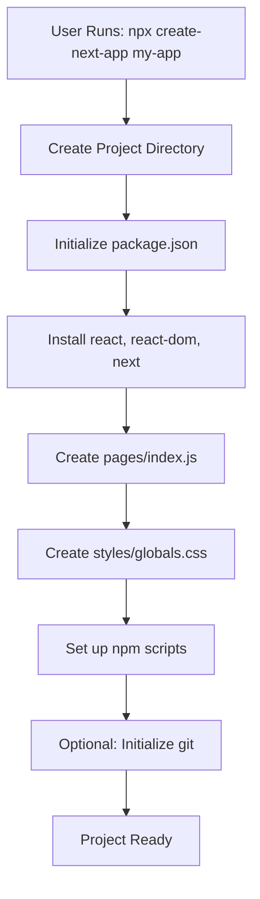
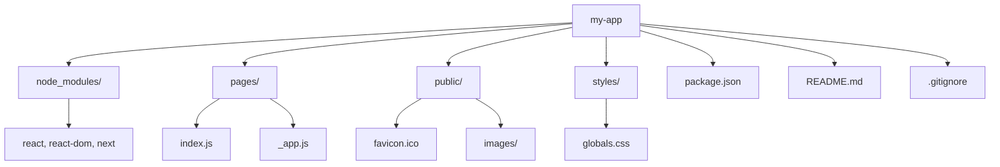
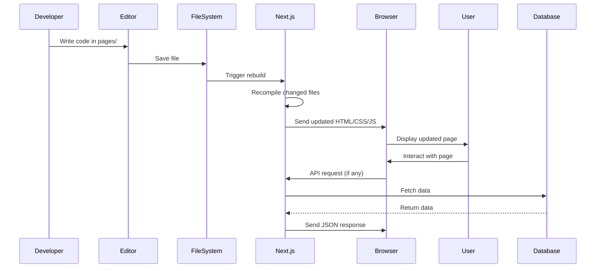
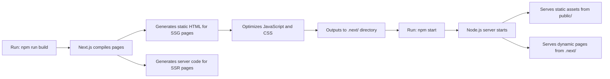

# Initializing a Next.js Project

## Introduction
Starting a new Next.js project is straightforward thanks to the official `create-next-app` command-line tool. This tool sets up a fully configured Next.js application with all necessary dependencies, allowing you to focus on building your application rather than configuring build tools.

## Why do we need this?
Manually setting up a React application with server-side rendering, routing, and build optimization is complex and time-consuming. `create-next-app` abstracts away this complexity, providing a standardized starting point that follows Next.js best practices.

## Problem Statement
As a developer wanting to learn Next.js, you need a quick and reliable way to bootstrap a project without dealing with webpack configuration, Babel setup, or other build tool complexities. Without a proper starter, initial setup can become a barrier to learning and productivity.

## Real World Story
Imagine you're hired to build a company's new marketing website. On day one, you need to set up the project. Instead of spending hours configuring build tools, you use `create-next-app` to have a working Next.js application running in minutes, allowing you to start building features immediately.

## Real World Analogy
Think of `create-next-app` as a prefabricated house foundation. Just as a contractor doesn't mix concrete and lay bricks from scratch for every house, you don't configure build tools from scratch for every web project. You start with a solid foundation and customize it to your needs.

## Visual Explanation
The `create-next-app` tool automates the setup of a Next.js project, creating the necessary file structure, installing dependencies, and configuring scripts for development and production.

## Mermaid Diagram 1: Project Creation Flow


## Internal Working
When you run `npx create-next-app my-app`, the tool performs several steps: it creates a project directory, initializes an npm project, installs React and Next.js dependencies, sets up a basic page structure with a pages directory, adds global styles, and configures npm scripts for development, building, and starting the application.

## Mermaid Diagram 2: File Structure After Creation


## Architecture
A Next.js application follows a convention-over-configuration approach. The `pages` directory uses file-system routing where each file becomes a route. The `public` directory serves static assets. Styles can be placed in `styles` or imported via CSS-in-JS. The `package.json` manages dependencies and scripts, while `next.config.js` allows for custom configuration.

## Mermaid Diagram 3: Development Workflow


## Step-by-Step Flow
1. **Run the command**: Execute `npx create-next-app my-app` in your terminal.
2. **Wait for setup**: The tool creates the project directory and installs dependencies.
3. **Explore structure**: Check the generated `pages/`, `public/`, `styles/`, and `package.json`.
4. **Start development**: Run `npm run dev` to launch the development server.
5. **Make changes**: Edit files in `pages/` to see hot module replacement in action.
6. **Build for production**: Run `npm run build` to create an optimized bundle.
7. **Start production**: Use `npm start` to run the production server.

## Mermaid Diagram 4: Build and Start Process


## Syntax
### Creating a New Project
```bash
# Using npx (recommended)
npx create-next-app my-app

# Using npm (v6+)
npm init next-app my-app

# Using Yarn
yarn create next-app my-app

# Using pnpm
pnpm create next-app my-app
```

### Basic Page Structure
```jsx
// pages/index.js
import Link from 'next/link';

export default function Home() {
  return (
    <div>
      <h1>Welcome to Next.js!</h1>
      <p>This is your first Next.js page.</p>
      <Link href="/about">
        <a>About Page</a>
      </Link>
    </div>
  );
}
```

## Basic Example
Creating a simple homepage with navigation:
```jsx
// pages/index.js
import Link from 'next/link';

export default function Home() {
  return (
    <div style={{ padding: '2rem' }}>
      <h1>My Next.js Blog</h1>
      <nav>
        <Link href="/">
          <a>Home</a>
        </Link> |
        <Link href="/about">
          <a>About</a>
        </Link> |
        <Link href="/posts">
          <a>Posts</a>
        </Link>
      </nav>
    </div>
  );
}
```

## Intermediate Example
Adding TypeScript support during project creation:
```bash
npx create-next-app my-ts-app --typescript
```
This creates a project with `tsconfig.json` and `.tsx` file extensions, enabling type safety.

## Advanced Example
Setting up a custom API route:
```jsx
// pages/api/hello.js
export default function handler(req, res) {
  res.status(200).json({ message: 'Hello from Next.js API!' );
}
```
Accessible at `/api/hello`, this demonstrates how Next.js enables full-stack development.

## Production Example
Deploying to Vercel:
1. Push your code to a GitHub repository.
2. Import the repository into Vercel.
3. Configure the project (if needed) and click "Deploy".
4. Vercel automatically builds and deploys your application.
5. Access the live site at the provided URL (e.g., `https://my-app.vercel.app`).

## Folder Structure
After running `create-next-app my-app`, you'll get:
```
my-app/
├── node_modules/
├── pages/
│   ├── _app.js
│   └── index.js
├── public/
│   ├── favicon.ico
│   └── images/
├── styles/
│   └── globals.css
├── .gitignore
├── package.json
├── README.md
└── next.config.js
```
- `pages/`: Contains application pages (each file becomes a route)
- `public/`: Static assets served at `/` (e.g., images, favicon)
- `styles/`: CSS files (globals.css is imported in `_app.js`)
- `next.config.js`: Custom Next.js configuration (optional)

## Best Practices
- Always use the latest version by specifying `@latest` or using `npx` (which fetches the latest).
- Consider using TypeScript for larger projects (`--typescript` flag).
- Initialize a Git repository immediately after creation (`git init`).
- Remove unused files from the starter template if not needed.
- Keep dependencies updated with `npm update` or `yarn upgrade`.
- Use environment variables for configuration (create `.env.local` for secrets).

## Common Mistakes
- Using `npx create-next-app` without updating npm (older npm versions may not have npx).
- Forgetting that only files in the `pages/` directory become routes by default.
- Trying to use the `pages` and `app` router simultaneously without understanding their differences.
- Modifying files outside of `pages/` expecting them to be routes (only `pages/` files are routes in the Pages Router).
- Not checking the generated `package.json` for available scripts (dev, build, start, lint).

## Performance Notes
- The initial bundle size includes React and Next.js (~100KB gzipped).
- Development server includes webpack hot module replacement (HMR) for fast updates.
- Production builds are optimized with code splitting, minification, and tree shaking.
- First paint is optimized through automatic static optimization for pages without data fetching.
- Static assets in `public/` are served efficiently by the underlying server (e.g., Vercel's CDN).

## Security Notes
- Keep dependencies updated to avoid known vulnerabilities (run `npm audit` regularly).
- Use environment variables for secrets (never commit `.env.local`; use `.env.local` for local development).
- The default Next.js setup includes basic security headers; consider adding a custom middleware for enhanced security (e.g., CSP, HSTS).
- Validate and sanitize user input in API routes to prevent injection attacks.
- Implement proper authentication and authorization for protected routes.

## SEO Considerations
- Next.js automatically handles basic SEO through the `<Head>` component for meta tags.
- Server-side rendering ensures content is fully crawlable by search engines (unlike client-side rendered apps).
- Generated HTML includes proper semantic structure when using semantic HTML elements.
- Use descriptive, keyword-rich URLs via the file-system routing (e.g., `/blog/post-title`).
- Optimize images with the `next/image` component for faster loading and better Core Web Vitals.
- Implement structured data (JSON-LD) for rich snippets in search results.

## Interview Questions
1. What command would you use to create a new Next.js project with TypeScript?
2. What is the purpose of the `pages` directory in a Next.js project?
3. How does `next dev` differ from `next start`?
4. What files are created by default when running `create-next-app`?
5. How would you customize the port used by the development server?

## MCQs
1. Which command creates a new Next.js app using Yarn?
   a) yarn create next-app
   b) yarn next-app create
   c) yarn add create-next-app
   d) yarn run create-next-app
   <details>
   <summary>Answer</summary>
   a) yarn create next-app
   </details>

2. What is the default port for the Next.js development server?
   a) 8080
   b) 3000
   c) 5000
   d) 8000
   <details>
   <summary>Answer</summary>
   b) 3000
   </details>

3. Which file is the entry point for a Next.js page?
   a) index.html
   b) app.js
   c) pages/index.js
   d) main.js
   <details>
   <summary>Answer</summary>
   c) pages/index.js
   </details>

4. What does the `--typescript` flag do when creating a Next.js app?
   a) Adds TypeScript support
   b) Converts JavaScript to TypeScript
   c) Removes JavaScript files
   d) Installs TypeScript globally
   <details>
   <summary>Answer</summary>
   a) Adds TypeScript support
   </details>

5. Where are static assets like images stored in a Next.js project?
   a) /public
   b) /static
   c) /assets
   d) /resources
   <details>
   <summary>Answer</summary>
   a) /public
   </details>

## Practice Exercise
1. Create a new Next.js project called `exercise-app`.
2. Start the development server and verify it runs on http://localhost:3000.
3. Stop the development server.
4. Create a production build and start the production server.
5. Visit http://localhost:3000 to see the production build.

## Mini Project
Create a simple "Hello, Next.js!" application:
1. Use `create-next-app` to bootstrap a new project.
2. Modify the homepage to display a greeting.
3. Add a navigation link to an About page.
4. Create the About page with some information about you.
5. Style the page using CSS Modules.

## Summary
In this topic, you learned how to bootstrap a new Next.js project using `create-next-app`. You understood the default file structure, available scripts, and how to run both development and production servers. This foundation will be used throughout your Next.js journey.

## Cheat Sheet
```
# Create New Next.js App
npx create-next-app my-app
npm init next-app my-app
yarn create next-app my-app
pnpm create next-app my-app

# With TypeScript
npx create-next-app my-app --typescript

# With Custom Import Alias
npx create-next-app my-app --import-alias "@/*"

# Common Scripts (in package.json)
"dev": "next dev"
"build": "next build"
"start": "next start"
"lint": "next lint"

# File Structure
my-app/
├── node_modules/
├── pages/          # Routes
├── public/         # Static assets
├── styles/         # CSS
├── package.json    # Dependencies & scripts
└── ...             # Config files
```

## Related Topics
- File-System Routing (Next Topic)
- Understanding Pages vs Components
- Styling in Next.js (CSS Modules, styled-jsx)
- Environment Variables
- Custom _app.js

## Further Reading
- [Next.js Documentation - Setup](https://nextjs.org/docs/getting-started)
- [create-next-app GitHub](https://github.com/vercel/next.js/tree/canary/packages/create-next-app)
- [Next.js CLI Documentation](https://nextjs.org/docs/api-reference/cli)