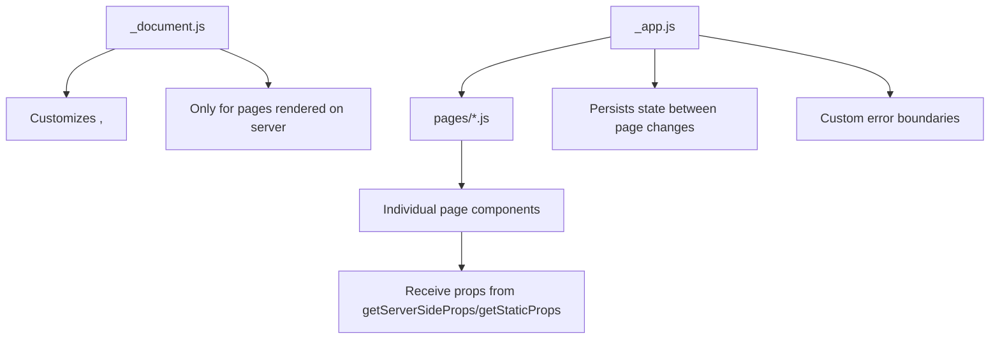
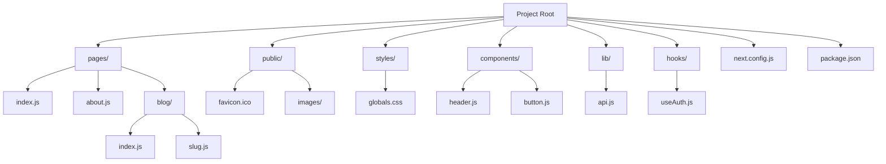
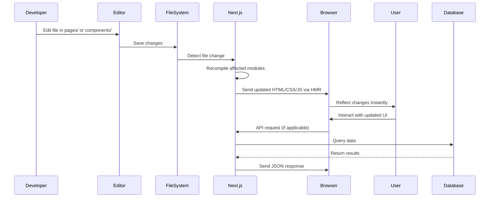

# Understanding the Default File Structure

## Introduction
The Next.js project structure follows conventions that make development intuitive and predictable. Understanding each directory and file's purpose is crucial for navigating and extending your application effectively.

## Why do we need this?
Without understanding the project structure, you might place files in incorrect locations, leading to confusion, unexpected behavior, or broken applications. Knowing where to put components, styles, and assets ensures your project remains maintainable.

## Problem Statement
New developers often struggle to locate where to add new pages, components, or styles, resulting in time wasted searching through directories or putting files in the wrong place.

## Real World Story
You're joining an existing Next.js project as a developer. During onboarding, you need to add a new feature. Understanding the project structure allows you to quickly locate where to add the new page, component, and styles without constantly asking teammates.

## Real World Analogy
Think of a Next.js project like a well-organized office:
- The `pages/` directory is like the reception area where visitors (routes) are directed
- The `components/` directory is like the supply closet with reusable items
- The `styles/` directory is like the design team's office
- The `public/` directory is like the public bulletin board

## Visual Explanation
When you create a new Next.js project, the framework generates a specific folder structure that separates concerns: routing, components, styles, static assets, and configuration. Each part has a distinct role in the application.

## Mermaid Diagram 1: File-Based Routing Mapping
```mermaid
flowchart LR
    A[pages/index.js] --> B[Route: /]
    C[pages/about.js] --> D[Route: /about]
    E[pages/blog/index.js] --> F[Route: /blog]
    G[pages/blog/[slug].js] --> H[Route: /blog/:slug]
    I[pages/blog/[...slug].js] --> J[Route: /blog/*]
    K[pages/api/hello.js] --> L[Route: /api/hello]
```

## Internal Working
Next.js uses the file system to determine routes:
- Every file inside `pages/` becomes a route based on its path
- `pages/index.js` → `/`
- `pages/about.js` → `/about`
- `pages/blog/[slug].js` → `/blog/:slug` (dynamic route)
- Files starting with `_` are exempt from routing (e.g., `_app.js`, `_document.js`)

## Mermaid Diagram 2: Special File Hierarchy


## Architecture
A Next.js application follows a convention-over-configuration approach. The core directories are:
- `pages/` - Contains page components that become routes via file-system routing
- `public/` - Serves static assets at the root URL (e.g., `/images/logo.png`)
- `styles/` - Holds CSS files (supports CSS Modules, Sass, etc.)
- Additional directories like `components/`, `lib/`, `hooks/` are conventional for organizing code
Special files like `_app.js` (custom App component) and `_document.js` (custom HTML document) allow for global customization.

## Mermaid Diagram 3: Typical File Structure Hierarchy


## Step-by-Step Flow
1. **Examine the root**: Look at the top-level directories after creating a new project.
2. **Identify routes**: Check the `pages/` directory to see what routes are available.
3. **Locate static assets**: Verify that images, icons, and other static files are in `public/`.
4. **Review styles**: Check `styles/` for global CSS and component-specific styles.
5. **Explore components**: Look in `components/` for reusable UI elements.
6. **Check configuration**: Review `next.config.js` and `package.json` for project settings.
7. **Understand special files**: Note the presence of `_app.js` and `_document.js` for customizations.
8. **Verify API routes**: Look in `pages/api/` for backend endpoints.

## Mermaid Diagram 4: Development Workflow


## Syntax
### Importing a Component
```jsx
// In any component or page
import Header from '../components/Header';
```
### Exporting a Page
```jsx
// pages/about.js
export default function AboutPage() {
  return <div>About Us</div>;
}
```
### Linking Between Pages
```jsx
import Link from 'next/link';

<Link href="/about">
  <a>About</a>
</Link>
```

## Basic Example
Creating a new page and linking to it:
1. Create `pages/contact.js`:
```jsx
export default function Contact() {
  return <div>Contact Us</div>;
}
```
2. Add a link in `pages/index.js`:
```jsx
import Link from 'next/link';

export default function Home() {
  return (
    <div>
      <h1>Home</h1>
      <Link href="/contact">
        <a>Contact</a>
      </Link>
    </div>
  );
}
```

## Intermediate Example
Using dynamic routes for blog posts:
1. Create `pages/posts/[id].js`:
```jsx
export default function Post({ params }) {
  return <div>Post ID: {params.id}</div>;
}
```
2. Link to a specific post:
```jsx
import Link from 'next/link';

<Link href="/posts/1">
  <a>First Post</a>
</Link>
```

## Advanced Example
Setting up an API route:
1. Create `pages/api/user.js`:
```jsx
export default function handler(req, res) {
  if (req.method === 'GET') {
    res.status(200).json({ name: 'John Doe', email: 'john@example.com' });
  } else {
    res.status(405).end(); // Method Not Allowed
  }
}
```
2. Fetch from a component:
```jsx
import { useEffect, useState } from 'react';

export default function UserProfile() {
  const [user, setUser] = useState(null);

  useEffect(() => {
    fetch('/api/user')
      .then(res => res.json())
      .then(data => setUser(data));
  }, []);

  return <div>{user ? user.name : 'Loading...'}</div>;
}
```

## Production Example
In a production build:
- The `.next/` directory contains optimized server and client builds
- Static assets in `public/` are served with efficient caching
- CSS is extracted and minified
- API routes become serverless functions when deployed to platforms like Vercel

## Folder Structure
A typical Next.js project after setting up common directories:
```
my-app/
├── node_modules/
├── pages/
│   ├── index.js          # Homepage
│   ├── about.js          # About page
│   ├── blog/
│   │   ├── index.js      # Blog list
│   │   └── [slug].js     # Single post
│   └── api/
│       └── hello.js      # API route
├── public/
│   ├── images/
│   │   └── logo.png
│   └── favicon.ico
├── styles/
│   ├── globals.css
│   └── modules/
│       ├── Header.module.css
│       └── Button.module.css
├── components/
│   ├── layout/
│   │   ├── Header.js
│   │   └── Footer.js
│   └── ui/
│       ├── Button.js
│       └── Input.js
├── lib/
│   ├── api.js
│   └── utils.js
├── hooks/
│   ├── useAuth.js
│   └── useFetch.js
└── next.config.js
```

## Best Practices
- Keep `pages/` lean: only place page components here; move reusable logic to `components/` or `lib/`
- Use consistent naming: PascalCase for components (`Button.js`), camelCase for hooks (`useAuth.js`)
- Group related files: create feature-based folders (e.g., `components/profile/`)
- Leverage the `public/` directory: place images, icons, and `robots.txt` here
- Use `_app.js` for wrappers: providers, global CSS, layout components
- Avoid deep nesting: keep directory structure shallow for easier navigation
- Follow convention-over-configuration: trust Next.js defaults unless you have a specific reason to change

## Common Mistakes
- Placing components directly in `pages/` (they become unintended routes)
- Forgetting that files/folders starting with `_` are exempt from routing
- Putting styles in `pages/` instead of `styles/` or alongside components
- Not understanding that `public/` serves at root URL (so `/images/logo.png` not `/public/images/logo.png`)
- Misplacing API routes (must be in `pages/api/`, not `api/` at root)
- Assuming all JavaScript files in the project become routes (only those in `pages/`)

## Performance Notes
- Next.js automatically code-splits by page, so each page loads only its necessary JavaScript
- Large components should be moved to `components/` and imported only where needed
- Dynamic imports (`next/dynamic`) can further split code for large libraries
- The `public/` directory is served efficiently with proper caching headers (when deployed to Vercel or similar)
- Use `next-bundle-analyzer` to visualize what's in each page's bundle and optimize accordingly

## Security Notes
- Files in `pages/` are server-rendered by default (unless using dynamic imports with `ssr: false`)
- Validate and sanitize dynamic route parameters to prevent injection attacks
- The `public/` directory is publicly accessible—never store sensitive files like `.env` or private keys here
- API routes in `pages/api/` follow standard backend security practices (authentication, input validation, etc.)
- Regularly update dependencies with `npm audit` to address known vulnerabilities

## SEO Considerations
- Proper file structure ensures search engine crawlers can correctly index your application
- Dynamic routes (e.g., `[slug].js`) are crawled when used with `getStaticPaths`/`getServerSideProps`
- Use the `next/head` component to set meta tags (title, description) for each page
- Generate a `sitemap.xml` in `public/` to help search engines discover your content
- Ensure fast loading times by optimizing images, leveraging browser caching, and minimizing render-blocking resources

## Interview Questions
1. What is the purpose of the `pages` directory in a Next.js project?
2. How does Next.js convert files in `pages/` to routes?
3. What happens if you place a component file directly in the `pages` directory?
4. What is the difference between `pages/index.js` and `pages/blog/index.js`?
5. Where should you place static assets like images and favicons?
6. What special files can you override in a Next.js project (e.g., `_app.js`)?
7. How are API routes structured in Next.js?
8. Explain the difference between `getStaticProps` and `getServerSideProps`.
9. What is the role of the `public` directory?
10. How would you organize a large Next.js project for maintainability?

## MCQs
1. Which file becomes the homepage route (`/`)?
   a) `pages/home.js`
   b) `pages/index.js`
   c) `app/index.js`
   d) `routes/index.js`
   <details>
   <summary>Answer</b) `pages/index.js`
   </details>

2. Where should you place a reusable Button component?
   a) `pages/Button.js`
   b) `components/Button.js`
   c) `styles/Button.js`
   d) `public/Button.js`
   <details>
   <summary>Answer</b) `components/Button.js`
   </details>

3. What does the `public` directory serve?
   a) Files at `/public/*`
   b) Files at the root URL (`/*`)
   c) Files at `/static/*`
   d) Files at `/assets/*`
   <details>
   <summary>Answer</b) Files at the root URL (`/*`)
   </details>

4. Which file allows you to customize the `<html>` and `<body>` tags?
   a) `_app.js`
   b) `_document.js`
   c) `custom-html.js`
   d) `next-config.js`
   <details>
   <summary>
   Answer</b) `_document.js`
   </details>

5. How do you create a dynamic route for a blog post ID?
   a) `pages/blog/id.js`
   b) `pages/blog/[id].js`
   c) `pages/blog/{id}.js`
   d) `pages/blog/:id.js`
   <details>
   <summary>Answer</b) `pages/blog/[id].js`
   </details>

6. What is the purpose of the `_app.js` file?
   a) Defines the root layout
   b) Configures the build process
   c) Stores environment variables
   d) Handles API routing
   <details>
   <summary>Answer</a) Defines the root layout (wraps all pages)
   </details>

## Practice Exercise
1. Create a new Next.js project called `structure-exercise`.
2. Examine the default file structure created by `create-next-app`.
3. Create a `components/` directory and add a `Header.js` component.
4. Create a `styles/` directory (if not present) and add a `globals.css` file.
5. Create a `pages/about.js` page that uses your Header component.
6. Add an image to the `public/images/` directory and display it on the About page.
7. Run the development server to verify everything works.

## Mini Project
Build a structured blog layout:
1. Create a `components/` directory with:
   - `Layout.js` (wrapper component)
   - `Header.js` (site navigation)
   - `Footer.js` (site footer)
   - `PostCard.js` (component to display blog posts)
2. Create a `styles/` directory with:
   - `globals.css` (global styles)
   - `Layout.module.css` (styles for Layout)
   - `Header.module.css` (styles for Header)
   - `PostCard.module.css` (styles for PostCard)
3. Create pages:
   - `pages/index.js` (homepage with list of posts)
   - `pages/blog/[slug].js` (individual post page)
   - `pages/about.js` (about page)
4. Add sample data (can be hardcoded initially):
   ```js
   const posts = [
     { id: 1, slug: 'first-post', title: 'First Post', date: '2023-01-01', content: 'Hello world!' },
     { id: 2, slug: 'second-post', title: 'Second Post', date: '2023-01-02', content: 'Another post.' }
   ];
   ```
5. Style the components using CSS Modules.
6. Add images to `public/images/` for blog posts (e.g., `post1.jpg`, `post2.jpg`).
7. Implement linking from the homepage to individual posts.
8. Run the development server and verify the blog displays correctly.

## Summary
In this topic, you explored the default Next.js file structure and learned the purpose of each directory and special file. You understand how file-based routing works, where to place different types of files, and how to organize your project for maintainability and scalability. This knowledge is essential for efficient development as you build more complex applications.

## Cheat Sheet
```
# Key Directories
/pages/     # Routes (each file = route)
/public/    # Static assets (served at root)
/styles/    # CSS files
/components/# Reusable components
/lib/       # Utility functions
/hooks/     # Custom React hooks

# Special Files
_pages/_app.js     # Wrapper for all pages
_pages/_document.js # Custom HTML document
_next.config.js    # Next.js configuration
_.env.local        # Environment variables

# Routing Examples
pages/index.js           → /
pages/about.js      → /about
pages/blog/index.js      → /blog
pages/blog/[slug].js     → /blog/:slug
pages/api/hello.js       → /api/hello

# Common Directories
/components/ui/       # Reusable UI elements (Button, Input)
/components/layout/   # Layout components (Header, Footer)
/lib/api.js           # API helper functions
/hooks/useAuth.js     # Custom authentication hook
```

## Related Topics
- Creating Pages and Navigation (Next Topic)
- Styling in Next.js (CSS Modules, Tailwind)
- API Routes
- Dynamic Routes
- Custom _app.js and _document.js
- Environment Variables

## Further Reading
- [Next.js Documentation - File Structure](https://nextjs.org/docs/getting-started#project-structure)
- [Next.js Documentation - Routing](https://nextjs.org/docs/routing/introduction)
- [Next.js Documentation - Asset Imports](https://nextjs.org/docs/api-reference/next/image)
- [Next.js Documentation - Metadata](https://nextjs.org/docs/api-reference/next/head)