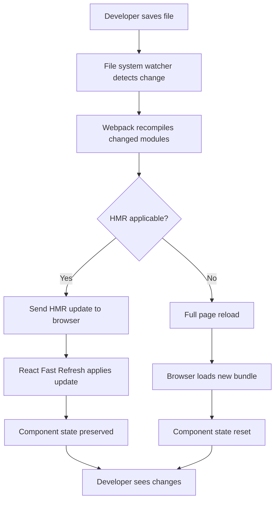
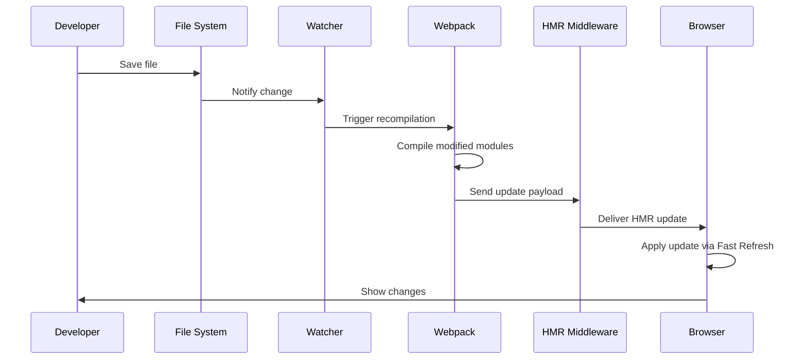

# Running the Development Server

## Introduction
The Next.js development server provides hot module replacement, fast refresh, and error overlay to enhance your development experience. Understanding how to start, configure, and use the development server is essential for efficient development.

## Why do we need this?
Manually refreshing the browser after every change is inefficient and breaks developer flow. The Next.js development server automates this process, providing instant feedback as you code.

## Problem Statement
Developers waste time switching between editor and browser, manually refreshing pages to see changes. Without proper development server usage, productivity suffers.

## Real World Story
You're implementing a new feature and need to see how your changes look in real-time. With the Next.js development server, you save your file and the browser updates instantly, allowing you to focus on coding rather than manual refreshes.

## Real World Analogy
Think of the development server like a smart mirror in a dressing room:
- As you change clothes (edit code), the mirror (browser) updates instantly
- You don't need to step out and walk to a mirror (manual refresh)
- If something doesn't fit (error), the mirror highlights the issue (error overlay)

## Visual Explanation
The development server watches your file system for changes, recompiles modified modules, and sends updates to the browser via Hot Module Replacement (HMR) and Fast Refresh, providing an instantaneous development experience.

## Mermaid Diagram 1: Development Server Workflow


## Internal Working
When you run `next dev`:
1. Next.js starts a Node.js server on port 3000 (by default)
2. Webpack compiles your application in development mode
3. Hot Module Replacement (HMR) middleware is injected
4. The server watches file system for changes
5. On file change:
   - Webpack recompiles only changed modules
   - HMR sends updates to the browser
   - React Fast Refresh preserves component state where possible
   - Full reload occurs only when necessary (e.g., config changes)

## Mermaid Diagram 2: Server Startup Process
```mermaid
flowchart LR
    A[Run: next dev] --> B[Initialize Node.js server]
    B --> C[Configure webpack for development]
    C --> D[Start file system watcher]
    D --> E[Compile initial bundle]
    E --> F[Serve pages on http://localhost:3000]
    F --> G[Accept incoming requests]
    G --> H[Apply middleware (HMR, error handling)]
    H --> I[Send responses to client]
```

## Architecture
The Next.js development server is built on Node.js and webpack, enhanced with custom middleware for Hot Module Replacement (HMR) and Fast Refresh. It integrates seamlessly with the Next.js build system to provide a fast, responsive development environment that mirrors production behavior while offering developer-centric features like instant updates and detailed error reporting.

## Mermaid Diagram 3: File Change Handling


## Step-by-Step Flow
1. **Start the server**: Run `npm run dev` or `next dev`
2. **Make changes**: Edit any file in your project (pages, components, styles, etc.)
3. **Save the file**: The file system watcher detects the change
4. **Trigger recompilation**: Webpack recompiles only the modified modules
5. **Apply updates**: HMR sends updates to the browser; Fast Refresh preserves state where possible
6. **View changes**: See updates in the browser instantly without manual refresh
7. **Handle errors**: If a syntax or runtime error occurs, an error overlay appears in the browser
8. **Continue editing**: Repeat steps 2-7 as you develop your application

## Syntax
### Starting the Development Server
```bash
# Using npm
npm run dev

# Using yarn
yarn dev

# Using pnpm
pnpm dev

# Directly with next CLI
next dev
```

### Specifying a Customizing Port and Host
```bash
# Change port
next dev -p 4000

# Change host (useful for mobile testing)
next dev -H 0.0.0.0

# Combine options
next dev -p 4000 -H 0.0.0.0
```

### Using Environment Variables (.env.local)
```env
PORT=4000
HOSTNAME=0.0.0.0
```

## Basic Example
Starting the development server with default settings:
1. Open terminal in your project directory
2. Run `npm run dev`
3. Open your browser to `http://localhost:3000`
4. Edit `pages/index.js` and save
5. See the changes appear in the browser instantly

## Intermediate Example
Using environment variables to configure the development server:
1. Create a `.env.local` file in your project root:
```env
PORT=4000
HOSTNAME=0.0.0.0
```
2. Start the server with `npm run dev`
3. The server will now run on `http://0.0.0.0:4000`, accessible from other devices on your network

## Advanced Example
Debugging the server-side code with VS Code:
1. Add the following to your `.vscode/launch.json`:
```json
{
  "version": "0.2.0",
  "configurations": [
    {
      "type": "node",
      "request": "launch",
      "name": "Next.js: debug server-side",
      "runtimeExecutable": "npm",
      "runtimeArgs": ["run", "dev"],
      "port": 9229
    }
  ]
}
```
2. Set breakpoints in your `pages/api/` or `getServerSideProps` functions
3. Start debugging from VS Code
4. When the server hits a breakpoint, execution will pause for inspection

## Production Example
While this topic focuses on development, note the relationship with production:
- Development: `next dev` (with HMR, source maps, error overlay)
- Production build: `next build` (optimized, minified, creates `.next` directory)
- Production start: `next start` (serves the optimized production build)
- Transition: Always run `next build` before `next start` for production deployments

## Folder Structure
The development server does not alter your project's source file structure, but it creates and uses the following directories during runtime:
- `.next/` - Contains compiled chunks, server-side code, and build assets (auto-generated, ignore in version control)
- The server runs from this directory when serving requests in development mode

## Best Practices
- **Keep the server running**: Leave `npm run dev` running during development to leverage instant updates
- **Leverage Fast Refresh**: Edit components and see UI updates without losing state
- **Use the error overlay**: Fix errors as they appear in the browser for rapid debugging
- **Monitor terminal output**: Watch for build warnings, errors, and important messages
- **Use environment variables**: Configure different ports or hosts per environment without changing code
- **Clear cache occasionally**: If encountering issues, stop the server and delete the `.next/` directory
- **Use HTTPS in development**: For testing secure contexts, use tools like `loklak` or `mkcert` with `next dev`

## Common Mistakes
- **Stopping the server accidentally**: Closing the terminal stops the server; use separate panels/tabs for editor and terminal
- **Editing unwatched files**: Most project files are watched, but some configs (like `next.config.js`) require a server restart
- **Ignoring startup errors**: Failing to check the terminal when the server doesn't start properly
- **Hardcoding ports**: Leads to port conflicts when running multiple projects; use environment variables instead
- **Expecting production behavior**: Features like error handling or caching may differ between dev and prod
- **Forgetting to save**: HMR triggers on file save, not on edit; unsaved changes won't trigger updates

## Performance Notes
- **Development speed**: Initial compilation is optimized for fast startup, not minimal bundle size
- **Memory usage**: Higher than production due to source maps and module hot-replacement machinery
- **CPU usage**: Minimal when idle; spikes during file saves and recompilation
- **Update latency**: Most changes appear in <300ms with Fast Refresh; full reloads take longer
- **Scalability**: Handle large projects efficiently via incremental compilation and module caching

## Security Notes
- **Development only**: The development server is not hardened for production use; never deploy `next dev` to production
- **Error exposure**: Detailed error messages and stack traces are shown in the browser—avoid exposing this in production
- **Network binding**: Binding to `0.0.0.0` makes the server accessible on your network; use firewalls if needed
- **Environment variables**: `.env.*` files are loaded in development; keep secrets out of version control
- **Dependency risks**: Development dependencies may have different vulnerability profiles than production ones

## SEO Considerations
- The development server allows you to test SEO-related features in real-time:
  - Preview meta tags via `next/head` before deploying
  - Verify server-side rendering (SSR) behavior for search engine crawlers
  - Test structured data implementation and rich snippets
  - Experiment with performance optimizations that impact SEO (e.g., image loading, font loading)
- However, SEO audits should be performed on a production-like build (`next start`) for accurate results

## Interview Questions
1. What command starts the Next.js development server?
2. What is Hot Module Replacement (HMR) and how does it benefit development?
3. How does Fast Refresh differ from traditional HMR in React applications?
4. How can you change the port on which the development server runs?
5. What happens when you modify `next.config.js` while the dev server is running?
6. How does the development server handle syntax and runtime errors?
7. What is the difference between `next dev` and `start` in terms of functionality and use cases?
8. How can you enable debugging of the Node.js process behind the Next.js server?
9. What are the security implications of using the development server in a production environment?
10. How does the development server assist in testing SEO-related changes?

## MCQs
1. Which command starts the Next.js development server?
   a) `next start`
   b) `next dev`
   c) `next build`
   d) `next export`
   <details>
   <summary>Answer</b) `next dev`
   </details>

2. What feature allows React component state to be preserved during hot reloading?
   a) Hot Module Replacement (HMR)
   b) Fast Refresh
   c) Server-Side Rendering (SSR)
   d) Static Site Generation (SSG)
   <details>
   <summary>Answer</b) `Fast Refresh`
   </details>

3. Where does the development server look for environment variables by default?
   a) `.env` only
   b) `.env.development` only
   c) `.env.local` only
   d) All of the above (in order: `.env.local`, `.env.[mode]`, `.env`)
   <details>
   <summary>Answer</d) All of the above (in order: `.env.local`, `.env.[mode]`, `.env`)
   </details>

4. What is the default port for the Next.js development server?
   a) 8080
   b) 3000
   c) 5000
   d) 8000
   <details>
   <summary>Answer</b) `3000`
   </details>

5. Which file change would require a full restart of the development server (not just HMR)?
   a) `pages/index.js`
   b) `components/Button.js`
   c) `next.config.js`
   d) `styles/globals.css`
   <details>
   <summary>Answer</c) `next.config.js`
   </details>

6. What does the `-H` flag do when running `next dev`?
   a) Enables hot module replacement
   b) Sets the hostname for the server to listen on
   c) Hides the terminal output
   d) Helps with debugging
   <details>
   <summary>Answer</b) Sets the hostname for the server to listen on (default: localhost)
   </details>

7. Which of the following is NOT a feature of the Next.js development server?
   a) Hot Module Replacement
   b) Automatic code splitting
   c) Error overlay in the browser
   d) Database connection pooling
   <details>
   <summary>Answer</d) Database connection pooling
   </details>

## Practice Exercise
1. Create a new Next.js project called `dev-server-exercise`
2. Start the development server and verify it runs on `http://localhost:3000`
3. Make a change to `pages/index.js` and observe the automatic browser update
4. Introduce a syntax error in your code and observe the error overlay
5. Fix the error and verify the application recovers
6. Change the port to `4000` and restart the server
7. Try accessing the site from another device on your network (use `0.0.0.0` host)
8. Stop the server and restart it to verify the port change persists

## Mini Project
Build a live code editor replica:
1. Create a new Next.js project
2. In `pages/index.js`, create a textarea for code input and a preview iframe
3. Use `useState` to store the code value
4. Implement a `useEffect` that updates the iframe's `srcDoc` whenever the code changes
5. Start the development server
6. Verify that changes to the textarea appear in the iframe instantly (no button needed)
7. Introduce an error in the code (e.g., invalid HTML) and observe how the iframe handles it
8. Fix the error and verify recovery
9. Experiment with adding a reset button to clear the textarea
10. Ensure the development server remains responsive throughout

## Summary
In this topic, you learned how to start and configure the Next.js development server, understood its core features (HMR, Fast Refresh, error overlay), and gained practical experience with common development workflows. This knowledge will significantly improve your development efficiency as you build Next.js applications.

## Cheat Sheet
```
# Start Development Server
npm run dev
yarn dev
pnpm dev
next dev

# Custom Port
next dev -p 4000
# or in package.json: "dev": "next dev -p 4000"

# Custom Host
next dev -H 0.0.0.0
# Useful for mobile testing on same network

# Environment Variables (.env.local)
PORT=4000
HOSTNAME=0.0.0.0

# Common Issues & Solutions
- Server not starting? Check if port 3000 is in use: lsof -i:3000 (Mac) or netstat -ano | findstr :3000 (Win)
- Changes not appearing? Ensure you saved the file (Ctrl+S/Cmd+S)
- Error overlay not showing? Check browser console for errors
- Hot reloading slow? Try disabling browser extensions temporarily

# Development Server Flags
-p, --port <number>      Port to listen on (default: 3000)
-H, --hostname <hostname> Hostname to listen on (default: localhost)
-p, --poll               Enable polling fallback for file watching
-t, --turbo              Enable TurboDev engine (experimental)
```

## Related Topics
- Building for Production (next build, next start)
- Environment Variables
- Error Handling
- Debugging Techniques
- Performance Optimization in Development

## Further Reading
- [Next.js Documentation - Development Server](https://nextjs.org/docs/api-reference/cli#dev)
- [Next.js Documentation - Fast Refresh](https://nextjs.org/docs/react-essentials#fast-refresh)
- [Next.js Documentation - Environment Variables](https://nextjs.org/docs/basic-features-environment-variables)
- [Next.js Documentation - Error Handling](https://nextjs.org/docs/api-reference/error-handling)