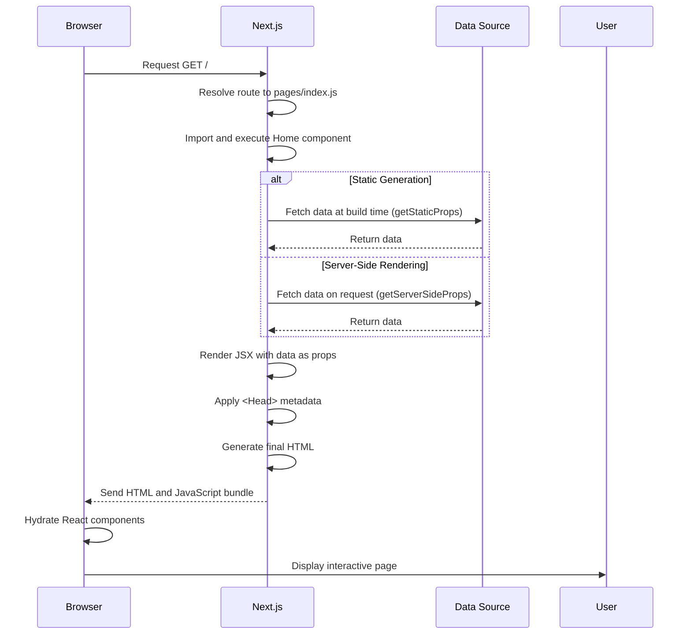

# Exploring the Initial Page (pages/index.js)

## Introduction
The initial page (`pages/index.js`) is the homepage of your Next.js application. Understanding its structure and how to modify it is your first step in building content for your application.

## Why do we need this?
Every Next.js application starts with a default homepage. Knowing how to customize this page allows you to begin presenting your content and branding to users immediately.

## Problem Statement
New developers might be unsure how to modify the default page or where to add their initial content, leading to a generic-looking application that doesn't represent their brand or purpose.

## Real World Story
You've just created a new Next.js project for your portfolio. The default page shows "Welcome to Next.js!" but you want it to display your name, a brief introduction, and navigation links to your projects and about section.

## Real World Analogy
Think of the initial page like the front door of a house:
- It's the first thing visitors see
- It should welcome them and give them a sense of what's inside
- You customize it with a welcome mat, decorations, and signs to reflect your style
- Just as you wouldn't leave a house with the builder's default sign, you shouldn't leave your Next.js app with the default welcome message

## Visual Explanation
The `pages/index.js` file exports a React component that Next.js automatically renders as the homepage (`/`). By modifying this component, you control what users see when they visit your site's root URL.

## Mermaid Diagram 1: Page Rendering Process
```mermaid
flowchart TD
    A[Request to /] --> B[Next.js resolves to pages/index.js]
    B --> C[Import default component]
    C --> D[Execute component function]
    D --> E[Render JSX to HTML]
    E --> F[Process <Head> if present]
    F --> G[Apply CSS (global or module)]
    G --> H[Send HTML to client]
    H --> I[Browser renders page]
    I --> J[Client-side hydration makes interactive]
```

## Internal Working
When you visit `http://localhost:3000`:
1. Next.js resolves the route `/` to `pages/index.js`
2. It imports and executes the default exported component
3. The component's JSX is rendered to HTML
4. Any `<Head>` content is used to update the document metadata
5. Styles (if using CSS Modules) are scoped to the component
6. Links created with `next/link` enable client-side navigation

## Mermaid Diagram 2: Component Structure
```mermaid
graph TD
    A[Default Page] --> B[Component Function]
    A --> C[Default Export]
    A --> D[JSX Return]
    B --> B1[Function Name: Home]
    C --> C1[export default Home]
    D --> D1[Returns JSX Elements]
    D --> D2[Can include <Head> for metadata]
    D --> D3[Can use hooks (useState, useEffect)]
    D --> D4[Can import components and styles]
```

## Architecture
A Next.js page component is a React component that follows specific conventions:
- Must export a component as default (or use named exports with `export const config` for advanced cases)
- Returns JSX that defines the page's structure and content
- Can utilize `<Head>` from `next/head` to manage document metadata
- Supports styling via CSS Modules, styled-jsx, or global CSS
- Enables data fetching through `getStaticProps`, `getServerSideProps`, or `getStaticPaths`
- Supports client-side navigation via the `next/link` component

## Mermaid Diagram 3: Data Flow in a Page


## Step-by-Step Flow
1. **Open the file**: Navigate to `pages/index.js` in your project
2. **Understand the structure**: Note the default export, component function, and JSX return
3. **Modify the content**: Change the text, add elements, or restructure the JSX
4. **Add metadata**: Import `Head` from `next/head` to set title and meta tags
5. **Add navigation**: Import `Link` from `next/link` to create client-side links
6. **Apply styling**: Use global CSS, CSS Modules, or styled-jsx to style the page
7. **Save the file**: The development server will automatically update the browser
8. **Verify changes**: Check that the homepage reflects your modifications

## Syntax
### Basic Page Component
```jsx
export default function Home() {
  return (
    <div>
      <h1>Welcome to My Site</h1>
      <p>This is my homepage.</p>
    </div>
  );
}
```

### Adding Metadata with Head
```jsx
import Head from 'next/head';

export default function Home() {
  return (
    <div>
      <Head>
        <title>My Page Title</title>
        <meta name="description" content="This is my page." />
      </Head>
      <h1>Welcome</h1>
    </div>
  );
}
```

### Adding Navigation with Link
```jsx
import Link from 'next/link';

export default function Home() {
  return (
    <div>
      <h1>My Site</h1>
      <nav>
        <Link href="/about">
          <a>About</a>
        </Link>
        <Link href="/contact">
          <a>Contact</a>
        </Link>
      </nav>
    </div>
  );
}
```

### Using CSS Modules
```jsx
import styles from '../styles/Home.module.css';

export default function Home() {
  return (
    <div className={styles.container}>
      <h1 className={styles.title}>Welcome</h1>
    </div>
  );
}
```

## Basic Example
Customizing the homepage with a greeting and navigation:
```jsx
// pages/index.js
import Link from 'next/link';

export default function Home() {
  return (
    <div style={{ padding: '2rem', textAlign: 'center' }}>
      <h1>Hello, I'm Jane Doe</h1>
      <p>Welcome to my personal website.</p>
      <div>
        <Link href="/about">
          <a>About Me</a>
        </Link> |{' '}
        <Link href="/projects">
          <a>Projects</a>
        </Link> |{' '}
        <Link href="/contact">
          <a>Contact</a>
        </Link>
      </div>
    </div>
  );
}
```

## Intermediate Example
Adding metadata and styling with CSS Modules:
1. Create `styles/Home.module.css`:
```css
.container {
  max-width: 800px;
  margin: 2rem auto;
  padding: 0 1rem;
  text-align: center;
}

.title {
  color: #2c3e50;
  margin-bottom: 1.5rem;
}

.description {
  color: #7f8c8d;
  line-height: 1.6;
}

.nav {
  margin-top: 2rem;
}

.link {
  margin: 0 1rem;
  text-decoration: none;
  color: #3498db;
}

.link:hover {
  text-decoration: underline;
}
```
2. Update `pages/index.js`:
```jsx
// pages/index.js
import Head from 'next/head';
import Link from 'next/link';
import styles from '../styles/Home.module.css';

export default function Home() {
  return (
    <div>
      <Head>
        <title>Jane Doe - Developer</title>
        <meta name="description" content="Full-stack developer specializing in Next.js and React." />
      </Head>
      <div className={styles.container}>
        <h1 className={styles.title}>Hello, I'm Jane Doe</h1>
        <p className={styles.description}>
          I build scalable web applications with a focus on performance and user experience.
        </p>
        <nav className={styles.nav}>
          <Link href="/about">
            <a className={styles.link}>About Me</a>
          </Link> |{' '}
          <Link href="/projects">
            <a className={styles.link}>Projects</a>
          </Link> |{' '}
          <Link href="/contact">
            <a className={styles.link}>Contact</a>
          </Link>
        </nav>
      </div>
    </div>
  );
}
```

## Advanced Example
Fetching data for the homepage using getStaticProps:
```jsx
// pages/index.js
import Link from 'next/link';

export async function getStaticProps() {
  // Simulate fetching data from an API or CMS
  const data = {
    name: 'Jane Doe',
    title: 'Full-Stack Developer',
    bio: 'I specialize in building performant, accessible web applications.',
    social: [
      { name: 'Twitter', url: 'https://twitter.com/janedoe' },
      { name: 'GitHub', url: 'https://github.com/janedoe' }
    ]
  };
  return { props: { data } };
}

export default function Home({ data }) {
  return (
    <div style={{ padding: '2rem', maxWidth: '800px', margin: '0 auto' }}>
      <h1>Hello, I'm {data.name}</h1>
      <p className="title">{data.title}</p>
      <p className="bio">{data.bio}</p>
      <div className="social">
        {data.social.map((site, index) => (
          <a key={index} href={site.url} target="_blank" rel="noreferrer">
            {site.name}
          </a>
        ))}
      </div>
      <nav>
        <Link href="/about">
          <a>About Me</a>
        </Link> |{' '}
        <Link href="/projects">
          <a>Projects</a>
        </Link> |{' '}
        <Link href="/contact">
          <a>Contact</a>
        </Link>
      </nav>
    </div>
  );
}
```

## Production Example
In production, the `pages/index.js` file is used as-is but with optimizations:
- JavaScript is minified and code-split by page
- CSS is extracted and minified (if using CSS Modules or styled-jsx)
- Images are optimized via the `next/image` component (if used)
- The server delivers a fully rendered HTML page for static routes (SSG) or minimal HTML for hydration (CSR)
- Caching headers are set appropriately for CDN delivery

## Folder Structure
The `pages/index.js` file resides in the `pages/` directory of your Next.js project:
```
my-app/
├── pages/
│   ├── index.js          # ← This file (homepage)
│   ├── about.js          # About page
│   └── ...               # Other pages
├── public/
│   └── ...               # Static assets
├── styles/
│   └── ...               # CSS files
├── components/
│   └── ...               # Reusable components
└── ...                   # Other configuration files
```

## Best Practices
- **Keep the homepage focused**: It should clearly communicate your site's purpose and value proposition
- **Use semantic HTML**: Proper heading hierarchy (h1 for main title, h2 for sections) improves accessibility and SEO
- **Optimize images**: Use the `next/image` component for automatic optimization, lazy loading, and responsive images
- **Manage metadata**: Always set a descriptive title and meta description via `<Head>` for SEO and social sharing
- **Handle navigation**: Provide clear links to key sections of your site (About, Projects, Contact)
- **Consider loading states**: If fetching data, show a skeleton or spinner while waiting
- **Test responsiveness**: Ensure the homepage looks and functions well on mobile and tablet devices
- **Keep it fast**: Prioritize performance since the homepage is often the most visited page

## Common Mistakes
- **Forgetting the default export**: Results in a blank page or error; every page must export a component as default
- **Using incorrect file paths**: Especially when importing styles or components from parent directories
- **Blocking the main thread**: Avoiding heavy computations or synchronous loops in the render function
- **Neglecting accessibility**: Missing alt text for images, poor color contrast, or lack of keyboard navigation
- **Overusing inline styles**: Prefer CSS Modules or styled-jsx for maintainability and scoping
- **Forgetting to add navigation**: Users need a clear way to explore beyond the homepage
- **Using `dangerouslySetInnerHTML` without sanitization**: Risk of XSS attacks when inserting raw HTML
- **Neglecting to update metadata**: Leaving default or irrelevant title/description harms SEO and social previews

## Performance Notes
- **Above-the-fold priority**: Ensure critical content loads first; defer non-essential scripts
- **Image optimization**: Always use `next/image` for automatic formatting, resizing, and lazy loading
- **CSS optimization**: Use CSS-in-JS solutions or purge unused CSS with tools like `postcss-purgecss`
- **JavaScript splitting**: Dynamic imports (`next/dynamic`) can lazy-load heavy components
- **Font optimization**: Use `next/font` for self-hosted, optimized web fonts
- **Third-party scripts**: Load non-essential scripts after hydration with `next/script` strategy="lazyAfterInteractive"
- **Measure performance**: Use Lighthouse or Web Vitals to assess and improve homepage performance

## Security Notes
- **Sanitize user input**: If displaying user-generated content, sanitize to prevent XSS
- **Secure metadata**: Ensure meta tags don't contain malicious scripts
- **Content Security Policy (CSP)**: Consider implementing CSP headers via `_headers` file or middleware
- **Dependency hygiene**: Regularly run `npm audit` to check for known vulnerabilities in dependencies
- **Environment variables**: Never expose secrets in client-side code; use `.env.local` for server-only values
- **API route protection**: If fetching data in `getServerSideProps`, ensure the API endpoint is secure

## SEO Considerations
- **Title tag**: Keep under 60 characters; include primary keyword and brand name
- **Meta description**: Keep under 160 characters; make it compelling and relevant to the page content
- **Heading structure**: Use one h1 per page (usually the main title), followed by h2/h3 for sections
- **Image alt text**: Provide descriptive alt attributes for all images; use empty alt for decorative images
- **Structured data**: Implement JSON-LD for rich snippets (e.g., FAQ, How-to, Organization)
- **Canonical tags**: Prevent duplicate content by setting canonical URLs via `<Head>`
- **Sitemap**: Ensure your sitemap.xml is properly formatted and submitted to search engines
- **Robots.txt**: Control crawler access to sensitive or duplicate content
- **URL structure**: Use descriptive, hyphen-separated URLs (e.g., `/about-me` instead of `/about`)

## Interview Questions
1. What is the purpose of the `pages/index.js` file in a Next.js application?
2. How does Next.js determine that `pages/index.js` corresponds to the root route (`/`)?
3. What are the requirements for a valid Next.js page component?
4. How do you add metadata (title, meta tags) to a Next.js page?
5. What is the difference between using global CSS and CSS Modules in a page?
6. How do you create navigation links between pages in Next.js?
7. What happens if you forget to export the default component from a page?
8. How can you pass data to a page component using `getStaticProps` or `getServerSideProps`?
9. What is the client-side hydration process in Next.js?
10. How does Next.js optimize the homepage for production builds?
11. What is the difference between `getStaticProps` and `getServerSideProps` for data fetching?
12. How do you use the `next/image` component to optimize images on the homepage?

## MCQs
1. Which file becomes the homepage in a Next.js application?
   a) `pages/home.js`
   b) `pages/index.js`
   c) `app/index.js`
   d) `routes/index.js`
   <details>
   <summary>Answer</b) `pages/index.js`
   </details>

2. How do you import the Link component for client-side navigation?
   a) `import { Link } from 'next/link'`
   b) `import Link from 'next/link'`
   c) `import { Link } from 'next/router'`
   d) `import Link from 'next/router'`
   <details>
   <summary>Answer</b) `import Link from 'next/link'`
   </details>

3. Which component is used to modify the document head in Next.js?
   a) `<Meta>`
   b) `<Head>`
   c) `<SEO>`
   d) `<Title>`
   <details>
   <summary>Answer</b) `<Head>`
   </details>

4. What is the correct way to import CSS Modules in a Next.js page?
   a) `import styles from './styles.css'`
   b) `import styles from '../styles/Home.module.css'`
   c) `import '../styles/Home.module.css'`
   d) `require('../styles/Home.module.css')`
   <details>
   <summary>Answer</b) `import styles from '../styles/Home.module.css'`
   </details>

5. What happens if you forget to export the default component from a page?
   a) The page shows a blank screen
   b) The page shows an error message
   c) Next.js uses a fallback component
   d) The application fails to start
   <details>
   <summary>Answer</b) The page shows an error message (or blank screen in production)
   </details>

6. What is the primary purpose of the `<Head>` component in Next.js?
   a) To define the page's layout
   b) To modify document metadata (title, meta tags, etc.)
   c) To handle form submissions
   d) To manage state
   <details>
   <summary>Answer</b) To modify document metadata (title, meta tags, etc.)
   </details>

7. Which of the following is NOT a valid way to style a Next.js page?
   a) Global CSS (`styles/globals.css`)
   b) CSS Modules (`styles/Home.module.css`)
   c) Inline styles (`style={{ color: 'red' }}`)
   d) `<style>` tags in JSX
   <details>
   <summary>Answer</d) `<style>` tags in JSX (not recommended; use JSX style object or CSS Modules)
   </details>

8. How do you add a favicon to your Next.js application?
   a) Place `favicon.ico` in the `public/` directory
   b) Import it from `next/favicon`
   c) Add a `<link>` tag in `_app.js`
   d) Both A and C
   <details>
   <summary>Answer</d) Both A and C (place in `public/` and/or override in `_app.js`)
   </details>

## Practice Exercise
1. Create a new Next.js project called `page-exercise`
2. Examine the default `pages/index.js` file
3. Modify the homepage to display:
   - Your name as an h1
   - A brief introduction as a paragraph
   - Navigation links to About, Projects, and Contact pages
4. Create the About, Projects, and Contact pages (can be simple placeholder content)
5. Add metadata (title and description) to the homepage using the `<Head>` component
6. Style the homepage using either global CSS or CSS Modules
7. Add an image to the homepage using the `<Image>` component from `next/image`
8. Run the development server to verify everything works correctly

## Mini Project
Build a polished homepage for a personal brand:
1. Create a layout component (Header, Footer, Main) to wrap your pages
2. Design a hero section with:
   - Your name and title
   - A brief bio
   - A call-to-action button
3. Add a features section showcing your skills or services
4. Include a portfolio section with project cards
5. Add a testimonials section (can be placeholder content)
6. Include a contact section with form (static version)
7. Implement responsive design using CSS Flexbox or Grid
8. Add proper metadata for SEO (title, description, open graph tags)
9. Optimize any images using the `next/image` component
10. Ensure accessibility with proper heading hierarchy, alt text, and color contrast

## Summary
In this topic, you learned how to explore and modify the initial page (`pages/index.js`) of a Next.js application. You understand the structure of a Next.js page component, how to add navigation, metadata, and styling, and how to create a welcoming entry point for your users.

## Cheat Sheet
```
# Basic Page Structure
export default function Page() {
  return (
    <div>
      {/* Your content */}
    </div>
  );
}

# With Head
import Head from 'next/head';

export default function Page() {
  return (
    <div>
      <Head>
        <title>Page Title</title>
        <meta name="description" content="Page description" />
      </Head>
      {/* Content */}
    </div>
  );
}

# With Link
import Link from 'next/link';

export default function Page() {
  return (
    <nav>
      <Link href="/">
        <a>Home</a>
      </Link>
      <Link href="/about">
        <a>About</a>
      </Link>
    </nav>
  );
}

# With CSS Modules
import styles from './styles.module.css';

export default function Page() {
  return (
    <div className={styles.container}>
      {/* Content */}
    </div>
  );
}

# With Image
import Image from 'next/image';

export default function Page() {
  return (
    <div>
      <Image
        src="/images/profile.jpg"
        alt="Your Name"
        width={400}
        height={400}
      />
    </div>
  );
}
```

## Related Topics
- Styling in Next.js (CSS Modules, Tailwind, styled-jsx)
- Creating Pages and Navigation
- Asset Optimization (next/image)
- Metadata and SEO
- Layout Components
- Data Fetching (getStaticProps, getServerSideProps)

## Further Reading
- [Next.js Documentation - Pages](https://nextjs.org/docs/routing/introduction#pages)
- [Next.js Documentation - Head](https://nextjs.org/docs/api-reference/next/head)
- [Next.js Documentation - Link](https://nextjs.org/docs/api-reference/next/link)
- [Next.js Documentation - CSS Modules](https://nextjs.org/docs/css-features#css-modules)
- [Next.js Documentation - Image Component](https://nextjs.org/docs/api-reference/next/image)