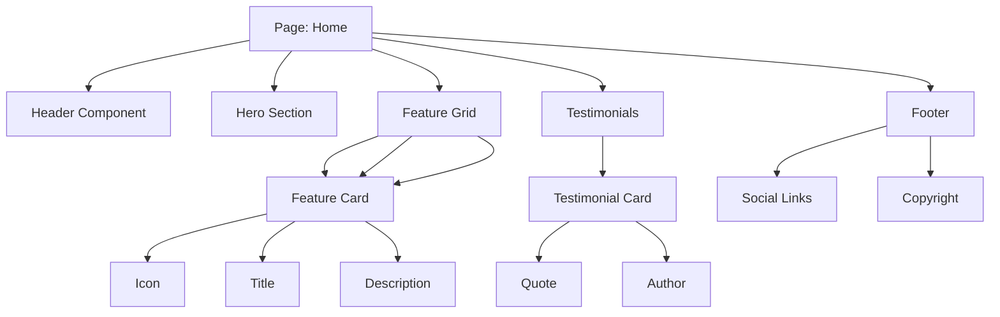
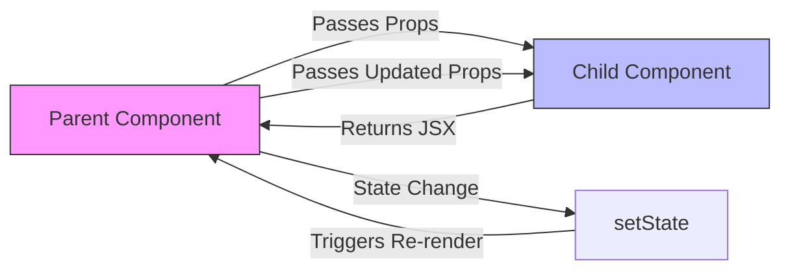

# Creating Your First Custom Component

## Introduction
Components are the building blocks of any React application, and Next.js is no exception. Learning how to create reusable components helps you build maintainable and scalable applications by avoiding code duplication and promoting separation of concerns.

## Why do we need this?
As your application grows, you'll find yourself repeating the same UI patterns (buttons, cards, modals, etc.). Creating reusable components saves development time, ensures consistency, and makes your codebase easier to maintain and test.

## Problem Statement
Without reusable components, you end up copying and pasting similar code across multiple pages, leading to inconsistencies, increased bundle size, and difficulty when making universal changes (e.g., updating a button style across the entire application).

## Real World Story
You're building an e-commerce site and need to display product cards on the homepage, category pages, and search results page. Instead of writing the same card markup and styles three times, you create a reusable `ProductCard` component that you can use everywhere with different props.

## Real World Analogy
Think of components like LEGO bricks:
- Each brick (component) has a specific shape and function
- You can reuse the same brick in many different constructions
- Specialized bricks (complex components) can be built from basic ones
- Changing the design of a brick improves every construction that uses it
- Just as you wouldn't mold a new LEGO brick for every model, you shouldn't rewrite UI patterns for every page

## Visual Explanation
Components allow you to encapsulate UI logic and presentation into reusable units. Instead of duplicating code, you define a component once and reuse it throughout your application.

## Mermaid Diagram 1: Component Composition


## Internal Working
When you create a component:
1. You define a function (or class) that returns JSX
2. You export it (default or named) so other files can import it
3. When imported, the component's code is bundled into your JavaScript
4. At runtime, React renders the component by calling its function and reconciling the result with the DOM

## Mermaid Diagram 2: Data Flow in Components


## Architecture
A React component is a self-contained module that encapsulates markup, styles, and behavior. It accepts inputs (props) and returns a description of the UI (JSX). Components can be composed together to build complex UIs, managed state locally or via external stores, and interact with the outside world through side effects (data fetching, subscriptions).

## Component Types
### Functional Components
Modern components written as functions, using hooks for state and side effects.
```jsx
import { useState } from 'react';

function Button({ onClick, children }) {
  const [isHovered, setIsHovered] = useState(false);
  
  return (
    <button 
      onMouseEnter={() => setIsHovered(true)}
      onMouseLeave={() => setIsHovered(false)}
      onClick={onClick}
      className={isHovered ? 'btn-hover' : ''}
    >
      {children}
    </button>
  );
}

export default Button;
```

### Class Components
Legacy class-based components (still supported but not recommended for new code).
```jsx
class Button extends React.Component {
  render() {
    return (
      <button onClick={this.props.onClick}>
        {this.props.children}
      </button>
    );
  }
}
```

## Component Structure
A typical functional component in Next.js:
```jsx
import { useState } from 'react';

function MyComponent({ title, onClick }) {
  const [count, setCount] = useState(0);
  
  const handleClick = () => {
    setCount(count + 1);
    onClick();
  };
  
  return (
    <div>
      <h2>{title}</h2>
      <p>Count: {count}</p>
      <button onClick={handleClick}>Click me</button>
    </div>
  );
}

export default MyComponent;
```

## Props
Props are inputs to a component (like function arguments):
- Passed as an object to the component function
- Can be any JavaScript value (string, number, object, array, function, etc.)
- Can have default values using destructuring defaults
- Are read-only from the component's perspective (should not be modified)
- Can be validated using PropTypes or TypeScript

## State and Effects
Components can manage local state and side effects:
- `useState`: Adds local state to functional components
- `useEffect`: Handles side effects like data fetching, subscriptions, timers
- `useContext`: Consumes React context
- Custom hooks: Reusable logic extracted into functions

## Basic Example
A simple reusable button component:
```jsx
// components/Button.js
export default function Button({ onClick, children, variant = 'primary' }) {
  const baseStyle = 'px-4 py-2 rounded font-medium transition-colors';
  const variantStyle = {
    primary: 'bg-blue-500 text-white hover:bg-blue-600',
    secondary: 'bg-gray-200 text-gray-800 hover:bg-gray-300',
    danger: 'bg-red-500 text-white hover-red-600'
  }[variant] || '';
  
  return (
    <button
      className={`${baseStyle} ${variantStyle}`}
      onClick={onClick}
    >
      {children}
    </button>
  );
}
```

Usage in a page:
```jsx
// pages/index.js
import Button from '../components/Button';

export default function Home() {
  const handleClick = () => alert('Clicked!');
  
  return (
    <div className="p-4">
      <h1>My App</h1>
      <Button onClick={handleClick}>Primary Button</Button>
      <Button variant="secondary" onClick={handleClick}>
        Secondary Button
      </Button>
      <Button variant="danger" onClick={handleClick}>
        Danger Button
      </Button>
    </div>
  );
}
```

## Intermediate Example
A reusable card component with flexible content:
```jsx
// components/Card.js
export default function Card({ title, children, footer, className = '' }) {
  return (
    <div className={`border rounded-lg shadow-md overflow-hidden ${className}`}>
      {title && <h2 className="px-6 py-4 text-lg font-bold">{title}</h2>}
      <div className="p-6">{children}</div>
      {footer && (
        <div className="px-6 pt-4 pb-2 border-t">
          {footer}
        </div>
      )}
    </div>
  );
}
```

Usage:
```jsx
// pages/index.js
import Card from '../components/Card';

export default function Home() {
  return (
    <div className="p-4 space-y-4">
      <Card title="Welcome">
        <p>Thanks for visiting my site!</p>
        <a href="/about" className="text-blue-500 underline">
          Learn More
        </a>
      </Card>
      
      <Card title="Features">
        <ul className="list-disc pl-5">
          <li>Fast performance</li>
          <li>Great SEO</li>
          <li>Easy deployment</li>
        </ul>
      </Card>
    </div>
  );
}
```

## Advanced Example
A component with state and effects (e.g., a counter):
```jsx
// components/Counter.js
import { useState } from 'react';

export default function Counter({ initialValue = 0, step = 1 }) {
  const [count, setCount] = useState(initialValue);
  
  const increment = () => setCount(c => c + step);
  const decrement = () => setCount(c => c - step);
  const reset = () => setCount(0);
  
  return (
    <div className="text-center space-y-4">
      <h2 className="text-xl font-bold">Counter: {count}</h2>
      <div className="flex justify-center space-x-3">
        <button onClick={decrement} className="px-3 py-1 bg-gray-200 rounded">
          -
        </button>
        <button onClick={reset} className="px-3 py-1 bg-gray-300 rounded">
          Reset
        </button>
        <button onClick={increment} className="px-3 py-1 bg-blue-500 text-white rounded">
          +
        </button>
      </div>
    </div>
  );
}
```

Usage:
```jsx
// pages/index.js
import Counter from '../components/Counter';

export default function Home() {
  return (
    <div className="p-4">
      <h1 className="text-2xl font-bold mb-4">Counter Example</h1>
      <Counter initialValue={10} step={5} />
    </div>
  );
}
```

## Production Example
In production builds, components benefit from:
- Tree shaking: Removes unused exports
- Code splitting: Enables lazy loading of route-specific components
- Minification: Reduces bundle size
- React 18 features: Automatic batching, concurrent rendering (when opted into)

You can further optimize with:
- `React.memo`: Prevents re-renders when props are shallowly equal
- `useMemo`: Memoizes expensive calculations
- `useCallback`: Memoizes functions to prevent child re-renders
- Dynamic imports: `dynamic(() => import('../components/HeavyComponent'))`

## Folder Structure Best Practices
Organize your components for scalability:
```
components/
├── ui/                 # Reusable UI primitives (buttons, inputs, etc.)
│   ├── Button.js
│   ├── Input.js
│   ├── Modal.js
│   └── Toast.js
├── layout/             # Layout components (headers, footers, etc.)
│   ├── Header.js
│   ├── Footer.js
│   └── Sidebar.js
├── features/           # Feature-specific components
│   ├── products/
│   │   ├── ProductList.js
│   │   ├── ProductCard.js
│   │   └── ProductForm.js
│   └── blog/
│       ├── PostList.js
│       ├── PostCard.js
│       └── CommentForm.js
└── hooks/              # Custom React hooks
    ├── useAuth.js
    ├── useFetch.js
    └── useForm.js
```

## Best Practices
- **Single Responsibility Principle**: Each component should have one clear purpose
- **Composition over inheritance**: Build complex components by combining simpler ones
- **Keep components small and focused**: Aim for components that do one thing well
- **Use prop types or TypeScript**: Validate props to catch errors early
- **Make components reusable**: Avoid hardcoding values that should be configurable
- **Handle edge cases**: Consider empty states, loading states, and error states
- **Optimize when necessary**: Use `React.memo`, `useMemo`, and `useCallback` for performance
- **Follow accessibility guidelines**: Ensure keyboard navigability and ARIA attributes
- **Keep dependencies minimal**: Avoid bloating your bundle with unnecessary libraries

## Common Mistakes
- **Not extracting repeated code**: Leads to duplication and maintenance headaches
- **Over-engineering**: Creating overly generic components when a simple one suffices
- **Ignoring prop validation**: Results in runtime errors from incorrect usage
- **Mutating props**: Props should be treated as read-only
- **Inconsistent naming**: Makes the codebase harder to navigate
- **Forgetting to clean up effects**: Leads to memory leaks in components using `useEffect`
- **Using array indices as keys**: Causes issues when list order changes
- **Overusing context**: Can cause unnecessary re-renders if not optimized
- **Neglecting accessibility**: Missing alt text, poor color contrast, lack of keyboard support
- **Storing secrets in client-side code**: Environment variables should be used for sensitive data

## Performance Notes
- Component rendering is efficient, but unnecessary re-renders impact performance
- Use `React.memo` to prevent re-renders when props haven't changed
- Use `useCallback` for functions passed as props to avoid child re-renders
- Use `useMemo` for expensive computations that depend on props
- Consider lazy loading large components with `next/dynamic`
- Monitor bundle size with tools like `next-bundle-analyzer`
- Profile performance with React DevTools Profiler

## Security Notes
- Validate and sanitize any data received from external sources (APIs, user input)
- Avoid `dangerouslySetInnerHTML` unless absolutely necessary and ensure content is sanitized
- Be cautious with third-party components; review their security practices
- Implement proper authentication and authorization checks in components that display sensitive data
- Use environment variables for secrets (never hardcode API keys or tokens)
- Regularly update dependencies to patch known vulnerabilities (`npm audit`)

## SEO Considerations
While components themselves don't directly affect SEO, they influence:
- **Page load performance**: Efficient components contribute to faster page loads (Core Web Vitals)
- **Content structure**: Proper use of semantic HTML elements (header, nav, main, section, article, footer)
- **Accessibility**: Overlaps with SEO best practices (alt text, heading hierarchy, ARIA labels)
- **Rendering behavior**: Ensure important content is server-rendered or pre-rendered for crawlers
- **Metadata management**: Use `next/head` in page components or layout components for dynamic meta tags

## Interview Questions
1. What is a React component and why are they fundamental to React development?
2. What's the difference between a functional component and a class component?
3. How do you pass data to a component, and what is the difference between props and state?
4. What are the key principles of creating reusable components?
6. What is the purpose of the `key` prop when rendering lists, and why is it important?
7. How can you prevent a component from re-rendering unnecessarily?
8. What are React hooks, and why were they introduced to replace class components for many use cases?
9. What is the difference between `useState` and `useReducer` for state management?
10. How do you share state between components that are not in a direct parent-child relationship?
11. What are higher-order components (HOCs) and render props, and when would you use each?
12. How do you create a custom hook, and what are the benefits of doing so?
13. What is component composition, and why is it a preferred approach over inheritance in React?
14. How do you handle side effects like data fetching or subscriptions in functional components?
15. What are the rules of hooks, and why must they be followed?
16. What is the difference between controlled and uncontrolled components in forms?
17. How do you optimize the performance of a React component?
18. What are some common security considerations when building React components?
19. How can components impact SEO, and what should you consider to ensure they are SEO-friendly?
20. What tools and techniques are available for testing React components?

## MCQs
1. Which of the following is the correct way to create a functional component in React?
   a) `function MyComponent() { return <div>Hello</div>; }`
   b) `class MyComponent extends React.Component { render() { return <div>Hello</div>; } }`
   c) `const MyComponent = () => { return <div>Hello</div>; }`
   d) Both a and c
   <details>
   <summary>Answer</d) Both a and c
   </details>

2. How do you pass a prop named `title` with value "Hello" to a component called `MyComponent`?
   a) `<MyComponent title="Hello" />`
   b) `<MyComponent value="Hello" />`
   c) `<MyComponent>{"Hello"}</MyComponent>`
   d) `<MyComponent><title>Hello</title></MyComponent>`
   <details>
   <summary>Answer</a) `<MyComponent title="Hello" />`
   </details>

3. What is the purpose of the `key` prop when rendering a list of elements?
   a) To make elements clickable
   b) To help React identify which items have changed, are added, or are removed
   c) To style the elements
   d) To set the focus on an element
   <details>
   <summary>Answer</b) To help React identify which items have changed, are added, or are removed
   </details>

4. Which hook would you use to manage state in a functional component?
   a) useEffect
   b) useContext
   c) useState
   d) useReducer
   <details>
   <summary>Answer</c) useState
   </details>

5. What does `React.memo` do?
   a) Memoizes the return value of a function
   b) Prevents a component from re-rendering if its props are shallowly equal
   c) Stores data in localStorage
   d) Creates a production build of your application
   <details>
   <summary>Answer</b) Prevents a component from re-rendering if its props are shallowly equal
   </details>

6. Which of the following is NOT a valid way to style a component in Next.js?
   a) CSS Modules
   b) Styled JSX
   c) Inline styles
   d) <style> tags in the component body
   <details>
   <summary>Answer</d) <style> tags in the component body
   </details>

7. What is the correct way to import and use a component named `Button` from `../components/Button.js`?
   a) `import Button from '../components/Button'`
   b) `import { Button } from '../components/Button'`
   c) `require('../components/Button')`
   d) Both a and c
   <details>
   <summary>Answer</a) `import Button from '../components/Button'`
   </details>

8. What is the purpose of the `children` prop?
   a) To pass down state to child components
   b) To allow components to accept arbitrary content between their opening and closing tags
   c) To manage component lifecycle
   d) To handle events
   <details>
   <summary>Answer</b) To allow components to accept arbitrary content between their opening and closing tags
   </details>

9. Which hook would you use to perform side effects like data fetching or subscriptions?
   a) useState
   b) useEffect
   c) useContext
   d) useReducer
   <details>
   <summary>Answer</b) useEffect
   </details>

10. What is a higher-order component (HOC)?
    a) A component that wraps another component to enhance its functionality
    b) A component that renders multiple children
    c) A component that uses the useState hook
    d) A component that is only used in production
    <details>
    <summary>Answer</a) A component that wraps another component to enhance its functionality
    </details>

## Practice Exercise
1. Create a new Next.js project called `component-exercise`
2. Create a `components` directory
3. Build a reusable `Button` component with variants (primary, secondary, danger)
4. Build a reusable `Card` component that accepts title, children, and optional footer
5. Create a `Badge` component that displays a count or status
6. Use these components in `pages/index.js` to build a dashboard-like interface
7. Add state to one of your components using `useState` (e.g., a click counter on the button)
8. Style your components using CSS Modules or Tailwind CSS
9. Run the development server to verify everything works

## Mini Project
Build a reusable UI component library for your Next.js applications:
1. Create a `components/ui` directory for primitive components
2. Build the following components:
   - Button (with variants: primary, secondary, danger, outline)
   - Input (text, email, password, textarea)
   - Select (dropdown)
   - Checkbox
   - Radio button group
   - Toggle switch
   - Card
   - Alert (success, error, warning, info)
   - Badge
   - Modal
   - Tooltip
   - Tabs
   - Accordion
3. Ensure each component:
   - Accepts appropriate props for customization
   - Has proper TypeScript definitions (if using TypeScript)
   - Follows accessibility guidelines (WCAG)
   - Is fully responsive
   - Includes JSDoc comments for documentation
4. Create a `components/layout` directory for layout components
5. Build:
   - Header (with logo, navigation, and user menu)
   - Footer (with copyright, links, and social media)
   - Sidebar (collapsible)
   - Page wrapper (provides consistent padding and max-width)
6. Create a showcase page (`/components`) that demonstrates all your components
7. Use your component library in at least two pages of your Next.js application
8. Document the usage of each component with examples
9. Consider publishing your component library as an npm package for future projects

## Summary
In this topic, you learned how to create reusable components in Next.js, understood the different types of components, explored patterns for component composition, and learned best practices for creating maintainable and efficient components. You now have the tools to build complex UIs by combining simple, reusable building blocks.

## Cheat Sheet
```
# Basic Functional Component
import React from 'react'; // Not needed in Next.js 12+

function MyComponent({ prop1, prop2 }) {
  return (
    <div>
      <h1>{prop1}</h1>
      <p>{prop2}</p>
    </div>
  );
}

export default MyComponent;

// With useState
import { useState } from 'react';

function Counter({ initialValue = 0 }) {
  const [count, setCount] = useState(initialValue);
  
  return (
    <div>
      <p>Count: {count}</p>
      <button onClick={() => setCount(count + 1)}>
        Increment
      </button>
    </div>
  );
}

export default Counter;

// With useEffect
import { useEffect, useState } from 'react';

function DataFetcher({ url }) {
  const [data, setData] = useState(null);
  const [loading, setLoading] = useState(true);
  
  useEffect(() => {
    let cancelled = false;
    fetch(url)
      .then(res => res.json())
      .then(data => {
        if (!cancelled) {
          setData(data);
          setLoading(false);
        }
      });
      });
 }) => e, }); 
 }; 
  return () => { cancelled = true; }; // Cleanup
  }, [url]);
  
  if (loading) return <p>Loading...</p>;
  if (!data) return <p>No data</p>;
  
  return <div>{JSON.stringify(data)}</div>;
}

export default DataFetcher;

// React.memo for performance optimization
import { memo } from 'react';

function MyComponent({ value }) {
  return <div>{value}</div>;
}

export default memo(MyComponent);

// Default Props (ES6 default parameters)
function Greeting({ name = 'Guest' }) {
  return <h1>Hello, {name}!</h1>;
}

export default Greeting;

// Destructuring with defaults
function UserProfile({ name = 'Anonymous', age = 0, isActive = false }) {
  return (
    <div>
      <h2>{name}</h2>
      <p>Age: {age}</p>
      <p>Status: {isActive ? 'Active' : 'Inactive'}</p>
    </div>
  );
}

export default UserProfile;

// Children Prop
function Card({ title, children }) {
  return (
    <div className="card">
      <h2>{title}</h2>
      <div className="card-body">{children}</div>
    </div>
  );
}

export default Card;

// Custom Hook
import { useState } from 'react';

function useCounter(initialValue = 0) {
  const [count, setCount] = useState(initialValue);
  
  const increment = () => setCount(c => c + 1);
  const decrement = () => setCount(c => c - 1);
  const reset = () => setCount(0);
  
  return { count, increment, decrement, reset };
}

export default useCounter;
```

## Related Topics
- Styling Components (CSS Modules, Tailwind CSS, styled-jsx)
- Props and Type Checking (PropTypes, TypeScript)
- State Management (useState, useReducer, Context API)
- Side Effects (useEffect, useLayoutEffect)
- Performance Optimization (React.memo, useMemo, useCallback)
- Custom Hooks
- Component Composition Patterns
- Testing Components (Jest, React Testing Library)

## Further Reading
- [React Documentation - Components and Props](https://reactjs.org/docs/components-and-props.html)
- [React Documentation - State and Lifecycle](https://reactjs.org/docs/state-and-lifecycle.html)
- [React Documentation - Hooks](https://reactjs.org/docs/hooks-intro.html)
- [React Documentation - Composition vs Inheritance](https://reactjs.org/docs/composition-vs-inheritance.html)
- [Next.js Documentation - Built-in CSS Support](https://nextjs.org/docs/css-features)
- [Next.js Documentation - Component APIs](https://nextjs.org/docs/api-reference)