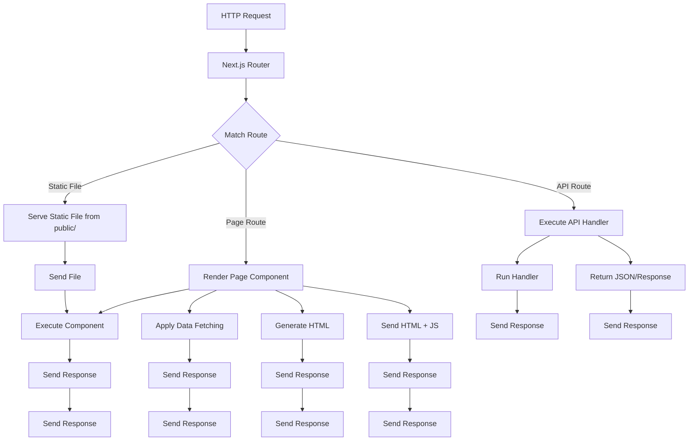

# Understanding File-System Routing

## Introduction
Next.js uses a file-system based routing mechanism where the structure of the `pages` directory directly defines the routes of your application. This intuitive approach eliminates the need for manual route configuration and makes navigation predictable.

## Why do we need this?
Traditional routing requires explicit route definitions in a separate configuration file, which can become cumbersome and error-prone as applications grow. File-system routing simplifies this by making the route structure visible and directly tied to your file organization.

## Problem Statement
Manually configuring routes in a separate file leads to duplication of effort, potential mismatches between UI and route configuration, and a steeper learning curve for new developers joining the project.

## Real World Story
You're working on a blog application and need to add a new section for tutorials. With file-system routing, you simply create a `tutorials` folder inside `pages` and add an `index.js` file. Instantly, the `/tutorials` route is available without touching any routing configuration.

## Real World Analogy
Think of file-system routing like organizing files in a cabinet:
- Each drawer represents a route section (`/blog`, `/api`, `/admin`)
- Folders inside drawers represent nested routes (`/blog/2023`, `/api/v1/users`)
- Files are the actual pages that get displayed
- Just as you can instantly see what's in each drawer by opening it, you can instantly see what routes exist by looking at the `pages` folder structure

## Visual Explanation
The `pages` directory uses a tree structure where each file or folder corresponds to a route segment.

## Mermaid Diagram 1: File-to-Route Mapping
```mermaid
graph TD
    A[pages/index.js] --> B[Route: /]
    C[pages/about.js] --> D[Route: /about]
    E[pages/blog/index.js] --> F[Route: /blog]
    G[pages/blog/[slug].js] --> H[Route: /blog/:slug]
    I[pages/products/index.js] --> J[Route: /products]
    K[pages/products/[id].js] --> L[Route: /products/:id]
    M[pages/api/users.js] --> N[Route: /api/users]
    O[pages/api/posts/[id].js] --> P[Route: /api/posts/:id]
```

## Internal Working
When Next.js starts, it:
1. Scans the `pages/` directory recursively
2. Maps each `.js`, `.jsx`, `.ts`, `.tsx` file to a route based on its path
3. Handles special filenames (`_app.js`, `_document.js`, etc.) differently
4. Creates a route object for each page that includes:
   - The page component
   - Data fetching functions (`getStaticProps`, `getServerSideProps`, etc.)
   - Route parameters info (for dynamic routes)
5. Uses this route map to handle incoming requests and client-side navigation

## Mermaid Diagram 2: Route Resolution Process


## Architecture
Next.js routing is built on the principle of convention over configuration. The framework automatically determines routes based on the file system structure, eliminating the need for external route configuration files. This approach provides:
- Predictable routing based on file locations
- Automatic code splitting per route
- Seamless integration with data fetching methods
- Support for static site generation (SSG), server-side rendering (SSR), and incremental static regeneration (ISR)
- Built-in support for API routes

## Marks of a Route
### Static Routes
Files like `pages/about.js` map directly to `/about`.

### Dynamic Routes
Files using bracket notation like `pages/posts/[id].js` map to `/posts/:id`, where `id` is a dynamic parameter.

### Catch-all Routes
Files like `pages/[...slug].js` match `/slug/*` (one or more segments).

### Optional Catch-all
Files like `pages/[[...slug]].js` match `/:slug*` (zero or more segments).

### API Routes
Files in `pages/api/` are treated as API endpoints rather than pages.

## Step-by-Step Flow
1. **File Creation**: Add a file to the `pages/` directory (e.g., `pages/blog/post.js`)
2. **Route Detection**: Next.js scans the directory and maps the file to a route (`/blog/post`)
3. **Component Rendering**: When the route is accessed, the file's default export is rendered as a React component
4. **Data Fetching**: If the component exports `getStaticProps` or `getServerSideProps`, data is fetched accordingly
5. **Response**: The rendered HTML (or JSON for API routes) is sent to the client

## Syntax
### Basic Page
```jsx
// pages/about.js
export default function About() {
  return <div>About Us</div>;
}
```

### Dynamic Route
```jsx
// pages/posts/[id].js
export default function Post({ params }) {
  return <div>Post ID: {params.id}</div>;
}
```

### Catch-all Route
```jsx
// pages/[...slug].js
export default function Path({ params }) {
  return <div>Path: {params.slug.join('/')}</div>;
}
```

### API Route
```jsx
// pages/api/hello.js
export default function handler(req, res) {
  res.status(200).json({ message: 'Hello' });
}
```

## Basic Example
Setting up basic navigation:
```jsx
// pages/index.js
import Link from 'next/link';

export default function Home() {
  return (
    <div>
      <h1>Home</h1>
      <nav>
        <Link href="/about">
          <a>About</a>
        </Link> | 
        <Link href="/blog">
          <a>Blog</a>
        </Link>
      </nav>
    </div>
  );
}
```

## Intermediate Example
Creating a dynamic route for blog posts:
```jsx
// pages/posts/[slug].js
import Link from 'next/link';

export default function Post({ params }) {
  return (
    <div>
      <h1>Post: {params.slug}</h1>
      <p>Content for post {params.slug}</p>
      <Link href="/posts">
        <a>All Posts</a>
      </Link>
    </div>
  );
}
```

## Advanced Example
Implementing a catch-all route for documentation:
```jsx
// pages/docs/[...slug].js
import Link from 'next/link';

export default function Docs({ params }) {
  const path = params.slug ? `/${params.slug.join('/')}` : '/';
  
  return (
    <div>
      <h1>Documentation</h1>
      <p>Current path: {path}</p>
      <nav>
        <Link href="/docs">
          <a>Overview</a>
        </Link> | 
        <Link href="/docs/getting-started">
          <a>Getting Started</a>
        </Link>
      </nav>
    </div>
  );
}
```

## Production Example
In production, Next.js optimizes routes:
- Static routes (e.g., `/about`) are pre-rendered as HTML at build time
- Dynamic routes (e.g., `/posts/[id]`) use the appropriate rendering strategy (SSG, SSR, or CSR) based on data fetching methods
- API routes become serverless functions on platforms like Vercel
- Client-side navigation via `next/link` provides instant transitions without full page reloads
- Prefetching: Links in the viewport are preloaded for faster navigation

## Folder Structure
A typical `pages` directory structure:
```
pages/
├── api/                 # API Routes
│   ├── auth/
│   │   ├── login.js
│   │   └── register.js
│   ├── users/
│   │   └── [id].js
│   └── posts.js
├── admin/               # Admin Section
│   ├── index.js         → /admin
│   ├── dashboard.js     → /admin/dashboard
│   └── users/
│       ├── index.js     → /admin/users
│       └── [id].js      → /admin/users/:id
├── blog/                # Blog Section
│   ├── index.js         → /blog
│   ├── [slug].js        → /blog/:slug
│   └── feed.xml         → /blog/feed.xml (static file)
├── products/            # Products Section
│   ├── index.js         → /products
│   ├── [id].js          → /products/:id
│   └── categories/
│       └── [slug].js    → /products/categories/:slug
├── users/               # User Profiles
│   └── [username].js    → /:username
├── _app.js              # Custom App
├── _document.js         # Custom Document
├── 404.js               # Custom 404 Page
├── 500.js               # Custom 500 Page
└── index.js             → / (Homepage)
```

## Best Practices
1. **Keep pages directory focused**: Only place files that define routes here
2. **Use meaningful folder names**: Reflect your site's information architecture
3. **Leverage dynamic routes**: For data-driven content (blog posts, products, users)
4. **Consider URL design**: Make URLs intuitive, SEO-friendly, and consistent
5. **Use index.js for folder indexes**: Represents the "main" page of a section
6. **Avoid deep nesting**: While possible, deeply nested URLs can be hard to manage
7. **Leverage API routes**: Keep backend logic close to frontend code
8. **Use route groups (App Router)**: For organizing routes without changing URL paths
9. **Implement proper 404 handling**: Create a custom 404 page for better UX
10. **Consider backward compatibility**: When changing URLs, implement redirects (via middleware or `next.config.js`)

## Common Mistakes
1. **Placing components in pages/**: This creates unintended routes (every file in `pages` becomes a route)
2. **Inconsistent naming**: Mixing `snake_case`, `camelCase`, and `kebab-case` leads to confusing URLs
3. **Forgetting index.js**: Accessing `/blog` fails if `pages/blog/index.js` doesn't exist
4. **Overlooking route precedence**: Static routes are matched before dynamic ones (e.g., `/blog/create` matches before `/blog/[slug]` if both exist)
5. **Misunderstanding catch-all vs optional catch-all**: `[...slug]` requires at least one segment, `[[...slug]]` allows zero segments
6. **Neglecting edge cases**: Empty parameters, special characters in dynamic segments, and trailing slashes
7. **Using reserved filenames**: Avoid names that conflict with system files or directories
8. **Ignoring case sensitivity**: On case-sensitive systems (`/Blog` ≠ `/blog`)
9. **Forgetting to restart dev server**: After adding new files/folders, the dev server may not detect them until restarted
10. **Mixing Pages and App Router**: In Next.js 13+, understanding the distinction between the two routing systems

## Performance Notes
- **Static Routes**: Fastest - served as pre-rendered HTML (if using SSG)
- **Static Generation with Revalidation (ISR)**: Balances freshness and performance
- **Server-Side Rendering (SSR)**: Slower initial load but always up-to-date data
- **Client-Side Rendering (CSR)**: Quickest initial HTML but requires client-side data fetching
- **Route Prefetching**: `next/link` component automatically prefetches linked pages in the viewport
- **Client-side Navigation**: Near-instantaneous transitions (no full page reload)
- **Code Splitting**: Each route gets its own JavaScript bundle, reducing initial load time
- **Dynamic Imports**: Further split code within routes using `next/dynamic` for large components
- **Edge Functions**: For ultra-low latency, consider deploying middleware or API routes to edge networks

## Security Notes
- **Input Validation**: Always validate parameters from dynamic routes (e.g., ensure an ID is a number)
- **Path Traversal Protection**: While Next.js prevents filesystem access, still sanitize user input
- **API Route Security**: Apply authentication, authorization, and rate limiting to API endpoints
- **CORS Configuration**: Configure Cross-Origin Resource Sharing headers for API routes as needed
- **Secure Headers**: Implement security headers (CSP, HSTS, X-Frame-Options) via middleware or headers API
- **Dependency Management**: Regularly audit dependencies with `npm audit` or `yarn audit`
- **Environment Variables**: Never expose secrets in client-side code; use `.env.local` for server-only values
- **Error Handling**: Implement proper error boundaries and error pages (404, 500) to avoid leaking stack traces

## SEO Considerations
- **Descriptive URLs**: Use readable, keyword-rich paths (e.g., `/blog/nextjs-routing-tips` vs `/blog/post123`)
- **Canonical URLs**: Prevent duplicate content by specifying preferred URLs
- **Trailing Slashes**: Be consistent (configure via `next.config.js` -> `trailingSlash: true`)
- **URL Hierarchy**: Reflect content structure in URLs (e.g., `/category/subcategory/item`)
- **Pagination**: Use proper `rel="next"` and `rel="prev"` links for paginated content
- **Meta Tags**: Use the `next/head` component to set title, description, and open graph tags
- **Structured Data**: Implement JSON-LD for rich snippets (recipes, events, products, etc.)
- **Image Optimization**: Use `next/image` for optimized, responsive images with proper `alt` text
- **Sitemap Generation**: Automatically generate `sitemap.xml` based on your routes
- **Robots.txt**: Control search engine crawling with a `robots.txt` file in `public/`

## Interview Questions
1. How does Next.js determine the route for a given file in the `pages` directory?
2. What is the difference between `pages/blog/index.js` and `pages/blog.js`?
3. How do you create a dynamic route for a resource with an ID (e.g., `/posts/123`)?
4. What is the difference between `[param].js`, `[...param].js`, and `[[...param]].js` in Next.js routing?
5. How do you create an API route in Next.js, and what HTTP methods does it support?
6. What special files does Next.js recognize in the `pages` directory (e.g., `_app.js`, `_document.js`)?
7. How does Next.js handle 404 errors (page not found)?
8. What is route precedence in Next.js, and how does it affect conflicting routes?
9. How would you implement a redirect from an old URL to a new one in Next.js?
10. How does Next.js support internationalized (i18n) routing?
11. What is the difference between `getStaticPaths` and `getStaticProps` for dynamic routes?
12. How can you prevent a route from being indexed by search engines (e.g., using `robots.txt`)?
13. What is the purpose of the `basePath` configuration in `next.config.js`?
14. How does Next.js handle trailing slashes in URLs, and how can you configure this behavior?
15. What are the performance implications of using dynamic routes vs static routes?

## MCQs
1. Which file creates the route `/blog/2023/05`?
   a) `pages/blog/2023/05.js`
   b) `pages/blog/[year]/[month].js`
   c) `pages/blog/2023/05/index.js`
   d) `pages/blog/[...slug].js`
   <details>
   <summary>Answer</b) `pages/blog/[year]/[month].js`
   </details>

2. What does `pages/[...slug].js` match?
   a) Only `/`
   b) `/` and `/anything`
   c) `/anything` and `/anything/anything` (one or more segments)
   d) Only `/something`
   <details>
   <summary>Answer</c) `/anything` and `/anything/anything` (one or more segments)
   </details>

3. Which file would create the route `/admin/dashboard/settings`?
   a) `pages/admin/dashboard/settings.js`
   b) `pages/admin/[...segments].js`
   c) `pages/admin/dashboard/index.js`
   d) `pages/admin/[section]/[subsection].js`
   <details>
   <summary>Answer</a) `pages/admin/dashboard/settings.js`
   </details>

4. How do you access a dynamic route parameter in a page component using the `pages` router?
   a) `props.params`
   b) `this.params`
   c) `useRouter().query`
   d) All of the above
   <details>
   <summary>Answer</d) All of the above (depending on context: `getStaticProps` uses `params`, page component uses `query` via `useRouter`)
   </details>

5. What special file is used to customize the `<html>` and `<body>` tags in Next.js?
   a) `_app.js`
   b) `_document.js`
   c) `custom-html.js`
   d) `head.js`
   <details>
   <summary>Answer</b) `_document.js`
   </details>

6. What is the difference between `[param].js` and `[[...param]].js`?
   a) `[param].js` matches one segment, `[[...param]].js` matches zero or more segments
   b) `[param].js` matches zero or more segments, `[[...param]].js` matches one or more segments
   c) Both match the same thing
   d) `[param].js` is for API routes, `[[...param]].js` is for pages
   <details>
   <summary>Answer</a) `[param].js` matches exactly one segment, `[[...param]].js` matches zero or more segments (optional catch-all)
   </details>

7. How does Next.js handle a request for a route that doesn't match any file?
   a) Returns a 500 error
   b) Returns a 404 error with a default page
   c) Redirects to the homepage
   d) Serves the `index.js` file
   <details>
   <summary>Answer</b) Returns a 404 error with a default page (can be overridden with `404.js`)
   </details>

8. What is the purpose of the `pages/api` directory?
   a) To store application logic
   b) To define custom middleware
   c) To create API routes (serverless functions)
   d) To store static assets
   <details>
   <summary>Answer</c) To create API routes (serverless functions)
   </details>

9. Which file would create the route `/docs/v1/introduction`?
   a) `pages/docs/v1/introduction.js`
   b) `docs/[version]/[topic].js`
   c) `pages/docs/[version]/[topic].js`
   d) `pages/docs/[...slug].js`
   <details>
   <summary>Answer</c) `docs/[version]/[topic].js`
   </details>

10. How do you access route parameters in a server-side function like `getStaticProps`?
    a) `params` argument
    b) `query` argument
    c) `request.params`
    d) `context.route`
    <details>
    <summary>Answer</a) `params` argument (e.g., `getStaticProps({ params })`)
    </details>

## Practice Exercise
1. Create a new Next.js project called `routing-exercise`
2. Create the following pages:
   - Home (`/`)
   - About (`/about`)
   - Blog listing (`/blog`)
   - Individual blog post (`/blog/[slug]`)
   - User profile (`/users/[username]`)
   - API endpoint to get user data (`/api/users/[id]`)
3. Implement navigation between pages using `next/link`
4. Create a custom 404 page
5. Test all routes in the development server
6. Try accessing non-existent routes to see the 404 page
7. Create a catch-all route for undefined paths

## Mini Project
Build a simple e-commerce browsing experience:
1. Create a product catalog with:
   - Homepage (`/`) featuring featured products
   - Product listing (`/products`) with filtering capabilities
   - Individual product page (`/products/[id]`)
   - Category pages (`/products/category/[slug]`)
   - Search results page (`/search`) - can use query parameters
2. Implement a shopping cart (client-side only for this exercise)
3. Create API routes for:
   - Getting product list (`/api/products`)
   - Getting single product (`/api/products/[id]`)
   - Creating an order (`/api/orders` - POST)
4. Add authentication routes:
   - Login (`/api/auth/login`)
   - Logout (`/api/auth/logout`)
   - Profile (`/api/profile`)
5. Create user profile pages:
   - Profile view (`/profile`)
   - Profile edit (`/profile/edit`)
6. Implement proper error handling and loading states
7. Add meta tags for SEO on important pages
8. Test navigation and ensure all routes work correctly

## Summary
In this topic, you learned how Next.js uses file-system routing to automatically map files in the `pages` directory to application routes. You understand how to create static, dynamic, catch-all, and API routes, and how to leverage this system for intuitive and maintainable route management.

## Cheat Sheet
```
# Static Routes
pages/index.js           → /
pages/about.js           → /about
pages/blog/index.js      → /blog

# Dynamic Routes
pages/posts/[id].js      → /posts/:id
pages/[slug].js          → /:slug
pages/[id]/comments.js   → /:id/comments

# Catch-all Routes
pages/[...slug].js       → /:slug* (one or more segments)
pages/[[...slug]].js     → /:slug?* (zero or more segments)

# API Routes
pages/api/hello.js       → /api/hello
pages/api/users/[id].js  → /api/users/:id

# Special Files
pages/_app.js            # Custom App
pages/_document.js       # Custom Document
pages/404.js             # Custom 404
pages/500.js             # Custom 500

# Accessing Parameters
// In getStaticProps/getServerSideProps
export async function getStaticProps({ params }) {
  const id = params.id
  // ...
}

// In page component (pages router)
import { useRouter } from 'next/router'
const router = useRouter()
const slug = router.query.slug

// Or with useParams (app router)
import { useParams } from 'next/navigation'
const { slug } = useParams()
```

## Related Topics
- Creating Pages and Navigation
- Data Fetching Methods (getStaticProps, getServerSideProps, getStaticPaths)
- API Routes and Middleware
- Internationalized Routing (i18n)
- Redirects and Rewrites
- Route Groups (App Router)
- Server Components (App Router)

## Further Reading
- [Next.js Documentation - Routing Fundamentals](https://nextjs.org/docs/routing/introduction)
- [Next.js Documentation - Dynamic Routes](https://nextjs.org/docs/routing/dynamic-routes)
- [Next.js Documentation - API Routes](https://nextjs.org/docs/api-routes/introduction)
- [Next.js Documentation - Internationalized Routing](https://nextjs.org/docs/advanced-features/i18n-routing)
- [Next.js Documentation - Redirects](https://nextjs.org/docs/api-reference/next.config.js/redirects)
- [Next.js Documentation - Middleware](https://nextjs.org/docs/middleware)
- [Next.js Documentation - Head](https://nextjs.org/docs/api-reference/next/head)
- [Next.js Documentation - Link](https://nextjs.org/docs/api-reference/next/link)