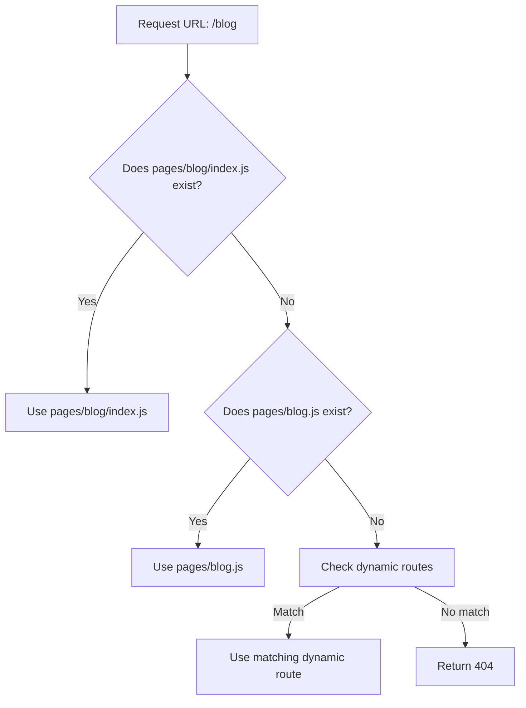
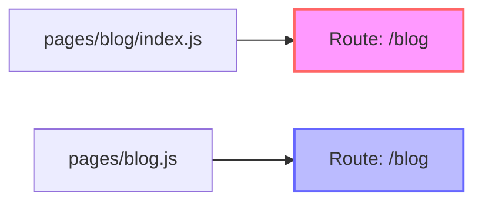
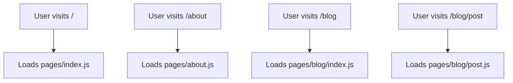
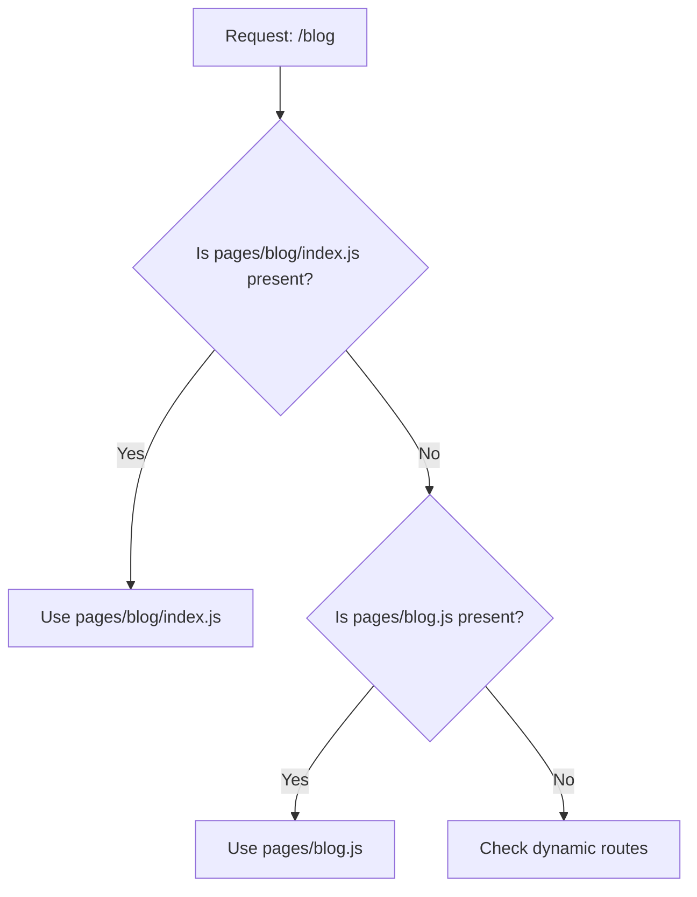
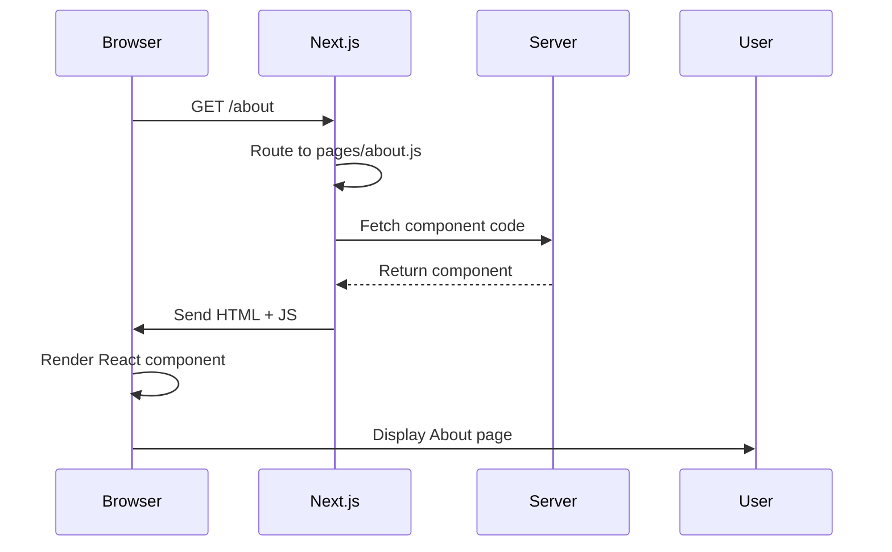

# Basic Routes and Index Files

## Introduction
Understanding how basic routes and index files work is fundamental to mastering Next.js routing. This topic covers how to create simple pages and how index files serve as the default route for a directory.

## Why do we need this?
Every web application needs a homepage and other static pages. Knowing how to create these basic routes efficiently allows you to build the foundation of your application's navigation structure.

## Problem Statement
Without understanding index files, developers might create redundant routes or confusion about how to access the main page of a section (e.g., `/blog` vs `/blog/index`).

## Real World Story
You're building a news website and need sections for different categories like politics, sports, and technology. Each section should have a landing page that shows recent articles in that category. By using index files, you can create `/politics`, `/sports`, and `/technology` as landing pages without creating redundant files like `/politics/index`.

## Real World Analogy
Think of index files like the main table in a room:
- When you enter a room (route section), you naturally look at the main table first
- The main table (index file) gives you an overview of what's in that section
- Side tables (other files in the directory) provide more specific information
- Just as you wouldn't label every table in a room as "Table 1", "Table 2", etc., you don't need to name every section's main page with a redundant filename

## Visual Explanation
```
pages/
├── index.js          → / (Homepage)
├── about.js          → /about (About page)
├── blog/
│   ├── index.js      → /blog (Blog landing page)
│   ├── first-post.js → /blog/first-post (Specific post)
│   └── guide.md      → /blog/guide (Static file)
└── api/
    └── hello.js      → /api/hello (API endpoint)
```

## Internal Working
When a request comes to the Next.js server:
1. The URL path is matched against files in the `pages/` directory
2. For a path like `/blog`:
   - Next.js looks for `pages/blog/index.js`
   - If found, it uses that component as the route handler
   - If not found, it looks for `pages/blog.js` (treated as a page)
3. For a path like `/`:
   - Next.js looks for `pages/index.js`
4. For a path like `/about`:
   - Next.js looks for `pages/about.js`

## Technical Explanation
### Route Resolution Priority
Next.js follows this order when resolving a path:
1. Check for `pages/<path>/index.js` (directory index)
2. Check for `pages/<path>.js` (page file)
3. Check for dynamic routes that match the path
4. Check for catch-all routes
5. If nothing matches, return 404

### Special Case: Root Route
- The root route `/` can only be mapped to `pages/index.js`
- There is no `pages/.js` file (invalid filename)

### Index Files in Nested Directories
- `pages/dashboard/index.js` → `/dashboard`
- `pages/settings/account/index.js` → `/settings/account`
- If both `pages/settings/account.js` and `pages/settings/account/index.js` exist, the `index.js` takes precedence for `/settings/account`

### Static Files in pages/
Note: Files in `pages/` that are not `.js`, `.jsx`, `.ts`, or `.tsx` are not treated as pages (unless using the app router with certain extensions). However, static files like `.md` or `.txt` in `pages/` will be served as static assets only if they're in the `public/` directory or handled via custom server logic.

## Mermaid Diagram 1: Route Resolution Flow


## Mermaid Diagram 2: Index File vs Page File


## Explanation
### Story
Imagine you're organizing a library. Instead of having a complex catalog system, you simply arrange books on shelves where the shelf location tells you exactly what book you'll find. The main shelf in each section shows you what's available in that section - that's your index file.

### Real-world Analogy
Like a shopping mall directory:
- Main directory shows: "Food Court", "Clothing", "Electronics"
- Each section has its own directory showing specific stores
- You don't need a separate map for every single store - the hierarchy guides you

### Technical Explanation
Next.js uses the file system as its router. When you request a URL, it maps that path to the file system:
- `/` → `pages/index.js`
- `/about` → `pages/about.js`
- `/blog/` → `pages/blog/index.js` (note the trailing slash is optional)
- `/blog/post` → `pages/blog/post.js`

## Diagram 1: Basic Route Mapping


## Diagram 2: Index File Precedence


## Diagram 3: Nested Directory Structure
```mermaid
flowchart LR
    A[pages/] --> B[index.js] --> C[/]
    A --> D[about.js] --> E[/about]
    A --> F[blog/] --> G[index.js] --> H[/blog]
    F --> I[first-post.js] --> J[/blog/first-post]
    A --> K[api/] --> L[hello.js] --> M[/api/hello]
```

## Diagram 4: Data Flow in Basic Routes


## Basic Example
Creating a simple homepage and about page:
```jsx
// pages/index.js
export default function Home() {
  return (
    <div>
      <h1>Welcome to My Site</h1>
      <p>This is the homepage.</p>
      <a href="/about">Learn About Us</a>
    </div>
  );
}

// pages/about.js
export default function About() {
  return (
    <div>
      <h1>About Us</h1>
      <p>We build amazing websites.</p>
      <a href="/">Back to Home</a>
    </div>
  );
}
```

## Intermediate Example
Creating a blog section with index file:
```jsx
// pages/blog/index.js
import Link from 'next/link';

export default function Blog() {
  return (
    <div>
      <h1>Blog</h1>
      <p>Latest posts:</p>
      <ul>
        <li>
          <Link href="/blog/first-post">
            <a>My First Post</a>
          </Link>
        </li>
        <li>
          <Link href="/blog/second-post">
            <a>My Second Post</a>
          </Link>
        </li>
      </ul>
    </div>
  );
}

// pages/blog/first-post.js
export default function FirstPost() {
  return (
    <div>
      <h1>My First Post</h1>
      <p>This is the content of my first blog post.</p>
      <Link href="/blog">
        <a>← Back to Blog</a>
      </Link>
    </div>
  );
}
```

## Advanced Example
Creating nested sections with index files:
```jsx
// pages/dashboard/index.js
export default function Dashboard() {
  return (
    <div>
      <h1>Dashboard Overview</h1>
      <p>Welcome to your dashboard.</p>
    </div>
  );
}

// pages/dashboard/analytics/index.js
export default function Analytics() {
  return (
    <div>
      <h1>Analytics</h1>
      <p>View your data and metrics here.</p>
    </div>
  );
}

// pages/dashboard/settings/index.js
export default function Settings() {
  return (
    <div>
      <h1>Settings</h1>
      <p>Configure your preferences.</p>
    </div>
  );
}
```

## Production Example
In production, basic routes are optimized:
- Static routes (`/`, `/about`, `/contact`) can be pre-rendered at build time if they don't require data fetching
- The HTML is served directly from CDN (on Vercel) for fastest performance
- Client-side navigation between basic routes is instantaneous
- Search engines can easily crawl and index these predictable URLs

## Folder Structure
```
pages/
├── index.js               # Homepage (/)
├── about.js               # About page (/about)
├── contact.js             # Contact page (/contact)
├── blog/
│   ├── index.js           # Blog landing page (/blog)
│   ├── [slug].js          # Individual blog post (/blog/:slug)
│   └── feed.xml           # RSS feed (static file)
├── docs/
│   ├── index.js           # Documentation homepage (/docs/)
│   ├── getting-started.js # Getting started guide (/docs/getting-started)
│   └── advanced/
│       └── index.js       # Advanced topics landing page (/docs/advanced/)
├── api/
│   ├── index.js           # API root (/api/)
│   ├── users/
│   │   └── index.js       # Users collection endpoint (/api/users/)
│   └── posts/
│       └── [id].js        # Individual post endpoint (/api/posts/:id)
└── [username].js          # User profile pages (dynamic route, /:username)
```

## Best Practices
1. **Use index.js for section landing pages**: Makes `/section` accessible
2. **Keep homepage simple**: `pages/index.js` should be lightweight for fastest load
3. **Leverage index files for nested sections**: `/section/subsection` via `pages/section/subsection/index.js`
4. **Avoid redundant naming**: Don't create both `pages/blog.js` and `pages/blog/index.js` unless you have a specific reason (and understand precedence)
5. **Use descriptive names**: Even for index files, the directory name provides context
6. **Consider using `.md` or other static files in `public/`**: For actual static content rather than putting in `pages/`
7. **Test route accessibility**: Ensure all important sections are reachable via intuitive URLs
8. **Document your route structure**: Especially for larger teams
9. **Use consistent casing**: Stick to kebab-case or snake_case for URL predictability
10. **Remember the root route**: Only `pages/index.js` can serve `/`

## Common Mistakes
1. **Forgetting to create index.js for sections**: Results in `/section` returning 404
2. **Confusing `pages/section.js` with `pages/section/index.js`**: Leads to unexpected behavior
3. **Placing components in pages/**: They become accessible as routes (e.g., `pages/components/Button.js` → `/components/Button`)
4. **Using uppercase in filenames**: Can cause issues on case-sensitive file systems
5. **Forgetting to restart dev server**: After adding new pages or folders
6. **Assuming all files in pages/ are routes**: Only `.js`, `.jsx`, `.ts`, `.tsx` files are considered for routing (by default)
7. **Overlooking that index.js takes precedence**: Leads to confusion when both `section.js` and `section/index.js` exist
8. **Not considering trailing slashes**: Next.js handles them, but be consistent for SEO
9. **Trying to access non-existent index files**: Results in 404, not fallback to parent
10. **Misunderstanding that index.js only works for directories**: It doesn't work for files (e.g., `pages/blog/index.js` is for `/blog`, not `/blog/index`)

## Performance Notes
- **Basic routes are fast**: Especially when statically optimized
- **HTML size**: Keep the initial HTML small for fastest first paint
- **CSS delivery**: Consider inlining critical CSS for above-the-fold content
- **JavaScript**: Minimize render-blocking JavaScript in the initial load
- **Images**: Optimize and use `next/image` for automatic optimization
- **Caching**: Static routes can be cached aggressively by CDNs
- **Client-side navigation**: Instantaneous between basic routes
- **Preloading**: Use `next/link` prefetching for likely next navigations

## Security Notes
- **Input validation**: Even basic routes should validate any query parameters
- **CSRF protection**: Not typically needed for GET-only basic routes, but important for forms
- **XSS prevention**: Sanitize any user-generated content before rendering
- **Information disclosure**: Don't expose sensitive information in basic routes (use authentication/authorization)
- **Rate limiting**: Generally not needed for public basic routes unless they perform expensive operations
- **Secure headers**: Implement via `_headers` file or middleware for security headers (CSP, HSTS, etc.)

## SEO Considerations
- **Descriptive URLs**: Use meaningful names for your pages and sections
- **Consistent trailing slashes**: Choose one style and stick to it (Next.js can enforce via `next.config.js`)
- **Canonical URLs**: Ensure each piece of content has one preferred URL
- **Title and meta description**: Use `<Head>` to set unique, descriptive titles and descriptions
- **Heading structure**: Use proper h1-h6 hierarchy for content
- **Image alt text**: Provide descriptive alt attributes for all images
- **Internal linking**: Use `next/link` for crawlable internal links
- **Sitemap**: Generate a sitemap based on your routes for search engines
- **Robots.txt**: Control what search engines can crawl via `public/robots.txt`
- **Pagination**: Use proper `rel="next"` and `rel="prev"` for paginated content (if applicable)

## Interview Questions
1. How does Next.js determine the route for `pages/about.js`?
2. What is the difference between accessing `/blog` and `/blog/index` in a Next.js application?
3. What happens if you create both `pages/blog.js` and `pages/blog/index.js`?
4. How do you create a homepage in Next.js?
5. What files does Next.js consider when resolving a route?
6. How does Next.js handle the root route `/`?
7. What is the purpose of index files in Next.js routing?
8. How would you create a section landing page for `/products`?
9. How do static routes differ from dynamic routes in terms of performance?
10. How does Next.js optimize basic routes for production?

## MCQs
1. Which file creates the route `/`?
   a) `pages/root.js`
   b) `pages/index.js`
   c) `pages/home.js`
   d) `pages/main.js`
   <details>
   <summary>Answer</b) `pages/index.js`
   </details>

2. If you have both `pages/blog.js` and `pages/blog/index.js`, which one serves `/blog`?
   a) `pages/blog.js` (takes precedence)
   b) `pages/blog/index.js` (takes precedence)
   c) Both serve the route (undefined behavior)
   d) Neither; you must choose one
   <details>
   <summary>Answer</b) `pages/blog/index.js` (index.js takes precedence)
   </details>

3. What is the route for `pages/admin/dashboard/index.js`?
   a) `/admin`
   b) `/admin/dashboard`
   c) `/admin/dashboard/index`
   d) `/admin/dashboard/index.js`
   <details>
   <summary>Answer</b) `/admin/dashboard`
   </details>

4. Which of the following is NOT a valid way to create an about page route?
   a) `pages/about.js`
   b) `pages/about/index.js`
   c) `pages/about/contact.js` (this would be `/about/contact`)
   d) `pages/aboutus.js` (this would be `/aboutus`)
   <details>
   <summary>Answer</c) `pages/about/contact.js` (this creates `/about/contact`, not `/about`)
   </details>

5. How does Next.js handle a request for `/blog` when `pages/blog/index.js` exists?
   a) Looks for `pages/blog.js` first
   b) Uses `pages/blog/index.js` directly
   c) Returns a 404
   d) Redirects to `/blog/index`
   <details>
   <summary>Answer</b) Uses `pages/blog/index.js` directly
   </details>

6. Which file would create the route `/docs/getting-started`?
   a) `pages/docs/getting-started.js`
   b) `pages/docs/index.js` + `pages/docs/getting-started/index.js`
   c) `pages/docs/getting-started/index.js`
   d) `pages/docs/getting-started/.[index].js`
   <details>
   <summary>Answer</a) `pages/docs/getting-started.js`
   </details>

7. What happens if you request `/products` and only `products/[id].js` exists?
   a) Shows the product page with id="products"
   b) Returns 404 (no matching route)
   c) Shows a list of all products
   d) Redirects to `/products/index`
   <details>
   <summary>Answer</b) Returns 404 (no matching route)
   </details>

8. Which file creates the route `/api/users`?
   a) `pages/api/users.js`
   b) `pages/api/users/index.js`
   c) Both a and b (with b taking precedence)
   d) Neither; you need `pages/api/users/[id].js`
   <details>
   <summary>Answer</c) Both a and b (with b taking precedence)
   </details>

9. How does Next.js treat files in the `pages/` directory that are not `.js`, `.jsx`, `.ts`, or `.tsx`?
   a) They are automatically routed based on filename
   b) They are ignored for routing purposes
   c) They cause a build error
   d) They are treated as static files and served at their path
   <details>
   <summary>Answer</b) They are ignored for routing purposes
   </details>

10. What is the file for the root route (`/`)?
    a) `pages/root.js`
    b) `pages/index.js`
    c) `pages/home.js`
    d) There is no specific file; it's configured in `next.config.js`
    <details>
    <summary>Answer</b) `pages/index.js`
    </details>

## Practice Exercise
1. Create a new Next.js project called `basic-routing-exercise`
2. Create the following pages:
   - Homepage (`/`)
   - About page (`/about`)
   - Services page (`/services`)
   - Contact page (`/contact`)
3. Create a `blog/` section with:
   - Blog landing page (`/blog`)
   - Individual blog post (`/blog/[slug]`)
4. Create an `api/` section with:
   - API root (`/api/`)
   - Users endpoint (`/api/users/`)
5. Link between pages using `next/link`
6. Test all routes in the development server
7. Verify that accessing `/blog` shows the blog landing page (not 404)
8. Verify that accessing `/api/users` shows the API endpoint response

## Mini Project
Build a simple documentation website:
1. Create a homepage (`/`) with site title and navigation
2. Create a `docs/` section for documentation:
   - Documentation homepage (`/docs/`)
   - Getting started guide (`/docs/getting-started`)
   - API reference (`/docs/api/`)
   - Tutorials (`/docs/tutorials/`)
3. Create a `blog/` section:
   - Blog homepage (`/blog/`)
   - Individual blog posts (`/blog/[slug]`)
4. Create an `api/` section for dynamic content:
   - Get all articles (`/api/articles`)
   - Get article by ID (`/api/articles/[id]`)
5. Implement navigation between all sections
6. Add meta tags for SEO on important pages
7. Ensure all routes are accessible and return appropriate content
8. Test the development server to verify everything works
9. Consider adding a search page (`/search`) that uses query parameters
10. Add a 404 page for handling invalid routes

## Summary
In this topic, you learned how to create basic routes and use index files in Next.js. You understand how the file-system routing maps files to URLs, how index files serve as section landing pages, and how to structure your pages directory for intuitive and maintainable routing.

## Cheat Sheet
```
# Basic Route Examples
pages/index.js           → / (Homepage)
pages/about.js           → /about
pages/contact.js         → /contact

# Index Files (Section Landing Pages)
pages/blog/index.js      → /blog
pages/products/index.js  → /products
pages/docs/index.js      → /docs

# Nested Index Files
pages/admin/index.js                 → /admin
pages/admin/dashboard/index.js       → /admin/dashboard
pages/settings/account/index.js      → /settings/account

# API Routes with Index Files
pages/api/index.js                   → /api/
pages/api/users/index.js             → /api/users/
pages/api/posts/[id].js              → /api/posts/:id

# Route Resolution Priority
1. pages/<path>/index.js   (if <path> is a directory)
2. pages/<path>.js         (if <path> is a file)
3. Dynamic routes
4. Catch-all routes
5. 404

# Special Case
pages/index.js             → / (only way to get root route)
```

## Related Topics
- Dynamic Routes and Parameter Handling
- Catch-all and Optional Catch-all Routes
- API Routes and Middleware
- Route Groups (App Router)
- Internationalized Routing (i18n)
- Redirects and Rewrites

## Further Reading
- [Next.js Documentation - Routing Fundamentals](https://nextjs.org/docs/routing/introduction)
- [Next.js Documentation - Index Routes](https://nextjs.org/docs/routing/introduction#index-routes)
- [Next.js Documentation - Page Components](https://nextjs.org/docs/routing/page-components)