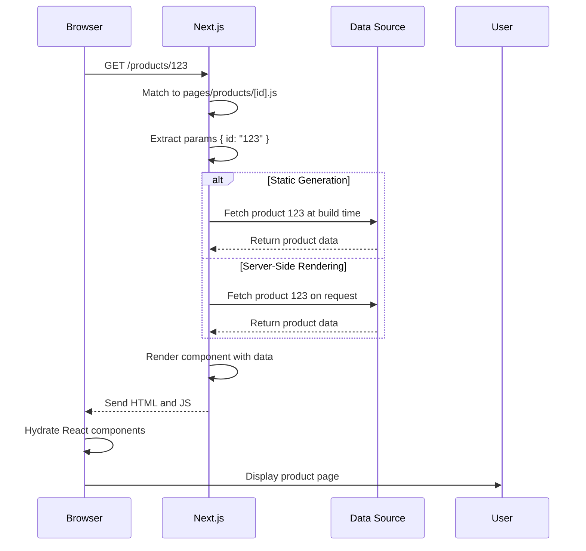

# Dynamic Routes and Parameter Handling

## Introduction
Dynamic routes allow you to create pages that match a range of URLs, enabling data-driven content like blog posts, product pages, or user profiles. This topic covers how to create dynamic routes and access route parameters in Next.js.

## Why do we need this?
Hardcoding a separate page for every possible URL (like every blog post or product) is impractical. Dynamic routes let you create a single page template that can display content for many different URLs based on parameters.

## Problem Statement
Without dynamic routes, you would need to create a new file for every piece of content, leading to maintenance nightmares and inconsistencies. Updating the design would require changing hundreds of similar files.

## Real World Story
You're building an e-commerce site with 10,000 products. Instead of creating 10,000 separate product pages, you create one dynamic route `pages/products/[id].js` that can display any product based on the `id` parameter.

## Real World Analogy
Think of dynamic routes like a template letter:
- Instead of writing a unique letter for every customer, you create one template with placeholders
- You fill in the placeholders (name, address, etc.) for each specific letter
- Similarly, a dynamic route is a template that fills in content based on URL parameters

## Visual Explanation
Dynamic routes use brackets to define parameterized segments in the file path.

## Mermaid Diagram 1: Dynamic Route Matching
```mermaid
flowchart TD
    A[Request: /products/123] --> B{Match to pages/products/[id].js}
    B -->|Yes| C[Extract params: { id: "123" }]
    C -->|No| D[Check other routes]
    D -->|Match dynamic| E[Process accordingly]
    E -->|No match| F[Return 404]
```

## Internal Working
When a request matches a dynamic route:
1. Next.js identifies the dynamic segments (enclosed in square brackets)
2. It extracts the values from the URL and puts them in the `params` object
3. The page component receives these parameters via:
   - `getStaticProps({ params })`
   - `getServerSideProps({ params })`
   - `getStaticPaths({ params })` (for SSG)
   - `useRouter()` hook (client-side)
   - `router.query` (in page component)
4. The component uses these parameters to fetch or compute the appropriate content

## Mermaid Diagram 2: Data Flow in Dynamic Routes


## Architecture
Dynamic routes in Next.js follow the same file-system routing principles as static routes, with the addition of parameter extraction. The framework handles:
- Parameter extraction from URLs
- Passing parameters to data fetching functions
- Client-side hydration of parameter values
- Proper 404 handling for non-matching parameters
- Integration with `getStaticPaths` for pre-rendering dynamic routes

## Syntax
### Single Parameter
```jsx
// pages/posts/[id].js
export default function Post({ params }) {
  return <div>Post ID: {params.id}</div>;
}
```

### Multiple Parameters
```jsx
// pages/blog/[year]/[month].js
export default function BlogPost({ params }) {
  return <div>Month: {params.month}, Year: {params.year}</div>;
}
```

### Catch-all (One or More Segments)
```jsx
// pages/[...slug].js
export default function Path({ params }) {
  return <div>Path: {params.slug.join('/')}</div>;
}
```

### Optional Catch-all (Zero or More Segments)
```jsx
// pages/[[...slug]].js
export default function Path({ params }) {
  const path = params.slug ? `/${params.slug.join('/')}` : '/';
  return <div>Path: {path}</div>;
}
```

## Basic Example
Creating a dynamic route for blog posts:
```jsx
// pages/blog/[slug].js
import { useRouter } from 'next/router';

export default function Post() {
  const router = useRouter();
  const { slug } = router.query;

  // Simulated data fetch
  const post = {
    welcome: { title: 'Welcome', content: 'First post!' },
    'nextjs-routing': { title: 'Routing Guide', content: 'Learn routing.' }
  }[slug] || { title: 'Not Found', content: 'Post does not exist.' };

  return (
    <div>
      <h1>{post.title}</h1>
      <div>{post.content}</div>
      {!router.isFallback && (
        <p><a href="/blog">← Back to Blog</a></p>
      )}
    </div>
  );
}
```

## Intermediate Example
Handling numeric IDs and converting to numbers:
```jsx
// pages/products/[id].js
import { useRouter } from 'next/router';

export default function Product() {
  const router = useRouter();
  const { id } = router.query;
  const numericId = parseInt(id, 10);

  const products = {
    1: { name: 'Laptop', price: 999.99 },
    2: { name: 'Mouse', price: 29.99 }
  };

  const product = products[numericId] || { name: 'Not Found', price: 0 };

  return (
    <div>
      <h2>{product.name}</h2>
      <p>Price: ${product.price.toFixed(2)}</p>
    </div>
  );
}
```

## Advanced Example
Using `getStaticProps` and `getStaticPaths` for static generation:
```jsx
// pages/posts/[id].js
export default function Post({ post }) {
  return (
    <div>
      <h1>{post.title}</h1>
      <p>{post.content}</p>
    </div>
  );
}

export async function getStaticProps({ params }) {
  const { id } = params;
  const res = await fetch(`https://jsonplaceholder.typicode.com/posts/${id}`);
  if (!res.ok) return { notFound: true };
  const post = await res.json();
  return { props: { post }, revalidate: 60 };
}

export async function getStaticPaths() {
  return {
    paths: [
      { params: { id: '1' } },
      { params: { id: '2' } },
      { params: { id: '3' } }
    ],
    fallback: 'blocking'
  };
}
```

## Production Example
In production, dynamic routes are handled based on your data fetching strategy:
- **Static Generation (SSG)**: Pre-rendered at build time (ideal for blogs)
- **Server-Side Rendering (SSR)**: Rendered on each request (ideal for frequent data changes)
- **Incremental Static Regeneration (ISR)**: Revalidated in the background (ideal for occasionally updated content)
- **Client-Side Rendering (CSR)**: Data fetched on the client (ideal for user-specific dashboards)

## Folder Structure
Common patterns for dynamic routes:
```
pages/
├── blog/
│   └── [slug].js          → /blog/:slug
├── products/
│   ├── [id].js            → /products/:id
│   └── [id]/
│       └── reviews.js     → /products/:id/reviews
├── users/
│   └── [username].js      → /:username
└── api/
    └── [resource]/
        └── [id].js        → /api/[resource]/:id
```

## Best Practices
1. **Choose the right parameter name**: Use descriptive names like `[slug]` or `[postId]` instead of generic `[id]` when it adds clarity
2. **Validate parameters**: Especially for numeric IDs, parse and check for validity
3. **Handle missing data**: Return `{ notFound: true }` from data fetching functions when data doesn't exist
4. **Use appropriate fetching strategy**: Match your data fetching method (SSG/SSR/ISR/CSR) to your data's update frequency
5. **Leverage `getStaticPaths`**: Define which paths to pre-render for static generation
6. **Consider fallback behavior**: Choose between `false`, `true`, or `'blocking'` based on your UX needs
7. **Keep components focused**: Each dynamic route page should handle its specific data fetching and presentation
8. **Optimize for performance**: Use `revalidate` in `getStaticProps` for ISR to balance freshness and performance
9. **Handle edge cases**: Consider what happens with empty parameters, special characters, or unexpected values
10. **Test thoroughly**: Verify both existing and non-existing paths work as expected

## Common Mistakes
1. **Forgetting to handle missing parameters**: Leads to undefined values and potential errors
2. **Not validating parameter types**: Treating string "123" as number 123 without conversion can cause issues
3. **Incorrect `getStaticPaths` configuration**: Results in 404s for valid paths or excessive rebuilds
4. **Using dynamic routes for static content**: Wastes server resources when static generation would suffice
5. **Ignoring error handling in data fetching**: Leads to unhandled promise rejections and crash loops
6. **Using the same parameter name in nested routes**: Creates confusion when accessing values
7. **Assuming parameter values are numbers**: Remember that `params` values are always strings
8. **Not handling empty arrays in catch-all**: `[[...slug]]` gives undefined for root, `[]` for single segment with `[...slug]`
9. **Confusing `params` and `query`**: `params` for route parameters, `query` for query strings (e.g., `?id=123`)
10. **Over-nesting dynamic routes**: Makes URLs long and complex; consider if the nesting is truly necessary

## Performance Notes
- **Static Generation (SSG)**: Fastest for end-users (HTML served from CDN)
- **Incremental Static Regeneration (ISR)**: Good balance of freshness and performance (background regeneration)
- **Server-Side Rendering (SSR)**: Slightly slower per request but always up-to-date
- **Client-Side Rendering (CSR)**: Quickest initial HTML but requires client-side data fetching (can cause loading states)
- **Parameter extraction overhead**: Negligible (simple string parsing)
- **Data fetching bottleneck**: Usually the limiting factor in performance, not route matching
- **Cacheability**: SSG/ISR responses can be cached by CDNs; SSR responses typically have shorter cache times
- **Prefetching**: `next/link` prefetches JavaScript for linked routes (but not the data)

## Security Notes
- **Input validation**: Always validate parameters before using them in database queries or file system operations
- **Sanitize user input**: If parameters come from untrusted sources (e.g., user-generated URLs), sanitize to prevent injection
- **Authorization checks**: Ensure users have permission to access the requested resource (e.g., user can only view their own profile)
- **Rate limiting**: Especially important for public API endpoints with dynamic parameters to prevent abuse
- **Error handling**: Avoid leaking stack traces or internal errors in responses; use proper error status codes
- **Secure headers**: Implement security headers (CSP, HSTS) via middleware or headers API
- **Redirect safety**: Validate redirect URLs to prevent open redirect vulnerabilities
- **Parameter pollution**: Though rare in path parameters, be aware of duplicate parameter names in query strings
- **Dependency checks**: Regularly audit dependencies for vulnerabilities (`npm audit` or `yarn audit`)

## SEO Considerations
- **Descriptive parameters**: Use meaningful names (e.g., `[slug]` instead of `[id]`) for readable URLs
- **URL structure**: Keep URLs clean and hierarchical (e.g., `/blog/2023/01/my-post` vs `/posts/123`)
- **Canonical tags**: Prevent duplicate content by specifying preferred URLs for paginated or filtered views
- **Trailing slashes**: Be consistent (configure via `next.config.js` -> `trailingSlash`)
- **Pagination**: Use `rel="next"` and `rel="prev"` for paginated series
- **Internationalization**: Consider language and region in parameters (e.g., `[lang]/[country]/[slug]`)
- **Structured data**: Include JSON-LD markup in dynamic pages for rich snippets (reviews, products, events)
- **Metadata**: Use `next/head` to set dynamic titles, descriptions, and open graph tags
- **Internal linking**: Link between related dynamic content to improve crawlability
- **Server-side rendering preference**: For SEO-critical content, favor SSG/SSR over CSR to ensure crawlers see content
- **Sitemap generation**: Dynamically generate sitemaps based on your routes and update frequency
- **Robots.txt**: Control crawler access to sensitive or duplicate content areas

## Interview Questions
1. How do you create a dynamic route for a blog post by slug in Next.js?
2. What is the difference between `[id].js` and `[[...id]].js` in the pages directory?
3. How do you access route parameters in a page component using the `useRouter` hook?
4. What is the purpose of `getStaticPaths` in Next.js?
5. How would you handle a dynamic route that can accept zero or more path segments?
6. How do you pass data to a dynamic page using `getStaticProps`?
7. What happens if you don't provide a `fallback` in `getStaticPaths`?
5. How would you create a catch-all route that matches all paths under a directory?
6. How do you validate dynamic route parameters to prevent security issues?
7. How does Next.js handle numeric parameters in dynamic routes?
8. What is the difference between `getStaticProps` and `getServerSideProps` for data fetching?
9. How can you implement authentication for dynamic routes (e.g., user-specific profiles)?
10. What are the performance implications of using dynamic routes versus static routes?

## MCQs
1. Which file creates the route `/blog/2023/05`?
   a) `pages/blog/[year]/[month].js`
   b) `pages/blog/2023/05.js`
   c) `pages/blog/[year]/05.js`
   d) `pages/blog/[year]/[month]/[day].js`
   <details>
   <summary>Answer</a) `pages/blog/[year]/[month].js`
   </details>

2. What does `pages/[...slug].js` match?
   a) Exactly one path segment
   b) Zero or more path segments
   c) One or more path segments
   d) Exactly two path segments
   <details>
   <summary>Answer</c) One or more path segments
   </details>

3. What does `pages/[[...slug]].js` match?
   a) Exactly one path segment
   b) Zero or more path segments
   c) One or more path segments
   d) Exactly two path segments
   <details>
   <summary>Answer</b) Zero or more path segments
   </details>

4. How do you access a dynamic route parameter in `getStaticProps`?
   a) `props.params`
   b) `this.params`
   c) The first argument to `getStaticProps`
   d) The `params` property of the context object
   <details>
   <summary>Answer</d) The `params` property of the context object
   </details>

5. Which file would create the route `/user/john/settings`?
   a) `pages/user/[name]/settings.js`
   b) `pages/user/[name]/[setting].js`
   c) `pages/user/[name].js`
   d) `pages/user/[name]/[setting]/[value].ed`
   <details>
   <summary>Answer</a) `pages/user/[name]/settings.js`
   </details>

6. What is the value of `params` for the route `/blog/2023/05/10` matching `pages/blog/[year]/[month]/[day].js`?
   a) `{ year: "2023", month: "05", day: "10" }`
   b) `{ year: 2023, month: 5, day: 10 }`
   c) `{ "0": "2023", "1": "05", "2": "10" }`
   d) `{ path: "/blog/2023/05/10" }`
   <details>
   <summary>Answer</a) `{ year: "2023", month: "05", day: "10" }`
   </details>

7. How do you handle a dynamic route that may not have matching data (e.g., invalid ID)?
   a) Return `{ notFound: true }` from `getStaticProps`/`getServerSideProps`
   b) Throw an error in the page component
   c) Return `{ redirect: { destination: '/404', permanent: false } }`
   d) All of the above
   <details>
   <summary>Answer</d) All of the above
   </details>

8. What is the purpose of the `fallback` option in `getStaticPaths`?
   a) To specify what to do when a requested path is not in the `paths` array
   b) To define the default layout for dynamic routes
   c) To set the cache duration for static regeneration
   d) To enable or disable API routes
   <details>
   <summary>Answer</a) To specify what to do when a requested path is not in the `paths` array
   </details>

9. Which file creates a catch-all route for the `docs` section?
   a) `pages/docs/[...slug].js`
   b) `pages/docs/[[...slug]].js`
   c) `pages/[...docs]/[...slug].js`
   d) `pages/[...slug]/docs.js`
   <details>
   <summary>Answer</a) `pages/docs/[...slug].js`
   </details>

10. How would you access a dynamic route parameter in an API route?
    a) `req.params`
    b) `req.query`
    c) `req.body`
    d) `req.headers`
    <details>
    <summary>Answer</b) `req.query`
    </details>

## Practice Exercise
1. Create a new Next.js project called `dynamic-routing-exercise`
2. Create a dynamic route for blog posts: `pages/blog/[slug].js`
3. Implement `getStaticProps` to fetch post data based on slug
4. Implement `getStaticPaths` to define which paths to pre-render
5. Create a list of blog posts on the homepage linking to individual posts
6. Add error handling for non-existent posts (show 404 page)
7. Create a dynamic route for products with multiple parameters: `pages/products/[category]/[id].js`
8. Implement navigation between product list and individual products
9. Test the dynamic routes in the development server
10. Verify that accessing `/blog/nonexistent` shows the 404 page

## Mini Project
Build a simple movie database application:
1. Create a dynamic route for movies: `pages/movies/[id].js`
2. Fetch movie data from a public API (like OMDB API) in `getStaticProps`
3. Implement `getStaticPaths` to handle a predefined set of movie IDs
4. Create a movie list page (`/movies`) that links to individual movies
5. Add search functionality that filters movies by title (client-side)
6. Create a dynamic route for movie reviews: `pages/movies/[id]/reviews/[reviewId].js`
7. Implement infinite scroll or pagination for movie lists
8. Add movie details: title, year, genre, director, plot, poster
9. Implement error handling for invalid movie IDs
10. Add a "Random Movie" button that redirects to a random movie in the database
11. Create an API route for submitting reviews: `api/movies/[id]/reviews` (POST)
12. Ensure all pages are responsive and accessible
13. Test the application thoroughly in development mode

## Summary
In this topic, you learned how to create dynamic routes in Next.js to handle data-driven content. You understand how to define dynamic route parameters, access them in your components and data fetching functions, and handle various types of dynamic routes including single parameters, multiple parameters, catch-all, and optional catch-all routes.

## Cheat Sheet
```
# Dynamic Route Syntax
pages/posts/[id].js          → /posts/:id
pages/blog/[year]/[month].js → /blog/:year/:month
pages/[slug].js              → /:slug
pages/[...slug].js           → /:slug* (one or more segments)
pages/[[...slug]].js         → /:slug?* (zero or more segments)

# Accessing Parameters
// In getStaticProps/getServerSideProps
export async function getStaticProps({ params }) {
  const { id } = params;
  // ...
}

// In page component (pages/router)
import { useRouter } from 'next/router';
const router = useRouter();
const { slug } = router.query;

// Or with useParams (app router)
import { useParams } from 'next/navigation';
const { slug }';
const { slug } = useParams();

// In API routes
export default function handler(req, res) {
  const { id } = req.query;
  // ...
}

// getStaticPaths Example
export async function getStaticPaths() {
  return {
    paths: [
      { params: { id: '1' } },
      { params: { id: '2' } }
    ],
    fallback: 'blocking' // true/false/'blocking'
  };
}

// Error Handling
// In getStaticProps/getServerSideProps
if (!data) {
  return { notFound: true };
}

// In page component
import { notFound } from 'next/navigation';
if (!data) {
  notFound();
}
```

## Related Topics
- Catch-all and Optional Catch-all Routes
- API Routes and Middleware
- Data Fetching Methods (getStaticProps, getServerSideProps, getStaticPaths)
- Static Generation vs Server-Side Rendering
- Incremental Static Regeneration (ISR)
- Route Groups (App Router)
- Dynamic Routes with TypeScript

## Further Reading
- [Next.js Documentation - Dynamic Routes](https://nextjs.org/docs/routing/dynamic-routes)
- [Next.js Documentation - getStaticProps and getStaticPaths](https://nextjs.org/docs/data-fetching/get-static-props)
- [Next.js Documentation - getServerSideProps](https://nextjs.org/docs/data-fetching/get-server-side-props)
- [Next.js Documentation - API Routes](https://nextjs.org/docs/api-routes/introduction)
- [Next.js Documentation - Dynamic Routes with TypeScript](https://nextjs.org/docs/routing/dynamic-routes#typed-routes)