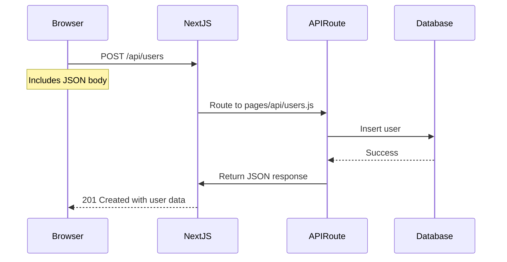
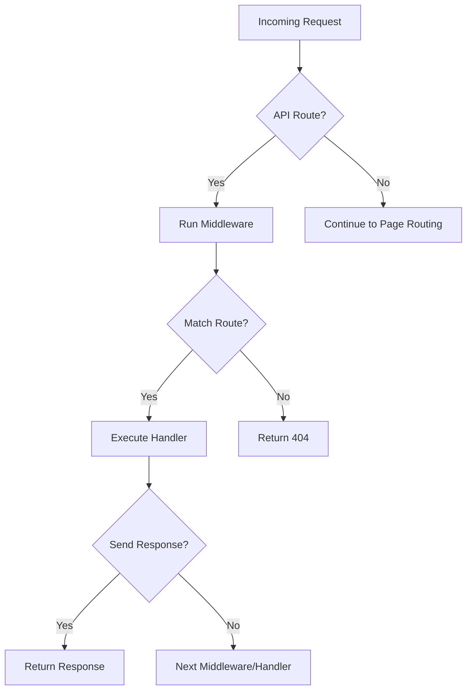

# API Routes and Middleware

## Introduction
API Routes in Next.js allow you to build your API endpoints as part of your Next.js application, enabling full-stack development within a single project. This topic covers how to create API routes, handle different HTTP methods, and use middleware for common functionality.

## Why do we need this?
Building a full-stack application often requires a backend to handle data operations, authentication, and business logic. Instead of setting up a separate server or service, Next.js API routes let you keep your frontend and backend code together, simplifying development and deployment.

## Problem Statement
Managing a separate backend service introduces complexity in deployment, versioning, and communication between frontend and backend. Developers need to maintain two codebases, handle CORS issues, and manage separate hosting configurations.

## Real World Story
You're building a blog platform and need endpoints to create, read, update, and delete posts. Instead of setting up a separate Node.js/Express server, you create API routes in `pages/api/posts/` that handle these operations directly within your Next.js project.

## Real World Analogy
Think of API routes like adding a kitchen to your apartment:
- Instead of going to a restaurant (separate backend) every time you want to cook, you have a kitchen (API routes) right in your home (Next.js app)
- You can prepare meals (handle requests) whenever you need without leaving your building
- You still have the option to order out (use external services) when it makes sense
- Your grocery shopping (data fetching) can be done locally or from external sources

## Visual Explanation
```
pages/
└── api/
    ├── hello.js              → GET /api/hello
    ├── users/
    │   ├── index.js          → GET/POST /api/users
    │   └── [id].js           → GET/PUT/DELETE /api/users/:id
    ├── posts/
    │   ├── [id].js         → GET/PUT/DELETE /api/posts/:id
    │   └── comments/
    │       └── [id].js     → POST /api/posts/:id/comments
    ├── auth/
    │   ├── login.js        → POST /api/auth/login
    │   └── logout.js       → POST /api/auth/logout
    └── _middleware.js      → Applies to all API routes
```

## Internal Working
When a request arrives at `/api/*`:
1. Next.js routes it to the API routes handler (instead of the page renderer)
2. The request is forwarded to the corresponding file in `pages/api/`
3. The file should export a default function that handles the request
4. The handler function receives `req` (IncomingMessage) and `res` (ServerResponse) objects
5. You can read request data (query, body, headers) and write response data (status, headers, body)
6. Middleware can be applied to run logic before the handler

## Technical Explanation
### API Route Structure
- All files inside `pages/api/` are treated as API endpoints
- The file path determines the endpoint URL (similar to pages routing)
- Only files with `.js`, `.jsx`, `.ts`, `.tsx` extensions are considered
- API routes are server-only - they never send code to the browser

### Request Handling
API route handlers follow this pattern:
```js
export default function handler(req, res) {
  // req: IncomingMessage (http module)
  // res: ServerResponse (http module)
  
  // Get query parameters: req.query
  // Get body (with body parsing): req.body
  // Get headers: req.headers
  // Get HTTP method: req.method
  
  // Set response: res.statusCode, res.setHeader(), res.write(), res.end()
  // Or use helpers: res.status(200).json(data)
}
```

### HTTP Methods
Handle different methods in the same handler:
```js
export default function handler(req, res) {
  if (req.method === 'GET') {
    // Handle GET request
  } else if (req.method === 'POST') {
    // Handle POST request
  } else if (req.method === 'PUT') {
    // Handle PUT request
  } else if (req.method === 'DELETE') {
    // Handle DELETE request
  } else {
    // Handle unsupported methods
    res.setHeader('Allow', ['GET', 'POST', 'PUT', 'DELETE']);
    res.status(405).end('Method Not Allowed');
  }
}
```

### Body Parsing
Next.js automatically parses:
- `application/json` (via `req.body`)
- `application/x-www-form-urlencoded` (via `req.body`)
- `multipart/form-data` (via `req.body` - but files need special handling)

For raw bodies or custom parsing, you need to disable body parsing:
```js
export const config = {
  api: {
    bodyParser: false
  }
};
```

### Response Helpers
```js
// Send JSON
res.status(200).json({ success: true, data });

// Send text
res.status(200).send('Hello World');

// Send status only
res.sendStatus(204);

// Redirect
res.redirect(301, '/new-location');

// Set header
res.setHeader('Content-Type', 'application/json');

// Set cookie
res.setHeader('Set-Cookie', 'cookieName=value; Max-Age=3600; Path=/');

// End response
res.end();
```

## Mermaid Diagram 1: API Route Request Flow


## Mermaid Diagram 2: API Route Middleware Flow


## Example: Simple API Route
1. Create `pages/api/hello.js`:
```js
export default function handler(req, res) {
  res.status(200).json({ message: 'Hello World' });
}
```

## Example: Handling Different Methods
1. Create `pages/api/tasks.js`:
```js
export default function handler(req, res) {
  if (req.method === 'GET') {
    // Get all tasks
    res.status(200).json({ tasks: [] });
  } else if (req.method === 'POST') {
    // Create new task
    const { title = req.body.title;
    // Save to database
    res.status(201).json({ id: 1, title, completed: false });
  } else {
    res.setHeader('Allow', ['GET', 'POST']);
    res.status(405).end('Method Not Allowed');
  }
}
```

## Example: Dynamic API Route
1. Create `pages/api/posts/[id].js`:
```js
export default function handler(req, res) {
  const { id } = req.query;
  
  if (req.method === 'GET') {
    // Get post by ID
    // In real app: fetch from database
    if (id === '1') {
      res.status(200).json({ id: 1, title: 'First Post', content: 'Hello' });
    } else {
      res.status(404).json({ error: 'Post not found' });
    }
  } else if (req.method === 'PUT') {
    // Update post by ID
    // In real app: validate and update in database
    res.status(200).json({ id, ...req.body });
  } else if (req.method === 'DELETE') {
    // Delete post by ID
    // In real app: delete from database
    res.status(204).end();
  } else {
    res.setHeader('Allow', ['GET', 'PUT', 'DELETE']);
    res.status(405).end('Method Not Allowed');
  }
}
```

## Example: Middleware with _middleware.js
1. Create `pages/api/_middleware.js`:
```js
export default function middleware(req, res) {
  // This runs for every API request
  
  // Example: Logging
  console.log(`${req.method} ${req.url}`);
  
  // Example: Authentication check
  const authHeader = req.headers.authorization;
  if (!authHeader || authHeader !== 'Bearer valid-token') {
    res.status(401).json({ error: 'Unauthorized' });
    return false; // Stop request from proceeding to handler
  }
  
  // Return true to continue to the next middleware/handler
  return true;
}
```

2. Create `pages/api/protected.js`:
```js
export default function handler(req, res) {
  // This will only run if middleware returns true
  res.status(200).json({ message: 'This is protected data' });
}
```

## Example: Connecting to Database
1. Create `pages/api/users/[id].js`:
```js
import { connectToDatabase } from '../../lib/mongodb';

export default function handler(req, res) {
  const { id } = req.query;
  
  switch (req.method) {
    case 'GET':
      // Get user by ID
      return getUser(req, res, id);
    case 'PUT':
      // Update user
      return updateUser(req, res, id);
    case 'DELETE':
      // Delete user
      return deleteUser(req, res, id);
    default:
      res.setHeader('Allow', ['GET', 'PUT', 'DELETE']);
      return res.status(405).end('Method Not Allowed');
  }
}

async function getUser(req, res, id) {
  try {
    const { db } = await connectToDatabase();
    const user = await db.collection('users').findOne({ _id: new ObjectId(id) });
    
    if (!user) {
      return res.status(404).json({ error: 'User not found' });
    }
    
    return res.status(200).json(user);
  } catch (error) {
    console.error('Error fetching user:', error);
    return res.status(500).json({ error: 'Internal Server Error' });
  }
}

async function updateUser(req, res, id) {
  try {
    const { db } = await connectToDatabase();
    const { name, email } = req.body;
    
    const result = await db.collection('users').updateOne(
      { _id: new ObjectId(id) },
      { $set: { name, email } }
    );
    
    if (result.matchedCount === 0) {
      return res.status(404).json({ error: 'User not found' });
    }
    
    return res.status(200).json({ message: 'User updated' });
  } catch (error) {
    console.error('Error updating user:', error);
    return res.status(500).json({ error: 'Internal Server Error' });
  }
}

async function deleteUser(req, res, id) {
  try {
    const { db } = await connectToDatabase();
    const result = await db.collection('users').deleteOne({ _id: new ObjectId(id) });
    
    if (result.deletedCount === 0) {
      return res.status(404).json({ error: 'User not found' });
    }
    
    return res.status(200).json({ message: 'User deleted' });
  } catch (error) {
    console.error('Error deleting user:', error);
    return res.status(500).json({ error: 'Internal Server Error' });
  }
}
```

## Example: Using External Libraries
1. Install required packages: `npm install axios sqlite3`
2. Create `pages/api/weather.js`:
```js
import axios from 'axios';

export default function handler(req, res) {
  const { city } = req.query;
  
  if (!city) {
    return res.status(400).json({ error: 'City parameter is required' });
  }
  
  try {
    const response = await axios.get(
      `https://api.openweathermap.org/data/2.5/weather`,
      {
        params: {
          q: city,
          appid: process.env.OPENWEATHER_API_KEY,
          units: 'metric'
        }
      }
    );
    
    return res.status(200).json(response.data);
  } catch (error) {
    if (error.response) {
      return res.status(error.response.status).json({ 
        error: error.response.data.message 
      });
    }
    return res.status(500).json({ error: 'Failed to fetch weather data' });
  }
}
```

## Example: File Upload Handling
1. Create `pages/api/upload.js`:
```js
import { promisify } from 'util';
import { pipeline } from 'stream';
import fs from 'fs';
import path from 'path';

// Disable body parsing for file uploads
export const config = {
  api: {
    bodyParser: false
  }
};

export default async function handler(req, res) {
  if (req.method !== 'POST') {
    res.setHeader('Allow', ['POST']);
    return res.status(405).end('Method Not Allowed');
  }
  
  // Prepare to save file
  const uploadDir = './public/uploads';
  if (!fs.existsSync(uploadDir)) {
    fs.mkdirSync(uploadDir, { recursive: true });
  }
  
  const fileName = `upload-${Date.now()}-${Math.round(Math.random() * 1E9)}`;
  const filePath = path.join(uploadDir, fileName);
  
  // Create write stream
  const writeStream = fs.createWriteStream(filePath);
  
  // Parse multipart/form-data and pipe to file
  try {
    await new Promise((resolve, reject) => {
      pipeline(
        req,
        // In a real app, you'd use a proper multipart parser like busboy
        // For demo, we'll assume raw binary data (not recommended for production)
        writeStream,
        (err) => {
          if (err) {
            console.error('File upload failed:', error);
            reject(err);
          } else {
            resolve();
          }
        }
      );
    });
    
    res.status(200).json({ 
      message: 'File uploaded successfully',
      fileName,
      filePath: `/uploads/${fileName}`
    });
  } catch (error) {
    console.error('File upload error:', error);
    res.status(500).json({ error: 'File upload failed' });
  }
}
```

## Production Example
In production, API routes are optimized:
- **Serverless Functions**: On Vercel, each API route becomes a serverless function
- **Server Mode**: On self-hosted Node.js servers, API routes are handled by the same server
- **Edge Functions**: On Vercel Edge, API routes can run at the edge for lower latency
- **Automatic scaling based on traffic
- **Scaling**: Automatic scaling based on traffic (serverless) or configurable (server mode)
- **Cold Starts**: Consider initialization time for serverless functions
- **Execution Limits**: Be aware of execution time limits (e.g., 10s on Vercel free tier)
- **Environment Variables**: Use `process.env` for configuration and secrets
- **Logging**: Use console.log/error - logs are captured by the platform
- **Timeouts**: Configure via `vercel.json` or platform-specific settings
- **Dependencies**: Bundle only what's needed to minimize cold start time

## Best Practices
1. **Keep API routes focused**: Each endpoint should have a single responsibility
2. **Use proper HTTP status codes**: 200 for success, 201 for created, 400 for bad request, 401 for unauthorized, 403 for forbidden, 404 for not found, 409 for conflict, 500 for server error
3. **Validate input**: Always validate and sanitize incoming data
4. **Handle errors gracefully**: Don't leak stack traces to clients
5. **Use asynchronous operations**: Avoid blocking the event loop
6. **Implement rate limiting**: Especially for public endpoints
7. **Secure sensitive endpoints**: Use authentication and authorization
8. **Log appropriately**: Use different levels (info, warn, error) for different situations
9. **Cache when appropriate**: Use caching headers for GET requests
10. **Version your API**: Consider `/api/v1/` prefix for breaking changes
11. **Use environment variables**: For configuration, secrets, and feature flags
12. **Test thoroughly**: Include unit tests for your API handlers
13. **Document your API**: Use tools like Swagger or write documentation
14. **Handle CORS**: If needed, set appropriate headers (though same-origin requests don't need it)
15. **Optimize dependencies**: Only import what you need in each API route

## Common Mistakes
1. **Forgetting to return/responses**: Leads to hanging requests
2. **Not handling all HTTP methods**: Results in 405 errors for unsupported methods
3. **Blocking the event loop**: Long-running operations without async/await
4. **Exposing sensitive data**: Errors or logs that include secrets
5. **Ignoring request size limits**: Large payloads can cause issues
6. **Not validating input**: Leads to security vulnerabilities (injection, etc.)
7. **Forgetting to set Content-Type**: Clients may misinterpret response format
8. **Using synchronous file operations**: Blocks the event loop
9. **Not handling connection errors**: Especially important for database operations
10. **Using inappropriate status codes**: Misleading clients about operation results
11. **Not setting appropriate headers**: Missing caching, security, or CORS headers
12. **Hardcoding configuration**: Should use environment variables
13. **Ignoring rate limits**: Can lead to service abuse or crashes
14. **Not cleaning up resources**: Especially important for file handles or database connections
15. **Over-engineering simple endpoints**: Sometimes a simple handler is best

## Performance Notes
- **Response time**: Critical for user experience; aim for <200ms for simple operations
- **Database connections**: Use connection pooling to avoid overhead
- **Memory usage**: Be cautious with large file uploads or data processing
- **Concurrency**: Handle multiple requests efficiently with async/await
- **Caching**: Implement caching strategies for repetitive read operations
- **Payload size**: Limit request/response sizes to prevent abuse
- **Compression**: Consider enabling gzip compression for responses
- **CDN integration**: For static assets, consider serving via CDN
- **Monitoring**: Track response times, error rates, and throughput
- **Scaling**: Understand how your hosting platform scales API routes
- **Cold starts**: For serverless, minimize initialization code to reduce latency
- **Batching**: Combine operations when possible to reduce database round trips

## Security Notes
- **Authentication**: Verify user identity before granting access to sensitive data
- **Authorization**: Check if authenticated user has permission for the requested action
- **Input validation**: Validate all inputs (query, body, params) against expected schema
- **Output encoding**: If returning user-generated content, prevent XSS
- **SQL/NoSQL injection**: Use parameterized queries or ORM protections
- **Request size limits**: Configure maximum body size to prevent DoS
- **Rate limiting**: Implement to prevent abuse and brute force attacks
- **CORS**: Configure appropriately if serving to different origins
- **Security headers**: Set headers like:
  - `Content-Security-Policy`
  - `X-Frame-Options`
  - `X-Content-Type-Options`
  - `Strict-Transport-Security` (HTTPS only)
  - `Referrer-Policy`
  - `X-XSS-Protection`
- **Dependencies**: Keep updated to avoid known vulnerabilities
- **Secrets management**: Never hardcode secrets; use environment variables
- **Error handling**: Don't leak internal details in error responses
- **File uploads**: Validate file types, scan for malware, store securely
- **Timeouts**: Set appropriate timeouts to prevent resource exhaustion

## SEO Considerations
While API routes don't directly affect SEO, they impact:
- **Performance**: Fast API responses improve page load times (Core Web Vitals)
- **Content availability**: Ensures data is available for server-side rendering
- **Reliability**: Reduces errors that could lead to incomplete page rendering
- **Security**: Prevents vulnerabilities that could compromise site integrity
- **Accessibility**: Ensures all users can access content regardless of device or network

## Interview Questions
1. How do you create an API route in Next.js?
2. How do you handle different HTTP methods in a single API route?
3. How do you access query parameters, request body, and headers in an API route?
4. What is the purpose of the `config` object in an API route?
5. How would you handle file uploads in an API route?
6. How do you connect to a database from an API route?
7. What middleware options exist for API routes in Next.js?
8. How would you implement authentication for API routes?
9. How do you handle errors in API routes?
10. How can you disable body parsing in an API route?
11. What is the difference between `res.send()`, `res.json()`, and `res.end()`?
12. How would you set cookies in an API route response?
13. How do you handle CORS in Next.js API routes?
14. What are the best practices for securing API routes?
15. How do you test API routes in Next.js?

## MCQs
1. Which file creates the API endpoint `/api/users`?
   a) `pages/api/users.js`
   b) `pages/api/users/index.js`
   c) Both a and b
   d) Neither a nor b
   <details>
   <summary>Answer</c) Both a and b
   </details>

2. How do you access the request body in an API route (by default)?
   a) `req.body`
   b) `req.query`
   c) `req.params`
   d) `req.data`
   <details>
   <summary>Answer</a) `req.body`
   </details>

3. Which method disables automatic body parsing in an API route?
   a) `export const config = { api: { bodyParser: false } }`
   b) `export const config = { bodyParser: false }`
   c) `export const config = { api: { parseBody: false } }`
   d) `export const config = { parseBody: false }`
   <details>
   <![CDATA[
   <details>
   <summary>Answer</summary>
   a) `export const config = { api: { bodyParser: false } }`
   </details>
   ]]>